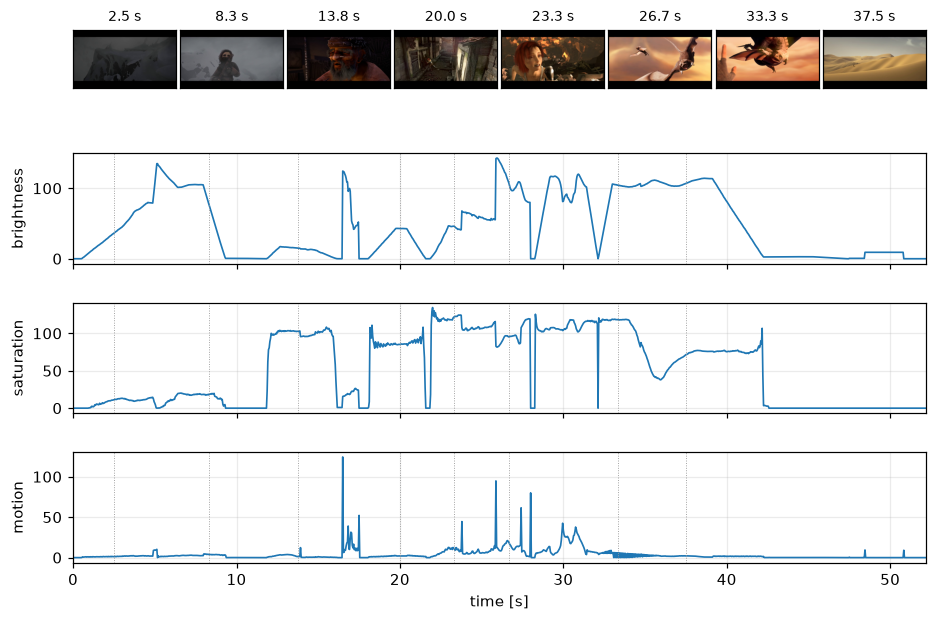
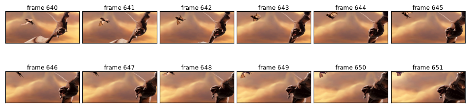
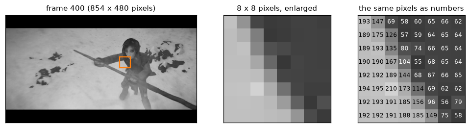
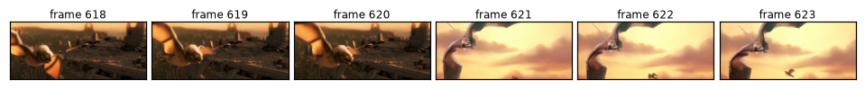

# 映像を「測る」とは {#sec-structure}

映像を観て「テンポが速い」「全体に暗い」と感じたとき、その感覚はどこから来ているのでしょうか。
この章では、映像がどのような部品でできているのかを確認し、本書が映像の何を、どのように数値にしていくのかを見渡します。

この章にはコードは出てきません。
パソコンに触れるのは次の章からですので、まずは読み物として通読してください。

::: {.callout-note title="この章のゴール"}
@fig-ch01-overview は、52秒の予告編を、明るさ・色の鮮やかさ・動きという3つの数値の移り変わりとして描いたものです。
この章を読み終えると、この図の横軸と縦軸が何を表しているのか、そしてグラフのどこに「編集の跡」が現れているのかを、説明できるようになります。
:::

{#fig-ch01-overview}

なお、この章の図は、すべて本書でこれから学ぶ方法を使って作成したものです。
第5章から第7章まで進めば、同じ図をみなさん自身の手で、みなさん自身の選んだ映像について描けるようになります。

## 感覚を数値で確かめる {#sec-ch01-why}

### 印象と根拠のあいだ

映像について語るとき、私たちは印象を表す言葉を使います。
「この監督の作品はカット割りが細かい」「後半になるにつれて画面が暗くなっていく」「アクションシーンの迫力がすごい」といった具合です。

こうした印象は、作品を理解するうえで欠かせない出発点です。
しかし、印象だけを根拠にして議論を進めると、困ったことが起こります。
別の人が「いや、そうは感じなかった」と言ったとき、どちらが正しいのかを確かめる手段がないのです。

そこで、印象を**数値で確かめる**という方法が役に立ちます。
「カット割りが細かい」という印象は、「1つのショットが平均して何秒続くか」を数えることで確かめられます。
「後半は暗い」という印象は、画面の明るさを最初から最後まで測ってグラフにすれば、ひと目でわかります。
数値にしておけば、別の人が同じ手順をたどって同じ結果を得られますし、別の作品と比べることもできます。

このように、映像の特徴を数値として取り出して調べることを、本書では映像の**定量分析**と呼びます。

### 数える研究の歴史

映像を数える試みは、コンピューターで動画を扱えるようになる前から行われてきました。
代表的なものが、ショットの長さを測る研究です。
映画研究者のバリー・ソルト（Barry Salt）は1970年代に、多数の映画についてショットの長さを計測し、その平均値である**平均ショット長**（Average Shot Length、略してASL）を、作品や時代の様式を比べるための指標として用いました [@salt1974]。

当時の計測は、人が映像を見ながらショットを1つずつ数えるという、たいへん根気のいる作業でした。
現在では、動画ファイルとパソコンがあれば、同じ計測を数分で終えられます。
しかもショットの長さだけでなく、明るさ、色、動きといった、人の手ではとても数えきれない量まで扱えます。
本書で学ぶのは、そのための具体的な方法です。

### 数値にするとは、定義を決めること

ここで一つ、本書全体を通じて大切にしたい考え方を述べておきます。

「テンポが速い」という印象を数値にしようとすると、すぐに「何を数えればよいのか」という問いに突き当たります。
ショットの切り替わりが頻繁であることでしょうか。
画面の中の物が激しく動いていることでしょうか。
それとも、カメラが速く動いていることでしょうか。
どれも「テンポ」に関係がありそうですが、数え方が違えば、得られる数値も、そこから言えることも変わります。

つまり、印象を数値にするためには、まず「この数値をもって、この性質を表すことにする」という**定義**を、自分で決めなければなりません。
そして、その定義が印象をうまく捉えているかどうかは、数値と映像を見比べて確かめるしかありません。

本書では、新しい数値を導入するたびに、「この数値は何を捉えていて、何を捉えていないのか」を、実際の映像と突き合わせて確認していきます。
数値は印象に取って代わるものではなく、印象を点検し、他の人と共有するための道具です。

## フレーム、画素、フレームレート {#sec-ch01-frame}

映像を数値として扱うためには、映像が何でできているのかを知っておく必要があります。

### 映像は静止画の連なり

映像は、動いているように見えますが、実際には**静止画を高速に切り替えて表示しているもの**です。
この1枚1枚の静止画を**フレーム**と呼びます。

@fig-ch01-frames は、予告編の中の連続する12枚のフレームを並べたものです。
左上の小さな竜が、フレームごとに少しずつ位置を変えていることがわかります。
隣り合うフレームの違いはごくわずかですが、これを次々に表示すると、私たちの目には竜が飛んでいるように見えます。

{#fig-ch01-frames}

本書では、フレームに先頭から順に番号を付けて呼びます。
最初のフレームを0番とするのが、プログラムの世界での習慣です。
@fig-ch01-frames に並んでいるのは、640番から651番までのフレームです。

### フレームレート

1秒間に何枚のフレームを表示するかを**フレームレート**と呼び、**fps**（frames per second）という単位で表します。
@tbl-ch01-fps に、よく使われる値を挙げます。

| フレームレート | 主な用途 |
|---|---|
| 24 fps | 映画 |
| 25 fps | ヨーロッパなどのテレビ放送 |
| 約30 fps（29.97 fps） | 日本や北米のテレビ放送 |
| 30 fps、60 fps | インターネットの動画、ゲームの映像 |

: 代表的なフレームレート {#tbl-ch01-fps}

フレームレートがわかれば、フレーム番号と時刻を互いに換算できます。

$$
\text{時刻（秒）} = \frac{\text{フレーム番号}}{\text{フレームレート}}
$$

先頭のフレーム（0番）の時刻は0秒です。

本書で使う予告編は24 fpsですから、640番のフレームの時刻は、$640 \div 24 \approx 26.7$ 秒です。

ただし、1枚のフレームは、ある一瞬だけ表示されるのではありません。
次のフレームに切り替わるまでの $1 \div 24 \approx 0.042$ 秒のあいだ、表示され続けます。
640番のフレームが表示されるのは、約26.67秒から約26.71秒までの区間です。
上の式で求められるのは、この区間の始まり、すなわち、そのフレームが表示され**始める**時刻です。
本書で「フレームの時刻」というときは、この時刻を指します。

また、@fig-ch01-frames の12枚は、$12 \div 24 = 0.5$ 秒分にあたります。

本書の分析では、フレーム番号を基本の物差しとして使い、人に示すときに秒へ換算します。
フレーム番号は整数で、あいまいさがないからです。

### 画素

次に、1枚のフレームの中身を見てみましょう。

フレームを大きく拡大していくと、やがて小さな正方形のタイルが並んでいる様子が見えてきます。
このタイルの1つ1つを**画素**（ピクセル）と呼びます。
1つの画素は1つの色で塗られていて、それ以上細かい模様はありません。

@fig-ch01-pixels は、フレームの一部を拡大したものです。
説明を簡単にするために、ここでは色のない白黒の画像にしています。

{#fig-ch01-pixels}

中央は、主人公の体と背景の雪との境目にあたる、縦8個・横8個の画素を拡大したものです。
右は、同じ画素を数値で表したものです。
明るい雪の部分には190前後の大きな数が、暗い主人公の側には60前後の小さな数が並んでいます。

このように、白黒の画像では、1つの画素の明るさが**0から255までの整数**で表されます。
0がもっとも暗い黒、255がもっとも明るい白です。
コンピューターの中では、画像は「見た目」としてではなく、この数値の表として保存されています。

カラーの画像では、1つの画素につき3つの数値を使います。
赤・緑・青の3色の光の強さをそれぞれ0から255で表し、その組み合わせで色を作るのです。
くわしくは第3章で扱います。

### 映像は膨大な数値の集まり

画素が横に何個、縦に何個並んでいるかを**解像度**と呼びます。
予告編の解像度は、横854画素・縦480画素です。

ここまでの話をまとめると、この予告編に含まれる数値の個数を計算できます。

- 1枚のフレームの画素数は、$854 \times 480 = 409{,}920$ 個です。
- カラーなので、1つの画素に3つの数値があります。1枚のフレームは $409{,}920 \times 3 = 1{,}229{,}760$ 個、およそ123万個の数値でできています。
- フレームは全部で1253枚あります。映像全体では $1{,}229{,}760 \times 1253 = 1{,}540{,}889{,}280$ 個、およそ15億個の数値になります。

わずか52秒の、それほど解像度の高くない映像でも、15億個の数値でできているのです。
映像の定量分析とは、この膨大な数値の集まりから、「明るさ」や「動き」といった意味のある少数の数値を取り出す作業だ、と言えます。

::: {.callout-note title="ファイルが小さいのはなぜか"}
15億個の数値をそのまま保存すると、およそ1.5 GBになります。
ところが、予告編のファイルの大きさは約4.4 MBしかありません。
およそ350分の1です。

これは、動画ファイルが**圧縮**されているからです。
隣り合う画素や、隣り合うフレームはよく似ているので、「前のフレームとの違い」だけを記録するなどの工夫によって、データを大幅に小さくできます。

圧縮された動画から元の画素の数値を取り出す処理は、第2章でインストールするOpenCVというライブラリがすべて引き受けてくれます。
ただし、圧縮のしくみに由来する注意点がいくつかあり、それらは第4章で扱います。
:::

## ショット、シーン、シークエンス {#sec-ch01-shot}

フレームは、映像を「技術的に」見たときの最小の単位でした。
一方、映像を「作品として」見るときには、もっと大きなまとまりが使われます。

### ショット

カメラが回り始めてから止まるまでに撮影された、ひと続きの映像を**ショット**と呼びます。
完成した作品の中では、ある切れ目から次の切れ目までの、途切れのない区間がショットにあたります。

ショットとショットのつなぎ目を**カット点**と呼びます。
@fig-ch01-cut は、予告編の中のカット点の前後3枚ずつを並べたものです。

{#fig-ch01-cut}

618番から620番までは、廃墟の上を飛ぶ小さな竜が映っています。
フレームごとの違いはわずかです。
ところが621番では、画面全体が空を飛ぶ大きな竜の姿に入れ替わっています。
この620番と621番のあいだがカット点です。

ここで、冒頭の @fig-ch01-overview をもう一度見てください。
一番下の「motion」のグラフには、ところどころに針のように鋭い山があります。
このグラフは「隣り合うフレームがどれだけ違うか」を表したもので、25.9秒（621番のフレーム）の位置にある高い山が、まさに @fig-ch01-cut のカット点です。
同じショットの中では隣り合うフレームがよく似ているのに対し、カット点では画面全体が入れ替わるため、違いが突出して大きくなるのです。

この性質を利用すれば、カット点をコンピューターに見つけさせることができます。
これが第8章の主題です。

::: {.callout-note title="切れ目はカットだけではない"}
ショットのつなぎ方には、瞬時に切り替わる**カット**のほかに、前の映像が次の映像へと徐々に溶け込む**ディゾルブ**や、画面が徐々に暗くなって消える（あるいは暗い画面から現れる）**フェード**があります。

@fig-ch01-overview の「brightness」のグラフで、値がなだらかに0まで下がり、また上がっていく箇所がいくつもあります。
これがフェードです。
予告編では、場面の区切りにフェードが多用されていることが、グラフから読み取れます。
:::

### シーンとシークエンス

ショットより大きなまとまりとして、シーンとシークエンスがあります。

- **シーン**：同じ場所、同じ時間で起こる、ひとまとまりの出来事を描いた部分です。ふつう、複数のショットで構成されます。
- **シークエンス**：物語のうえでひとつのまとまりをなす、複数のシーンの連なりです。たとえば「追跡の場面」が、街中、屋上、路地という複数のシーンにまたがっているとき、その全体が1つのシークエンスです。

映像全体は、@fig-ch01-hierarchy のような入れ子の構造をしています。

::: {#fig-ch01-hierarchy}

```{=html}
<svg viewBox="0 0 760 300" role="img" aria-label="映像の階層構造。映像はシークエンスに、シークエンスはシーンに、シーンはショットに、ショットはフレームに分かれる。" style="width:100%;height:auto;font-family:inherit" fill="currentColor">
  <g font-size="14">
    <text x="8" y="36">映像</text>
    <text x="8" y="96">シークエンス</text>
    <text x="8" y="156">シーン</text>
    <text x="8" y="216">ショット</text>
    <text x="8" y="276">フレーム</text>
  </g>
  <g fill="#1f6fb2" fill-opacity="0.16" stroke="#1f6fb2" stroke-width="1.5">
    <rect x="120" y="14" width="632" height="34" rx="4"/>
    <rect x="120" y="74" width="250" height="34" rx="4"/>
    <rect x="376" y="74" width="376" height="34" rx="4"/>
    <rect x="120" y="134" width="118" height="34" rx="4"/>
    <rect x="244" y="134" width="126" height="34" rx="4"/>
    <rect x="376" y="134" width="170" height="34" rx="4"/>
    <rect x="552" y="134" width="200" height="34" rx="4"/>
  </g>
  <g fill="#f2b441" fill-opacity="0.22" stroke="#d99a2b" stroke-width="1.5">
    <rect x="120" y="194" width="52" height="34" rx="4"/>
    <rect x="178" y="194" width="60" height="34" rx="4"/>
    <rect x="244" y="194" width="34" height="34" rx="4"/>
    <rect x="284" y="194" width="50" height="34" rx="4"/>
    <rect x="340" y="194" width="30" height="34" rx="4"/>
    <rect x="376" y="194" width="90" height="34" rx="4"/>
    <rect x="472" y="194" width="74" height="34" rx="4"/>
    <rect x="552" y="194" width="44" height="34" rx="4"/>
    <rect x="602" y="194" width="38" height="34" rx="4"/>
    <rect x="646" y="194" width="62" height="34" rx="4"/>
    <rect x="714" y="194" width="38" height="34" rx="4"/>
  </g>
  <g stroke="currentColor" stroke-opacity="0.55" stroke-width="1">
    <path d="M120 254v34 M128 254v34 M136 254v34 M144 254v34 M152 254v34 M160 254v34 M168 254v34 M176 254v34 M184 254v34 M192 254v34 M200 254v34 M208 254v34 M216 254v34 M224 254v34 M232 254v34 M240 254v34 M248 254v34 M256 254v34 M264 254v34 M272 254v34 M280 254v34 M288 254v34 M296 254v34 M304 254v34 M312 254v34 M320 254v34 M328 254v34 M336 254v34 M344 254v34 M352 254v34 M360 254v34 M368 254v34 M376 254v34 M384 254v34 M392 254v34 M400 254v34 M408 254v34 M416 254v34 M424 254v34 M432 254v34 M440 254v34 M448 254v34 M456 254v34 M464 254v34 M472 254v34 M480 254v34 M488 254v34 M496 254v34 M504 254v34 M512 254v34 M520 254v34 M528 254v34 M536 254v34 M544 254v34 M552 254v34 M560 254v34 M568 254v34 M576 254v34 M584 254v34 M592 254v34 M600 254v34 M608 254v34 M616 254v34 M624 254v34 M632 254v34 M640 254v34 M648 254v34 M656 254v34 M664 254v34 M672 254v34 M680 254v34 M688 254v34 M696 254v34 M704 254v34 M712 254v34 M720 254v34 M728 254v34 M736 254v34 M744 254v34 M752 254v34"/>
  </g>
</svg>
```

映像の階層構造。下の段ほど細かい単位で、いちばん下の縦線1本がフレーム1枚を表す。
:::

### 本書が扱うのはショットまで

ここで注意しておきたいのは、これらの単位の「確かさ」に違いがあることです。

ショットの境目は、画面を見れば誰でも同じ場所を指摘できます。
画面が切り替わったかどうかは、映像そのものに記録されている事実だからです。
これに対して、シーンやシークエンスの境目は、物語の内容をどう理解するかによって変わります。
同じ作品でも、人によって区切り方が異なることは珍しくありません。

本書では、画素の数値から直接求められる範囲、すなわち**フレームとショット**を分析の単位とします。
シーンやシークエンスといった意味のまとまりは、数値の結果を見ながら、人が判断して付け加えるものと位置づけます。

::: {.callout-note title="コラム：生成AIは、シーンの切れ目を見つけられるか"}
シーンやシークエンスの境目は人が判断するもの、と述べました。
しかし、この線引きは揺らぎつつあります。

シーンの境目をコンピューターに見つけさせる研究は、以前からあります。
たとえばRaoらは、150本の映画に人がシーンの区切りを書き込んだデータを用意し、それを手本としてコンピューターに学習させました [@rao2020]。

近年は、文章や画像を扱う生成AIを使う試みが現れています。
Scene-VLMという手法は、画像と文章の両方を扱えるAIに、フレームとせりふの書き起こしを与え、ショットごとに「ここはシーンの境目か」を判断させます [@berman2025]。
境目と判断した理由を、文章で説明させることもできます。
また、Chapter-Llamaという手法は、1時間ほどの動画について、せりふの書き起こしとフレームの説明文をAIに読ませ、内容の区切りの時刻と、区間ごとの見出しを出力させます [@ventura2025]。
こちらの対象は映画ではなく動画投稿サイトの映像ですが、ショットよりずっと大きな、意味のまとまりを扱う試みです。

では、こうした方法は定量的なのでしょうか、それとも定性的なのでしょうか。

コンピューターが決まった手順で境目の位置を出力し、その結果を数えたり比べたりできるという点では、定量的に見えます。
一方で、判断のよりどころは、「隣り合うフレームの違いがこの値を超えたら境目とする」といった、画素の数値についての明示的な定義ではありません。
人が内容を読み取って付けた区切りを、手本として学んだ結果です。
AIを取り替えれば答えが変わることもあり、なぜそこを境目としたのかを、数式でたどることもできません。
人が行ってきた解釈を、AIが肩代わりしているとも言えます。

このように、定量と定性の境界は、あいまいになりつつあります。
だからこそ、@sec-ch01-why で述べた「何を数えるのか、定義を決める」という姿勢が、いっそう大切になります。
AIの出力を使う場合にも、「このAIは何を境目とみなしているのか」「人の判断とどれくらい一致するのか」を確かめる必要があります。
その確かめ方は、第8章で学ぶカット点検出の評価と同じ考え方です。
:::

## 何を測れるのか——明るさ・色・動き・編集 {#sec-ch01-features}

では、15億個の数値から、具体的に何を取り出せるのでしょうか。
本書では、@tbl-ch01-features の4つの観点を扱います。

| 観点 | 取り出す数値の例 | 印象との対応の例 | 扱う章 |
|---|---|---|---|
| **明るさ** | 画面の平均的な明るさ、明暗の差の大きさ | 「暗い」「重苦しい」「コントラストが強い」 | 第5章 |
| **色** | 色合い、鮮やかさ、画面を代表する色 | 「暖かい色調」「色あせた」「カラフル」 | 第6章 |
| **動き** | 画面内の動きの大きさと向き | 「激しい」「静か」「カメラが動いている」 | 第7章 |
| **編集** | カット点の位置、ショットの長さ | 「テンポが速い」「長回し」 | 第8章、第9章 |

: 本書で扱う4つの観点 {#tbl-ch01-features}

このうち、明るさ・色・動きの3つは、**フレームごとに1つの数値**として求められます。
フレームは時間順に並んでいますから、求めた数値も時間順に並びます。
このように、時間の順に並んだ数値の列を**時系列**と呼びます。

@fig-ch01-overview の3つのグラフは、まさにこの時系列を描いたものでした。
あらためて、グラフから読み取れることを確認してみましょう。

- **brightness（明るさ）**：予告編は真っ黒な画面から始まり、ゆっくりと明るくなっていきます。その後、値が0付近まで落ち込む箇所が何度もあります。これは場面の区切りに置かれたフェードです。
- **saturation（色の鮮やかさ）**：12秒付近までは値が低く、そこから42秒付近までは高くなっています。上段のフレームと見比べると、前半は雪山の灰色がかった場面、中盤以降は夕焼けのような色の濃い場面であることがわかります。42秒以降に値がほぼ0になるのは、黒い背景に白い文字だけのタイトル画面だからです。
- **motion（動き）**：全体としては低い値が続きますが、14秒から30秒にかけて、鋭い山が集中しています。この区間で、ショットが短い間隔で次々に切り替わっていることを示しています。

1回観ただけでは「前半は静かで、中盤から慌ただしくなる予告編だ」という程度の印象しか残らないかもしれません。
グラフにすると、その印象が、何秒から何秒までの、どのような変化に由来するのかを、具体的に指し示せるようになります。

残る1つの観点である編集は、少し性質が異なります。
カット点はフレームごとの数値ではなく、「何番のフレームで切り替わったか」という位置の一覧として得られます。
そこから、ショットが何個あり、それぞれが何秒続くのかが求められます。

::: {.callout-important title="数値が教えてくれないこと"}
これらの数値が表しているのは、あくまで**画面に何が映っているか**であって、**それが何を意味するか**ではありません。

明るさのグラフから「この場面は暗い」ことはわかりますが、その暗さが恐怖を表しているのか、安らぎを表しているのか、あるいは単に夜の場面であるだけなのかは、数値からはわかりません。
それを判断するのは、作品を観て、文脈を理解している人間の役割です。

@sec-ch01-shot のコラムで触れたように、最近は、映像の内容を文章で説明する生成AIも現れています。
そのようなAIに尋ねれば、「この暗さは不安を表している」といった答えが返ってくるかもしれません。
しかし、それは本書で扱うような、定義に従って画素の数値から計算した結果ではありません。
AIによる1つの解釈です。
人による解釈と同じように、根拠を確かめ、ほかの見方と比べる対象として扱う必要があります。

数値にできることと、できないことの境目を、本書では繰り返し確認していきます。
:::

## 本書の地図 {#sec-ch01-map}

最後に、本書の全体の流れを確認しておきます。
@fig-ch01-map を見てください。

::: {#fig-ch01-map}

```{=html}
<svg viewBox="0 0 760 330" role="img" aria-label="本書の構成。第1部の準備（第1章から第4章）を土台に、第2部で明るさ・色・動き・カット点検出を学び、第3部でショットの統計と総合演習に進む。" style="width:100%;height:auto;font-family:inherit" fill="currentColor">
  <g font-size="13" font-weight="700" fill="#1f6fb2">
    <text x="8" y="24">第I部　準備</text>
    <text x="8" y="130">第II部　映像から数値を取り出す</text>
    <text x="8" y="246">第III部　作品を分析する</text>
  </g>
  <g fill="none" stroke="currentColor" stroke-opacity="0.6" stroke-width="1.5">
    <rect x="8" y="36" width="178" height="52" rx="6"/>
    <rect x="198" y="36" width="178" height="52" rx="6"/>
    <rect x="388" y="36" width="178" height="52" rx="6"/>
    <rect x="578" y="36" width="174" height="52" rx="6"/>
  </g>
  <g fill="#1f6fb2" fill-opacity="0.14" stroke="#1f6fb2" stroke-width="1.5">
    <rect x="8" y="142" width="178" height="52" rx="6"/>
    <rect x="198" y="142" width="178" height="52" rx="6"/>
    <rect x="388" y="142" width="178" height="52" rx="6"/>
    <rect x="578" y="142" width="174" height="52" rx="6"/>
  </g>
  <g fill="#f2b441" fill-opacity="0.18" stroke="#d99a2b" stroke-width="1.5">
    <rect x="198" y="258" width="270" height="52" rx="6"/>
    <rect x="482" y="258" width="270" height="52" rx="6"/>
  </g>
  <g font-size="12" text-anchor="middle" fill-opacity="0.7">
    <text x="97" y="56">第1章</text><text x="287" y="56">第2章</text><text x="477" y="56">第3章</text><text x="665" y="56">第4章</text>
    <text x="97" y="162">第5章</text><text x="287" y="162">第6章</text><text x="477" y="162">第7章</text><text x="665" y="162">第8章</text>
    <text x="333" y="278">第9章</text><text x="617" y="278">第10章</text>
  </g>
  <g font-size="14" font-weight="700" text-anchor="middle">
    <text x="97" y="77">映像を「測る」とは</text><text x="287" y="77">環境の準備</text><text x="477" y="77">画像はNumPy配列</text><text x="665" y="77">ビデオの基本操作</text>
    <text x="97" y="183">明るさ</text><text x="287" y="183">色</text><text x="477" y="183">動き</text><text x="665" y="183">カット点検出</text>
    <text x="333" y="299">ショットの統計とキーフレーム</text><text x="617" y="299">総合演習</text>
  </g>
  <g stroke="currentColor" stroke-width="1.6" fill="none">
    <line x1="380" y1="92" x2="380" y2="110"/>
    <line x1="665" y1="198" x2="665" y2="226"/><line x1="665" y1="226" x2="333" y2="226"/><line x1="333" y1="226" x2="333" y2="250"/>
    <line x1="468" y1="284" x2="474" y2="284"/>
  </g>
  <path d="M380 116 l-6 -10 l12 0z"/><path d="M333 256 l-6 -10 l12 0z"/><path d="M482 284 l-10 -6 l0 12z"/>
</svg>
```

本書の構成。第I部で道具をそろえ、第II部で4つの観点を1つずつ学び、第III部でそれらを組み合わせる。
:::

**第I部**では、分析のための道具をそろえます。
第2章でパソコンに環境を整え、第3章で「画像は数値の表である」ことをプログラムの上で確かめ、第4章で動画ファイルからフレームを取り出す方法を身につけます。

**第II部**が本書の中心です。
明るさ（第5章）、色（第6章）、動き（第7章）を、それぞれフレームごとの数値として取り出し、時系列のグラフに描きます。
第8章では、これらの知識を使ってカット点を自動で検出し、その結果がどれくらい正しいのかを評価します。

**第III部**では、作品全体を分析します。
第9章でショットの長さの統計を求め、第10章では、それまでに学んだ方法をひとつの手順にまとめて、1本の作品を最初から最後まで分析します。

第II部の各章は、第I部の内容を前提にしていますが、互いにはほぼ独立しています。
先を急ぐ方は、第I部を読んだあと、関心のある章から読み進めてもかまいません。
ただし、第8章は第5章から第7章までの内容を、第9章は第8章の結果を使いますので、この2つの章は順番に読んでください。

## まとめ {#sec-ch01-summary}

- 映像の**定量分析**とは、映像の特徴を数値として取り出して調べることです。印象を点検し、他の人と共有し、作品どうしを比べるための道具になります。
- 印象を数値にするには、「何を数えるか」という**定義**を自分で決める必要があります。定義が違えば、言えることも変わります。
- 映像は**フレーム**という静止画の連なりであり、フレームは**画素**の集まりです。画素は0から255の整数で表されます。
- 1秒あたりのフレーム数が**フレームレート**（fps）です。フレーム番号をフレームレートで割ると、秒単位の時刻になります。
- 途切れなく続くひと続きの映像が**ショット**で、そのつなぎ目が**カット点**です。本書では、フレームとショットを分析の単位とします。
- 本書で扱う観点は、**明るさ・色・動き・編集**の4つです。数値が表すのは画面に映っているものであり、その意味を解釈するのは人間の役割です。

## 演習 {#sec-ch01-exercises}

この章の演習は、パソコンを使わずに取り組めます。

1. 30 fpsの映像で、開始から2分15秒ちょうどに表示され始めるフレームは何番でしょうか。また、24 fpsの映像の10000番のフレームが表示され始めるのは、開始から何分何秒でしょうか。
2. 横1920画素・縦1080画素、30 fps、長さ10分のカラー映像は、全部でいくつの数値でできているでしょうか。本文の予告編の何倍にあたるかも求めてください。
3. 好きな映像作品を1つ選び、その作品について日ごろ感じている印象を3つ書き出してください。それぞれの印象について、「何を数えれば確かめられそうか」を考えてみましょう。数えるものが1つに決まらない場合は、候補をすべて挙げてください。
4. 手元の映像（テレビ番組でも動画投稿サイトの映像でもかまいません）を1分間だけ再生し、カット点が何回あったかを数えてください。そこから、1ショットあたりの平均の長さを計算してみましょう。数えていて判断に迷った箇所があれば、それがどのような切り替わりだったかを記録しておいてください。第8章で、その迷いの正体を扱います。
5. @fig-ch01-overview の「brightness」のグラフから、フェードが何回あるかを数えてみてください。数えるときに、「どこまで値が下がればフェードとみなすか」を決める必要があったはずです。その基準を言葉で書いてみましょう。
