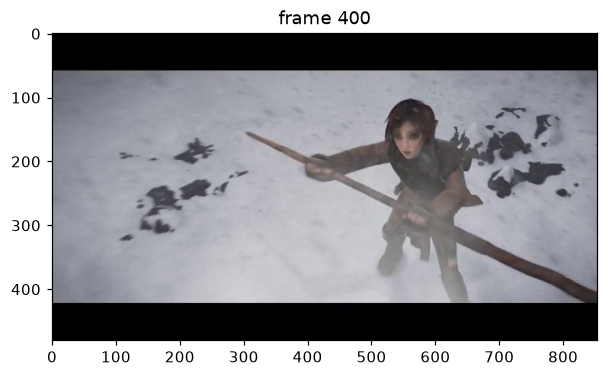

# 環境の準備 {#sec-setup}

この章では、Windowsパソコンに、本書のコードを実行するための環境を整えます。インストールするものは3つだけで、作業時間は30分ほどです。

::: {.callout-note title="この章のゴール"}
章の最後に、サンプル映像から取り出した1枚のフレームを、ノートブックの上に表示します（@fig-frame-400）。ここまでできれば、第3章以降のコードはすべて同じ環境で動きます。
:::

{#fig-frame-400 width=75%}

## 全体像——何をインストールするのか {#sec-setup-overview}

手を動かす前に、これから何をそろえるのかを確認しておきます。@fig-setup-overview を見てください。

::: {#fig-setup-overview}

```{=html}
<svg viewBox="0 0 760 330" role="img" aria-label="環境の全体像。Windowsの上にuvとVS Codeをインストールする。uvがプロジェクトフォルダの中にPythonとライブラリを用意し、VS Codeからそれを使ってノートブックを実行する。" style="width:100%;height:auto;font-family:inherit" fill="currentColor">
  <rect x="4" y="4" width="752" height="322" rx="10" fill="none" stroke="currentColor" stroke-opacity="0.35" stroke-width="1.5"/>
  <text x="22" y="30" font-size="15" fill-opacity="0.65">Windows 11</text>

  <!-- uv -->
  <rect x="24" y="52" width="170" height="110" rx="8" fill="#1f6fb2" fill-opacity="0.14" stroke="#1f6fb2" stroke-width="1.5"/>
  <text x="109" y="88" font-size="19" font-weight="700" text-anchor="middle">① uv</text>
  <text x="109" y="116" font-size="13" text-anchor="middle">Pythonとライブラリを</text>
  <text x="109" y="136" font-size="13" text-anchor="middle">用意・管理する道具</text>

  <!-- VS Code -->
  <rect x="24" y="196" width="170" height="110" rx="8" fill="#1f6fb2" fill-opacity="0.14" stroke="#1f6fb2" stroke-width="1.5"/>
  <text x="109" y="232" font-size="19" font-weight="700" text-anchor="middle">③ VS Code</text>
  <text x="109" y="260" font-size="13" text-anchor="middle">ノートブックを書いて</text>
  <text x="109" y="280" font-size="13" text-anchor="middle">実行するエディター</text>

  <!-- プロジェクトフォルダ -->
  <rect x="290" y="52" width="446" height="254" rx="8" fill="none" stroke="currentColor" stroke-opacity="0.6" stroke-width="1.5" stroke-dasharray="6 5"/>
  <text x="308" y="78" font-size="14" fill-opacity="0.75">プロジェクトフォルダ　C:\work\video-analysis</text>

  <rect x="308" y="94" width="410" height="92" rx="8" fill="#f2b441" fill-opacity="0.16" stroke="#d99a2b" stroke-width="1.5"/>
  <text x="326" y="122" font-size="16" font-weight="700">② Python ＋ ライブラリ（.venv フォルダ）</text>
  <text x="326" y="148" font-size="12">Python 3.14 ／ OpenCV ／ NumPy ／ pandas ／ Matplotlib ／ SciPy</text>
  <text x="326" y="170" font-size="13" fill-opacity="0.7">このプロジェクト専用。ほかのソフトには影響しません</text>

  <rect x="308" y="204" width="196" height="84" rx="8" fill="none" stroke="currentColor" stroke-opacity="0.6" stroke-width="1.5"/>
  <text x="406" y="240" font-size="15" font-weight="700" text-anchor="middle">ノートブック</text>
  <text x="406" y="264" font-size="13" text-anchor="middle">ch02.ipynb など</text>

  <rect x="522" y="204" width="196" height="84" rx="8" fill="none" stroke="currentColor" stroke-opacity="0.6" stroke-width="1.5"/>
  <text x="620" y="240" font-size="15" font-weight="700" text-anchor="middle">サンプル映像</text>
  <text x="620" y="264" font-size="13" text-anchor="middle">data フォルダ</text>

  <!-- 矢印 -->
  <g stroke="currentColor" stroke-width="1.8" fill="none">
    <line x1="194" y1="107" x2="298" y2="130"/>
    <line x1="194" y1="251" x2="298" y2="247"/>
    <line x1="406" y1="204" x2="406" y2="190"/>
  </g>
  <g>
    <path d="M308 132 l-13 -8 l2 12z"/>
    <path d="M308 246 l-12 -5 l1 11z"/>
    <path d="M406 186 l-6 11 l12 0z"/>
  </g>
  <text x="243" y="100" font-size="12" text-anchor="middle" fill-opacity="0.75">作る</text>
  <text x="243" y="238" font-size="12" text-anchor="middle" fill-opacity="0.75">開く</text>
  <text x="416" y="200" font-size="12" fill-opacity="0.75">②を使って実行</text>
</svg>
```

環境の全体像。自分でインストールするのは①と③で、②は①のuvが用意します。
:::

それぞれの役割は次のとおりです。

| | 名前 | 役割 |
|---|---|---|
| ① | **uv** | Python本体とライブラリをダウンロードし、プロジェクトごとに管理するツールです。 |
| ② | **Pythonとライブラリ** | 実際に計算を行う部分です。映像の読み込みはOpenCV、数値計算はNumPyが担当します。 |
| ③ | **Visual Studio Code** | コードを書いて実行するためのエディターです。以下ではVS Codeと呼びます。 |

ここで大切なのは、②のPythonとライブラリが**プロジェクトフォルダの中に**置かれるという点です。この「プロジェクト専用のPython一式」を**仮想環境**と呼びます。パソコン全体に何かを入れるわけではないので、すでに別のPythonが入っていても干渉しませんし、うまくいかなければフォルダごと削除してやり直せます。

::: {.callout-tip title="Pythonをすでにインストールしている場合"}
python.orgのインストーラーやAnacondaでPythonを導入済みでも、そのままで問題ありません。本書の手順はそれらとは別に、プロジェクト専用のPythonを用意します。アンインストールする必要はありません。
:::

## ターミナル（PowerShell）の最低限の使い方 {#sec-setup-terminal}

uvは、文字で命令を入力して使うツールです。そのための画面を**ターミナル**と呼びます。使う命令はごくわずかですので、ここで先に慣れておきましょう。

### ターミナルを開く

スタートボタンを右クリックし、表示されたメニューから［ターミナル］を選びます。次のような表示が出れば準備完了です。

```{.default}
PS C:\Users\taro>
```

`PS` はPowerShellという種類のターミナルであることを、`C:\Users\taro` はいま作業しているフォルダを表しています（`taro` の部分は、みなさんのユーザー名になります）。この「いま作業しているフォルダ」を**カレントフォルダ**と呼びます。

`>` の右側に命令を入力し、Enterキーを押すと実行されます。

::: {.callout-note title="本書でのコマンドの書き方"}
本書では、ターミナルに入力する命令を次のように示します。
入力するのは `>` より右側の部分だけです。
`>` の付いていない行は、実行後に表示される結果です。

```{.default}
> pwd

Path
----
C:\Users\taro
```

この例は、「`pwd`という命令を実行した結果として、`C:\Users\taro`が表示された」という様子を表しています。
:::

### 作業用のフォルダを作る

本書の作業場所として、Cドライブの直下に `work` というフォルダを作ります。
他の場所でも問題ありません（その場合は適宜読み替えてください）が、フォルダ名を半角英数字にすることを強く推奨します（理由は下記コラムを参照）。
次の2行を、1行ずつ実行してください。

```{.default}
> mkdir C:\work
> cd C:\work
```

`mkdir` はフォルダを作る命令、`cd` はカレントフォルダを移動する命令です。実行すると、表示が `PS C:\work>` に変わります。

::: {.callout-warning title="フォルダ名に日本語や空白を使わない"}
作業用のフォルダは、**半角英数字だけの場所**に作ってください。OpenCVは、フォルダ名やファイル名に日本語が含まれていると、画像や動画の読み込みに失敗することがあります。しかもエラーを出さずに「読めなかった」という結果だけを返すため、原因に気づきにくいトラブルになります。

［ドキュメント］フォルダは、ユーザー名が日本語の場合や、OneDriveと同期している場合に、この問題が起きやすい場所です。本書で `C:\work` を使うのはそのためです。
:::

### 覚えておく命令

本書で使う命令は、@tbl-ps-commands の6つです。

| 命令 | 意味 | 例 |
|---|---|---|
| `pwd` | カレントフォルダを表示する | `pwd` |
| `ls` | フォルダの中身を一覧表示する | `ls` |
| `cd` | カレントフォルダを移動する | `cd C:\work` |
| `cd ..` | 1つ上のフォルダに移動する | `cd ..` |
| `mkdir` | フォルダを作る | `mkdir data` |
| `explorer .` | カレントフォルダをエクスプローラーで開く | `explorer .` |

: 本書で使うPowerShellの命令 {#tbl-ps-commands}

あわせて、次の2つの操作を覚えておくと入力がぐっと楽になります。

- **Tabキー**：フォルダ名やファイル名を途中まで入力してTabキーを押すと、残りを補ってくれます。
- **↑キー**：前に実行した命令を呼び出します。少し直して再実行したいときに便利です。

## uvでPythonを導入する {#sec-setup-uv}

### uvをインストールする

ターミナルで次の命令を入力します。
長いので、コードの右上に表示されるコピーボタンを使ってコピーし、ターミナル上で右クリックして貼り付けてください。
貼り付けた後、Enterキーはまだ押さないでください。

```{.default}
> powershell -ExecutionPolicy ByPass -c "irm https://astral.sh/uv/install.ps1 | iex"
```

これは、uvの開発元（Astral社）が公開しているインストール用のスクリプトをダウンロードして実行する、という命令です。
命令を実行する（Enterキーを押す）前に一呼吸おいて確認しましょう。

::: {.callout-warning title="よく分からない命令を実行するのは要注意"}
上記の命令は、「インターネットから指定したスクリプト（命令の列を記述したファイル）をダウンロードして、その内容を実行せよ」というものです。
実は、このような命令を何も考えずに（無批判で）実行する習慣をつけてしまうのは、大いに問題があります。

今回の場合、uvというソフトウェアをインストールするにあたって「インターネットで uv の評判を調べる」「調べてもよく分からない場合は、ソフトウェアに詳しい知人やAIに尋ねて、それらの意見を参考にして判断する」「ドメイン `astral.sh` がuvの公式サイトのものか確かめる」「uv公式サイトの[installation](https://docs.astral.sh/uv/getting-started/installation/)に書いてあるインストール手順が上記の命令と一致していることを確かめる」といった事前作業をしておくとより安心です。
:::

命令を実行し、インストール作業が完了したら、**ターミナルをいったん閉じて、開き直してください**。開き直すことで、`uv` という命令が使えるようになります。

開き直したターミナルで、インストールできたことを確認します。

```{.default}
> uv --version
uv 0.12.23 (…)
```

バージョン番号が表示されれば成功です。数字はインストールした時期によって変わりますので、違っていてもかまいません。

::: {.callout-warning title="「uv は…として認識されません」と表示されたら"}
ターミナルを開き直していないことが、ほとんどの場合の原因です。すべてのターミナルのウィンドウを閉じてから、もう一度開いてください。
:::

### Pythonをインストールする

続いて、uvを使ってPythonをインストールします。本書ではPython 3.14を使います。

```{.default}
> uv python install 3.14
```

ダウンロードが始まり、十数秒ほどで完了します。このPythonはuvが管理する専用の場所に置かれ、次の節で作るプロジェクトから利用されます。

## プロジェクトを作り、ライブラリを入れる {#sec-setup-project}

### プロジェクトを作る

本書のコードとデータを置くフォルダを作ります。このように、ひとまとまりの作業のためのフォルダを**プロジェクト**と呼びます。カレントフォルダが `C:\work` であることを確認してから、次の2行を実行してください。

```{.default}
> uv init --bare --python 3.14 video-analysis
> cd video-analysis
```

1行目で `video-analysis` というフォルダが作られ、その中に `pyproject.toml` というファイルが1つできます。これは、このプロジェクトが使うPythonのバージョンとライブラリを記録しておく「設定の台帳」です。2行目で、そのフォルダの中に移動しています。

以降、`uv` の命令は必ずこの `C:\work\video-analysis` の中で実行します。

### ライブラリを追加する

本書で使うライブラリを追加します。

```{.default}
> uv add opencv-python numpy pandas matplotlib scipy
> uv add --dev ipykernel
```

1行目で追加しているライブラリの役割は @tbl-libraries のとおりです。

| ライブラリ | 役割 | 主に使う章 |
|---|---|---|
| OpenCV（`opencv-python`） | 動画・画像の読み書きと画像処理 | 全章 |
| NumPy | 配列を使った数値計算 | 全章 |
| Matplotlib | 画像の表示とグラフの描画 | 全章 |
| pandas | フレームごとの数値を表として扱う | 第5章以降 |
| SciPy | 統計の計算 | 第8章以降 |

: 本書で使うライブラリ {#tbl-libraries}

2行目の `ipykernel` は、分析そのものではなく、ノートブックからこのプロジェクトのPythonを呼び出すために必要な部品です。分析用のライブラリと区別するために、`--dev`（開発用）という印を付けて追加しています。

### 何が起きたのかを確認する

`ls` でフォルダの中身を見てみましょう。`pyproject.toml` に加えて、`.venv` と `uv.lock` が増えています。

- **`.venv` フォルダ**：@sec-setup-overview で説明した仮想環境です。Python本体と、いま追加したライブラリがすべてこの中に入っています。
- **`uv.lock`**：実際にインストールされたライブラリの正確なバージョンの記録です。

`pyproject.toml` をメモ帳で開くと、追加したライブラリが書き込まれているのがわかります。

```{.toml filename="pyproject.toml"}
[project]
name = "video-analysis"
version = "0.1.0"
requires-python = ">=3.14"
dependencies = [
    "matplotlib>=3.11.2",
    "numpy>=2.5.5",
    "opencv-python>=5.1.0.95",
    "pandas>=3.1.1",
    "scipy>=1.18.1",
]

[dependency-groups]
dev = [
    "ipykernel>=7.4.0",
]
```

これらのファイルは `uv add` が自動で書き換えますので、自分で編集する必要はありません。バージョンの数字は、実行した時期によってこれより新しくなります。

最後に、OpenCVが使えることをターミナルから確かめておきます。

```{.default}
> uv run python -c "import cv2; print(cv2.__version__)"
5.1.0
```

`uv run` は「このプロジェクトの仮想環境を使って実行する」という意味です。バージョン番号が表示されれば、ライブラリの準備は完了です。

## Visual Studio CodeとJupyterノートブック {#sec-setup-vscode}

### ノートブックとは

本書のコードは、**Jupyterノートブック**という形式で書いていきます。ノートブックは、コードを**セル**という小さな単位に区切り、セルごとに実行して、その場で結果を確かめられる仕組みです。画像やグラフもコードのすぐ下に表示されるので、「少し書いては結果を見る」という進め方に向いています。

### VS Codeをインストールする

1. ブラウザーで <https://code.visualstudio.com/> を開き、Windows用のインストーラーをダウンロードします。
2. インストーラーを実行します。設定は初期値のままでかまいませんが、「追加タスクの選択」の画面で［PATHへの追加］にチェックが入っていることを確認してください。
3. インストールが終わったら、**ターミナルを開き直します**。

### プロジェクトをVS Codeで開く

ターミナルでプロジェクトフォルダに移動し、次の命令を実行します。末尾の `.`（ピリオド）は「カレントフォルダ」を意味します。

```{.default}
> cd C:\work\video-analysis
> code .
```

VS Codeが起動し、「このフォルダー内のファイルの作成者を信頼しますか？」と尋ねられます。自分で作ったフォルダですので、［はい、作成者を信頼します］を選びます。

::: {.callout-important title="VS Codeは必ず「フォルダ」で開く"}
VS Codeは、開いたフォルダの中にある `.venv` を探して、そのPythonを使います。ファイルを単独で開いたり、別のフォルダを開いたりすると、せっかく用意したライブラリが見つかりません。本書の作業は、いつも `video-analysis` フォルダを開いた状態で行ってください。
:::

### 拡張機能を入れる

VS Codeに機能を追加する部品を**拡張機能**と呼びます。画面左端に縦に並んだアイコンから［拡張機能］（四角形が4つ並んだアイコン）を選び、検索欄に名前を入力して、次の3つをインストールしてください。

| 拡張機能 | 検索する語 | 役割 |
|---|---|---|
| Japanese Language Pack for Visual Studio Code | `japanese` | 画面を日本語表示にします |
| Python | `python` | Pythonのコードの入力を支援します |
| Jupyter | `jupyter` | VS Codeでノートブックを扱えるようにします |

いずれも発行元がMicrosoftのものを選びます。日本語化は、インストール後に表示される案内に従ってVS Codeを再起動すると有効になります。

### 最初のノートブックを作る

1. メニューの［ファイル］→［新しいファイル］を選び、ファイル名に `ch02.ipynb` と入力してEnterキーを押します。保存場所を尋ねられたら、`video-analysis` フォルダの直下のまま保存します。
2. ノートブックの右上にある［カーネルの選択］をクリックします。
3. ［Python 環境］を選び、一覧から `.venv` と書かれたものを選びます。

**カーネル**とは、ノートブックのコードを実際に実行するPythonのことです。ここで `.venv` を選ぶことで、@sec-setup-project で用意したライブラリがノートブックから使えるようになります。右上の表示が `.venv (Python 3.14.x)` のように変われば設定完了です。

::: {.callout-warning title="一覧に .venv が表示されないときは"}
次の2点を確認してください。

- VS Codeで `video-analysis` フォルダを開いていますか。ウィンドウのタイトルや、左側のエクスプローラーの見出しで確認できます。
- `uv add --dev ipykernel` を実行しましたか。

どちらも問題ないのに表示されない場合は、VS Codeを閉じて、`code .` で開き直してみてください。
:::

### セルを実行してみる

ノートブックには、最初から空のセルが1つあります。そこに次のコードを入力し、**Shiftキーを押しながらEnterキー**を押してください。

```python
import cv2

print(cv2.__version__)
```

```{.default}
5.1.0
```

セルのすぐ下に、OpenCVのバージョンが表示されます。初回は実行の準備に数秒かかります。Shift＋Enterは「このセルを実行して、次のセルに進む」という操作で、本書ではこの操作を何度も繰り返すことになります。

## サンプル映像を入手する {#sec-setup-sample}

分析の対象となる映像を用意します。本書では、**Sintel**（シンテル）という短編アニメーション映画の予告編を、最初のサンプルとして使います。

Sintelは、3DCGソフトウェアBlenderを開発するBlender Foundationが2010年に制作した作品です。クリエイティブ・コモンズの「表示 3.0」ライセンス（CC BY 3.0）で公開されており、出典を示せば、誰でも自由に利用・加工・再配布できます。映像を切り出した図を本書のように公開できるのは、このライセンスのおかげです。

::: {.callout-note title="クレジット"}
Sintel — © copyright Blender Foundation | [durian.blender.org](https://durian.blender.org/)
:::

### ダウンロードする

まず、映像を置くための `data` フォルダを作ります。VS Codeのメニューから［ターミナル］→［新しいターミナル］を選ぶと、画面の下部にターミナルが開きます。カレントフォルダは最初からプロジェクトフォルダになっていますので、ここからはこのターミナルを使うと便利です。

```{.default}
> mkdir data
> curl.exe -L -o data\sintel_trailer-480p.mp4 https://download.blender.org/durian/trailer/sintel_trailer-480p.mp4
```

`curl.exe` は、指定したアドレスのファイルをダウンロードする命令です。`.exe` まで含めて入力してください。ファイルの大きさは約4.4MBで、数秒で完了します。

::: {.callout-tip title="ブラウザーでダウンロードしてもかまいません"}
上のアドレスをブラウザーで開いて保存し、できたファイルを `C:\work\video-analysis\data` に移動しても同じです。その場合は、ファイル名が `sintel_trailer-480p.mp4` になっていることを確認してください。
:::

ダウンロードしたファイルは、エクスプローラーでダブルクリックすれば普通に再生できます。この先で数値として扱う映像がどのようなものか、一度通して観ておきましょう。52秒の短い映像ですが、暗い場面と明るい場面、静かな場面と激しい場面が含まれていて、分析の練習に適しています。

ここまでの作業で、プロジェクトフォルダは次のようになっています。

```{.default}
C:\work\video-analysis
├── .venv                         … 仮想環境（Pythonとライブラリ）
├── data
│   └── sintel_trailer-480p.mp4   … サンプル映像
├── ch02.ipynb                    … ノートブック
├── pyproject.toml                … プロジェクトの設定
└── uv.lock                       … ライブラリのバージョンの記録
```

## 動作確認——最初の1フレームを表示する {#sec-setup-check}

準備が整いましたので、映像を読み込んでみます。ここで使う関数の詳しい説明は第3章と第4章で行いますから、いまは「映像からフレームを取り出して表示できる」ことを確かめるのが目的です。コードの細部がわからなくても心配はいりません。

### 動画ファイルを開く

`ch02.ipynb` に新しいセルを追加して、次のコードを実行します。セルは、既存のセルの下にマウスを移動すると現れる［＋ コード］ボタンで追加できます。

```python
cap = cv2.VideoCapture("data/sintel_trailer-480p.mp4")

print(cap.isOpened())
```

```{.default}
True
```

`cv2.VideoCapture` は動画ファイルを開く関数です。開いた結果を `cap` という変数に入れておき、以降はこの `cap` を通して映像を操作します。`cap.isOpened()` は、ファイルを正しく開けたかどうかを `True` か `False` で返します。

::: {.callout-warning title="False と表示されたら"}
OpenCVは、ファイルが見つからなくてもエラーを出しません。`False` が表示された場合は、次の順に確認してください。

1. `data` フォルダの中に `sintel_trailer-480p.mp4` がありますか。ファイル名のつづりは合っていますか。
2. ノートブック `ch02.ipynb` は、`video-analysis` フォルダの直下に保存されていますか。ファイルの場所は、ノートブックのある場所を基準にして探されます。
3. フォルダまでの道筋に、日本語や空白が含まれていませんか（@sec-setup-terminal）。
:::

### 映像の基本情報を調べる

続けて、映像の大きさやフレーム数を調べます。

```python
width = cap.get(cv2.CAP_PROP_FRAME_WIDTH)
height = cap.get(cv2.CAP_PROP_FRAME_HEIGHT)
fps = cap.get(cv2.CAP_PROP_FPS)
count = cap.get(cv2.CAP_PROP_FRAME_COUNT)

print(width, height, fps, count)
```

```{.default}
854.0 480.0 24.0 1253.0
```

この映像は、横854画素・縦480画素の画像が、1秒あたり24枚の速さで、全部で1253枚並んだものだとわかりました。1253枚を1秒あたり24枚で割ると約52.2秒となり、再生時間と一致します。映像は「画像が時間順に並んだもの」である、という第1章の話を、数字で確かめられたことになります。

### 最初のフレームを読む

では、最初のフレームを読み込んでみましょう。

```python
ok, frame = cap.read()

print(ok)
print(frame.shape)
```

```{.default}
True
(480, 854, 3)
```

`cap.read()` は、フレームを1枚読み込んで、2つの値を返します。1つ目の `ok` は読み込みに成功したかどうか、2つ目の `frame` が画像そのものです。`frame.shape` の `(480, 854, 3)` は、この画像が「縦480 × 横854 × 3色」の数値の集まりであることを示しています。画像が数値の配列であるとはどういうことかは、第3章の主題です。

このフレームを表示します。

```python
import matplotlib.pyplot as plt

rgb = cv2.cvtColor(frame, cv2.COLOR_BGR2RGB)
plt.imshow(rgb)
plt.show()
```

実行すると、**真っ黒な画像**が表示されます。失敗したように見えますが、これは正しい結果です。この予告編は黒い画面から始まるため、最初のフレームには何も映っていないのです。数値でも確かめておきましょう。

```python
print(frame.mean())
```

```{.default}
0.0
```

`frame.mean()` は、画像を構成するすべての数値の平均です。0は「黒」を表しますから、平均が0.0ということは、このフレームが完全に真っ黒であることを意味します。目で見た印象を数値で裏づける——本書でこれから繰り返していく作業の、最初の一例です。

### 400番目のフレームを表示する

何か映っているフレームを見るために、先頭から400枚進んだ位置に移動してから読み込みます。

```python
cap.set(cv2.CAP_PROP_POS_FRAMES, 400)
ok, frame = cap.read()

rgb = cv2.cvtColor(frame, cv2.COLOR_BGR2RGB)
plt.imshow(rgb)
plt.title("frame 400")
plt.show()
```

{width=75%}

雪の上に立つ主人公の姿が表示されました。24枚で1秒ですから、400番目のフレームは開始からおよそ16.7秒の場面にあたります。

コードの要点を確認しておきます。

- `cap.set(cv2.CAP_PROP_POS_FRAMES, 400)` は、次に読み込む位置を400番目のフレームに移動します。
- `cv2.cvtColor(frame, cv2.COLOR_BGR2RGB)` は、色の並び順を変換しています。OpenCVとMatplotlibでは色の並び順が異なるため、この1行がないと、赤と青が入れ替わった不自然な色で表示されます。理由は第3章で詳しく説明します。
- 画像の周囲の目盛りは、画素の位置を表しています。左上が原点で、横方向に0から853、縦方向に0から479です。

平均値も、先ほどとは違う値になっています。

```python
print(frame.mean())
```

```{.default}
119.44672944314338
```

雪の白が画面の大部分を占める、明るいフレームであることが数値に表れています。

### 後片付け

最後に、開いていた動画ファイルを閉じます。

```python
cap.release()
```

`cap.release()` は「この映像はもう使いません」とOpenCVに伝える命令です。動画を開いたら、使い終わったところで必ず `release()` を呼ぶ、と覚えておいてください。

これで環境の準備は完了です。ノートブックはCtrl＋Sで保存しておきましょう。

## まとめ {#sec-setup-summary}

- 本書の環境は、**uv**（Pythonとライブラリの管理）、**Pythonとライブラリ**（計算の実行）、**VS Code**（ノートブックの編集と実行）の3つで構成されます。
- Pythonとライブラリは、プロジェクトフォルダの中の `.venv`（仮想環境）に置かれます。パソコンのほかの部分には影響しません。
- 作業用のフォルダは、日本語や空白を含まない場所（本書では `C:\work\video-analysis`）に作ります。
- VS Codeはプロジェクトフォルダを開いて使い、ノートブックのカーネルには `.venv` を選びます。
- 動画は `cv2.VideoCapture` で開き、`read()` でフレームを1枚ずつ取り出し、最後に `release()` で閉じます。
- OpenCVはファイルを開けなくてもエラーを出しません。`isOpened()` や `ok` で、成功したかどうかを確かめる習慣をつけましょう。

次回以降の作業は、ターミナルで `cd C:\work\video-analysis` を実行し、続けて `code .` を実行するところから始めます。

## 演習 {#sec-setup-exercises}

1. 400番目以外のフレームも表示してみましょう。たとえば100番目、700番目、1000番目にはどんな場面が映っているでしょうか。
2. いろいろなフレームについて `frame.mean()` の値を調べ、見た目の明るさとの関係を観察してください。値がもっとも大きくなるフレームは見つかるでしょうか。この疑問には、第5章で映像全体を調べることで答えを出します。
3. フレームの番号に、総フレーム数と同じ1253を指定するとどうなるでしょうか。`ok` と `frame` の値を表示して確かめてください。
4. 手元にある別の動画ファイルを `data` フォルダにコピーし、大きさ・フレームレート・総フレーム数を調べてみましょう。総フレーム数をフレームレートで割った値は、再生時間と一致するでしょうか。
