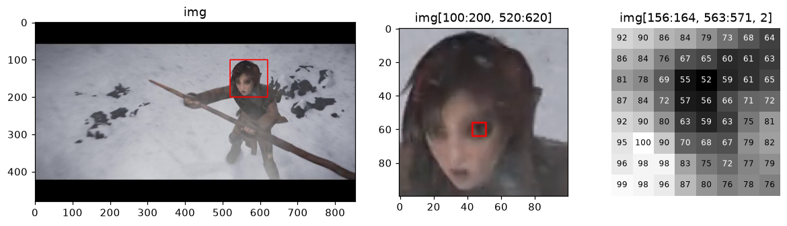
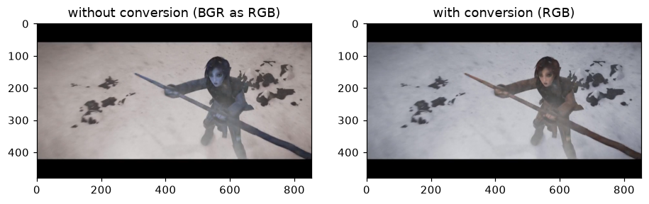
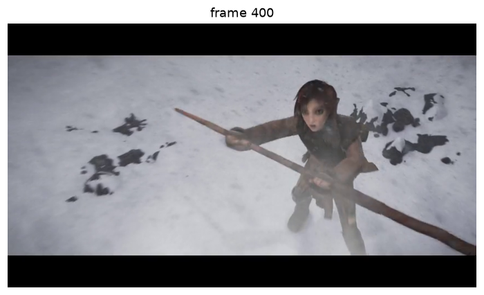
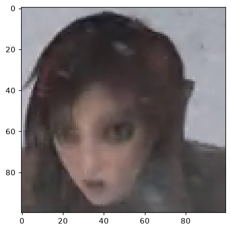
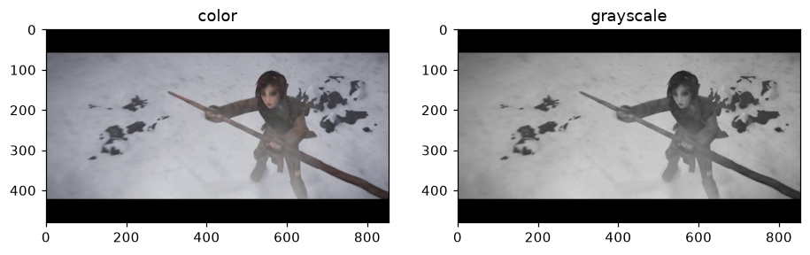
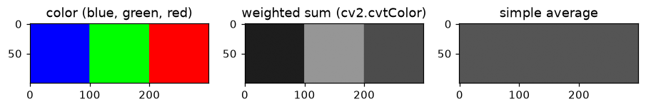
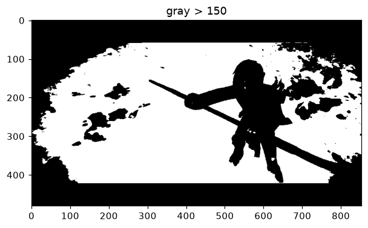

# 画像はNumPy配列である {#sec-numpy}

第2章の最後に、映像から取り出したフレームを画面に表示しました。
そのとき `frame.shape` が `(480, 854, 3)` と表示されたことを覚えているでしょうか。
OpenCVが読み込んだ画像は、写真のような特別な「もの」ではなく、数値が規則正しく並んだ表です。
この章では、1枚の画像を材料にして、その数値の表の読み方と扱い方を身につけます。

映像の分析は、結局のところ「フレームという数値の表から、目的に合った数値を計算して取り出す」作業の繰り返しです。
ここで学ぶ内容は、第5章以降のすべての計算の土台になります。

::: {.callout-note title="この章のゴール"}
1枚のフレームを数値の配列として読み、一部を切り出し、グレースケールに変換し、表示できるようになります。
章の中ほどでは、顔の一部を拡大して、画素の値を数字のまま並べた図を作ります（@fig-ch03-pixel-grid）。
:::

{#fig-ch03-pixel-grid width=100%}

この章の作業は、新しいノートブックで行います。
VS Codeで `video-analysis` フォルダを開き、`ch03.ipynb` という名前のノートブックを作って、カーネルに `.venv` を選んでください（手順は @sec-setup と同じです）。

最初のセルで、この章で使うライブラリをまとめて読み込みます。

```python
import time

import cv2
import matplotlib.pyplot as plt
import numpy as np
```

`cv2` はOpenCV、`plt` はMatplotlibの描画機能、`np` はNumPyです。
`np` や `plt` という短い名前は、Pythonの利用者のあいだで広く使われている慣習です。
`time` は、処理にかかる時間を測るために章の最後で使います。

## 画像を読み込んで、配列の形を調べる {#sec-ch03-shape}

### 練習用の画像を用意する

この章で扱うのは、動画ではなく1枚の静止画です。
材料として、第2章で表示したSintel予告編の400番目のフレームを、画像ファイルとして保存しておきます。

```python
cap = cv2.VideoCapture("data/sintel_trailer-480p.mp4")
cap.set(cv2.CAP_PROP_POS_FRAMES, 400)
ok, frame = cap.read()
cap.release()

print(cv2.imwrite("data/frame400.png", frame))
```

```{.default}
True
```

前半の4行は、第2章で実行したものと同じです。
最後の `cv2.imwrite` は、画像をファイルに保存する関数で、1つ目に保存先のファイル名、2つ目に画像を指定します。
保存に成功すると `True` を返します。
`data` フォルダの中に `frame400.png` ができていることを、エクスプローラーで確かめてください。
ダブルクリックすれば、普通の画像として開けます。

### 画像ファイルを読み込む

保存した画像を読み込みます。
画像ファイルを読む関数は `cv2.imread` です。

```python
img = cv2.imread("data/frame400.png")

print(type(img))
```

```{.default}
<class 'numpy.ndarray'>
```

`type(img)` は、変数 `img` に入っているものの種類を調べる命令です。
結果の `numpy.ndarray` は、NumPyの**配列**（array。数値を縦横に規則正しく並べたもの）であることを示しています。
OpenCVには「画像」という専用の種類はありません。
画像は、最初からNumPyの配列として読み込まれます。
これが章題の意味です。

保存する前の `frame` と、ファイルから読み直した `img` が同じものかどうかも確かめておきます。

```python
print(np.array_equal(img, frame))
```

```{.default}
True
```

`np.array_equal` は、2つの配列の形と中身がすべて一致するときに `True` を返します。
PNG形式は、保存しても画素の値が1つも変わらない形式です。
そのため、ファイルを経由しても完全に同じ配列が得られました。

::: {.callout-warning title="読み込みに失敗してもエラーにならない"}
`cv2.imread` は、ファイルが見つからないときもエラーで止まりません。
画像の代わりに `None`（「何もない」ことを表す値）を返します。

```python
missing = cv2.imread("data/frame4000.png")

print(missing)
```

```{.default}
None
```

このとき、`can't open/read file` という警告が合わせて表示されます。
`None` のまま先へ進むと、次の行で `'NoneType' object has no attribute 'shape'` のような、原因のわかりにくいエラーになります。
このエラーを見たら、まずファイル名とフォルダを確認してください。
:::

### 配列の形を調べる

配列の縦横の大きさを**形**（shape）と呼びます。

```python
print(img.shape)
```

```{.default}
(480, 854, 3)
```

3つの数字は、順に「縦の画素数」「横の画素数」「色の数」です。
この画像は、縦480画素・横854画素で、1つの画素につき3つの数値を持っています。

ここで注意が必要なのは、**縦が先、横が後**という順番です。
画面や動画の解像度は、ふつう「854×480」や「1920×1080」のように、横を先に言います。
配列の形はその逆です。
これは、配列が「行と列」で数値を管理しているためです。
数学では、数値を縦横に並べた表の大きさを「2行3列」のように、行を先に言います。
配列の順番は、この習慣にならったものです。
まず上から何行目か（縦の位置）を決め、次に左から何列目か（横の位置）を決めます。

なお、表計算ソフトのセルの名前は「B3」のように、列（B）を先に、行（3）を後に言います。
配列とは逆の順番ですので、混同しないようにしてください。

@fig-ch03-axes に、配列と画像の対応をまとめます。

::: {#fig-ch03-axes}

```{=html}
<svg viewBox="0 0 760 300" role="img" aria-label="画像と配列の対応。原点は左上にあり、縦方向のyは下向きに0から479まで、横方向のxは右向きに0から853まで増える。1つの画素はimg[y, x]で指定する。色の軸は0がB、1がG、2がRである。" style="width:100%;height:auto;font-family:inherit" fill="currentColor">
  <rect x="80" y="60" width="356" height="200" fill="#1f6fb2" fill-opacity="0.10" stroke="currentColor" stroke-width="1.5"/>
  <g stroke="currentColor" stroke-width="1.8" fill="none">
    <line x1="80" y1="40" x2="430" y2="40"/>
    <line x1="42" y1="60" x2="42" y2="254"/>
  </g>
  <path d="M440 40 l-12 -6 l0 12z"/>
  <path d="M42 264 l-6 -12 l12 0z"/>
  <text x="258" y="28" font-size="14" text-anchor="middle">x（横の位置、列）</text>
  <text x="80" y="54" font-size="12" fill-opacity="0.75">0</text>
  <text x="436" y="54" font-size="12" text-anchor="end" fill-opacity="0.75">853</text>
  <text x="20" y="164" font-size="14" text-anchor="middle" transform="rotate(-90 20 164)">y（縦の位置、行）</text>
  <text x="74" y="74" font-size="12" text-anchor="end" fill-opacity="0.75">0</text>
  <text x="74" y="258" font-size="12" text-anchor="end" fill-opacity="0.75">479</text>
  <circle cx="80" cy="60" r="4"/>
  <text x="90" y="80" font-size="12" fill-opacity="0.75">原点（左上）</text>
  <g stroke="currentColor" stroke-width="1" stroke-opacity="0.5" stroke-dasharray="4 4" fill="none">
    <line x1="80" y1="170" x2="300" y2="170"/>
    <line x1="300" y1="60" x2="300" y2="170"/>
  </g>
  <rect x="294" y="164" width="12" height="12" fill="#d99a2b" stroke="currentColor" stroke-width="1"/>
  <text x="314" y="166" font-size="15" font-weight="700">img[y, x]</text>
  <text x="314" y="186" font-size="12" fill-opacity="0.75">縦の位置が先、横の位置が後</text>
  <text x="258" y="284" font-size="13" text-anchor="middle" fill-opacity="0.75">img.shape = (480, 854, 3)　…（縦, 横, 色）</text>
  <g stroke="currentColor" stroke-width="1.5">
    <rect x="560" y="70" width="150" height="90" fill="#c0392b" fill-opacity="0.22"/>
    <rect x="540" y="100" width="150" height="90" fill="#2e8b57" fill-opacity="0.22"/>
    <rect x="520" y="130" width="150" height="90" fill="#1f6fb2" fill-opacity="0.22"/>
  </g>
  <text x="595" y="182" font-size="15" font-weight="700" text-anchor="middle">0：B（青）</text>
  <text x="682" y="120" font-size="13" text-anchor="end">1：G（緑）</text>
  <text x="702" y="90" font-size="13" text-anchor="end">2：R（赤）</text>
  <text x="615" y="250" font-size="13" text-anchor="middle" fill-opacity="0.75">3つ目の軸は色</text>
  <text x="615" y="270" font-size="13" text-anchor="middle" fill-opacity="0.75">同じ大きさの表が3枚重なっている</text>
</svg>
```

画像と配列の対応。原点は左上で、yは下に向かって増えます。色の並び順（B、G、R）については @sec-ch03-bgr で説明します。
:::

数学のグラフでは原点が左下にあり、上に向かってyが増えますが、画像では原点が**左上**で、**下に向かって**yが増えます。
第2章で表示した画像の縦軸の目盛りが、上から0、100、200と並んでいたのはこのためです。

配列について、あと2つ調べておきます。

```python
print(img.ndim)
print(img.size)
print(480 * 854 * 3)
```

```{.default}
3
1229760
1229760
```

`ndim` は軸の数（**次元**の数、number of dimensions）で、縦・横・色の3つです。
`size` は配列に含まれる数値の総数です。
480×854×3を計算した値と一致しています。
この1枚の画像は、約123万個の数値でできているわけです。

## 画素値とデータ型（`uint8`） {#sec-ch03-dtype}

### 1つの画素を取り出す

配列から数値を取り出すには、角かっこ `[ ]` の中に位置を書きます。
上から150番目、左から560番目の画素を取り出してみます。
主人公の、額にかかる前髪のあたりです。

```python
print(img[150, 560])
```

```{.default}
[105 111 133]
```

3つの数値が返ってきました。
これが、この画素の色を表す**画素値**（pixel value）です。
位置の指定は、形と同じく「縦の位置、横の位置」の順であることに注意してください。
`img[560, 150]` と書くと、縦の位置が480を超えているのでエラーになります。

3つの数値のうち1つだけを取り出すには、3つ目の位置も指定します。

```python
print(img[150, 560, 0])
```

```{.default}
105
```

Pythonのリストと同じく、番号は0から数えます。
したがって、縦の位置は0から479、横の位置は0から853、色は0から2の範囲で指定します。

ほかの場所の値も見てみましょう。
雪の部分と、画面上端の黒い帯の部分です。

```python
print(img[300, 100])
print(img[20, 100])
```

```{.default}
[179 170 167]
[0 0 0]
```

雪は3つとも大きな値、黒い帯は3つとも0です。
画素値は、**数値が大きいほど明るい**ことを表しています。

### 画素値は0から255の整数

配列に入っている数値の種類を**データ型**（data type）と呼び、`dtype` で調べられます。

```python
print(img.dtype)
print(img.min(), img.max())
```

```{.default}
uint8
0 219
```

`uint8` は「符号なし8ビット整数」という型です。
**ビット**（bit）は0か1を表す最小の単位で、8ビットあると2の8乗、つまり256通りの値を区別できます。
「符号なし」とは、マイナスの数を扱わないという意味です。
合わせると、`uint8` は**0から255までの整数**だけを表せる型だということになります。
0がもっとも暗く、255がもっとも明るい値です。

`min()` と `max()` は、配列全体の最小値と最大値です。
この画像には、0（真っ黒）から219までの値が含まれていることがわかります。

画素値に `uint8` が使われるのは、1つの数値を1バイト（8ビット）で記録できて、メモリを節約できるからです。

```python
print(img.nbytes)
```

```{.default}
1229760
```

`nbytes` は、配列がメモリ上で占めるバイト数です。
数値の個数とちょうど同じ、約1.2MBです。
映像は1秒に24枚の画像を使いますから、この節約は重要です。

### 落とし穴：`uint8` どうしの計算は桁あふれする {#sec-ch03-overflow}

`uint8` には、知らないと必ずつまずく性質があります。
0から255の範囲に収まらない計算結果を、正しく表せないのです。

小さな配列で実験してみます。
`np.array` は、リストから配列を作る関数です。
`dtype=np.uint8` を付けて、画像と同じ型にします。

```python
a = np.array([200, 100, 50], dtype=np.uint8)
b = np.array([100, 100, 100], dtype=np.uint8)

print(a + b)
```

```{.default}
[ 44 200 150]
```

配列どうしを足すと、同じ位置の数値どうしが足し合わされます。
2つ目の100＋100＝200と、3つ目の50＋100＝150は正しい結果です。
ところが、1つ目の200＋100は、300ではなく**44**になっています。

これは、`uint8` が255までしか表せないためです。
255の次は0に戻って数え直されるので、300は「300−256＝44」として記録されます。
車の走行距離計が、最大値を超えると0に戻るのと同じしくみです。
このように、型の表せる範囲を超えて値がおかしくなることを**オーバーフロー**（overflow、桁あふれ）と呼びます。

引き算でも同じことが起こります。

```python
print(a - b)
```

```{.default}
[100   0 206]
```

3つ目の50−100は、−50ではなく**206**になりました。
0より小さくなると、今度は255の側から数え直されます（−50＋256＝206）。
2つの計算で起きたことを、@fig-ch03-overflow-ring に示します。

::: {#fig-ch03-overflow-ring}

```{=html}
<svg viewBox="0 0 760 290" role="img" aria-label="uint8のオーバーフロー。0から255までの値を箱に並べた図。200に100を足すと、55進んで255に達し、次は0に戻り、さらに44進んで44になる。50から100を引くと、50戻って0に達し、その前は255に戻り、さらに49戻って206になる。" style="width:100%;height:auto;font-family:inherit" fill="currentColor">
  <rect x="170" y="86" width="70" height="42" fill="currentColor" fill-opacity="0.04" stroke="currentColor" stroke-opacity="0.55" stroke-width="1"/>
  <text x="205" y="112.4" font-size="15" font-weight="700" text-anchor="middle">0</text>
  <rect x="240" y="86" width="70" height="42" fill="currentColor" fill-opacity="0.04" stroke="currentColor" stroke-opacity="0.55" stroke-width="1"/>
  <text x="275" y="112.4" font-size="15" font-weight="700" text-anchor="middle">…</text>
  <rect x="310" y="86" width="70" height="42" fill="#1f6fb2" stroke="currentColor" stroke-opacity="0.55" stroke-width="1"/>
  <text x="345" y="112.4" font-size="15" font-weight="700" text-anchor="middle" fill="#ffffff">44</text>
  <rect x="380" y="86" width="70" height="42" fill="currentColor" fill-opacity="0.04" stroke="currentColor" stroke-opacity="0.55" stroke-width="1"/>
  <text x="415" y="112.4" font-size="15" font-weight="700" text-anchor="middle">…</text>
  <rect x="450" y="86" width="70" height="42" fill="#f0b84a" stroke="currentColor" stroke-opacity="0.55" stroke-width="1"/>
  <text x="485" y="112.4" font-size="15" font-weight="700" text-anchor="middle" fill="#1c1300">200</text>
  <rect x="520" y="86" width="70" height="42" fill="currentColor" fill-opacity="0.04" stroke="currentColor" stroke-opacity="0.55" stroke-width="1"/>
  <text x="555" y="112.4" font-size="15" font-weight="700" text-anchor="middle">…</text>
  <rect x="590" y="86" width="70" height="42" fill="currentColor" fill-opacity="0.04" stroke="currentColor" stroke-opacity="0.55" stroke-width="1"/>
  <text x="625" y="112.4" font-size="15" font-weight="700" text-anchor="middle">255</text>
  <path d="M485 82 C485 56, 625 56, 625 75" fill="none" stroke="#d6453d" stroke-width="1.8"/>
  <path d="M625 84 l-5 -9 h10z" fill="#d6453d"/>
  <text x="555" y="57" font-size="12" text-anchor="middle" font-weight="700">55進む</text>
  <path d="M205 82 C205 56, 345 56, 345 75" fill="none" stroke="#d6453d" stroke-width="1.8"/>
  <path d="M345 84 l-5 -9 h10z" fill="#d6453d"/>
  <text x="275" y="57" font-size="12" text-anchor="middle" font-weight="700">44進む</text>
  <path d="M639 82 V30 H191 V75" fill="none" stroke="#d6453d" stroke-width="1.8" stroke-dasharray="5 4"/>
  <path d="M191 84 l-5 -9 h10z" fill="#d6453d"/>
  <text x="415" y="24" font-size="12" text-anchor="middle" font-weight="700">255の次は0に戻る（1進む）</text>
  <text x="14" y="104" font-size="15" font-weight="700">200 ＋ 100</text>
  <text x="14" y="123" font-size="12" fill-opacity="0.75">55＋1＋44＝100</text>
  <rect x="170" y="232" width="70" height="42" fill="currentColor" fill-opacity="0.04" stroke="currentColor" stroke-opacity="0.55" stroke-width="1"/>
  <text x="205" y="258.4" font-size="15" font-weight="700" text-anchor="middle">0</text>
  <rect x="240" y="232" width="70" height="42" fill="currentColor" fill-opacity="0.04" stroke="currentColor" stroke-opacity="0.55" stroke-width="1"/>
  <text x="275" y="258.4" font-size="15" font-weight="700" text-anchor="middle">…</text>
  <rect x="310" y="232" width="70" height="42" fill="#f0b84a" stroke="currentColor" stroke-opacity="0.55" stroke-width="1"/>
  <text x="345" y="258.4" font-size="15" font-weight="700" text-anchor="middle" fill="#1c1300">50</text>
  <rect x="380" y="232" width="70" height="42" fill="currentColor" fill-opacity="0.04" stroke="currentColor" stroke-opacity="0.55" stroke-width="1"/>
  <text x="415" y="258.4" font-size="15" font-weight="700" text-anchor="middle">…</text>
  <rect x="450" y="232" width="70" height="42" fill="#1f6fb2" stroke="currentColor" stroke-opacity="0.55" stroke-width="1"/>
  <text x="485" y="258.4" font-size="15" font-weight="700" text-anchor="middle" fill="#ffffff">206</text>
  <rect x="520" y="232" width="70" height="42" fill="currentColor" fill-opacity="0.04" stroke="currentColor" stroke-opacity="0.55" stroke-width="1"/>
  <text x="555" y="258.4" font-size="15" font-weight="700" text-anchor="middle">…</text>
  <rect x="590" y="232" width="70" height="42" fill="currentColor" fill-opacity="0.04" stroke="currentColor" stroke-opacity="0.55" stroke-width="1"/>
  <text x="625" y="258.4" font-size="15" font-weight="700" text-anchor="middle">255</text>
  <path d="M345 228 C345 202, 205 202, 205 221" fill="none" stroke="#d6453d" stroke-width="1.8"/>
  <path d="M205 230 l-5 -9 h10z" fill="#d6453d"/>
  <text x="275" y="203" font-size="12" text-anchor="middle" font-weight="700">50戻る</text>
  <path d="M625 228 C625 202, 485 202, 485 221" fill="none" stroke="#d6453d" stroke-width="1.8"/>
  <path d="M485 230 l-5 -9 h10z" fill="#d6453d"/>
  <text x="555" y="203" font-size="12" text-anchor="middle" font-weight="700">49戻る</text>
  <path d="M191 228 V176 H639 V221" fill="none" stroke="#d6453d" stroke-width="1.8" stroke-dasharray="5 4"/>
  <path d="M639 230 l-5 -9 h10z" fill="#d6453d"/>
  <text x="415" y="170" font-size="12" text-anchor="middle" font-weight="700">0の前は255に戻る（1戻る）</text>
  <text x="14" y="250" font-size="15" font-weight="700">50 − 100</text>
  <text x="14" y="269" font-size="12" fill-opacity="0.75">50＋1＋49＝100</text>
  <text x="674" y="112" font-size="15" font-weight="700">→ 44</text>
  <text x="674" y="258" font-size="15" font-weight="700">→ 206</text>
</svg>
```

`uint8` のオーバーフロー。黄色の箱が計算前の値、青の箱が計算結果。255と0は、破線のようにつながっている
:::

エラーも警告も出ない点に注意してください。
結果は、見た目にはもっともらしい0から255の整数です。
「暗い画素から明るい画素を引いたら、非常に明るい値になった」という結果が、気づかないうちに計算に紛れ込みます。

::: {.callout-important title="uint8のまま足し算・引き算をしない"}
2枚の画像の差を求める計算は、第7章の「フレーム間差分」で動きを捉えるときの中心になります。
そこで `uint8` のまま引き算をすると、差が負になる画素がすべて誤った値になります。
この章の最後（@sec-ch03-vectorize）で、実際の画像を使ってこの失敗を再現します。
:::

### 対策：計算の前に型を変える

対策は、計算の前に、もっと広い範囲を表せる型に変換しておくことです。
型の変換には `astype` を使います。

```python
a16 = a.astype(np.int16)
b16 = b.astype(np.int16)

print(a16 + b16)
print(a16 - b16)
```

```{.default}
[300 200 150]
[100   0 -50]
```

`int16` は、−32768から32767までの整数を表せる型です。
300も−50も、正しく計算できました。

「どちらがどれだけ大きいか」ではなく「どれだけ違うか」だけを知りたいときは、**絶対値**（absolute value。マイナスの符号を取り除いた値）を求めます。

```python
print(np.abs(a16 - b16))
```

```{.default}
[100   0  50]
```

計算結果をふたたび画像として扱うには、0から255の範囲に収めてから `uint8` に戻します。
範囲に収めるには `np.clip` を使います。

```python
total = np.clip(a16 + b16, 0, 255).astype(np.uint8)

print(total, total.dtype)
```

```{.default}
[255 200 150] uint8
```

`np.clip(配列, 0, 255)` は、0より小さい値を0に、255より大きい値を255に置き換えます。
300は、表せる最大の明るさである255になりました。

### 割り算をすると小数になる

もう1つ、型について知っておくべきことがあります。
割り算の結果は、整数ではなく小数になります。

```python
print(a / 2)
print((a / 2).dtype)
```

```{.default}
[100.  50.  25.]
float64
```

`float64` は小数を表す型です（**浮動小数点数**、英語でfloating-point numberと呼びます）。
`100.` のように末尾に点が付いているのは、小数であることを示しています。
`float64` は非常に広い範囲の値を表せるので、オーバーフローの心配はまずありません。
本書では、平均などの計算をするときは `float64` に、差を求めるときは `int16` に変換するか、あとで紹介する `cv2.absdiff` を使う、という使い分けをします。

小数を `uint8` に戻すときは、小数点以下が**切り捨て**られます。

```python
x = np.array([-10.0, 99.7, 300.0])
print(np.clip(x, 0, 255).astype(np.uint8))
```

```{.default}
[  0  99 255]
```

99.7は、100ではなく99になりました。

## BGRとRGB——OpenCVの色の並び順 {#sec-ch03-bgr}

### 3つの数値は青・緑・赤の順

1つの画素が持つ3つの数値は、**光の三原色**である赤（Red）、緑（Green）、青（Blue）の強さを表しています。
3つの光を混ぜる割合で、さまざまな色を作り出します。
3つとも0なら黒、3つとも255なら白、3つが同じ値なら灰色です。

問題は、その並び順です。
一般には「赤・緑・青」の順に並べ、頭文字を取って**RGB**と呼びます。
ところがOpenCVは、歴史的な経緯から「**青・緑・赤**」の順で画像を扱います。
これを**BGR**と呼びます。

先ほどの髪の画素で確かめます。

```python
b, g, r = img[150, 560]

print(b, g, r)
```

```{.default}
105 111 133
```

3つの数値を、左から順に `b`、`g`、`r` という変数に入れました。
最後の赤がもっとも大きな値です。
主人公の赤みがかった茶色の髪の画素ですから、赤が強いのは見た目どおりです。

この3つの数値の層を、それぞれ**チャンネル**（channel）と呼びます。
OpenCVで読み込んだ画像では、0番目がBチャンネル、1番目がGチャンネル、2番目がRチャンネルです。

### 変換しないと、赤と青が入れ替わる

Matplotlibをはじめ、ほかの多くのライブラリは、画像がRGBの順に並んでいることを前提にしています。
そのため、OpenCVで読んだ画像をそのままMatplotlibに渡すと、赤と青が入れ替わって表示されます。

並び順を変換する関数が、第2章でも使った `cv2.cvtColor` です。

```python
rgb = cv2.cvtColor(img, cv2.COLOR_BGR2RGB)

print(img[150, 560])
print(rgb[150, 560])
```

```{.default}
[105 111 133]
[133 111 105]
```

`cv2.COLOR_BGR2RGB` は「BGRからRGBへ」という変換の指定です（`2` は英語の to を表す略記です）。
同じ画素の値が、逆の順番に並び替えられました。
数値そのものは変わっていません。
並び替えのようすを @fig-ch03-bgr-rgb に示します。

::: {#fig-ch03-bgr-rgb}

```{=html}
<svg viewBox="0 0 760 245" role="img" aria-label="BGRからRGBへの並べ替え。img[150, 560]は、番号0がBの105、番号1がGの111、番号2がRの133。cvtColorで変換したrgb[150, 560]は、番号0がRの133、番号1がGの111、番号2がBの105。値は同じで、並ぶ順だけが逆になる。" style="width:100%;height:auto;font-family:inherit" fill="currentColor">
  <text x="296" y="46" font-size="12" text-anchor="middle" font-weight="700">0</text>
  <rect x="250" y="56" width="92" height="40" fill="#1f6fb2" stroke="currentColor" stroke-opacity="0.55" stroke-width="1"/>
  <text x="296" y="81.4" font-size="15" font-weight="700" text-anchor="middle" fill="#fff">B　105</text>
  <text x="388" y="46" font-size="12" text-anchor="middle" font-weight="700">1</text>
  <rect x="342" y="56" width="92" height="40" fill="#2e8b57" stroke="currentColor" stroke-opacity="0.55" stroke-width="1"/>
  <text x="388" y="81.4" font-size="15" font-weight="700" text-anchor="middle" fill="#fff">G　111</text>
  <text x="480" y="46" font-size="12" text-anchor="middle" font-weight="700">2</text>
  <rect x="434" y="56" width="92" height="40" fill="#c0392b" stroke="currentColor" stroke-opacity="0.55" stroke-width="1"/>
  <text x="480" y="81.4" font-size="15" font-weight="700" text-anchor="middle" fill="#fff">R　133</text>
  <rect x="250" y="170" width="92" height="40" fill="#c0392b" stroke="currentColor" stroke-opacity="0.55" stroke-width="1"/>
  <text x="296" y="195.4" font-size="15" font-weight="700" text-anchor="middle" fill="#fff">R　133</text>
  <text x="296" y="228" font-size="12" text-anchor="middle" font-weight="700">0</text>
  <rect x="342" y="170" width="92" height="40" fill="#2e8b57" stroke="currentColor" stroke-opacity="0.55" stroke-width="1"/>
  <text x="388" y="195.4" font-size="15" font-weight="700" text-anchor="middle" fill="#fff">G　111</text>
  <text x="388" y="228" font-size="12" text-anchor="middle" font-weight="700">1</text>
  <rect x="434" y="170" width="92" height="40" fill="#1f6fb2" stroke="currentColor" stroke-opacity="0.55" stroke-width="1"/>
  <text x="480" y="195.4" font-size="15" font-weight="700" text-anchor="middle" fill="#fff">B　105</text>
  <text x="480" y="228" font-size="12" text-anchor="middle" font-weight="700">2</text>
  <line x1="296" y1="100" x2="480" y2="166" stroke="currentColor" stroke-width="1.8" stroke-opacity="0.6"/>
  <line x1="388" y1="100" x2="388" y2="166" stroke="currentColor" stroke-width="1.8" stroke-opacity="0.6"/>
  <line x1="480" y1="100" x2="296" y2="166" stroke="currentColor" stroke-width="1.8" stroke-opacity="0.6"/>
  <text x="236" y="46" font-size="12" text-anchor="end" font-weight="700">番号</text>
  <text x="236" y="228" font-size="12" text-anchor="end" font-weight="700">番号</text>
  <text x="14" y="73" font-size="13" font-weight="700">img[150, 560]</text>
  <text x="14" y="90" font-size="11" fill-opacity="0.8">OpenCVの並び（BGR）</text>
  <text x="14" y="187" font-size="13" font-weight="700">rgb[150, 560]</text>
  <text x="14" y="204" font-size="11" fill-opacity="0.8">Matplotlibの並び（RGB）</text>
  <rect x="586" y="86" width="90" height="90" fill="#856f69" stroke="currentColor" stroke-opacity="0.55" stroke-width="1"/>
  <text x="631" y="196" font-size="12" text-anchor="middle" fill-opacity="0.85">この画素の色</text>
  <text x="631" y="74" font-size="12" text-anchor="middle" fill-opacity="0.85">値は同じ、並ぶ順が逆</text>
</svg>
```

BGRからRGBへの並べ替え。箱の上下の数は、3つ目の軸の番号
:::

変換する前と後の画像を、並べて表示してみます。
複数の画像を並べる書き方は、次の節で説明します。

```python
fig, axes = plt.subplots(1, 2, figsize=(10, 3.2))
axes[0].imshow(img)
axes[0].set_title("without conversion (BGR as RGB)")
axes[1].imshow(rgb)
axes[1].set_title("with conversion (RGB)")
plt.show()
```

{#fig-ch03-bgr-vs-rgb width=100%}

@fig-ch03-bgr-vs-rgb の左では、主人公の顔が青白く、雪がわずかに赤みを帯びて見えます。
赤の強い肌や髪が青の強い色に、青みがかった雪が赤みがかった色に入れ替わったためです。

この失敗が厄介なのは、**エラーにならず、画像もそれらしく表示される**ことです。
とくに、もともと色味の少ない映像では気づきにくくなります。
人の肌が青白く見えたら、まずBGRとRGBの取り違えを疑ってください。

::: {.callout-tip title="本書の方針"}
本書では、画像は**つねにBGRの順のまま**変数に入れておき、Matplotlibで表示する直前にだけRGBへ変換します。
OpenCVの関数はBGRを前提にしているので、途中で並び順を変えてしまうと、今度はOpenCVの側で取り違えが起こるからです。
:::

### チャンネルを1枚ずつ取り出す

3つのチャンネルを別々に取り出すこともできます。

```python
blue = img[:, :, 0]
green = img[:, :, 1]
red = img[:, :, 2]

print(red.shape)
print(blue.mean(), green.mean(), red.mean())
```

```{.default}
(480, 854)
123.4791325136612 117.65662080405933 117.2044350117096
```

`:` だけを書くと「その軸のすべて」という意味になります。
`img[:, :, 2]` は、「縦はすべて、横もすべて、色は2番目（R）だけ」という指定です。
結果の形は `(480, 854)` で、色の軸がなくなり、縦と横だけの2次元の配列になりました。

`mean()` は平均です。
このフレームは、3つのチャンネルのうち青の平均がもっとも大きくなっています。
雪の場面がわずかに青みを帯びていることが、数値に表れています。

## Matplotlibで画像を表示する {#sec-ch03-imshow}

### 基本の表示

画像の表示には、Matplotlibの `plt.imshow` を使います。
すでに何度か使いましたが、ここで使い方を整理しておきます。

```python
plt.figure(figsize=(8, 4.5))
plt.imshow(rgb)
plt.title("frame 400")
plt.axis("off")
plt.show()
```

{#fig-ch03-imshow-title width=75%}

各行の役割は次のとおりです。

- `plt.figure(figsize=(8, 4.5))` は、図の大きさを指定します。単位はインチで、（横, 縦）の順です。省略すると既定の大きさになります。
- `plt.imshow(rgb)` は、配列を画像として描きます。カラー画像は、RGBの順に変換したものを渡します。
- `plt.title("frame 400")` は、図の上に題を付けます。
- `plt.axis("off")` は、周囲の目盛りを消します。画素の位置を読み取りたいときは、この行を省きます。
- `plt.show()` は、ここまでに用意した図を表示します。

::: {.callout-note title="図の中の文字は英語にします"}
Matplotlibは、初期設定のままでは日本語の文字を表示できず、「□」に化けてしまいます。
本書では、フォントの設定に手間をかけないよう、図の題や軸の名前を英語で書くことにします。
:::

### 複数の画像を並べる

画像を見比べたいときは、`plt.subplots` で図を区画に分けます。
@fig-ch03-bgr-vs-rgb を描いたコードを、もう一度見てください。

`plt.subplots(1, 2, figsize=(10, 3.2))` は、「縦に1段、横に2列」の区画を作ります。
戻り値は2つあり、`fig` が図全体、`axes` が区画の並びです。
`axes[0]` が左の区画、`axes[1]` が右の区画で、それぞれに対して `imshow` や `set_title` を呼び出します。
区画に題を付けるときは、`plt.title` ではなく `set_title` という名前になる点に注意してください。

### 1チャンネルの画像を表示するときの注意

色の軸を持たない2次元の配列を表示するときには、注意が2つあります。
前の節で取り出したRチャンネル `red` を、何も指定せずに表示した場合と、指定を加えた場合を比べてみます。

```python
fig, axes = plt.subplots(1, 2, figsize=(10, 3.2))
axes[0].imshow(red)
axes[0].set_title("default colormap")
axes[1].imshow(red, cmap="gray", vmin=0, vmax=255)
axes[1].set_title('cmap="gray", vmin=0, vmax=255')
plt.show()
```

{#fig-ch03-cmap-default width=100%}

@fig-ch03-cmap-default の左は、濃い青紫から緑を経て黄色へと変わる配色になりました。
2次元の配列は「色」の情報を持たないので、Matplotlibは数値の大小を、あらかじめ決められた配色に当てはめて表示します。
この配色を**カラーマップ**（colormap）と呼びます。
数値の小さいところが青紫、大きいところが黄色になっているだけで、画像に色が付いたわけではありません。

1つ目の注意は、白黒の濃淡で表示したいときには `cmap="gray"` を指定する、ということです。

2つ目の注意は、`vmin=0, vmax=255` の指定です。
これを省くと、Matplotlibは**配列の中の最小値を黒、最大値を白**に割り当てます。
つまり、明るさを自動的に引き伸ばして表示します。
全体に暗い画像で、その影響を確かめましょう。
`red` の値を4分の1にした、暗い画像を作ります。

```python
dark = red // 4
print(dark.min(), dark.max())

fig, axes = plt.subplots(1, 2, figsize=(10, 3.2))
axes[0].imshow(dark, cmap="gray")
axes[0].set_title("without vmin, vmax")
axes[1].imshow(dark, cmap="gray", vmin=0, vmax=255)
axes[1].set_title("vmin=0, vmax=255")
plt.show()
```

```{.default}
0 53
```

{#fig-ch03-vmin-vmax width=100%}

`//` は、割り算の結果の小数点以下を切り捨てる演算子です。
`dark` の最大値は53で、本来はかなり暗い画像です。
ところが @fig-ch03-vmin-vmax の左では、53が白として表示され、元の画像と区別がつきません。
右のように `vmin=0, vmax=255` を指定すると、「0が黒、255が白」という本来の対応で表示され、暗い画像は暗く見えます。

明るさを比べるための図で、画像ごとに明るさが引き伸ばされてしまっては困ります。
本書では、白黒の画像を表示するときは `cmap="gray", vmin=0, vmax=255` をまとめて指定することにします。
毎回書くのは手間ですので、第4章の最後で、これらを自動で指定する表示用の関数を作ります。

## スライスで矩形領域を切り出す {#sec-ch03-slice}

### 範囲を指定して切り出す

画像の一部分だけを取り出したいことがあります。
顔のあたりだけを調べたい、字幕の部分を除きたい、といった場合です。
配列では、位置の代わりに「開始:終了」という範囲を書くことで、その部分を切り出せます。
この書き方を**スライス**（slice）と呼びます。

主人公の顔のあたりを切り出してみます。

```python
face = img[100:200, 520:620]

print(face.shape)
```

```{.default}
(100, 100, 3)
```

`img[100:200, 520:620]` は、「縦は100番目から199番目まで、横は520番目から619番目まで」という指定です。
ここでも、**縦の範囲が先、横の範囲が後**です。
座標で書けば `img[y0:y1, x0:x1]` となります。
「x、yの順」に慣れていると逆に書いてしまいやすいので、気をつけてください。

範囲の終わりの番号（200や620）は、切り出す部分に**含まれません**。
`range(100, 200)` が100から199までを表すのと同じ規則です。
そのため、切り出した部分の画素数は、単純に引き算で求められます（200−100＝100）。
縦の範囲 `100:200` を図にすると、@fig-ch03-slice-range のようになります。

::: {#fig-ch03-slice-range}

```{=html}
<svg viewBox="0 0 760 180" role="img" aria-label="スライス100:200が指す範囲。行の番号を箱に並べ、100番目から199番目までに色を付けてある。開始の100は含まれ、終了の200は含まれない。切り出されるのは200引く100で100行。" style="width:100%;height:auto;font-family:inherit" fill="currentColor">
  <rect x="150" y="74" width="62" height="44" fill="currentColor" fill-opacity="0.04" stroke="currentColor" stroke-opacity="0.55" stroke-width="1"/>
  <text x="181" y="101.4" font-size="15" font-weight="700" text-anchor="middle">98</text>
  <rect x="212" y="74" width="62" height="44" fill="currentColor" fill-opacity="0.04" stroke="currentColor" stroke-opacity="0.55" stroke-width="1"/>
  <text x="243" y="101.4" font-size="15" font-weight="700" text-anchor="middle">99</text>
  <rect x="274" y="74" width="62" height="44" fill="#f0b84a" stroke="currentColor" stroke-opacity="0.55" stroke-width="1"/>
  <text x="305" y="101.4" font-size="15" font-weight="700" text-anchor="middle" fill="#1c1300">100</text>
  <rect x="336" y="74" width="62" height="44" fill="#f0b84a" stroke="currentColor" stroke-opacity="0.55" stroke-width="1"/>
  <text x="367" y="101.4" font-size="15" font-weight="700" text-anchor="middle" fill="#1c1300">101</text>
  <rect x="398" y="74" width="62" height="44" fill="#f0b84a" stroke="currentColor" stroke-opacity="0.55" stroke-width="1"/>
  <text x="429" y="101.4" font-size="15" font-weight="700" text-anchor="middle" fill="#1c1300">…</text>
  <rect x="460" y="74" width="62" height="44" fill="#f0b84a" stroke="currentColor" stroke-opacity="0.55" stroke-width="1"/>
  <text x="491" y="101.4" font-size="15" font-weight="700" text-anchor="middle" fill="#1c1300">198</text>
  <rect x="522" y="74" width="62" height="44" fill="#f0b84a" stroke="currentColor" stroke-opacity="0.55" stroke-width="1"/>
  <text x="553" y="101.4" font-size="15" font-weight="700" text-anchor="middle" fill="#1c1300">199</text>
  <rect x="584" y="74" width="62" height="44" fill="currentColor" fill-opacity="0.04" stroke="currentColor" stroke-opacity="0.55" stroke-width="1"/>
  <text x="615" y="101.4" font-size="15" font-weight="700" text-anchor="middle">200</text>
  <rect x="646" y="74" width="62" height="44" fill="currentColor" fill-opacity="0.04" stroke="currentColor" stroke-opacity="0.55" stroke-width="1"/>
  <text x="677" y="101.4" font-size="15" font-weight="700" text-anchor="middle">201</text>
  <text x="138" y="102" font-size="13" text-anchor="end" fill-opacity="0.75">行の番号</text>
  <line x1="274" y1="44" x2="274" y2="126" stroke="#d6453d" stroke-width="3"/>
  <line x1="584" y1="44" x2="584" y2="126" stroke="#d6453d" stroke-width="3"/>
  <text x="274" y="36" font-size="14" text-anchor="middle" font-weight="700">開始 100</text>
  <text x="584" y="36" font-size="14" text-anchor="middle" font-weight="700">終了 200</text>
  <text x="282" y="62" font-size="12" fill-opacity="0.75">ここから</text>
  <text x="576" y="62" font-size="12" text-anchor="end" fill-opacity="0.75">ここの手前まで</text>
  <path d="M280 134 v6 h298 v-6" fill="none" stroke="currentColor" stroke-width="1.3" stroke-opacity="0.6"/>
  <text x="429" y="160" font-size="13" text-anchor="middle">切り出される行：100番目から199番目まで（200 − 100 ＝ 100行）</text>
</svg>
```

スライス `100:200` が指す範囲。開始の番号は含まれ、終了の番号は含まれない
:::

切り出した結果も配列ですから、そのまま表示できます。

```python
plt.imshow(cv2.cvtColor(face, cv2.COLOR_BGR2RGB))
plt.show()
```

{#fig-ch03-crop-face width=40%}

### スライスの書き方いろいろ

範囲の書き方には、いくつかの省略形があります。

```python
print(img[:, :427].shape)
print(img[58:422].shape)
print(img[::2, ::2].shape)
```

```{.default}
(480, 427, 3)
(364, 854, 3)
(240, 427, 3)
```

- `img[:, :427]`：開始を省略すると「最初から」の意味になります。縦はすべて、横は0番目から426番目まで、つまり画像の左半分です。
- `img[58:422]`：後ろの軸の指定を省略すると「すべて」の意味になります。縦の58番目から421番目までの、横長の帯です。
- `img[::2, ::2]`：3つ目の数字は「何個おきに取るか」を表します。縦横とも1つおきに画素を取るので、大きさが半分の画像になります。

2つ目の `img[58:422]` には、実用的な意味があります。
このフレームの上下には、黒い帯があります。
横長の映画を、それより縦に長い画面に収めるために付けられた帯で、**レターボックス**（letterbox）と呼ばれます。
このフレームで調べると、絵が映っているのは58番目から421番目の行でした。
帯の部分と絵の部分の値を調べてみます。

```python
print(img[:58].max(), img[422:].max())
print(img[58:422].mean())
```

```{.default}
11 13
157.4776262964202
```

上の帯の最大値は11、下の帯の最大値は13で、ほぼ真っ黒です（完全な0でないのは、動画の圧縮によるわずかな誤差です）。
絵の部分だけの平均は約157.5でした。
第2章で求めた画像全体の平均は約119.4でしたから、黒い帯が平均を大きく引き下げていたことがわかります。
「何を測っているのか」は、どの範囲を計算に含めるかで変わります。

### 落とし穴：スライスは元の画像とつながっている

スライスには、もう1つ知っておくべき性質があります。
切り出した配列は、元の配列の**コピーではありません**。
元の配列の一部分を指し示しているだけです。
そのため、切り出した側を書き換えると、元の画像も書き換わります。

```python
patch = img[100:200, 520:620]
patch[:] = 0

print(img[150, 560])
```

```{.default}
[0 0 0]
```

`patch[:] = 0` は、`patch` のすべての画素を0にする命令です。
書き換えたのは `patch` なのに、元の `img` の画素まで0になってしまいました。

元の画像を残したまま、切り出した部分だけを加工したいときは、`copy()` で独立した複製を作ります。
画像を読み直してから、試してみます。

```python
img = cv2.imread("data/frame400.png")
patch = img[100:200, 520:620].copy()
patch[:] = 0

print(img[150, 560])
```

```{.default}
[105 111 133]
```

今度は、元の画像は変わっていません。
切り出した画像に何かを描き込んだり、値を書き換えたりするときは、`copy()` を付けると覚えておいてください。

### 画素の値を数字のまま眺める

スライスを使って、章の冒頭の @fig-ch03-pixel-grid を作ります。
まず、顔の領域の中から、目のあたりの縦8画素・横8画素を、Rチャンネルだけ取り出します。

```python
small = img[156:164, 563:571, 2]

print(small)
```

```{.default}
[[ 92  90  86  84  79  73  68  64]
 [ 86  84  76  67  65  60  61  63]
 [ 81  78  69  55  52  59  61  65]
 [ 87  84  72  57  56  66  71  72]
 [ 92  90  80  63  59  63  75  81]
 [ 95 100  90  70  68  67  79  82]
 [ 96  98  98  83  75  72  77  79]
 [ 99  98  96  87  80  76  78  76]]
```

8行8列の数値が表示されました。
中央付近に50台の小さな値（暗い画素）が集まっています。
これが瞳の部分です。

この数値を、対応する濃淡の上に書き込んだ図を作ります。
少し長いコードですが、新しく出てくるのは2つだけです。

```python
fig, axes = plt.subplots(1, 3, figsize=(13, 3.8), width_ratios=[1.9, 1, 1])

marked = img.copy()
cv2.rectangle(marked, (520, 100), (620, 200), (0, 0, 255), 2)
axes[0].imshow(cv2.cvtColor(marked, cv2.COLOR_BGR2RGB))
axes[0].set_title("img")

face = img[100:200, 520:620].copy()
cv2.rectangle(face, (43, 56), (51, 64), (0, 0, 255), 1)
axes[1].imshow(cv2.cvtColor(face, cv2.COLOR_BGR2RGB))
axes[1].set_title("img[100:200, 520:620]")

axes[2].imshow(small, cmap="gray")
axes[2].set_title("img[156:164, 563:571, 2]")
axes[2].axis("off")
for y in range(8):
    for x in range(8):
        value = small[y, x]
        color = "white" if value < 75 else "black"
        axes[2].text(x, y, value, ha="center", va="center", color=color, fontsize=8)
plt.show()
```

{width=100%}

新しく出てきたのは、次の2つです。

- `cv2.rectangle(画像, 左上の点, 右下の点, 色, 線の太さ)` は、画像に長方形の枠を描き込みます。点は**（x, y）の順**で指定します。色はBGRの順ですから、`(0, 0, 255)` は赤です。画像そのものを書き換える関数なので、`copy()` で作った複製に描いています。
- `axes[2].text(x, y, 文字, ...)` は、図の中の指定した位置に文字を書きます。2重の `for` 文で64個の画素を順にたどり、その値を書き込んでいます。暗い画素の上では白、明るい画素の上では黒の文字にして、読みやすくしています。

右の区画では、濃淡の違いをはっきり見せるために、あえて `vmin`・`vmax` を指定していません。
そのため、この8×8画素の中の最小値52が黒、最大値100が白として表示されています。

::: {.callout-warning title="スライスは [y, x]、OpenCVの描画関数は (x, y)"}
配列の位置やスライスは「縦、横」の順でした。
一方、`cv2.rectangle` のようなOpenCVの関数に点や大きさを渡すときは、「横、縦」の順で指定します。
上のコードでも、`img[100:200, 520:620]` と切り出した領域に、`(520, 100)` から `(620, 200)` の枠を描いています。
同じ領域なのに数字の順番が逆になるので、混乱したときはこの対応を思い出してください。
:::

@fig-ch03-pixel-grid を左から右へたどると、私たちが「顔」や「目」として見ているものが、数値の並びにほかならないことがわかります。
逆にいえば、この数値をうまく集計すれば、「明るい」「赤っぽい」「動いている」といった画面の性質を、数値として取り出せるはずです。
次の節からは、その集計の基本となる操作を見ていきます。

## グレースケール化——3つの値を1つにまとめる {#sec-ch03-gray}

### グレースケール画像に変換する

明るさや動きを調べるときは、色の情報が要らないことがよくあります。
そのような場合は、1つの画素が持つ3つの数値を、明るさを表す1つの数値にまとめます。
こうして作った白黒の濃淡だけの画像を**グレースケール画像**（grayscale image）と呼びます。

変換には、ここでも `cv2.cvtColor` を使います。

```python
gray = cv2.cvtColor(img, cv2.COLOR_BGR2GRAY)

print(gray.shape, gray.dtype)
```

```{.default}
(480, 854) uint8
```

形が `(480, 854)` になり、色の軸がなくなりました。
数値の個数は3分の1になっています。
型は `uint8` のままです。

元の画像と並べて表示します。

```python
fig, axes = plt.subplots(1, 2, figsize=(10, 3.2))
axes[0].imshow(cv2.cvtColor(img, cv2.COLOR_BGR2RGB))
axes[0].set_title("color")
axes[1].imshow(gray, cmap="gray", vmin=0, vmax=255)
axes[1].set_title("grayscale")
plt.show()
```

{#fig-ch03-gray-frame width=100%}

### 3つの値をどうまとめているのか

3つの数値を1つにまとめる方法として、まず思いつくのは、3つの平均を取ることでしょう。
しかし、`cv2.cvtColor` が行っている計算は、単純な平均ではありません。
髪の画素で確かめます。

```python
print(img[150, 560])
print(gray[150, 560])
```

```{.default}
[105 111 133]
117
```

3つの値の平均は（105＋111＋133）÷3≒116.3ですから、117とは少し違います。

OpenCVは、次の式でグレースケールの値を計算しています。

$$
Y = 0.299\,R + 0.587\,G + 0.114\,B
$$

$R$、$G$、$B$ はその画素の赤・緑・青の値、$Y$ が求めるグレースケールの値です。
3つの値に、それぞれ異なる係数を掛けてから足し合わせています。
この係数を**重み**（weight）と呼び、このような計算を**重み付き和**（weighted sum）と呼びます。
3つの重みを足すと、0.299＋0.587＋0.114＝1になります。
つまりこの式は、「緑を約6割、赤を約3割、青を約1割の比率で混ぜた平均」を計算しています。

緑の重みが大きいのは、人間の目の性質に合わせているためです。
人間の目は、同じ強さの光でも、緑をもっとも明るく、青をもっとも暗く感じます。
この重みは、テレビ放送の規格（ITU-R BT.601）で定められたものです [@itu-bt601]。
$Y$ は、単なる数値の平均ではなく、「人間が感じる明るさ」に近づけた値だといえます。
この値を**輝度**（luminance）と呼びます。
輝度については、第5章であらためて取り上げます。

式のとおりに計算して、確かめてみましょう。

```python
b, g, r = img[150, 560]

print(0.299 * r + 0.587 * g + 0.114 * b)
```

```{.default}
116.89399999999999
```

約116.89となりました。
これを整数に丸めると117で、`gray[150, 560]` の値と一致します。

### 画像全体で確かめる

1つの画素だけでは偶然かもしれませんので、すべての画素で確かめます。
3つのチャンネルを取り出し、小数の型に変換してから、同じ式を計算します。

```python
b = img[:, :, 0].astype(np.float64)
g = img[:, :, 1].astype(np.float64)
r = img[:, :, 2].astype(np.float64)

weighted = 0.299 * r + 0.587 * g + 0.114 * b
print(weighted.shape, weighted.dtype)
```

```{.default}
(480, 854) float64
```

ここでは、`r`、`g`、`b` は1つの数値ではなく、それぞれ480×854の配列です。
配列に数値を掛けると、すべての要素にその数値が掛かります。
配列どうしを足すと、同じ位置の要素どうしが足されます。
そのため、1つの画素に対する式とまったく同じ書き方で、約41万個の画素すべてを一度に計算できます。
この書き方については、次の節で詳しく説明します。

自分で計算した `weighted` と、OpenCVが作った `gray` の差を調べます。

```python
diff = np.abs(weighted - gray)

print(diff.max())
```

```{.default}
0.49900000000002365
```

差の絶対値は、もっとも大きい画素でも0.5未満でした。
`cv2.cvtColor` は、計算した値を四捨五入して、もっとも近い整数にしています。
四捨五入では、元の値と丸めた値の差は、最大で0.5になります。
たとえば116.89は117になり、その差は0.11です。
116.501なら117になり、差は0.499です。
つまり、0.5弱の差が残るのは、丸めただけで、ほかに違いがないということです。
`cv2.cvtColor` が、たしかに上の式で計算していることが確認できました。

::: {.callout-note title="厳密には、ごくまれに1だけ違う"}
OpenCVは、計算を速くするために、3つの重みを整数で近似して計算しています。
そのため、式のとおりに計算して四捨五入した値と、ごくまれに1だけ違うことがあります。
本書の分析では、この違いは無視できます。
:::

### 単純な平均と比べる

では、重み付き和と単純な平均とで、結果はどのくらい違うのでしょうか。

```python
average = (r + g + b) / 3

print(np.abs(average - gray).max())
print(np.abs(average - gray).mean())
```

```{.default}
4.0
1.4048147606036951
```

このフレームでは、差は最大でも4、平均では約1.4でした。
大きな違いではありません。
このフレームは雪と茶色の服が大部分を占めていて、3つのチャンネルの値がもともと近いためです。

違いがはっきり現れるのは、鮮やかな色の場合です。
青・緑・赤の原色を並べた画像を作って、比べてみます。

```python
bars = np.zeros((100, 300, 3), dtype=np.uint8)
bars[:, 0:100] = (255, 0, 0)
bars[:, 100:200] = (0, 255, 0)
bars[:, 200:300] = (0, 0, 255)

bars_weighted = cv2.cvtColor(bars, cv2.COLOR_BGR2GRAY)
bars_average = bars.mean(axis=2)

print(bars_weighted[50, 50], bars_weighted[50, 150], bars_weighted[50, 250])
print(bars_average[50, 50], bars_average[50, 150], bars_average[50, 250])
```

```{.default}
29 150 76
85.0 85.0 85.0
```

`np.zeros` は、すべての値が0の配列を作る関数です。
縦100・横300の真っ黒な画像を作り、横方向に3等分して、BGRの順で青 `(255, 0, 0)`、緑 `(0, 255, 0)`、赤 `(0, 0, 255)` を書き込みました。
`bars.mean(axis=2)` は、3つ目の軸（色）の方向に平均を取る、という意味です（`axis` は次の節で説明します）。

単純な平均では、3色とも85になりました。
どの色も「255が1つと、0が2つ」ですから、平均すれば同じ値になります。
一方、重み付き和では、青が29、緑が150、赤が76と、大きく異なる値になりました。

```python
fig, axes = plt.subplots(1, 3, figsize=(10, 1.8))
axes[0].imshow(cv2.cvtColor(bars, cv2.COLOR_BGR2RGB))
axes[0].set_title("color (blue, green, red)")
axes[1].imshow(bars_weighted, cmap="gray", vmin=0, vmax=255)
axes[1].set_title("weighted sum (cv2.cvtColor)")
axes[2].imshow(bars_average, cmap="gray", vmin=0, vmax=255)
axes[2].set_title("simple average")
plt.show()
```

{#fig-ch03-gray-bars width=100%}

@fig-ch03-gray-bars の左の画像を見ると、緑がもっとも明るく、青がもっとも暗く感じられるはずです。
中央の重み付き和は、その感じ方をよく再現しています。
右の単純な平均では、3色の区別がまったくつかなくなっています。

本書では、グレースケール化には `cv2.cvtColor(画像, cv2.COLOR_BGR2GRAY)` を使います。

::: {.callout-note title="最初からグレースケールで読み込む方法との違い"}
`cv2.imread("data/frame400.png", cv2.IMREAD_GRAYSCALE)` のように書くと、画像を最初からグレースケールで読み込めます。
ただし、本書の環境（OpenCV 5.1）で確かめたところ、この方法で得た画像は、`cv2.cvtColor` で変換した画像と完全には一致しませんでした。
全体の約15%の画素で、値が1だけ小さくなっていました。

原因は、丸め方の違いです。
`cv2.cvtColor` は、計算した値を四捨五入します。
これに対して、PNGファイルをグレースケールで読み込むときは、小数点以下が切り捨てられています。
たとえば、計算した値が116.89の画素は、`cv2.cvtColor` では117に、読み込み時の変換では116になります。
この違いはファイルの形式によるもので、同じ画像をBMP形式やTIFF形式で保存して試すと、差は出ませんでした。

画像全体の平均で見ると、約0.15の違いです。
実用上は問題にならない差ですが、同じ分析の中では、どちらかの方法に統一しておくと安心です。
:::

## 配列全体をまとめて計算する（`for`文を書かない考え方） {#sec-ch03-vectorize}

### `for` 文で平均を求める

グレースケール画像の平均を求めることを考えます。
Pythonの基本文法だけで書くなら、すべての画素を `for` 文で順にたどり、値を足し合わせて、最後に画素数で割ることになります。
かかった時間も測ってみましょう。

```python
height, width = gray.shape

start = time.perf_counter()
total = 0
for y in range(height):
    for x in range(width):
        total += int(gray[y, x])
mean_loop = total / (height * width)
time_loop = time.perf_counter() - start

print(mean_loop)
print(f"{time_loop:.4f} s")
```

```{.default}
118.0670106362217
0.0728 s
```

`time.perf_counter()` は、その時点の時刻を秒単位で返す関数です。
処理の前後で呼び出して差を取ると、かかった時間がわかります。
`f"{time_loop:.4f} s"` は、数値を小数点以下4桁で表示する書き方です。

平均は約118.07、かかった時間は約0.07秒でした。
時間は、お使いのパソコンや、そのときの状態によって変わります。

なお、`int(gray[y, x])` と `int()` で囲んでいるのは、@sec-ch03-overflow で見たオーバーフローを避けるためです。
`gray[y, x]` は `uint8` の値ですから、そのまま足し合わせていくと、255を超えたところで結果がおかしくなります。
Pythonの整数に変換しておけば、その心配はありません。

### 配列の機能で平均を求める

同じ計算を、配列の `mean()` で行います。

```python
start = time.perf_counter()
mean_vec = gray.mean()
time_vec = time.perf_counter() - start

print(mean_vec)
print(f"{time_vec:.6f} s")
```

```{.default}
118.0670106362217
0.000315 s
```

結果はまったく同じ値です。
かかった時間は約0.0003秒でした。

```python
print(time_loop / time_vec)
```

```{.default}
230.86921658407232
```

`for` 文の200倍以上の速さです。
倍率は実行のたびに変わりますが、桁違いに速いことは変わりません。

0.07秒なら十分に速い、と感じるかもしれません。
しかし、これは1枚の画像についての時間です。
Sintelの予告編は1253枚のフレームからなりますから、`for` 文では約90秒かかる計算になります。
2時間の映画なら、フレームは約17万枚です。
しかも平均は、もっとも単純な計算の1つです。
映像の分析では、**画素を1つずつたどる `for` 文は書かない**ことが原則になります。

### なぜ速いのか

Pythonの `for` 文が遅いのは、1回の繰り返しのたびに、「値を取り出す」「型を調べる」「足し算の方法を決める」といった多くの準備をするためです。
41万回の繰り返しで、その準備も41万回行われます。

NumPyの配列は、すべての要素が同じ型（ここでは `uint8`）で、メモリ上に隙間なく並んでいます。
`gray.mean()` を呼び出すと、NumPyの内部にある、あらかじめ機械語に翻訳されたプログラムが、その数値の並びを一気に処理します。
要素ごとの準備が要らないので、高速に計算できます。

このように、繰り返しを自分で書かずに、配列全体に対する演算として書くことを**ベクトル化**（vectorization）と呼びます。
ベクトル化したコードは、速いだけでなく、短くて読みやすくなります。
「すべての画素の平均」と言葉で言うとおりのことが、`gray.mean()` とそのまま書けるからです。

### 配列全体に対する演算の例

ベクトル化した書き方は、すでにこの章で何度も使っています。
ここで整理しておきましょう。

**集計**（aggregation）。
配列全体から1つの数値を求めます。

```python
print(gray.min(), gray.max(), gray.mean(), gray.std())
```

```{.default}
0 214 118.0670106362217 73.73898282805958
```

`std()` は標準偏差で、値のばらつきの大きさを表します。
第5章で、画面のコントラストの指標として使います。

**数値との演算**。
配列と1つの数値を演算すると、すべての要素にその演算が行われます。

```python
half = gray * 0.5

print(half.dtype, half[150, 560])
```

```{.default}
float64 58.5
```

小数を掛けたので、結果は `float64` になりました。

**比較**。
配列と数値を比較すると、要素ごとに「条件を満たすかどうか」を調べた配列が得られます。

```python
bright = gray > 150

print(bright.dtype, bright.shape)
print(bright[150, 560], bright[300, 100])
```

```{.default}
bool (480, 854)
False True
```

`bright` は、元の画像と同じ形で、`True` か `False` だけが入った配列です（`bool` はその型の名前です）。
値が150より大きい画素が `True` になっています。
髪の画素（値は117）は `False`、雪の画素は `True` です。
このような、条件に合う画素を示す配列を**マスク**（mask）と呼びます。

マスクは、画像として表示できます。

```python
plt.imshow(bright, cmap="gray")
plt.title("gray > 150")
plt.show()
```

{#fig-ch03-mask width=70%}

@fig-ch03-mask では、`True` が白、`False` が黒で表示されています。
明るい雪の部分が白く、人物や岩、上下の帯が黒く抜き出されました。

マスクを集計すると、条件に合う画素を数えられます。
計算の中では、`True` は1、`False` は0として扱われます。

```python
print(bright.sum())
print(bright.mean())
```

```{.default}
210722
0.5140564012490242
```

`sum()` は合計ですから、`True` の個数、つまり明るい画素の数になります。
`mean()` は平均ですから、明るい画素が全体に占める割合になります。
このフレームでは、画面の約51%が、値150を超える明るい画素でした。
「画面のどれだけが明るいか」が、たった1行で数値になります。
8個の値を例にすると、@fig-ch03-mask-count のようになります。

::: {#fig-ch03-mask-count}

```{=html}
<svg viewBox="0 0 760 205" role="img" aria-label="マスクのsumとmeanの意味。8個の画素の値92、160、201、150、117、178、64、155について、150より大きいかどうかを調べると、False、True、True、False、False、True、False、Trueになる。計算ではTrueは1、Falseは0として扱われるので、sumはTrueの個数の4、meanはTrueの割合の0.5になる。" style="width:100%;height:auto;font-family:inherit" fill="currentColor">
  <rect x="230" y="40" width="60" height="34" fill="currentColor" fill-opacity="0.04" stroke="currentColor" stroke-opacity="0.55" stroke-width="1"/>
  <text x="260" y="62.04" font-size="14" text-anchor="middle">92</text>
  <rect x="230" y="84" width="60" height="34" fill="none" stroke-dasharray="4 3" stroke="currentColor" stroke-opacity="0.55" stroke-width="1"/>
  <text x="260" y="105.68" font-size="13" text-anchor="middle" fill-opacity="0.6">False</text>
  <rect x="230" y="128" width="60" height="34" fill="none" stroke-dasharray="4 3" stroke="currentColor" stroke-opacity="0.55" stroke-width="1"/>
  <text x="260" y="150.04" font-size="14" text-anchor="middle" fill-opacity="0.6">0</text>
  <rect x="290" y="40" width="60" height="34" fill="currentColor" fill-opacity="0.04" stroke="currentColor" stroke-opacity="0.55" stroke-width="1"/>
  <text x="320" y="62.04" font-size="14" text-anchor="middle">160</text>
  <rect x="290" y="84" width="60" height="34" fill="#1f6fb2" stroke="currentColor" stroke-opacity="0.55" stroke-width="1"/>
  <text x="320" y="105.68" font-size="13" font-weight="700" text-anchor="middle" fill="#ffffff">True</text>
  <rect x="290" y="128" width="60" height="34" fill="#f0b84a" stroke="currentColor" stroke-opacity="0.55" stroke-width="1"/>
  <text x="320" y="150.04" font-size="14" font-weight="700" text-anchor="middle" fill="#1c1300">1</text>
  <rect x="350" y="40" width="60" height="34" fill="currentColor" fill-opacity="0.04" stroke="currentColor" stroke-opacity="0.55" stroke-width="1"/>
  <text x="380" y="62.04" font-size="14" text-anchor="middle">201</text>
  <rect x="350" y="84" width="60" height="34" fill="#1f6fb2" stroke="currentColor" stroke-opacity="0.55" stroke-width="1"/>
  <text x="380" y="105.68" font-size="13" font-weight="700" text-anchor="middle" fill="#ffffff">True</text>
  <rect x="350" y="128" width="60" height="34" fill="#f0b84a" stroke="currentColor" stroke-opacity="0.55" stroke-width="1"/>
  <text x="380" y="150.04" font-size="14" font-weight="700" text-anchor="middle" fill="#1c1300">1</text>
  <rect x="410" y="40" width="60" height="34" fill="currentColor" fill-opacity="0.04" stroke="currentColor" stroke-opacity="0.55" stroke-width="1"/>
  <text x="440" y="62.04" font-size="14" text-anchor="middle">150</text>
  <rect x="410" y="84" width="60" height="34" fill="none" stroke-dasharray="4 3" stroke="currentColor" stroke-opacity="0.55" stroke-width="1"/>
  <text x="440" y="105.68" font-size="13" text-anchor="middle" fill-opacity="0.6">False</text>
  <rect x="410" y="128" width="60" height="34" fill="none" stroke-dasharray="4 3" stroke="currentColor" stroke-opacity="0.55" stroke-width="1"/>
  <text x="440" y="150.04" font-size="14" text-anchor="middle" fill-opacity="0.6">0</text>
  <rect x="470" y="40" width="60" height="34" fill="currentColor" fill-opacity="0.04" stroke="currentColor" stroke-opacity="0.55" stroke-width="1"/>
  <text x="500" y="62.04" font-size="14" text-anchor="middle">117</text>
  <rect x="470" y="84" width="60" height="34" fill="none" stroke-dasharray="4 3" stroke="currentColor" stroke-opacity="0.55" stroke-width="1"/>
  <text x="500" y="105.68" font-size="13" text-anchor="middle" fill-opacity="0.6">False</text>
  <rect x="470" y="128" width="60" height="34" fill="none" stroke-dasharray="4 3" stroke="currentColor" stroke-opacity="0.55" stroke-width="1"/>
  <text x="500" y="150.04" font-size="14" text-anchor="middle" fill-opacity="0.6">0</text>
  <rect x="530" y="40" width="60" height="34" fill="currentColor" fill-opacity="0.04" stroke="currentColor" stroke-opacity="0.55" stroke-width="1"/>
  <text x="560" y="62.04" font-size="14" text-anchor="middle">178</text>
  <rect x="530" y="84" width="60" height="34" fill="#1f6fb2" stroke="currentColor" stroke-opacity="0.55" stroke-width="1"/>
  <text x="560" y="105.68" font-size="13" font-weight="700" text-anchor="middle" fill="#ffffff">True</text>
  <rect x="530" y="128" width="60" height="34" fill="#f0b84a" stroke="currentColor" stroke-opacity="0.55" stroke-width="1"/>
  <text x="560" y="150.04" font-size="14" font-weight="700" text-anchor="middle" fill="#1c1300">1</text>
  <rect x="590" y="40" width="60" height="34" fill="currentColor" fill-opacity="0.04" stroke="currentColor" stroke-opacity="0.55" stroke-width="1"/>
  <text x="620" y="62.04" font-size="14" text-anchor="middle">64</text>
  <rect x="590" y="84" width="60" height="34" fill="none" stroke-dasharray="4 3" stroke="currentColor" stroke-opacity="0.55" stroke-width="1"/>
  <text x="620" y="105.68" font-size="13" text-anchor="middle" fill-opacity="0.6">False</text>
  <rect x="590" y="128" width="60" height="34" fill="none" stroke-dasharray="4 3" stroke="currentColor" stroke-opacity="0.55" stroke-width="1"/>
  <text x="620" y="150.04" font-size="14" text-anchor="middle" fill-opacity="0.6">0</text>
  <rect x="650" y="40" width="60" height="34" fill="currentColor" fill-opacity="0.04" stroke="currentColor" stroke-opacity="0.55" stroke-width="1"/>
  <text x="680" y="62.04" font-size="14" text-anchor="middle">155</text>
  <rect x="650" y="84" width="60" height="34" fill="#1f6fb2" stroke="currentColor" stroke-opacity="0.55" stroke-width="1"/>
  <text x="680" y="105.68" font-size="13" font-weight="700" text-anchor="middle" fill="#ffffff">True</text>
  <rect x="650" y="128" width="60" height="34" fill="#f0b84a" stroke="currentColor" stroke-opacity="0.55" stroke-width="1"/>
  <text x="680" y="150.04" font-size="14" font-weight="700" text-anchor="middle" fill="#1c1300">1</text>
  <text x="14" y="55" font-size="13" font-weight="700">画素の値</text>
  <text x="14" y="71" font-size="11" fill-opacity="0.8">説明のための8個</text>
  <text x="14" y="105" font-size="13" font-weight="700">値 &gt; 150</text>
  <text x="14" y="143" font-size="13" font-weight="700">計算での扱い</text>
  <text x="14" y="159" font-size="11" fill-opacity="0.8">True は1、False は0</text>
  <text x="470" y="190" font-size="13" text-anchor="middle" font-weight="700">sum() ＝ 4（True の個数）　　mean() ＝ 4 ÷ 8 ＝ 0.5（True の割合）</text>
</svg>
```

マスクの `sum()` と `mean()`。`True` を1、`False` を0として、合計と平均を求める
:::

### 軸を指定して集計する

集計の関数に `axis` を指定すると、配列全体ではなく、特定の方向についてだけ集計できます。

```python
print(img.mean(axis=(0, 1)))
```

```{.default}
[123.47913251 117.6566208  117.20443501]
```

`axis=(0, 1)` は、「0番目の軸（縦）と1番目の軸（横）の方向に平均する」という指定です。
縦と横がまとめられて、残った色の軸の3つの値、つまりB・G・Rそれぞれの平均が得られます。
@sec-ch03-bgr でチャンネルを1枚ずつ取り出して求めた値と同じです。

`axis` に指定した軸が、集計されて**なくなる**と考えると覚えやすいでしょう。
もう1つ例を挙げます。

```python
row_mean = gray.mean(axis=1)

print(row_mean.shape)
print(row_mean[:3], row_mean[240])
```

```{.default}
(480,)
[0. 0. 0.] 147.98126463700234
```

`axis=1` は横方向の平均です。
横の軸がなくなり、480個の値、つまり「行ごとの平均」が残ります。
最初の3行は黒い帯なので0、画面中央の240番目の行は約148です。

3行4列の小さな配列 `a` を例にして、`axis` のはたらきを @fig-ch03-axis-mean に示します。

::: {#fig-ch03-axis-mean}

```{=html}
<svg viewBox="0 0 760 300" role="img" aria-label="軸を指定した平均。3行4列の配列で、1行目が10、20、30、40、2行目が50、60、70、80、3行目が90、100、110、120。axis=1を指定すると横につぶされて、行ごとの平均25、65、105の3つの値が残る。axis=0を指定すると縦につぶされて、列ごとの平均50、60、70、80の4つの値が残る。" style="width:100%;height:auto;font-family:inherit" fill="currentColor">
  <text x="238" y="95" font-size="12" text-anchor="end" fill-opacity="0.75">行 0</text>
  <rect x="250" y="70" width="64" height="40" fill="currentColor" fill-opacity="0.04" stroke="currentColor" stroke-opacity="0.55" stroke-width="1"/>
  <text x="282" y="95.04" font-size="14" text-anchor="middle">10</text>
  <rect x="314" y="70" width="64" height="40" fill="currentColor" fill-opacity="0.04" stroke="currentColor" stroke-opacity="0.55" stroke-width="1"/>
  <text x="346" y="95.04" font-size="14" text-anchor="middle">20</text>
  <rect x="378" y="70" width="64" height="40" fill="currentColor" fill-opacity="0.04" stroke="currentColor" stroke-opacity="0.55" stroke-width="1"/>
  <text x="410" y="95.04" font-size="14" text-anchor="middle">30</text>
  <rect x="442" y="70" width="64" height="40" fill="currentColor" fill-opacity="0.04" stroke="currentColor" stroke-opacity="0.55" stroke-width="1"/>
  <text x="474" y="95.04" font-size="14" text-anchor="middle">40</text>
  <line x1="514" y1="90" x2="556" y2="90" stroke="#1f6fb2" stroke-width="2"/>
  <path d="M564 90 l-9 -5 v10z" fill="#1f6fb2"/>
  <rect x="570" y="70" width="64" height="40" fill="#1f6fb2" stroke="currentColor" stroke-opacity="0.55" stroke-width="1"/>
  <text x="602" y="95.04" font-size="14" font-weight="700" text-anchor="middle" fill="#ffffff">25</text>
  <text x="238" y="135" font-size="12" text-anchor="end" fill-opacity="0.75">行 1</text>
  <rect x="250" y="110" width="64" height="40" fill="currentColor" fill-opacity="0.04" stroke="currentColor" stroke-opacity="0.55" stroke-width="1"/>
  <text x="282" y="135.04" font-size="14" text-anchor="middle">50</text>
  <rect x="314" y="110" width="64" height="40" fill="currentColor" fill-opacity="0.04" stroke="currentColor" stroke-opacity="0.55" stroke-width="1"/>
  <text x="346" y="135.04" font-size="14" text-anchor="middle">60</text>
  <rect x="378" y="110" width="64" height="40" fill="currentColor" fill-opacity="0.04" stroke="currentColor" stroke-opacity="0.55" stroke-width="1"/>
  <text x="410" y="135.04" font-size="14" text-anchor="middle">70</text>
  <rect x="442" y="110" width="64" height="40" fill="currentColor" fill-opacity="0.04" stroke="currentColor" stroke-opacity="0.55" stroke-width="1"/>
  <text x="474" y="135.04" font-size="14" text-anchor="middle">80</text>
  <line x1="514" y1="130" x2="556" y2="130" stroke="#1f6fb2" stroke-width="2"/>
  <path d="M564 130 l-9 -5 v10z" fill="#1f6fb2"/>
  <rect x="570" y="110" width="64" height="40" fill="#1f6fb2" stroke="currentColor" stroke-opacity="0.55" stroke-width="1"/>
  <text x="602" y="135.04" font-size="14" font-weight="700" text-anchor="middle" fill="#ffffff">65</text>
  <text x="238" y="175" font-size="12" text-anchor="end" fill-opacity="0.75">行 2</text>
  <rect x="250" y="150" width="64" height="40" fill="currentColor" fill-opacity="0.04" stroke="currentColor" stroke-opacity="0.55" stroke-width="1"/>
  <text x="282" y="175.04" font-size="14" text-anchor="middle">90</text>
  <rect x="314" y="150" width="64" height="40" fill="currentColor" fill-opacity="0.04" stroke="currentColor" stroke-opacity="0.55" stroke-width="1"/>
  <text x="346" y="175.04" font-size="14" text-anchor="middle">100</text>
  <rect x="378" y="150" width="64" height="40" fill="currentColor" fill-opacity="0.04" stroke="currentColor" stroke-opacity="0.55" stroke-width="1"/>
  <text x="410" y="175.04" font-size="14" text-anchor="middle">110</text>
  <rect x="442" y="150" width="64" height="40" fill="currentColor" fill-opacity="0.04" stroke="currentColor" stroke-opacity="0.55" stroke-width="1"/>
  <text x="474" y="175.04" font-size="14" text-anchor="middle">120</text>
  <line x1="514" y1="170" x2="556" y2="170" stroke="#1f6fb2" stroke-width="2"/>
  <path d="M564 170 l-9 -5 v10z" fill="#1f6fb2"/>
  <rect x="570" y="150" width="64" height="40" fill="#1f6fb2" stroke="currentColor" stroke-opacity="0.55" stroke-width="1"/>
  <text x="602" y="175.04" font-size="14" font-weight="700" text-anchor="middle" fill="#ffffff">105</text>
  <text x="282" y="60" font-size="12" text-anchor="middle" fill-opacity="0.75">列 0</text>
  <line x1="282" y1="198" x2="282" y2="230" stroke="#1f6fb2" stroke-width="2"/>
  <path d="M282 238 l-5 -9 h10z" fill="#1f6fb2"/>
  <rect x="250" y="244" width="64" height="40" fill="#f0b84a" stroke="currentColor" stroke-opacity="0.55" stroke-width="1"/>
  <text x="282" y="269.04" font-size="14" font-weight="700" text-anchor="middle" fill="#1c1300">50</text>
  <text x="346" y="60" font-size="12" text-anchor="middle" fill-opacity="0.75">列 1</text>
  <line x1="346" y1="198" x2="346" y2="230" stroke="#1f6fb2" stroke-width="2"/>
  <path d="M346 238 l-5 -9 h10z" fill="#1f6fb2"/>
  <rect x="314" y="244" width="64" height="40" fill="#f0b84a" stroke="currentColor" stroke-opacity="0.55" stroke-width="1"/>
  <text x="346" y="269.04" font-size="14" font-weight="700" text-anchor="middle" fill="#1c1300">60</text>
  <text x="410" y="60" font-size="12" text-anchor="middle" fill-opacity="0.75">列 2</text>
  <line x1="410" y1="198" x2="410" y2="230" stroke="#1f6fb2" stroke-width="2"/>
  <path d="M410 238 l-5 -9 h10z" fill="#1f6fb2"/>
  <rect x="378" y="244" width="64" height="40" fill="#f0b84a" stroke="currentColor" stroke-opacity="0.55" stroke-width="1"/>
  <text x="410" y="269.04" font-size="14" font-weight="700" text-anchor="middle" fill="#1c1300">70</text>
  <text x="474" y="60" font-size="12" text-anchor="middle" fill-opacity="0.75">列 3</text>
  <line x1="474" y1="198" x2="474" y2="230" stroke="#1f6fb2" stroke-width="2"/>
  <path d="M474 238 l-5 -9 h10z" fill="#1f6fb2"/>
  <rect x="442" y="244" width="64" height="40" fill="#f0b84a" stroke="currentColor" stroke-opacity="0.55" stroke-width="1"/>
  <text x="474" y="269.04" font-size="14" font-weight="700" text-anchor="middle" fill="#1c1300">80</text>
  <text x="378" y="34" font-size="14" text-anchor="middle" font-weight="700">a（形は (3, 4)）</text>
  <text x="602" y="42" font-size="13" text-anchor="middle" font-weight="700">a.mean(axis=1)</text>
  <text x="602" y="60" font-size="12" text-anchor="middle" fill-opacity="0.75">形は (3,)</text>
  <text x="648" y="126" font-size="12" fill-opacity="0.75">横につぶす</text>
  <text x="648" y="144" font-size="12" fill-opacity="0.75">行ごとの平均</text>
  <text x="238" y="261" font-size="13" text-anchor="end" font-weight="700">a.mean(axis=0)</text>
  <text x="238" y="279" font-size="12" text-anchor="end" fill-opacity="0.75">形は (4,)</text>
  <text x="520" y="261" font-size="12" fill-opacity="0.75">縦につぶす</text>
  <text x="520" y="279" font-size="12" fill-opacity="0.75">列ごとの平均</text>
</svg>
```

`axis` を指定した平均。`axis=1` では横の軸がなくなって行ごとの平均が残り、`axis=0` では縦の軸がなくなって列ごとの平均が残る
:::

### 実際の画像でオーバーフローを確かめる

最後に、@sec-ch03-overflow で予告したとおり、配列全体の演算で起こるオーバーフローを、実際の画像で確かめます。

1つ目は、画像を明るくする例です。
すべての画素値に100を足します。

```python
wrong = img + 100
right = np.clip(img.astype(np.int16) + 100, 0, 255).astype(np.uint8)

print(img[300, 100], wrong[300, 100], right[300, 100])
```

```{.default}
[179 170 167] [23 14 11] [255 255 255]
```

`wrong` は `uint8` のまま足した結果、`right` は `int16` に変換してから足し、0から255の範囲に収めて `uint8` に戻した結果です。
雪の画素 `[179 170 167]` は、`uint8` のまま100を足すと `[23 14 11]` になりました。
279が、279−256＝23になったのです。
明るくしたつもりが、ほぼ真っ黒になっています。

```python
fig, axes = plt.subplots(1, 2, figsize=(10, 3.2))
axes[0].imshow(cv2.cvtColor(wrong, cv2.COLOR_BGR2RGB))
axes[0].set_title("img + 100 (uint8, overflow)")
axes[1].imshow(cv2.cvtColor(right, cv2.COLOR_BGR2RGB))
axes[1].set_title("int16, clip, uint8")
plt.show()
```

{#fig-ch03-overflow-brighten width=100%}

@fig-ch03-overflow-brighten の左では、もっとも明るかった雪の部分が黒くなり、その境目には不自然な色が現れています。
3つのチャンネルのうち一部だけがオーバーフローした画素です。
右は、明るい部分が白く飛んでいますが、全体が明るくなった自然な結果です。

2つ目は、2枚の画像の引き算です。
次のフレーム（401番目）を読み込んで、グレースケールに変換します。

```python
cap = cv2.VideoCapture("data/sintel_trailer-480p.mp4")
cap.set(cv2.CAP_PROP_POS_FRAMES, 401)
ok, frame = cap.read()
cap.release()

gray_next = cv2.cvtColor(frame, cv2.COLOR_BGR2GRAY)
print(gray[300, 100], gray_next[300, 100])
```

```{.default}
170 67
```

この場面ではカメラが主人公に急速に近づいていて、1フレームのあいだに画面が大きく動きます。
位置 `[300, 100]` の画素は、400番目のフレームでは雪（170）でしたが、401番目のフレームでは雪から顔を出した岩の暗い部分（67）に変わっています。

2枚の差を、2通りの方法で求めます。

```python
diff_wrong = gray_next - gray
diff_right = cv2.absdiff(gray_next, gray)

print(diff_wrong[300, 100], diff_right[300, 100])
print(diff_wrong.mean(), diff_right.mean())
```

```{.default}
153 103
88.01990144418423 14.320457650273225
```

`cv2.absdiff` は、2枚の画像の差の絶対値を、オーバーフローを起こさずに計算するOpenCVの関数です。

位置 `[300, 100]` の正しい差は、170と67の差で103です。
`uint8` のまま引き算をした `diff_wrong` では、67−170＝−103が、−103＋256＝153になっています。

画像全体の平均を見ると、影響の大きさがわかります。
正しい差の平均は約14.3ですが、`uint8` のままの引き算では約88.0と、6倍以上の値になりました。
「2枚のフレームはどのくらい違うか」という問いに、まったく違う答えが出てしまいます。

```python
fig, axes = plt.subplots(1, 2, figsize=(10, 3.2))
axes[0].imshow(diff_wrong, cmap="gray", vmin=0, vmax=255)
axes[0].set_title("gray_next - gray (uint8, overflow)")
axes[1].imshow(diff_right, cmap="gray", vmin=0, vmax=255)
axes[1].set_title("cv2.absdiff(gray_next, gray)")
plt.show()
```

{#fig-ch03-overflow-diff width=100%}

@fig-ch03-overflow-diff の右では、人物や杖、岩の輪郭のように、動きによって明るさが変わった部分だけが明るく表示されています。
左では、ほとんど変化のないはずの雪の部分にまで、白い領域が広がっています。
わずかに暗くなっただけの画素（たとえば差が−1の画素）が、255という最大の値になってしまうためです。

`cv2.absdiff` の結果は、@sec-ch03-overflow の方法、つまり `int16` に変換してから引き算をして絶対値を取った結果と一致します。

```python
diff_int = np.abs(gray_next.astype(np.int16) - gray.astype(np.int16))
print(np.array_equal(diff_int, diff_right))
print((gray_next < gray).mean())
```

```{.default}
True
0.358582162373146
```

2行目は、401番目のフレームのほうが暗くなった画素の割合です。
全体の約36%の画素で、引き算の結果が負になり、`uint8` のままでは誤った値になっていたことがわかります。

第7章では、この「フレームどうしの差」を使って、映像の中の動きを数値にします。
そのときに使うのは、ここで確かめた `cv2.absdiff` です。

## まとめ {#sec-ch03-summary}

- OpenCVで読み込んだ画像は、NumPyの配列です。形は**（縦, 横, 色）**の順で、原点は左上にあります。
- 画素値は `uint8` 型で、0（暗い）から255（明るい）までの整数です。
- `uint8` のまま足し算や引き算をすると、範囲を超えた値が**オーバーフロー**して、誤った結果になります。エラーは出ません。計算の前に `astype` で `int16` や `float64` に変換するか、差には `cv2.absdiff` を使います。
- OpenCVの色の並び順は**BGR**です。Matplotlibで表示するときは、`cv2.cvtColor(画像, cv2.COLOR_BGR2RGB)` でRGBに変換します。
- 白黒の画像を `plt.imshow` で表示するときは、`cmap="gray", vmin=0, vmax=255` を指定します。
- 画像の一部は、スライス `img[y0:y1, x0:x1]` で切り出します。縦の範囲が先です。切り出した配列は元の画像とつながっているので、書き換えるときは `copy()` を使います。
- グレースケール化は `cv2.cvtColor(画像, cv2.COLOR_BGR2GRAY)` で行います。その中身は、重み付き和 $0.299R + 0.587G + 0.114B$ です。
- 画素を1つずつたどる `for` 文は書かず、`mean()` や比較演算など、配列全体に対する演算で計算します（**ベクトル化**）。

この章の作業で、プロジェクトフォルダには `ch03.ipynb` と `data\frame400.png` が加わりました。

## 演習 {#sec-ch03-exercises}

1. `img` から、主人公が持っている杖の一部を切り出して表示してください。目盛り付きで表示した画像から、おおよその座標を読み取るとよいでしょう。
2. `img` の左半分と右半分のそれぞれについて、グレースケールの平均を求めてください。どちらが明るいでしょうか。画像を見た印象と合っていますか。
3. @sec-ch03-vectorize では、しきい値を150としてマスクを作りました。しきい値を100や200に変えると、マスクの画像と、`True` の割合はどう変わるでしょうか。
4. レターボックスの黒い帯を除いた `img[58:422]` について、B・G・Rそれぞれの平均を `axis` を使って求めてください。帯を含めた場合の値（@sec-ch03-bgr）と比べて、3つの値の大小関係は変わるでしょうか。
5. 手元にある写真（JPEGやPNG）を `data` フォルダにコピーし、`cv2.imread` で読み込んで、形とデータ型を調べてください。さらに、グレースケールに変換して、平均と標準偏差を求めてみましょう。ファイル名は半角英数字にしてください。
