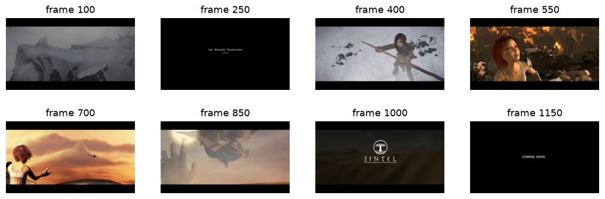
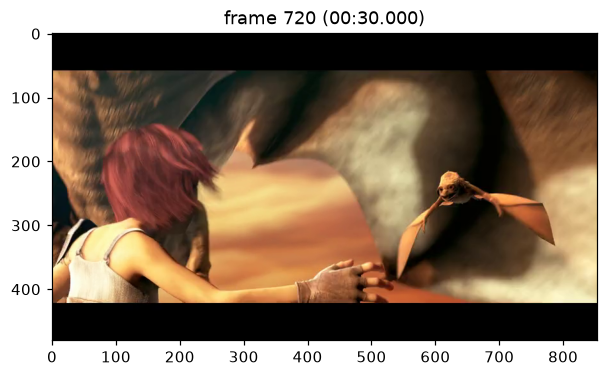
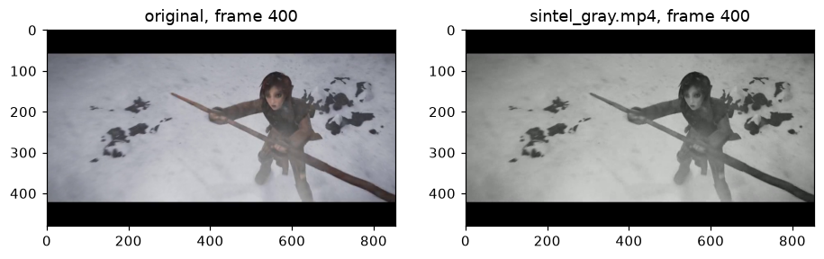

# ビデオの基本操作 {#sec-video}

第3章では、1枚の画像が数値の配列であることを学びました。
映像は、その配列が時間の順に並んだものです。
この章では、動画ファイルを開き、フレームを1枚ずつ取り出して処理し、結果を保存するまでの一連の操作を身につけます。

映像の分析は、どのような内容であっても、「動画を開く → フレームを順に読む → 各フレームから数値を計算する → 動画を閉じる」という同じ形をしています。
この章でその「定型」を一度しっかり作っておけば、第5章以降は「各フレームから何を計算するか」だけに集中できます。

::: {.callout-note title="この章のゴール"}
動画のフレームを順に処理して、結果を画像や動画として保存できるようになります。
章の最後には、本書を通して使う共通の関数を `videotools.py` というファイルにまとめ、それを使って予告編の全体を見渡す図を作ります（@fig-ch04-frame-strip）。
:::

{#fig-ch04-frame-strip width=100%}

新しいノートブック `ch04.ipynb` を作り、カーネルに `.venv` を選んでください。
最初のセルで、この章で使うライブラリを読み込みます。

```python
import os
import time

import cv2
import matplotlib.pyplot as plt
import numpy as np
```

`os` は、フォルダを作ったり、ファイルの大きさを調べたりするための、Pythonの標準ライブラリです。

## `VideoCapture`で動画を開く {#sec-ch04-open}

動画ファイルを開くには、`cv2.VideoCapture` を使います。
第2章で一度使いましたが、あらためて確認します。

```python
path = "data/sintel_trailer-480p.mp4"
cap = cv2.VideoCapture(path)

print(cap.isOpened())
```

```{.default}
True
```

ファイルの場所を、`path` という変数に入れておきました。
この章では同じ動画を何度も開くので、毎回ファイル名を書かずに済むようにするためです。

`cv2.VideoCapture(path)` が返す `cap` は、動画そのもの（すべてのフレーム）ではありません。
動画ファイルへの「窓口」にあたるものです。
この窓口を通して、動画の情報を尋ねたり、フレームを1枚ずつ受け取ったりします。
開いた時点では、フレームはまだ1枚も読み込まれていません。

`cap.isOpened()` は、ファイルを正しく開けたかどうかを返します。
存在しないファイルを指定すると、どうなるでしょうか。

```python
bad = cv2.VideoCapture("data/sintel.mp4")

print(bad.isOpened())
print(bad.read())
```

```{.default}
False
(False, None)
```

エラーにはならず、`isOpened()` が `False` を返すだけです。
そのままフレームを読もうとしても、やはりエラーにはならず、「失敗」を表す `False` と、画像の代わりの `None` が返ってきます。
第3章の `cv2.imread` と同じく、OpenCVは**失敗しても黙っている**ことが多いのです。
動画を開いたら `isOpened()` を確かめる習慣をつけてください。
この確認を自動で行う関数を、章の最後に作ります。

使い終わった窓口は、`release()` で閉じます。

```python
bad.release()
```

## 映像プロパティを調べる——解像度、フレームレート、総フレーム数 {#sec-ch04-props}

### 基本の4つのプロパティ

動画の大きさやフレーム数などの情報を**プロパティ**と呼び、`cap.get` で取得します。

```python
width = int(cap.get(cv2.CAP_PROP_FRAME_WIDTH))
height = int(cap.get(cv2.CAP_PROP_FRAME_HEIGHT))
fps = cap.get(cv2.CAP_PROP_FPS)
frame_count = int(cap.get(cv2.CAP_PROP_FRAME_COUNT))

print(width, height, fps, frame_count)
```

```{.default}
854 480 24.0 1253
```

`cap.get` には、知りたいプロパティの種類を、`cv2.CAP_PROP_` で始まる名前で指定します。
本書でよく使うものを @tbl-ch04-props にまとめます。

| 名前 | 意味 | この映像での値 |
|---|---|---|
| `cv2.CAP_PROP_FRAME_WIDTH` | フレームの横の画素数 | 854 |
| `cv2.CAP_PROP_FRAME_HEIGHT` | フレームの縦の画素数 | 480 |
| `cv2.CAP_PROP_FPS` | フレームレート（1秒あたりのフレーム数） | 24.0 |
| `cv2.CAP_PROP_FRAME_COUNT` | 総フレーム数 | 1253 |
| `cv2.CAP_PROP_POS_FRAMES` | 次に読むフレームの番号 | （読むたびに変わる） |

: 本書でよく使う映像プロパティ {#tbl-ch04-props}

横と縦の画素数の組を**解像度**と呼びます。
この映像の解像度は854×480です。

`cap.get` は、どのプロパティも小数の形で返します。

```python
print(cap.get(cv2.CAP_PROP_FRAME_WIDTH))
```

```{.default}
854.0
```

画素数やフレーム数は整数ですから、上のコードでは `int()` で整数に変換しました。
フレームレートは、映像によっては29.97のような小数になるので、小数のまま扱います。

### 再生時間を求める

総フレーム数をフレームレートで割ると、再生時間（秒）が得られます。

```python
duration = frame_count / fps

print(duration)
```

```{.default}
52.208333333333336
```

1253枚のフレームを、1秒あたり24枚の速さで表示するので、約52.2秒です。

::: {.callout-warning title="総フレーム数は「目安」として扱う"}
`CAP_PROP_FRAME_COUNT` の値は、フレームを実際に数えた結果ではなく、動画ファイルに記録されている情報をもとにした値です。
そのため、動画ファイルによっては、実際に読み込めるフレームの数と一致しないことがあります。
次の節で、この映像について実際に数えて確かめます。
:::

## フレームを1枚ずつ読むループ {#sec-ch04-loop}

### `read()` は「次の1枚」を返す

フレームを読み込むには `cap.read()` を使います。
その動きを理解するために、`CAP_PROP_POS_FRAMES` というプロパティを見てみます。
これは「次に読むフレームの番号」を表します。

```python
print(cap.get(cv2.CAP_PROP_POS_FRAMES))
```

```{.default}
0.0
```

開いた直後は0、つまり先頭のフレームを指しています。
フレームの番号は、配列の位置と同じく0から数えます。
フレームを2回読んで、この値の変化を調べます。

```python
ok, frame = cap.read()
print(ok, frame.shape, cap.get(cv2.CAP_PROP_POS_FRAMES))

ok, frame = cap.read()
print(ok, frame.shape, cap.get(cv2.CAP_PROP_POS_FRAMES))
```

```{.default}
True (480, 854, 3) 1.0
True (480, 854, 3) 2.0
```

`read()` を呼ぶたびに、「次に読む位置」が1つずつ進んでいます。
`cap` は、ビデオテープの再生ヘッドのように、現在の位置を覚えています（@fig-ch04-pointer）。
`read()` は、その位置のフレームを1枚返し、位置を1つ進める、という命令です。

::: {#fig-ch04-pointer}

```{=html}
<svg viewBox="0 0 760 190" role="img" aria-label="フレームが番号0から1252まで横一列に並んでいる。capは次に読む位置を覚えており、read()を呼ぶたびにその位置のフレームを返して、位置を1つ右へ進める。最後のフレームの次ではokがFalseになる。" style="width:100%;height:auto;font-family:inherit" fill="currentColor">
  <g stroke="currentColor" stroke-width="1.5">
    <rect x="40" y="40" width="70" height="50" fill="currentColor" fill-opacity="0.18"/>
    <rect x="110" y="40" width="70" height="50" fill="currentColor" fill-opacity="0.18"/>
    <rect x="180" y="40" width="70" height="50" fill="#d99a2b" fill-opacity="0.35"/>
    <rect x="250" y="40" width="70" height="50" fill="none"/>
    <rect x="320" y="40" width="70" height="50" fill="none"/>
    <rect x="500" y="40" width="70" height="50" fill="none"/>
    <rect x="570" y="40" width="70" height="50" fill="none"/>
  </g>
  <rect x="640" y="40" width="70" height="50" fill="none" stroke="currentColor" stroke-width="1.5" stroke-dasharray="5 4" stroke-opacity="0.6"/>
  <text x="75" y="71" font-size="15" text-anchor="middle">0</text>
  <text x="145" y="71" font-size="15" text-anchor="middle">1</text>
  <text x="215" y="71" font-size="15" font-weight="700" text-anchor="middle">2</text>
  <text x="285" y="71" font-size="15" text-anchor="middle">3</text>
  <text x="355" y="71" font-size="15" text-anchor="middle">4</text>
  <text x="445" y="71" font-size="18" text-anchor="middle">…</text>
  <text x="535" y="71" font-size="15" text-anchor="middle">1251</text>
  <text x="605" y="71" font-size="15" text-anchor="middle">1252</text>
  <text x="675" y="71" font-size="13" text-anchor="middle" fill-opacity="0.75">なし</text>
  <text x="75" y="28" font-size="12" text-anchor="middle" fill-opacity="0.75">読んだ</text>
  <text x="145" y="28" font-size="12" text-anchor="middle" fill-opacity="0.75">読んだ</text>
  <text x="675" y="28" font-size="12" text-anchor="middle" fill-opacity="0.75">ok が False</text>
  <path d="M215 96 l-8 14 l16 0z"/>
  <line x1="215" y1="108" x2="215" y2="128" stroke="currentColor" stroke-width="1.8"/>
  <text x="215" y="148" font-size="14" font-weight="700" text-anchor="middle">次に読む位置</text>
  <text x="215" y="168" font-size="12" text-anchor="middle" fill-opacity="0.75">CAP_PROP_POS_FRAMES = 2</text>
  <line x1="300" y1="118" x2="400" y2="118" stroke="currentColor" stroke-width="1.8"/>
  <path d="M412 118 l-14 -7 l0 14z"/>
  <text x="424" y="123" font-size="13">read() を呼ぶたびに、1つ右へ進む</text>
</svg>
```

`cap` は「次に読む位置」を覚えています。`read()` は、その位置のフレームを返して、位置を1つ進めます。
:::

### 最後まで読むループ

`read()` を繰り返し呼べば、すべてのフレームを順に受け取れます。
では、いつ止めればよいのでしょうか。
`read()` が返す1つ目の値 `ok` は、読み込みに成功したかどうかを表します。
最後のフレームを読み終えたあとで `read()` を呼ぶと、`ok` が `False` になります。
これを終了の合図にします。

位置を先頭に戻すために動画を開き直してから、最後まで読んで、フレームを数えてみます。

```python
cap.release()
cap = cv2.VideoCapture(path)

n = 0
while True:
    ok, frame = cap.read()
    if not ok:
        break
    n += 1

print(n)
```

```{.default}
1253
```

これが、本書でもっともよく使う**読み込みループ**の基本形です。
1行ずつ確認します。

- `while True:` は、「ずっと繰り返す」という意味です。繰り返しの回数を決めずに始めて、止める条件はループの中に書きます。
- `ok, frame = cap.read()` で、次のフレームを読みます。
- `if not ok:` は、読み込みに失敗した場合、つまりもうフレームが残っていない場合です。`break` で繰り返しを抜けます。
- `n += 1` で、読めたフレームを数えています。

実際に読めたフレームは1253枚でした。
`CAP_PROP_FRAME_COUNT` の値と一致しています。

::: {.callout-note title="この映像では一致しましたが、保証はされません"}
ここで確かめられたのは、「この動画ファイルを、この環境で読んだ場合には一致した」ということです。
前の節で述べたとおり、動画ファイルによっては、`CAP_PROP_FRAME_COUNT` の値と、実際に読めるフレームの数がずれることがあります。

そのため本書では、繰り返しの回数を `for i in range(frame_count):` のように総フレーム数で決めるのではなく、**`ok` が `False` になるまで読む**書き方を使います。
この書き方なら、総フレーム数の値が不正確でも、読めるフレームをすべて、過不足なく処理できます。
:::

読み終えたあとの状態も見ておきます。

```python
ok, frame = cap.read()

print(ok, frame)
print(cap.get(cv2.CAP_PROP_POS_FRAMES))
```

```{.default}
False None
1253.0
```

何度 `read()` を呼んでも、`False` と `None` が返るだけです。
位置は自動では先頭に戻りません。
もう一度最初から読みたいときは、動画を開き直します。

```python
cap.release()
```

### ループの中で計算する

読み込みループの中に計算を書けば、すべてのフレームに同じ処理を行えます。
例として、各フレームをグレースケールに変換し、その平均を記録してみます。
全体にかかる時間も測ります。

```python
cap = cv2.VideoCapture(path)

means = []
start = time.perf_counter()
while True:
    ok, frame = cap.read()
    if not ok:
        break
    gray = cv2.cvtColor(frame, cv2.COLOR_BGR2GRAY)
    means.append(gray.mean())
elapsed = time.perf_counter() - start

cap.release()

print(len(means))
print(f"{elapsed:.2f} s")
```

```{.default}
1253
1.55 s
```

`means` は、最初は空のリストです。
ループの中で、フレームごとの平均を `append` で1つずつ追加していきます。
ループが終わると、1253個の数値が入ったリストができあがります。

```python
print(means[0], means[400])
```

```{.default}
0.0 118.0670106362217
```

先頭のフレームは真っ黒なので0.0、400番目のフレームは約118.07です。
400番目の値は、第3章で `frame400.png` から求めたグレースケールの平均と一致しています。

「動画を開く → `ok` が `False` になるまで読む → フレームごとに計算してリストに追加する → 閉じる」。
映像から数値を取り出す処理は、すべてこの形をしています。
第5章では、ここで作ったような数値の列をグラフにして、映像全体の明るさの移り変わりを調べます。

::: {.callout-warning title="すべてのフレームをリストにためない"}
上のコードでリストに追加したのは、フレームごとに1つの**数値**です。
フレームの**画像そのもの**を、すべてリストに追加してはいけません。
この映像の1フレームは約1.2MBですから、1253枚で約1.5GBのメモリが必要になります。
長い映像では、パソコンのメモリを使い切ってしまいます。
フレームは、読んだらその場で必要な数値を計算し、画像そのものは次のフレームで上書きして捨てていくのが原則です。
:::

## 指定したフレームへ移動する——フレーム番号と時刻の対応 {#sec-ch04-seek}

### 読む位置を移動する

映像の途中にある特定のフレームだけを見たいときは、「次に読む位置」を直接書き換えます。
この操作を**シーク**と呼びます。
プロパティの値を設定するには、`cap.set` を使います。

```python
cap = cv2.VideoCapture(path)
cap.set(cv2.CAP_PROP_POS_FRAMES, 400)

print(cap.get(cv2.CAP_PROP_POS_FRAMES))
```

```{.default}
400.0
```

位置が400になりました。
この状態で `read()` を呼ぶと、400番目のフレームが返ってきて、位置は401に進みます。

```python
ok, frame = cap.read()

print(ok, cap.get(cv2.CAP_PROP_POS_FRAMES))
```

```{.default}
True 401.0
```

本当に400番目のフレームが読めたのかを確かめましょう。
前の節で、先頭から順に読んで求めた `means[400]` と比べます。

```python
gray = cv2.cvtColor(frame, cv2.COLOR_BGR2GRAY)

print(gray.mean(), means[400])
```

```{.default}
118.0670106362217 118.0670106362217
```

同じ値になりました。

### フレーム番号と時刻を換算する

映像の中の位置は、フレーム番号でも、時刻（先頭からの秒数）でも表せます。
両者の関係は単純です。
$n$ をフレーム番号、$t$ を時刻（秒）、$f$ をフレームレートとすると、次のようになります。

$$
t = \frac{n}{f}, \qquad n = t \times f
$$

1秒あたり $f$ 枚のフレームがあるので、フレーム番号をフレームレートで割れば秒数に、秒数にフレームレートを掛ければフレーム番号になります。

```python
n = 400
t = n / fps

print(t)
```

```{.default}
16.666666666666668
```

400番目のフレームは、開始から約16.7秒の位置にあります。
正確には、この値は、そのフレームが表示され**始める**時刻です。
先頭のフレーム（0番目）の時刻は0秒です。

逆に、時刻からフレーム番号を求めます。

```python
t = 30.0
n = round(t * fps)

print(n)
```

```{.default}
720
```

開始から30秒の位置は、720番目のフレームです。
フレーム番号は整数でなければなりませんので、`round` で四捨五入しています。

時刻は、「分:秒」の形で表したほうが読みやすくなります。
フレーム番号をその形の文字列に変換する関数を作っておきます。

```python
def timecode(n, fps):
    seconds = n / fps
    minutes = int(seconds // 60)
    return f"{minutes:02d}:{seconds - minutes * 60:06.3f}"

print(timecode(400, fps))
print(timecode(1252, fps))
```

```{.default}
00:16.667
00:52.167
```

`seconds // 60` は、秒数を60で割った商の整数部分、つまり「分」です。
`f"{minutes:02d}"` は、整数を2桁で、足りない桁を0で埋めて表示する書き方です。
`:06.3f` は、小数点以下3桁、全体で6文字、足りない桁を0で埋める、という指定です。
最後のフレーム（1252番目）が表示され始めるのは、52.167秒の時点です。

30秒の位置のフレームを表示してみます。

```python
cap.set(cv2.CAP_PROP_POS_FRAMES, round(30.0 * fps))
ok, frame = cap.read()

plt.imshow(cv2.cvtColor(frame, cv2.COLOR_BGR2RGB))
plt.title("frame 720 (00:30.000)")
plt.show()
```

{#fig-ch04-frame-720 width=70%}

総フレーム数以上の番号を指定した場合は、読み込みに失敗します。

```python
cap.set(cv2.CAP_PROP_POS_FRAMES, frame_count)
ok, frame = cap.read()

print(ok, frame)
```

```{.default}
False None
```

フレーム番号は0から数えるので、最後のフレームは1252番目です。
1253番目のフレームは存在しません。

### 注意：シークは正確とはかぎらない {#sec-ch04-seek-accuracy}

シークは便利ですが、1つ注意があります。
`cap.set(cv2.CAP_PROP_POS_FRAMES, n)` で移動して読んだフレームが、**本当に $n$ 番目のフレームであるとはかぎらない**のです。

これは、動画の圧縮のしくみに原因があります。
動画ファイルは、すべてのフレームを独立した画像として記録しているわけではありません。
多くのフレームは、「前後のフレームとの違い」だけを記録することで、データの量を減らしています。
単独で画像に戻せるフレームは、数十枚から数百枚に1枚の割合でしか含まれていません。
このフレームを**キーフレーム**と呼びます。

途中のフレームを取り出すには、手前のキーフレームまで戻り、そこから目的のフレームまで順に復元していく必要があります。
この処理が、動画の形式やOpenCVが内部で使う読み込み機能の組み合わせによっては、正確に行われないことがあります。
その場合、指定した番号から数フレームずれた画像が返ってきます。
しかも、エラーにはなりません。

Sintelの予告編では、どうでしょうか。
「シークして読んだフレーム」と「先頭から順に読んだフレーム」が同じ画像かどうかを、実際に比べてみます。
まず、先頭から順に読みながら、50フレームおきに画像を取っておきます。

```python
cap.release()
cap = cv2.VideoCapture(path)

kept = {}
n = 0
while True:
    ok, frame = cap.read()
    if not ok:
        break
    if n % 50 == 0:
        kept[n] = frame
    n += 1

print(len(kept))
```

```{.default}
26
```

`kept` は辞書で、フレーム番号をキーにして画像を記録しています。
`n % 50` は、`n` を50で割った余りです。
余りが0のとき、つまり番号が0、50、100、…のフレームだけを取っておきます。
全部で26枚ですから、メモリの心配はありません。

次に、同じ番号のフレームをシークで読み、取っておいた画像と比べます。
あえて後ろのフレームから順に、逆向きに移動してみます。

```python
mismatch = []
for n in sorted(kept, reverse=True):
    cap.set(cv2.CAP_PROP_POS_FRAMES, n)
    ok, frame = cap.read()
    if not ok or not np.array_equal(frame, kept[n]):
        mismatch.append(n)

cap.release()

print(mismatch)
```

```{.default}
[]
```

`mismatch` は、一致しなかったフレームの番号を記録するリストです。
結果は空で、26枚すべてが、画素の値まで完全に一致しました。
筆者の環境では、1253枚のすべてのフレームについても同じ確認を行い、すべて一致することを確かめています。

::: {.callout-important title="シークの結果は、映像ごとに確かめる"}
この映像では、シークは正確でした。
しかし、これは「この動画ファイルを、この環境で読んだ場合」の結果であって、ほかの映像でも正確だという保証はありません。

本書では、次の方針をとります。

- 映像全体を分析するときは、シークを使わず、**先頭から順に読みます**。順に読むかぎり、フレームがずれることはありません。
- 特定のフレームを1枚だけ見たいときも、正確さが必要な場面では、先頭から順に数えて取り出します。そのための関数を @sec-ch04-videotools で作ります。
- 自分の映像でシークを使いたいときは、上のコードで、順に読んだ結果と一致することを確かめてから使います。
:::

## フレームを画像として保存する {#sec-ch04-imwrite}

### 1枚を保存する

取り出したフレームを画像ファイルとして保存するには、第3章でも使った `cv2.imwrite` を使います。
保存先として、プロジェクトフォルダの中に `out` というフォルダを作ります。

```python
os.makedirs("out", exist_ok=True)

frame = kept[400]
print(cv2.imwrite("out/frame_0400.png", frame))
```

```{.default}
True
```

`os.makedirs` は、フォルダを作る命令です。
`exist_ok=True` を付けると、フォルダがすでにある場合に何もせず、エラーにもなりません。
セルを何度実行しても問題が起きないようにするための指定です。

`cv2.imwrite` には、BGRの順のままの画像を渡します。
RGBに変換する必要はありません。
変換が必要なのは、Matplotlibで表示するときだけです。

::: {.callout-warning title="保存先のフォルダがないと、黙って失敗する"}
`cv2.imwrite` は、保存先のフォルダが存在しないときも、エラーになりません。
`False` を返すだけで、ファイルは作られません。

```python
print(cv2.imwrite("outputs/frame_0400.png", frame))
```

```{.default}
False
```

フォルダ名を `outputs` と書き間違えた例です。
たくさんのフレームを保存する処理を書いたのに、フォルダを開いたら何もなかった、という失敗の原因はたいていこれです。
:::

### PNGとJPEG

保存する画像の形式は、ファイル名の拡張子で決まります。
同じフレームを、JPEG形式でも保存してみます。

```python
print(cv2.imwrite("out/frame_0400.jpg", frame))

print(os.path.getsize("out/frame_0400.png"))
print(os.path.getsize("out/frame_0400.jpg"))
```

```{.default}
True
293065
64504
```

`os.path.getsize` は、ファイルの大きさをバイト単位で返します。
PNGは約293KB、JPEGは約65KBで、JPEGのほうが4分の1以下の大きさです。

この差は、圧縮の方法の違いによるものです。
保存したファイルを読み直して、元の画像と比べてみます。

```python
png = cv2.imread("out/frame_0400.png")
jpg = cv2.imread("out/frame_0400.jpg")

print(np.array_equal(png, frame))
print(np.array_equal(jpg, frame))
```

```{.default}
True
False
```

PNGは、読み直すと元の画像と完全に一致します。
このような、元のデータを完全に復元できる圧縮を**可逆圧縮**と呼びます。
JPEGは一致しません。
JPEGは、人間の目には違いがわかりにくい範囲で画素の値を変えることで、ファイルを小さくしています。
こちらは**非可逆圧縮**と呼びます。

どのくらい変わったのかを調べます。

```python
diff = cv2.absdiff(jpg, frame)

print(diff.max(), diff.mean())
```

```{.default}
10 0.4674172196200885
```

画素値の差は、最大で10、平均では約0.47でした。
目で見てわかる違いではありませんが、数値としては変わっています。

本書では、次のように使い分けます。

- あとで数値の計算に使う画像は、**PNG**で保存します。保存によって値が変わらないためです。
- 目で見て確認するための画像を大量に保存するときは、**JPEG**でかまいません。

### 一定の間隔でフレームを保存する

読み込みループと組み合わせて、100フレームおきに画像を保存してみます。
ファイル名には、フレーム番号を入れておきます。

```python
for n in [0, 50, 400, 1250]:
    print(f"out/frame_{n:04d}.png")
```

```{.default}
out/frame_0000.png
out/frame_0050.png
out/frame_0400.png
out/frame_1250.png
```

`{n:04d}` は、整数を4桁で、足りない桁を0で埋めて表示する書き方です。
桁数をそろえておくと、エクスプローラーでファイル名の順に並べたときに、フレームの順番どおりに並びます。
桁をそろえないと、`frame_1000.png` が `frame_200.png` より前に並んでしまいます。

では、保存します。

```python
cap = cv2.VideoCapture(path)

n = 0
saved = 0
while True:
    ok, frame = cap.read()
    if not ok:
        break
    if n % 100 == 0:
        cv2.imwrite(f"out/frame_{n:04d}.png", frame)
        saved += 1
    n += 1

cap.release()

print(saved)
```

```{.default}
13
```

13枚の画像が保存されました。
`out` フォルダをエクスプローラーで開くと、予告編のおおまかな流れを、画像の一覧として眺めることができます。

## 処理した映像を動画として書き出す（`VideoWriter`） {#sec-ch04-writer}

### 書き出しの準備

処理したフレームを、画像ではなく動画として保存したいこともあります。
処理の結果を、動きのある映像として確かめたい場合などです。
動画の書き出しには `cv2.VideoWriter` を使います。
例として、予告編の全体をグレースケールに変換した動画を作ります。

```python
fourcc = cv2.VideoWriter_fourcc(*"mp4v")
writer = cv2.VideoWriter("out/sintel_gray.mp4", fourcc, fps, (width, height))

print(writer.isOpened())
```

```{.default}
True
```

`cv2.VideoWriter` には、4つのものを指定します。

1. **保存先のファイル名**。拡張子は `.mp4` にします。
2. **圧縮方式の指定**。動画を圧縮する方式を**コーデック**と呼びます。OpenCVでは、コーデックを**FourCC**と呼ばれる4文字の記号で指定します。`"mp4v"` は、MPEG-4という方式を表す記号です。`cv2.VideoWriter_fourcc(*"mp4v")` は、この4文字を、OpenCVが受け取れる形に変換しています（`*` は、文字列を1文字ずつに分けて渡すための書き方です）。
3. **フレームレート**。元の映像と同じ値にします。違う値にすると、再生の速さが変わってしまいます。
4. **フレームの大きさ**。**（横, 縦）の順**で指定します。

読み込みのときと同じく、`isOpened()` で準備ができたかどうかを確かめます。

::: {.callout-warning title="大きさは（横, 縦）の順"}
配列の形は（縦, 横）の順でしたが、`VideoWriter` に渡す大きさは（横, 縦）の順です。
第3章で見た「OpenCVの関数に点や大きさを渡すときは、横が先」という規則が、ここでも当てはまります。
`frame.shape` の値をそのままの順番で渡さないように注意してください。
:::

### フレームを書き込む

読み込みループの中で、フレームをグレースケールに変換し、`writer.write` で1枚ずつ書き込みます。

```python
cap = cv2.VideoCapture(path)

while True:
    ok, frame = cap.read()
    if not ok:
        break
    gray = cv2.cvtColor(frame, cv2.COLOR_BGR2GRAY)
    out = cv2.cvtColor(gray, cv2.COLOR_GRAY2BGR)
    writer.write(out)

cap.release()
writer.release()
```

最後に `writer.release()` を呼ぶことを忘れないでください。
この命令で、書き込みが完了し、ファイルが閉じられます。
忘れると、再生できない壊れたファイルになることがあります。

ループの中で、グレースケールに変換した `gray` を、`cv2.COLOR_GRAY2BGR` でもう一度変換している点に注目してください。

```python
print(gray.shape, out.shape)
print(out[240, 400])
```

```{.default}
(480, 854) (480, 854, 3)
[0 0 0]
```

上で用意した `writer` は、3チャンネルのカラー画像を受け取る設定になっています。
そこで、1チャンネルの `gray` を、3チャンネルの `out` に変換してから渡しています。
`cv2.COLOR_GRAY2BGR` は、グレースケールの値を、B・G・Rの3つにそのまま複製します。
3つの値が同じですから、見た目は白黒のままです。
最後に読んだフレームは真っ黒なので、3つの値はすべて0になっています。

::: {.callout-warning title="大きさやチャンネル数が合わないフレームは、書き込まれない"}
`writer.write` は、用意したときの設定と合わないフレームを渡されても、エラーで止まりません。
そのフレームを書き込まないだけです。
試しに、大きさの縦と横を逆に指定してみます。

```python
writer = cv2.VideoWriter("out/wrong.mp4", fourcc, fps, (height, width))
print(writer.isOpened())

writer.write(kept[400])
writer.release()

print(os.path.getsize("out/wrong.mp4"))
```

```{.default}
True
257
```

`isOpened()` は `True` で、ファイルも作られますが、大きさは257バイトしかありません。
フレームが1枚も入っていない、再生できないファイルです。
このとき `Failed to write frame` という警告が表示されることがありますが、処理は止まりません。
書き出した動画が再生できないときは、まず、フレームの大きさとチャンネル数を確認してください。
:::

### 書き出した動画を確かめる

書き出した動画を、今度は読み込む側から調べます。

```python
cap = cv2.VideoCapture("out/sintel_gray.mp4")

print(cap.isOpened())
print(cap.get(cv2.CAP_PROP_FRAME_WIDTH), cap.get(cv2.CAP_PROP_FRAME_HEIGHT))
print(cap.get(cv2.CAP_PROP_FPS), cap.get(cv2.CAP_PROP_FRAME_COUNT))
```

```{.default}
True
854.0 480.0
24.0 1253.0
```

解像度、フレームレート、総フレーム数のいずれも、元の映像と同じです。
400番目のフレームを取り出して、元のフレームと並べてみます。

```python
cap.set(cv2.CAP_PROP_POS_FRAMES, 400)
ok, written = cap.read()
cap.release()

fig, axes = plt.subplots(1, 2, figsize=(10, 3.2))
axes[0].imshow(cv2.cvtColor(kept[400], cv2.COLOR_BGR2RGB))
axes[0].set_title("original, frame 400")
axes[1].imshow(cv2.cvtColor(written, cv2.COLOR_BGR2RGB))
axes[1].set_title("sintel_gray.mp4, frame 400")
plt.show()
```

{#fig-ch04-gray-video width=100%}

グレースケールの動画ができています。
`out` フォルダの `sintel_gray.mp4` をダブルクリックして、再生してみてください。

この動画について、知っておくべきことが3つあります。

**1. 画素の値は、書き込んだものと完全には一致しません。**
動画の圧縮は、JPEGと同じ非可逆圧縮です。

```python
gray400 = cv2.cvtColor(kept[400], cv2.COLOR_BGR2GRAY)
diff = cv2.absdiff(written[:, :, 0], gray400)

print(diff.max(), diff.mean())
```

```{.default}
22 3.1112314597970334
```

書き込んだグレースケールの画像と、動画から読み直した画像とでは、画素値が最大で22、平均で約3.1ずれていました。
書き出した動画は、目で見て確認するためのものと考えてください。
数値の分析は、書き出した動画ではなく、**元の映像に対して行う**のが原則です。

**2. 音声は含まれません。**
OpenCVが扱うのは映像だけです。
元の予告編には音声がありますが、書き出した動画は無音になります。

**3. ファイルの大きさは、元の映像より小さくなるとはかぎりません。**

```python
print(os.path.getsize(path))
print(os.path.getsize("out/sintel_gray.mp4"))
```

```{.default}
4372373
8136819
```

色の情報を捨て、音声もなくなったのに、ファイルは元の約4.4MBから約8.1MBへと、かえって大きくなりました。
元の映像はH.264という効率のよい方式で圧縮されていますが、ここで使った `mp4v` は、それより古い、効率の低い方式だからです。

::: {.callout-note title="ほかのFourCCについて"}
H.264で書き出すための `"avc1"` というFourCCもあります。
ただし、使えるコーデックはOpenCVの入れ方や環境によって異なり、筆者の環境では `"avc1"` を指定すると `isOpened()` が `False` になりました。
`"mp4v"` と拡張子 `.mp4` の組み合わせは、追加の準備なしに使えることが多いため、本書ではこれを使います。
より小さく、より互換性の高い動画が必要なときは、付録で紹介するFFmpegで変換するのが確実です。
:::

::: {.callout-tip title="1チャンネルのまま書き込む方法"}
`cv2.VideoWriter` の最後に `isColor=False` を付け加えると、1チャンネルのグレースケール画像をそのまま受け取る設定になります。

```python
writer = cv2.VideoWriter("out/test_gray.mp4", fourcc, fps, (width, height), isColor=False)
print(writer.isOpened())

for i in range(24):
    writer.write(gray400)
writer.release()

cap = cv2.VideoCapture("out/test_gray.mp4")
print(cap.get(cv2.CAP_PROP_FRAME_COUNT))
cap.release()
```

```{.default}
True
24.0
```

同じフレームを24回書き込んで、24フレーム（1秒）の動画ができました。
本書では、設定をカラーに統一しておくほうが間違いが少ないので、`cv2.COLOR_GRAY2BGR` で3チャンネルに変換してから書き込む方法を使います。
:::

## フレームを間引く・縮小する——処理時間との付き合い方 {#sec-ch04-speed}

### 処理時間を見積もる

@sec-ch04-loop では、1253枚のフレームを読んでグレースケールの平均を求めるのに、1〜2秒ほどかかりました。
52秒の映像なら、気にならない時間です。
しかし、映像が長くなり、解像度が高くなり、計算が複雑になると、処理時間は急速に増えていきます。
数分で済むはずの分析に何時間もかかる、ということが実際に起こります。

処理時間を減らす基本的な方法は2つです。

- **間引く**：すべてのフレームではなく、数枚に1枚だけを処理する。
- **縮小する**：フレームを小さくしてから処理する。

どちらも、結果の精密さと引き換えに時間を節約する方法です。
どのくらい時間が減り、結果がどのくらい変わるのかを、実際に測って確かめます。

### フレームを間引く

同じ処理を条件を変えて繰り返すので、関数にまとめておきます。
`step` 枚に1枚の割合で、グレースケールの平均を求める関数です。

```python
def brightness_every(path, step):
    cap = cv2.VideoCapture(path)
    values = []
    n = 0
    while True:
        ok, frame = cap.read()
        if not ok:
            break
        if n % step == 0:
            gray = cv2.cvtColor(frame, cv2.COLOR_BGR2GRAY)
            values.append(gray.mean())
        n += 1
    cap.release()
    return values
```

@sec-ch04-imwrite で100フレームおきに保存したときと同じ形です。
フレームはすべて読みますが、計算するのは、番号を `step` で割った余りが0のフレームだけです。

すべてのフレームを処理した場合（`step` が1）と、5枚に1枚だけ処理した場合（`step` が5）の時間を測ります。

```python
start = time.perf_counter()
values_1 = brightness_every(path, 1)
time_1 = time.perf_counter() - start

start = time.perf_counter()
values_5 = brightness_every(path, 5)
time_5 = time.perf_counter() - start

print(len(values_1), f"{time_1:.2f} s")
print(len(values_5), f"{time_5:.2f} s")
```

```{.default}
1253 1.13 s
251 1.09 s
```

計算するフレームを1253枚から251枚へと5分の1に減らしたのに、時間はわずかしか短くなっていません。
なお、同じ処理でも、かかる時間は実行のたびに数割ほど変わります。
ここでは細かい数字ではなく、5分の1にはほど遠いという点に注目してください。

時間が減らない理由は、グレースケール化と平均の計算が、もともと軽い処理だからです。
時間の大半は、`cap.read()` でフレームを読み込むところ、つまり圧縮された動画を画像に戻す処理に使われています。
この処理を**デコード**と呼びます。
上の関数は、計算しないフレームも `cap.read()` で読んでいるので、デコードの時間は減っていません。

この時間をもとに、2時間の映画を処理する時間を見積もってみます。

```python
frames_2h = 2 * 60 * 60 * 24

print(frames_2h)
print(frames_2h * time_1 / len(values_1) / 60)
```

```{.default}
172800
2.6060017233536823
```

24fpsで2時間の映画は、172800フレームです。
1フレームあたりの時間が同じだとすると、すべてのフレームを読んで平均を求めるだけで、約2.6分かかる計算になります。
これは854×480という小さな解像度での値です。
解像度が高ければ、デコードの時間はさらに長くなります。

### 読み飛ばすフレームには `grab()` を使う

使わないフレームを読み飛ばすための、専用の命令があります。
`cap.grab()` です。

`cap.read()` は、内部で2つの仕事をしています。
1つは、動画ファイルから次のフレームのデータを取り出して、位置を1つ進めることです。
もう1つは、そのデータを、私たちが使えるBGRの配列に変換することです。
`cap.grab()` は、前半の仕事だけを行います。
配列を作らないので、そのぶん速く済みます。
戻り値は、成功したかどうかを表す `True` か `False` の1つだけです。

計算しないフレームでは `grab()` を使うように、関数を書き換えます。

```python
def brightness_every_grab(path, step):
    cap = cv2.VideoCapture(path)
    values = []
    n = 0
    while True:
        if n % step == 0:
            ok, frame = cap.read()
            if not ok:
                break
            gray = cv2.cvtColor(frame, cv2.COLOR_BGR2GRAY)
            values.append(gray.mean())
        else:
            if not cap.grab():
                break
        n += 1
    cap.release()
    return values
```

処理するフレームでは `read()` を、それ以外のフレームでは `grab()` を呼んでいます。
どちらの場合も、失敗したら（映像の終わりに達したら）ループを抜けます。

```python
start = time.perf_counter()
values_5g = brightness_every_grab(path, 5)
time_5g = time.perf_counter() - start

print(len(values_5g), f"{time_5g:.2f} s")
print(values_5g == values_5)
```

```{.default}
251 0.71 s
True
```

時間が短くなりました。
2行目の `True` は、得られた251個の値が、`read()` で読み飛ばした場合とまったく同じであることを示しています。
`grab()` で読み飛ばしても、フレームがずれることはありません。

それでも、時間は5分の1にはなっていません。
`grab()` で読み飛ばすフレームについても、動画ファイルからデータを取り出す仕事は残るためです。
前の節で説明したとおり、多くのフレームは前後のフレームとの違いとして記録されているので、途中のフレームを完全に無視して先へ進むことはできません。

### 間引くと結果はどう変わるか

間引きによって、得られる結果はどのくらい変わるのでしょうか。
映像全体の明るさの平均を、間引く前と後で比べます。

```python
print(np.mean(values_1))
print(np.mean(values_5))
```

```{.default}
47.01548683238292
46.526057887886395
```

`np.mean` は、リストの平均を求めます。
すべてのフレームを使った場合は約47.0、5枚に1枚の場合は約46.5で、差は0.5ほどです。
さらに粗く、25枚に1枚（ほぼ1秒に1枚）にしてみます。

```python
values_25 = brightness_every_grab(path, 25)

print(len(values_25), np.mean(values_25))
```

```{.default}
51 47.506317158010745
```

51枚のフレームから求めた平均は約47.5で、やはり差は0.5ほどです。
「映像全体の明るさの平均」のような、全体を要約する数値は、かなり間引いても大きくは変わりません。
隣り合うフレームは、たいていよく似ているからです。

ただし、間引いてはいけない分析もあります。
第7章で扱う動きの分析や、第8章で扱うカット点の検出は、**隣り合うフレームどうしの違い**を調べます。
フレームを間引くと、「隣」の意味が変わってしまいます。
間引いてよいかどうかは、何を測りたいかによって決まります。

### フレームを縮小する

もう1つの方法は、フレームを小さくすることです。
画像の大きさを変えるには `cv2.resize` を使います。

```python
frame = kept[400]
small = cv2.resize(frame, None, fx=0.5, fy=0.5, interpolation=cv2.INTER_AREA)

print(frame.shape, small.shape)
print(frame.size, small.size)
```

```{.default}
(480, 854, 3) (240, 427, 3)
1229760 307440
```

`fx` と `fy` は、横と縦の倍率です。
どちらも0.5にしたので、縦横がそれぞれ半分になり、数値の個数は4分の1になりました。
2つ目の `None` は、「大きさを画素数では指定しない」という意味です。

`interpolation=cv2.INTER_AREA` は、縮小の方法の指定です。
`cv2.INTER_AREA` は、元の画像の複数の画素を**平均して**1つの画素にまとめます。
画素を単純に間引く方法に比べて、細かい模様が不自然に崩れにくいので、縮小するときはこの指定を使います。

倍率ではなく、画素数で大きさを指定することもできます。

```python
small2 = cv2.resize(frame, (427, 240), interpolation=cv2.INTER_AREA)

print(small2.shape)
```

```{.default}
(240, 427, 3)
```

ここでも、大きさは**（横, 縦）の順**で指定します。
結果の配列の形は（縦, 横, 色）の順ですから、数字の並びが逆になっています。

縮小しても、平均はほとんど変わりません。

```python
print(frame.mean(), small.mean())
```

```{.default}
119.44672944314338 119.55770556856622
```

### 縮小が効くのは、計算が重いとき

縮小によって時間が減るのは、フレームに対する**計算**の部分です。
デコードの時間は変わりません。
したがって、グレースケールの平均のような軽い計算では、縮小してもほとんど効果がありません。
効果が現れるのは、計算そのものが重い場合です。

重い計算の例として、`cv2.medianBlur` を使ってみます。
これは、それぞれの画素を、周囲の画素の中央値で置き換える処理で、画像のノイズを取り除くために使われます。
本書の分析では使いませんが、1フレームあたりの計算量が多い処理の代表として取り上げます。
元の大きさのフレームと、半分に縮小したフレームで、1回あたりの時間を比べます。

```python
start = time.perf_counter()
for i in range(20):
    result = cv2.medianBlur(frame, 9)
time_full = (time.perf_counter() - start) / 20

start = time.perf_counter()
for i in range(20):
    result_small = cv2.medianBlur(small, 9)
time_small = (time.perf_counter() - start) / 20

print(f"{time_full * 1000:.1f} ms")
print(f"{time_small * 1000:.1f} ms")
print(time_full / time_small)
```

```{.default}
33.4 ms
8.5 ms
3.907499428217457
```

時間の測定は誤差が大きいので、同じ処理を20回繰り返し、その平均を求めています。
`ms` はミリ秒（1000分の1秒）です。
元の大きさでは1フレームあたり約33ミリ秒、半分の大きさでは約8.5ミリ秒でした。
画素の数が4分の1になり、時間もおよそ4分の1になっています。

予告編の全フレームにこの処理を行う場合の時間を見積もります。

```python
print(time_full * frame_count, time_small * frame_count)
```

```{.default}
41.84693725063262 10.709390498803621
```

元の大きさでは約42秒、縮小すれば約11秒です。
デコードにかかる1秒ほどに比べて、はるかに長い時間です。
このような重い計算では、縮小の効果がはっきり現れます。
縮小の処理そのものにかかる時間は、わずかです。

```python
start = time.perf_counter()
for i in range(20):
    small = cv2.resize(frame, None, fx=0.5, fy=0.5, interpolation=cv2.INTER_AREA)
time_resize = (time.perf_counter() - start) / 20

print(f"{time_resize * 1000:.2f} ms")
```

```{.default}
0.15 ms
```

第7章で扱うオプティカルフローは、本書の中でもっとも重い計算です。
そこでは、ここで学んだ縮小が実際に役に立ちます。

処理時間との付き合い方を、次のようにまとめておきます。

- まず短い区間や、粗く間引いた条件で試し、コードが正しく動くことを確かめてから、全体を処理します。
- 時間がかかりすぎるときは、どこに時間がかかっているのかを `time.perf_counter()` で測ります。推測で対策をしないことが大切です。
- 計算が重いなら縮小を、フレーム数が多すぎるなら間引きを検討します。ただし、その分析で間引いたり縮小したりしてよいかを、先に考えます。

## 本書で使う共通の関数をまとめる {#sec-ch04-videotools}

### なぜ関数にまとめるのか

この章では、「動画を開いて、`ok` が `False` になるまで読み、最後に閉じる」というループを、何度も書きました。
第5章以降でも、このループを数十回は使います。
毎回同じコードを書いていると、ノートブックが長くなるだけでなく、`release()` を書き忘れたり、`isOpened()` の確認を省いたりといった間違いが入り込みます。

そこで、繰り返し使う処理を5つの関数にまとめ、`videotools.py` という1つのファイルに保存します。
このように、関数をまとめたファイルを**モジュール**と呼びます。
モジュールにしておけば、どのノートブックからでも `import` して使えます。

作る関数は、@tbl-ch04-videotools の5つです。

| 関数 | 役割 |
|---|---|
| `open_video(path)` | 動画を開く。開けなければエラーにする |
| `video_info(path)` | 解像度、フレームレート、総フレーム数、再生時間をまとめて返す |
| `iter_frames(path, start, stop, step)` | フレームを順に読み、番号と画像を1組ずつ返す |
| `read_frame(path, n)` | $n$ 番目のフレームを1枚だけ返す |
| `show(image, title, ax)` | カラーでもグレースケールでも、正しく表示する |

: `videotools.py` にまとめる関数 {#tbl-ch04-videotools}

まず、ノートブックの上で関数を1つずつ作って動作を確かめ、最後にファイルにまとめます。

### `open_video`：開けなければエラーにする

1つ目は、動画を開く関数です。

```python
def open_video(path):
    """動画ファイルを開く。開けなかった場合はエラーにする。"""
    cap = cv2.VideoCapture(str(path))
    if not cap.isOpened():
        raise FileNotFoundError(f"動画を開けません: {path}")
    return cap
```

`cv2.VideoCapture` との違いは、開けなかったときの動作です。
`raise` は、エラーを自分で発生させる命令です。
`isOpened()` が `False` のときに、「動画を開けません」というメッセージを付けたエラーを発生させて、その場で処理を止めます。

`str(path)` は、渡されたものを文字列に変換しています。
ファイルの場所を、文字列以外の形（Pythonの `pathlib` という機能が作る値）で渡された場合にも動くようにするためです。

使ってみます。

```python
cap = open_video(path)
print(cap.isOpened())
cap.release()
```

```{.default}
True
```

存在しないファイルを指定すると、次のようになります。

```python
cap = open_video("data/sintel.mp4")
```

```{.default}
FileNotFoundError: 動画を開けません: data/sintel.mp4
```

実際には、エラーが起きた場所を示す数行の表示に続いて、最後にこの行が表示されます。
@sec-ch04-open で見たように、`cv2.VideoCapture` は失敗しても黙っていました。
この関数を通して開けば、ファイル名の間違いに、その場で気づけます。

### `video_info`：基本情報を辞書で返す

2つ目は、映像の基本情報をまとめて返す関数です。

```python
def video_info(path):
    """動画の基本情報を辞書で返す。"""
    cap = open_video(path)
    width = int(cap.get(cv2.CAP_PROP_FRAME_WIDTH))
    height = int(cap.get(cv2.CAP_PROP_FRAME_HEIGHT))
    fps = cap.get(cv2.CAP_PROP_FPS)
    frame_count = int(cap.get(cv2.CAP_PROP_FRAME_COUNT))
    cap.release()
    return {
        "width": width,
        "height": height,
        "fps": fps,
        "frame_count": frame_count,
        "duration": frame_count / fps,
    }
```

@sec-ch04-props で1つずつ調べた値を、辞書にまとめて返します。
動画を開くところから閉じるところまでを関数の中で済ませるので、呼び出す側は `release()` を気にする必要がありません。

```python
info = video_info(path)

print(info)
```

```{.default}
{'width': 854, 'height': 480, 'fps': 24.0, 'frame_count': 1253, 'duration': 52.208333333333336}
```

個々の値は、名前を指定して取り出します。

```python
print(info["fps"], info["duration"])
```

```{.default}
24.0 52.208333333333336
```

`frame_count` と、そこから計算した `duration`（再生時間）は、@sec-ch04-props で述べたとおり、目安の値です。

### ジェネレーター：値を1つずつ渡す関数

3つ目の `iter_frames` は、読み込みループそのものを関数にしたものです。
ここで、1つ問題があります。
ふつうの関数は、`return` で結果を**1回だけ**返します。
「すべてのフレームを返す関数」をふつうに書こうとすると、フレームをすべてリストにためてから返すことになります。
しかし、それには大量のメモリが必要です。

```python
print(frame_count * height * width * 3 / 1e9)
```

```{.default}
1.54088928
```

`1e9` は10億のことで、バイト数をGB単位に直しています。
52秒の予告編でも、すべてのフレームをためると約1.5GBになります。

この問題を解決するのが、**ジェネレーター**です。
ジェネレーターは、結果を1つ作るたびに呼び出した側へ渡し、次を求められるまで待つ、という動きをする関数です。
`return` の代わりに `yield` と書くと、その関数はジェネレーターになります。

フレームとは関係のない、小さな例で動きを確かめます。
0から順に、指定した数の手前まで数える関数です。

```python
def count_up(limit):
    n = 0
    while n < limit:
        yield n
        n += 1
```

ジェネレーターは、`for` 文と組み合わせて使います。

```python
for value in count_up(3):
    print(value)
```

```{.default}
0
1
2
```

`range(3)` と同じように使えました。
関数の中と外が、どのような順番で実行されているのかを見るために、`yield` の直前に `print` を入れてみます。

```python
def count_up_verbose(limit):
    n = 0
    while n < limit:
        print("  yield", n)
        yield n
        n += 1

for value in count_up_verbose(3):
    print("loop body", value)
```

```{.default}
  yield 0
loop body 0
  yield 1
loop body 1
  yield 2
loop body 2
```

関数の中の処理と、`for` 文の中の処理が、**交互に**実行されています。
流れは次のとおりです。

1. `for` 文が最初の値を求めると、関数の中身が先頭から実行され、`yield n` に到達します。
2. `yield n` は、`n` の値を `for` 文に渡し、関数の実行を**その場で一時停止**します。
3. `for` 文の中身（`print("loop body", value)`）が実行されます。
4. `for` 文が次の値を求めると、関数は**一時停止したところの続きから**再開します。`n += 1` が実行され、`while` の先頭に戻って、次の `yield` に到達します。
5. 関数が最後まで実行されて終わると、`for` 文も終わります。

大切なのは、値がまとめて作られるのではなく、**1つずつ、必要になったときに作られる**という点です。
フレームに当てはめれば、「1枚読んで渡し、処理が済んだら次の1枚を読む」という動きになります。
メモリに置かれるフレームは、つねに1枚だけです。

### `iter_frames`：読み込みループを関数にする

まず、もっとも単純な形で書いてみます。
`yield` には、フレーム番号と画像の2つを組にして渡します。

```python
def iter_frames_simple(path):
    cap = open_video(path)
    n = 0
    while True:
        ok, frame = cap.read()
        if not ok:
            break
        yield n, frame
        n += 1
    cap.release()
```

@sec-ch04-loop の読み込みループとほとんど同じです。
違うのは、ループの中に `yield n, frame` の1行があることだけです。
フレームごとの計算を書いていた場所で、番号と画像を呼び出した側に渡しています。

```python
count = 0
for n, frame in iter_frames_simple(path):
    count += 1

print(count, n, frame.shape)
```

```{.default}
1253 1252 (480, 854, 3)
```

呼び出す側のコードが、`for` 文の1行になりました。
`VideoCapture` も `read()` も `ok` の確認も `release()` も、関数の中に隠れています。
`for n, frame in ...` と書くことで、渡された2つの値を `n` と `frame` に受け取っています。
1253枚を読み終えたとき、最後のフレームの番号は1252です。

この単純な形に、3つの機能を加えたものが、完成版の `iter_frames` です。

```python
def iter_frames(path, start=0, stop=None, step=1):
    """フレームを先頭から順に読み、(フレーム番号, 画像) を1組ずつ返す。

    start 以上 stop 未満のフレームを、step 枚おきに取り出す。
    stop を省略すると最後まで読む。
    """
    cap = open_video(path)
    try:
        n = 0
        while stop is None or n < stop:
            if n >= start and (n - start) % step == 0:
                ok, frame = cap.read()
                if not ok:
                    break
                yield n, frame
            else:
                # 使わないフレームは、画像に変換せずに読み飛ばす
                if not cap.grab():
                    break
            n += 1
    finally:
        cap.release()
```

行数は増えましたが、加わったのは次の3点です。

**1. 範囲と間隔の指定（`start`、`stop`、`step`）。**
`start` 番目以上、`stop` 番目未満のフレームを、`step` 枚おきに取り出します。
`range(start, stop, step)` と同じ考え方で、`stop` 番目のフレームは含まれません。
`def` の行で `start=0, stop=None, step=1` と書いてあるのは、省略したときの値です。
何も指定しなければ、先頭から最後まで、すべてのフレームを取り出します。
`while stop is None or n < stop:` は、「`stop` が指定されていないか、まだ `stop` に達していないあいだ繰り返す」という条件です。

**2. 使わないフレームは `grab()` で読み飛ばす。**
`if n >= start and (n - start) % step == 0:` が、「このフレームを使うかどうか」の判定です。
`start` 以降で、かつ `start` から数えて `step` の倍数番目のフレームだけを `read()` で読み、`yield` で渡します。
それ以外のフレームは、@sec-ch04-speed で学んだ `grab()` で読み飛ばします。

ここで、`start` より前のフレームも、シークで飛び越えるのではなく、`grab()` で1枚ずつ読み飛ばしている点に注意してください。
@sec-ch04-seek-accuracy で見たように、シークは正確とはかぎりません。
先頭から数えていけば、`n` はつねに正しいフレーム番号を指します。
速さよりも、番号の確かさを優先した作りです。

**3. `try` と `finally` で、必ず動画を閉じる。**
`try:` に続く部分を実行したあと、`finally:` に続く部分が**どのような場合にも必ず**実行されます。
最後まで読み終えた場合はもちろん、呼び出した側が `for` 文を `break` で途中で抜けた場合や、途中でエラーが起きた場合にも、`cap.release()` が実行されます。
単純な形の `iter_frames_simple` では、途中で抜けると、最後の `cap.release()` に到達しないままになってしまいます。

使ってみましょう。
400番目から420番目の手前までを、5枚おきに取り出します。

```python
for n, frame in iter_frames(path, start=400, stop=420, step=5):
    print(n, frame.shape, frame.mean())
```

```{.default}
400 (480, 854, 3) 119.44672944314338
405 (480, 854, 3) 97.96243006765548
410 (480, 854, 3) 50.889480061150145
415 (480, 854, 3) 46.74999186833203
```

400、405、410、415番目の4枚が取り出されました。
420番目は含まれません。
400番目のフレームの平均は、第2章で求めた値と一致しています。

引数を省略すれば、すべてのフレームが対象になります。

```python
count = 0
for n, frame in iter_frames(path):
    count += 1

print(count, n)
```

```{.default}
1253 1252
```

`step` だけを指定すると、映像全体から一定の間隔で取り出せます。

```python
numbers = []
for n, frame in iter_frames(path, step=100):
    numbers.append(n)

print(numbers)
```

```{.default}
[0, 100, 200, 300, 400, 500, 600, 700, 800, 900, 1000, 1100, 1200]
```

途中で `break` することもできます。
平均が100を超える最初のフレームを探してみます。

```python
for n, frame in iter_frames(path):
    if frame.mean() > 100:
        break

print(n, frame.mean())
```

```{.default}
120 106.63776346604216
```

120番目のフレームで条件を満たし、そこでループを抜けました。
残りの1100枚あまりは読み込まれません。
このときも、`finally` のおかげで、動画はきちんと閉じられます。

### `read_frame`：1枚だけ取り出す

4つ目は、指定した番号のフレームを1枚だけ返す関数です。

```python
def read_frame(path, n):
    """n 番目のフレームを1枚だけ読んで返す。"""
    for _, frame in iter_frames(path, start=n, stop=n + 1):
        return frame
    raise IndexError(f"フレーム {n} を読めません: {path}")
```

`iter_frames` に `start=n, stop=n + 1` を指定すると、$n$ 番目のフレーム1枚だけが取り出されます。
`for` 文の中でいきなり `return frame` としているので、最初の1枚を受け取った時点で、それを返して関数を終えます。
`_`（アンダースコア）は、受け取っても使わない値を入れておく変数の名前として、慣習的に使われます。
ここではフレーム番号を使わないので、`_` で受けています。

$n$ 番目のフレームが存在しない場合は、`for` 文が1回も実行されずに終わり、次の `raise` でエラーになります。

```python
frame = read_frame(path, 400)

print(np.array_equal(frame, kept[400]))
```

```{.default}
True
```

@sec-ch04-seek-accuracy で、先頭から順に読んで取っておいた400番目のフレームと、完全に一致しています。

存在しない番号を指定すると、エラーになります。

```python
frame = read_frame(path, 5000)
```

```{.default}
IndexError: フレーム 5000 を読めません: data/sintel_trailer-480p.mp4
```

この関数は、`iter_frames` を使っているので、シークをせず、先頭から $n$ 番目まで順に読み飛ばします。
そのため、後ろのほうのフレームほど時間がかかります。

```python
start = time.perf_counter()
frame = read_frame(path, 1200)
print(f"{time.perf_counter() - start:.2f} s")
```

```{.default}
0.61 s
```

1200番目のフレームを取り出すのに、約0.6秒かかりました。
1枚や数枚を取り出して眺めるには十分な速さです。
ただし、たくさんのフレームを順に処理したいときに、`read_frame` を `for` 文で何度も呼んではいけません。
呼ぶたびに先頭から読み直すことになり、非常に遅くなります。
その場合は、`iter_frames` を使います。

### `show`：カラーでもグレースケールでも表示する

最後は、画像を表示する関数です。

```python
def show(image, title=None, ax=None):
    """OpenCVの画像（BGRまたはグレースケール）を表示する。"""
    if ax is None:
        ax = plt.gca()
    if image.ndim == 2:
        ax.imshow(image, cmap="gray", vmin=0, vmax=255)
    else:
        ax.imshow(cv2.cvtColor(image, cv2.COLOR_BGR2RGB))
    if title is not None:
        ax.set_title(title)
    return ax
```

第3章で学んだ、表示のときの2つの注意を、この関数に任せます。

- 画像が2次元（`image.ndim == 2`）、つまりグレースケールなら、`cmap="gray", vmin=0, vmax=255` を指定して表示します。
- そうでなければカラー画像ですから、BGRからRGBに変換して表示します。

`ax` は、`plt.subplots` で作った区画を指定するための引数です。
省略すると、`plt.gca()` が返す「現在の描画先」に表示します。
`plt.imshow` を単独で使うときと同じ動作です。

```python
frame = read_frame(path, 400)
gray = cv2.cvtColor(frame, cv2.COLOR_BGR2GRAY)

fig, axes = plt.subplots(1, 2, figsize=(10, 3.2))
show(frame, title="BGR image", ax=axes[0])
show(gray, title="grayscale image", ax=axes[1])
plt.show()
```

{#fig-ch04-show-both width=100%}

カラー画像もグレースケール画像も、同じ `show` で正しく表示できました。
色の変換や `cmap` の指定を、毎回書く必要はもうありません。

### ファイルにまとめる

5つの関数ができましたので、ファイルにまとめます。

1. VS Codeのメニューの［ファイル］→［新しいファイル］を選び、ファイル名に `videotools.py` と入力してEnterキーを押します。保存場所は、ノートブックと同じ `video-analysis` フォルダの直下にします。
2. 開いたファイルに、次の内容を入力して、Ctrl＋Sで保存します。

関数の部分は、ここまでにノートブックで作ったものと同じです。
先頭に、ファイルの説明と、関数の中で使っているライブラリの `import` を加えています。

```{.python filename="videotools.py"}
"""本書で使う共通の関数（第4章で作成）。"""

import cv2
import matplotlib.pyplot as plt


def open_video(path):
    """動画ファイルを開く。開けなかった場合はエラーにする。"""
    cap = cv2.VideoCapture(str(path))
    if not cap.isOpened():
        raise FileNotFoundError(f"動画を開けません: {path}")
    return cap


def video_info(path):
    """動画の基本情報を辞書で返す。"""
    cap = open_video(path)
    width = int(cap.get(cv2.CAP_PROP_FRAME_WIDTH))
    height = int(cap.get(cv2.CAP_PROP_FRAME_HEIGHT))
    fps = cap.get(cv2.CAP_PROP_FPS)
    frame_count = int(cap.get(cv2.CAP_PROP_FRAME_COUNT))
    cap.release()
    return {
        "width": width,
        "height": height,
        "fps": fps,
        "frame_count": frame_count,
        "duration": frame_count / fps,
    }


def iter_frames(path, start=0, stop=None, step=1):
    """フレームを先頭から順に読み、(フレーム番号, 画像) を1組ずつ返す。

    start 以上 stop 未満のフレームを、step 枚おきに取り出す。
    stop を省略すると最後まで読む。
    """
    cap = open_video(path)
    try:
        n = 0
        while stop is None or n < stop:
            if n >= start and (n - start) % step == 0:
                ok, frame = cap.read()
                if not ok:
                    break
                yield n, frame
            else:
                # 使わないフレームは、画像に変換せずに読み飛ばす
                if not cap.grab():
                    break
            n += 1
    finally:
        cap.release()


def read_frame(path, n):
    """n 番目のフレームを1枚だけ読んで返す。"""
    for _, frame in iter_frames(path, start=n, stop=n + 1):
        return frame
    raise IndexError(f"フレーム {n} を読めません: {path}")


def show(image, title=None, ax=None):
    """OpenCVの画像（BGRまたはグレースケール）を表示する。"""
    if ax is None:
        ax = plt.gca()
    if image.ndim == 2:
        ax.imshow(image, cmap="gray", vmin=0, vmax=255)
    else:
        ax.imshow(cv2.cvtColor(image, cv2.COLOR_BGR2RGB))
    if title is not None:
        ax.set_title(title)
    return ax
```

各関数の最初の行にある、`"""` で囲まれた文は、その関数の説明です。
動作には影響しませんが、あとで読み返すときの手がかりになります。
途中で試作した `iter_frames_simple` は、ファイルには入れません。

::: {.callout-important title="このファイルは、以降のすべての章で使います"}
第5章以降のコードは、`videotools.py` がプロジェクトフォルダの直下にあり、上の内容と同じであることを前提にしています。
入力を間違えると、あとの章で思わぬエラーになります。
コードの右上に表示されるコピーボタンを使って、そのまま貼り付けることをおすすめします。
:::

### モジュールを読み込んで使う

ノートブックに戻り、作ったモジュールから関数を読み込みます。

```python
from videotools import iter_frames, open_video, read_frame, show, video_info

print(video_info("data/sintel_trailer-480p.mp4"))
```

```{.default}
{'width': 854, 'height': 480, 'fps': 24.0, 'frame_count': 1253, 'duration': 52.208333333333336}
```

`from videotools import ...` は、「`videotools.py` というファイルから、これらの関数を読み込む」という意味です。
ファイル名から `.py` を除いたものが、モジュールの名前になります。
ノートブックの上で作った同じ名前の関数は、ここで読み込んだもので置き換えられます。

本当にファイルから読み込まれた関数なのかを確かめておきます。

```python
print(iter_frames.__module__)
```

```{.default}
videotools
```

`__module__` は、その関数がどこで定義されたかを表します。
`videotools` と表示されれば、ファイルから読み込んだ関数です。

::: {.callout-warning title="エラーになったときは"}
- `ModuleNotFoundError: No module named 'videotools'`：`videotools.py` が、ノートブックと同じフォルダにありません。保存場所とファイル名のつづりを確認してください。
- `SyntaxError` や `IndentationError`：ファイルの内容に入力の間違いがあります。行の先頭の空白（字下げ）の数にも意味がありますので、コピーして貼り付け直すのが確実です。
:::

::: {.callout-warning title="videotools.py を書き換えたら、カーネルを再起動する"}
Pythonは、一度 `import` したモジュールを覚えていて、同じノートブックの中では、ファイルを読み直しません。
`videotools.py` を修正したあとで `import` のセルを実行し直しても、古い内容のままです。
ファイルを書き換えたときは、ノートブックの上部にある［再起動］ボタンでカーネルを再起動し、最初のセルから実行し直してください。
:::

### 予告編の全体を見渡す

最後に、作った関数を使って、章の冒頭の @fig-ch04-frame-strip を描きます。
100番目のフレームから、150フレームおきに取り出して並べます。

```python
path = "data/sintel_trailer-480p.mp4"

fig, axes = plt.subplots(2, 4, figsize=(13, 4.2))
axes = axes.ravel()
i = 0
for n, frame in iter_frames(path, start=100, step=150):
    show(frame, title=f"frame {n}", ax=axes[i])
    axes[i].axis("off")
    i += 1
plt.show()
```

{width=100%}

`plt.subplots(2, 4, ...)` は、縦2段・横4列の区画を作ります。
このとき `axes` は2行4列の並びになるので、`axes.ravel()` で、左上から順に8個が並んだ1列に直しています。
あとは、`iter_frames` から受け取ったフレームを、`show` で順に区画へ描いていくだけです。

動画を開く、位置を数える、読み飛ばす、色を変換する、閉じる、といった細かい操作は、すべて関数の中に収まりました。
ノートブックに残っているのは、「100番目から150フレームおきに取り出して、並べて表示する」という、やりたいことそのものです。
第5章からは、この `for n, frame in iter_frames(path):` の中に、明るさ、色、動きを測る計算を書いていきます。

## まとめ {#sec-ch04-summary}

- 動画は `cv2.VideoCapture` で開き、`cap.get` で解像度・フレームレート・総フレーム数を調べます。OpenCVは開けなくてもエラーを出さないので、`isOpened()` で確認します。
- `cap.read()` は、「次の1枚」を返して、位置を1つ進めます。すべてのフレームを処理するには、**`ok` が `False` になるまで読む**ループを書きます。
- `CAP_PROP_FRAME_COUNT` の値と、シークで読んだフレームの番号は、動画ファイルによっては正確でないことがあります。Sintelの予告編ではどちらも正確でしたが、保証はされません。映像全体の分析では、先頭から順に読みます。
- フレーム番号 $n$ と時刻 $t$（秒）は、フレームレート $f$ を使って $t = n / f$ で換算します。
- フレームの保存には `cv2.imwrite` を使います。数値の計算に使う画像はPNGで保存します。保存先のフォルダがないと、黙って失敗します。
- 動画の書き出しには `cv2.VideoWriter` を使います。大きさは（横, 縦）の順で指定し、最後に必ず `release()` を呼びます。書き出した動画は非可逆圧縮されていて、音声も含まれません。
- 処理時間を減らす方法は、間引きと縮小です。フレームの読み込み（デコード）そのものにも時間がかかります。読み飛ばすフレームには `cap.grab()` を使います。
- 繰り返し使う処理を、`videotools.py` の5つの関数（`open_video`、`video_info`、`iter_frames`、`read_frame`、`show`）にまとめました。

この章の作業で、プロジェクトフォルダは次のようになっています。

```{.default}
C:\work\video-analysis
├── .venv
├── data
│   ├── frame400.png              … 第3章で保存した画像
│   └── sintel_trailer-480p.mp4
├── out                           … この章で保存した画像と動画
├── ch02.ipynb
├── ch03.ipynb
├── ch04.ipynb
├── videotools.py                 … 共通の関数
├── pyproject.toml
└── uv.lock
```

`videotools.py` を `import` すると、`__pycache__` というフォルダが自動的に作られます。
Pythonが作業用に使うもので、そのままにしておいて問題ありません。

## 演習 {#sec-ch04-exercises}

1. `timecode` 関数を使って、100番目、700番目、1000番目のフレームの時刻を求めてください。また、`read_frame` と `show` を使って、それぞれのフレームを表示してください。
2. `iter_frames` を使って、予告編から1秒おき（24フレームおき）にフレームを取り出し、`out` フォルダにJPEG形式で保存してください。ファイル名にはフレーム番号を4桁で入れます。保存された枚数は、予想どおりだったでしょうか。
3. `iter_frames` を使って、平均（`frame.mean()`）が1未満の、ほぼ真っ黒なフレームが何枚あるかを数えてください。それらは予告編のどのあたりにあるでしょうか。
4. 予告編の360番目から480番目の手前まで（15秒から20秒まで）を、縦横を半分に縮小したカラーの動画として書き出してください。`VideoWriter` に指定する大きさは `(426, 240)` とし、`cv2.resize` にも同じ大きさを指定します（動画の縦横の画素数は、偶数にしておくのが安全です）。書き出した動画を `video_info` で調べ、フレーム数が120になっていることを確かめましょう。
5. 手元にある別の動画ファイルを `data` フォルダにコピーし、`video_info` で基本情報を調べてください。次に、`iter_frames` で実際に読めるフレームの数を数え、`frame_count` の値と一致するかを確かめましょう。さらに、@sec-ch04-seek-accuracy のコードを使って、シークで読んだフレームが、順に読んだフレームと一致するかどうかも調べてみてください。
