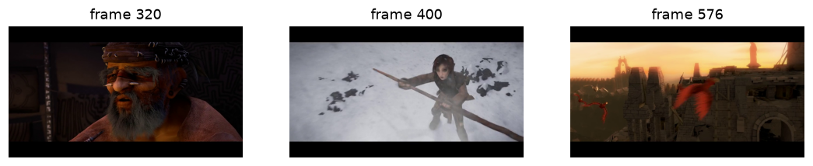
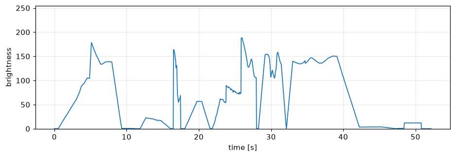
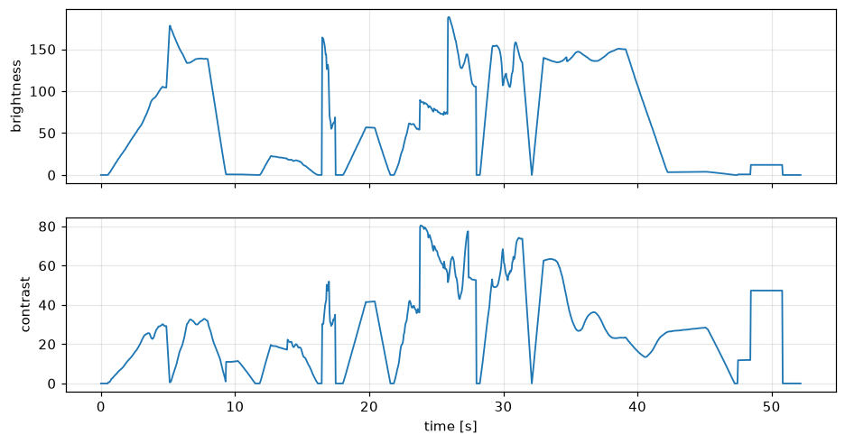
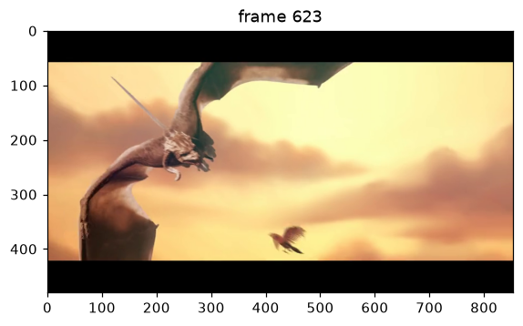
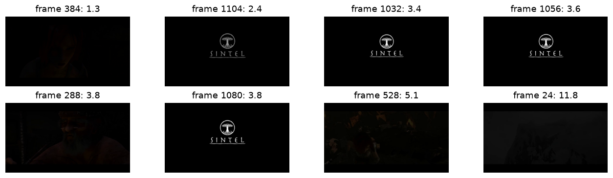
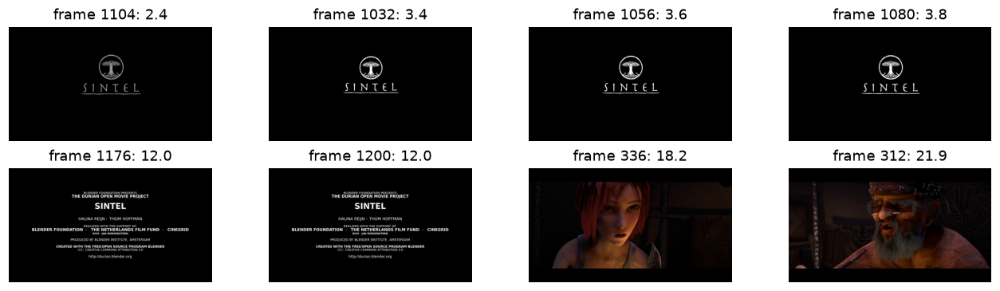

# 明るさ {#sec-brightness}

第II部では、映像から数値を取り出す方法を、1章に1つずつ学んでいきます。
最初に取り上げるのは、もっとも基本的な量である「明るさ」です。
暗い場面から明るい場面へ、映像の明るさは時間とともに移り変わります。
この章では、その移り変わりをフレームごとの数値として取り出し、1本のグラフに描きます。

この章には、明るさそのものとは別に、もう1つの目的があります。
「全フレームについて値を計算する → 表にまとめる → グラフにする → 表から目的のフレームを探す」という手順は、第6章以降の色・動き・カットの分析でもそのまま繰り返します。
その型を、いちばん単純な題材で身につけておきましょう。

::: {.callout-note title="この章のゴール"}
Sintel予告編の全フレームについて明るさを計算し、その時間変化を1本のグラフに描きます（@fig-ch05-goal）。
グラフの山や谷が、映像のどの場面にあたるのかを、数値とフレームの両方で確かめられるようになります。
:::

{#fig-ch05-goal width=100%}

新しいノートブック `ch05.ipynb` をプロジェクトフォルダの直下に作り、カーネルに `.venv` を選んでください。
最初のセルで、この章で使うライブラリと、第4章で作った `videotools.py` の関数をまとめて読み込みます。

```python
import os

import cv2
import matplotlib.pyplot as plt
import numpy as np
import pandas as pd

from videotools import iter_frames, read_frame, show, video_info

VIDEO = "data/sintel_trailer-480p.mp4"
```

`pandas` は、この章で初めて使うライブラリです。
`pd` という短い名前で読み込むのが慣習になっています。
使い方は @sec-ch05-dataframe で説明します。

## 輝度とは何か {#sec-ch05-luminance}

### 3つの値を1つにまとめる

カラー画像の1つの画素は、青・緑・赤の3つの値を持っています。
「この画素はどれくらい明るいか」を1つの数で答えるには、3つの値を1つにまとめなければなりません。
そのまとめ方が、第3章で学んだグレースケール化でした。

$$
Y = 0.299R + 0.587G + 0.114B
$$

$R$、$G$、$B$ は画素の赤・緑・青の値（0〜255）で、$Y$ がまとめた結果です。
要するに、3つの値にそれぞれ重みを掛けて足し合わせています。
3つの重みを足すとちょうど1になるので、$Y$ も0〜255の範囲に収まります。
本書では、この $Y$ を画素の**輝度**と呼び、明るさの指標として使います。

400番目のフレームを読み込み、グレースケールに変換します。

```python
frame = read_frame(VIDEO, 400)
gray = cv2.cvtColor(frame, cv2.COLOR_BGR2GRAY)

print(frame.shape, frame.dtype)
print(gray.shape, gray.dtype)
```

```{.default}
(480, 854, 3) uint8
(480, 854) uint8
```

3色ぶんあった配列が、縦480 × 横854の、1画素につき値が1つの配列になりました。
`cv2.cvtColor` が本当に上の式を計算しているのか、1つの画素で確かめておきます。

```python
b, g, r = frame[240, 300]

print(b, g, r)
print(0.299 * r + 0.587 * g + 0.114 * b)
print(gray[240, 300])
```

```{.default}
196 188 188
188.91199999999998
189
```

上から240行目、左から300列目の画素は、青196・緑188・赤188です。
式に当てはめると188.912になり、これを整数に丸めた189が、`gray` の同じ位置に入っています。

カラーの画像とグレースケールの画像を並べて表示します（@fig-ch05-gray）。

```python
fig, axes = plt.subplots(1, 2, figsize=(10, 3))
show(frame, title="color", ax=axes[0])
show(gray, title="gray", ax=axes[1])
plt.show()
```

{#fig-ch05-gray width=100%}

### なぜ重みが等しくないのか

3つの値を単純に平均するのではなく、緑に0.587という大きな重みを、青に0.114という小さな重みを付けるのは、人の目の性質に合わせるためです。
人の目は、同じ強さの光でも、緑をもっとも明るく感じ、青をもっとも暗く感じます。
重みは、この感じ方の違いを反映するように決められています。

重みの効果は、純粋な赤・緑・青を変換してみるとよくわかります。

```python
# 純粋な赤、緑、青の3画素からなる画像（BGRの順で書く）
colors = np.array([[[0, 0, 255], [0, 255, 0], [255, 0, 0]]], dtype=np.uint8)

print(cv2.cvtColor(colors, cv2.COLOR_BGR2GRAY))
```

```{.default}
[[ 76 150  29]]
```

3つとも「1色だけが最大値の255」という点では同じですが、輝度は赤が76、緑が150、青が29になりました。
真っ青な画面は、真緑の画面の5分の1ほどの明るさとして数えられるわけです。

::: {.callout-note title="この重みの出どころ"}
0.299、0.587、0.114という重みは、テレビ放送の規格（ITU-R BT.601）で定められたものです [@itu-bt601]。
規格によって重みは少しずつ異なりますが、緑が大きく青が小さいという点は共通しています。
OpenCVの `cv2.COLOR_BGR2GRAY` は、この重みを使います。
:::

### この「輝度」で言えること、言えないこと

ここで、この指標の限界を確認しておきます。
本書の輝度は、動画ファイルに記録された画素値から計算した数であり、光の強さを測定器で測った値ではありません。
物理学や照明の分野でいう輝度（単位はカンデラ毎平方メートル）とは別のものです。
違いは次の3点にあります。

- **画素値は、光の強さに比例していません**。画素値は、暗い部分の違いを細かく記録できるように、光の強さを変換した値として記録されています。したがって、輝度が2倍だからといって、光の強さが2倍というわけではありません。
- **実際に目に届く光は、表示する装置で変わります**。同じ画素値でも、スマートフォンの画面と映画館のスクリーンとでは、出てくる光の強さがまったく違います。
- **目が感じる明るさは、周囲にも左右されます**。暗い部屋で観るか明るい部屋で観るか、直前の場面が明るかったか暗かったかによって、同じ画面の印象は変わります。

映像技術の分野では、この区別をはっきりさせるために、画素値から計算した $Y$ を**ルーマ**（luma）と呼んで、物理的な輝度と呼び分けることがあります。

それでも、この指標は十分に役に立ちます。
同じ映像の中で「この場面はあの場面より暗い」と比べたり、明るさがいつ、どのように変化するかを追ったりする目的には、画素値に基づく指標で足ります。
本書で「輝度」「明るさ」と書くときは、つねにこの意味で使います。

## フレームの平均輝度とコントラスト {#sec-ch05-mean-contrast}

### 1枚のフレームを2つの数で要約する

グレースケール画像には、約41万個（480 × 854）の輝度の値が並んでいます。
このままでは多すぎて扱えないので、1枚のフレームを少数の数で要約します。
ここでは次の2つを使います。

- **平均輝度**：全画素の輝度の平均です。フレーム全体がどれくらい明るいかを表します。
- **コントラスト**：全画素の輝度の**標準偏差**です。フレームの中で、明るい部分と暗い部分の差がどれくらい大きいかを表します。

標準偏差は、値が平均のまわりにどれくらい散らばっているかを表す量で、次の式で計算します。

$$
\sigma = \sqrt{\frac{1}{N}\sum_{i=1}^{N}\left(x_i - \mu\right)^2}
$$

$N$ は画素の数、$x_i$ は $i$ 番目の画素の輝度、$\mu$ は平均輝度です。
要するに、「各画素が平均からどれだけ離れているか」を2乗して平均し、最後に平方根をとって元の単位に戻しています。
全画素が同じ値の、のっぺりした画像では0になり、真っ白な部分と真っ黒な部分が混ざった画像では大きくなります。

NumPyでは、どちらも1行で計算できます。
400番目のフレームで試します。

```python
print(gray.mean())
print(gray.std())
```

```{.default}
118.0670106362217
73.73898282805958
```

`std()` が式のとおりの計算をしていることを、第3章で学んだ配列の演算で確かめておきます。

```python
diff = gray - gray.mean()

print(np.sqrt((diff ** 2).mean()))
```

```{.default}
73.73898282805958
```

同じ値になりました。
以降は `std()` を使います。

::: {.callout-note title="コントラストの定義は1つではありません"}
コントラストには、「もっとも明るい画素ともっとも暗い画素の差」など、ほかの定義もあります。
本書で使う標準偏差は、少数の極端な画素に左右されにくく、計算が簡単であるため、映像の分析でよく使われます。
RMSコントラストとも呼ばれます。
:::

### 数値と見た目を対応させる

数値が見た目の印象と合っているかを、3枚のフレームで確かめます。
見た目の違うフレームとして、320番目、400番目、576番目を選びました（@fig-ch05-three-frames）。

```python
numbers = [320, 400, 576]

fig, axes = plt.subplots(1, 3, figsize=(12, 2.6))
for n, ax in zip(numbers, axes):
    frame = read_frame(VIDEO, n)
    gray = cv2.cvtColor(frame, cv2.COLOR_BGR2GRAY)
    print(n, gray.mean(), gray.std())
    show(frame, title=f"frame {n}", ax=ax)
    ax.axis("off")
plt.show()
```

```{.default}
320 15.823972970335674 18.19080361628202
400 118.0670106362217 73.73898282805958
576 65.83385050741609 78.75440472995484
```

{#fig-ch05-three-frames width=100%}

`zip(numbers, axes)` は、フレーム番号と、図の中の表示場所とを1組ずつ取り出すための書き方です。
`ax.axis("off")` は、画像のまわりの目盛りを消しています。

平均輝度から見ていきます。
暗い室内の320番目が15.8、雪原の400番目が118.1、夕暮れの576番目がその中間の65.8で、見た目の印象と順序が合っています。

コントラストはどうでしょうか。
576番目は、明るい空と、影になった暗い建物とが画面を二分しており、78.8という大きな値は納得できます。
ところが、全体が白っぽい400番目も73.7で、576番目とほとんど変わりません。
400番目のフレームは、576番目ほど明暗の差が大きいようには見えません。

この食い違いには原因があります。
次の節で、輝度の分布を詳しく調べて突き止めます。

## 輝度ヒストグラム {#sec-ch05-histogram}

### ヒストグラムを計算する

平均と標準偏差は、41万個の値をたった2つの数に要約したものです。
要約する前の姿、つまり「どの輝度の画素が何個あるか」を数えたものが**ヒストグラム**です。
輝度は0から255までの256通りですから、256個の箱を用意して、それぞれの値を持つ画素を数えます。

NumPyの `np.histogram` で計算します。
400番目のフレームに戻りましょう。

```python
gray = cv2.cvtColor(read_frame(VIDEO, 400), cv2.COLOR_BGR2GRAY)
counts, edges = np.histogram(gray, bins=256, range=(0, 256))

print(counts.shape, edges.shape)
print(counts.sum())
print(counts[:8])
```

```{.default}
(256,) (257,)
409920
[96501  1600   350   140   166   163    78    22]
```

`bins=256` は箱の数、`range=(0, 256)` は数える範囲です。
この指定で、「0以上1未満」「1以上2未満」……「255以上256以下」という幅1の箱が256個できます。
戻り値は2つあります。

- `counts`：それぞれの箱に入った画素の数です。`counts[0]` が輝度0の画素数、`counts[255]` が輝度255の画素数になります。
- `edges`：箱の境目の値です。箱が256個なので、境目は257個あります。この章では使いません。

`counts` の合計409920は、480 × 854、つまり全画素数と一致しています。
すべての画素が、どれか1つの箱に数えられたということです。

::: {.callout-tip title="OpenCVの cv2.calcHist でも同じ結果になります"}
OpenCVにも、ヒストグラムを計算する `cv2.calcHist` があります。

```python
hist = cv2.calcHist([gray], [0], None, [256], [0, 256])

print(hist.shape, hist.dtype)
print(np.array_equal(hist.ravel(), counts))
```

```{.default}
(256,) float32
True
```

引数は順に、画像のリスト、数える対象のチャンネル番号、マスク（使わないので `None`）、箱の数、値の範囲です。
結果は、256個の値が並んだ `float32`（小数）の配列で返ってきます。
整数か小数かという型の違いはありますが、数えた結果は `np.histogram` と完全に同じです。
`ravel()` は配列を1列に並べ直すメソッドです。
OpenCVのバージョンによっては結果が256行1列の形で返ってくるため、どちらの場合でも比べられるように付けています。
この章では、戻り値の扱いやすい `np.histogram` を使います。
:::

ヒストグラムをグラフにします（@fig-ch05-hist-400-full）。

```python
plt.figure(figsize=(8, 3))
plt.fill_between(np.arange(256), counts, step="mid")
plt.xlabel("pixel value")
plt.ylabel("number of pixels")
plt.grid(alpha=0.3)
plt.show()
```

{#fig-ch05-hist-400-full width=85%}

`plt.fill_between` は、線と横軸の間を塗りつぶす関数です。
`step="mid"` を指定すると、階段状の形になります。
横軸が輝度（左が暗く、右が明るい）、縦軸がその輝度を持つ画素の数です。

グラフを見ると、左端の輝度0に、ほかとは桁違いに高い柱が立っています。
雪原の明るい画素は150〜200あたりに山を作っていますが、左端の柱に比べるとごく低く見えます。
輝度0の画素がどれだけあるのか、数字で確かめます。

```python
print(counts[0])
print(counts[0] / counts.sum())
```

```{.default}
96501
0.23541422716627636
```

全画素の約24%が、完全な黒です。
雪原のフレームに、これほど多くの真っ黒な画素があるのは不自然です。

### 黒帯を見つける

その正体は、@fig-ch05-gray にも写っている、画面の上下の黒い帯です。
横長の映像を、それより縦の比率が大きい画面に収めるために上下に入れる黒い帯を、**レターボックス**と呼びます。
この予告編の動画ファイルには、黒帯が映像の一部として記録されています。
以下では単に黒帯と呼びます。

黒帯がどの行からどの行までなのかを、画素値から調べましょう。
グレースケール画像の、行ごとの平均を計算します。

```python
row_mean = gray.mean(axis=1)

print(row_mean.shape)
print(row_mean[:5])
```

```{.default}
(480,)
[0. 0. 0. 0. 0.]
```

`mean` に `axis=1` を指定すると、横方向（列の方向）に平均をとります。
結果は、480行のそれぞれについて平均輝度が1つずつ並んだ配列です。
グラフにします（@fig-ch05-row-mean-400）。

```python
plt.figure(figsize=(8, 3))
plt.plot(row_mean, linewidth=1.2)
plt.xlabel("row (y)")
plt.ylabel("mean pixel value")
plt.grid(alpha=0.3)
plt.show()
```

{#fig-ch05-row-mean-400 width=85%}

上端から60行目あたりまでと、420行目あたりから下端までが、ほぼ0になっています。
これが黒帯です。

ただし、1枚のフレームだけで境目を決めるのは危険です。
たまたまそのフレームの上のほうが暗かっただけかもしれないからです。
そこで、全フレームについて行ごとの平均を求め、それをさらにフレーム全体で平均します。
第4章で作った `iter_frames` で全フレームを順に読みます。

```python
row_sum = np.zeros(480)
count = 0
for n, frame in iter_frames(VIDEO):
    gray = cv2.cvtColor(frame, cv2.COLOR_BGR2GRAY)
    row_sum += gray.mean(axis=1)
    count += 1

row_mean_all = row_sum / count
print(count)
```

```{.default}
1253
```

`row_sum` に各フレームの行ごとの平均を足し込んでいき、最後にフレーム数で割っています。
1253フレームすべてを読みますが、数秒で終わります。
境目の付近の値を表示します。

```python
print(row_mean_all[52:62].round(1))
print(row_mean_all[418:428].round(1))
```

```{.default}
[ 0.1  0.   0.1  0.3  0.5  0.8 67.4 68.  68.  68.2]
[50.5 50.5 50.4 49.9  0.8  0.6  0.2  0.1  0.   0.1]
```

1行目は52行目から61行目、2行目は418行目から427行目の値です。
上側では、57行目の0.8から58行目の67.4へと値が跳ね上がっています。
下側では、421行目の49.9から422行目の0.8へと急に落ちています。
境目は明確で、**絵が映っているのは58行目から421行目まで**だとわかりました。

黒帯の中の値が、完全な0ではなく0.1や0.8になっている点にも触れておきます。
動画は圧縮して記録されているため、絵と黒帯の境目の近くでは、絵の明るさがわずかに黒帯の側ににじむことがあります。
絵の部分の平均が50〜70であるのに比べれば、無視できる大きさです。

::: {.callout-warning title="黒帯の範囲は映像ごとに違います"}
58行目から421行目という範囲は、このファイルに固有の値です。
黒帯のない映像もあれば、左右に黒帯のある映像もあります。
別の映像を分析するときは、ここで行ったように、必ず画素値から範囲を調べてください。
左右の黒帯は、`axis=0` として列ごとの平均を計算すれば、同じ方法で調べられます。
この予告編には、左右の黒帯はありません。
:::

### 黒帯を除いて計算し直す

境目がわかったので、第3章で学んだスライスで、絵の部分だけを切り出します。
スライスの終わりは「その手前まで」なので、421行目までを含めるには422を指定します。

```python
TOP, BOTTOM = 58, 422

gray = cv2.cvtColor(read_frame(VIDEO, 400), cv2.COLOR_BGR2GRAY)
crop = gray[TOP:BOTTOM]

print(crop.shape)
print(crop.size / gray.size)
```

```{.default}
(364, 854)
0.7583333333333333
```

切り出した画像は縦364 × 横854で、もとのフレームの約76%にあたります。
残りの約24%が黒帯で、先ほどの「輝度0の画素が約24%」という結果と合います。

黒帯を含めた場合と除いた場合とで、平均輝度とコントラストを比べます。
先ほどの3枚に、125番目のフレームを加えました。

```python
for n in [320, 400, 576, 125]:
    gray = cv2.cvtColor(read_frame(VIDEO, n), cv2.COLOR_BGR2GRAY)
    crop = gray[TOP:BOTTOM]
    print(n, round(gray.mean(), 1), round(gray.std(), 1),
          round(crop.mean(), 1), round(crop.std(), 1))
```

```{.default}
320 15.8 18.2 20.9 18.2
400 118.1 73.7 155.7 36.3
576 65.8 78.8 86.8 79.7
125 132.8 74.8 175.0 0.9
```

結果を @tbl-ch05-letterbox に整理します。

| フレーム | 平均輝度（黒帯を含む） | 平均輝度（黒帯を除く） | コントラスト（黒帯を含む） | コントラスト（黒帯を除く） |
|---:|---:|---:|---:|---:|
| 320 | 15.8 | 20.9 | 18.2 | 18.2 |
| 400 | 118.1 | 155.7 | 73.7 | 36.3 |
| 576 | 65.8 | 86.8 | 78.8 | 79.7 |
| 125 | 132.8 | 175.0 | 74.8 | 0.9 |

: 黒帯を含めた場合と除いた場合の、平均輝度とコントラスト {#tbl-ch05-letterbox}

黒帯の影響は、2つの量で現れ方が違います。

**平均輝度**は、どのフレームでも同じ割合で小さくなっています。
黒帯の画素はほぼ0なので、平均に対しては「0を24%混ぜる」のと同じ効果になり、値が約0.76倍になります。
400番目のフレームでは、155.7 × 0.758 ≒ 118.0 で、確かにそうなっています。
全フレームが同じ割合で小さくなるだけなので、フレームどうしの大小関係は変わりません。

**コントラスト**への影響は、フレームによってまったく違います。
400番目のフレームは、黒帯を除くと73.7から36.3へと半分になりました。
黒帯を含めた73.7という値の大部分は、絵の中の明暗ではなく、「明るい絵」と「黒い帯」の差を測ったものだったのです。
前の節で感じた食い違いの原因は、これでした。
黒帯を除いた値は、400番目が36.3、576番目が79.7で、見た目の印象と合っています。

125番目のフレームは、その極端な例です（@fig-ch05-frame-125）。

```python
frame = read_frame(VIDEO, 125)
plt.figure(figsize=(5, 3))
show(frame, title="frame 125")
plt.show()
```

{#fig-ch05-frame-125 width=60%}

絵の部分はほぼ一様な灰色で、黒帯を除いたコントラストは0.9しかありません。
ところが、黒帯を含めて計算すると74.8になり、@tbl-ch05-letterbox の中で576番目に次ぐ大きさになってしまいます。

以上から、本書では次の方針をとります。

::: {.callout-important title="黒帯は切り出して除いてから計算する"}
黒帯は作品の絵ではなく、絵を画面に収めるための余白です。
含めたまま計算すると、平均輝度は一律に小さくなり、コントラストは絵の内容と関係のない値になります。
この章では、`gray[TOP:BOTTOM]` で絵の部分だけを切り出してから、すべての値を計算します。
:::

この処理は何度も使うので、関数にしておきます。

```python
def to_gray(frame):
    """黒帯を除いたグレースケール画像を返す。"""
    gray = cv2.cvtColor(frame, cv2.COLOR_BGR2GRAY)
    return gray[TOP:BOTTOM]
```

### ヒストグラムの形を読む

黒帯を除いたうえで、3枚のフレームのヒストグラムを並べます（@fig-ch05-hist-three）。
左にグレースケール画像、右にそのヒストグラムを置き、平均輝度の位置に破線を引きます。

```python
fig, axes = plt.subplots(3, 2, figsize=(10, 6.5), width_ratios=[1, 1.4])
for i, n in enumerate([320, 400, 576]):
    gray = to_gray(read_frame(VIDEO, n))
    counts, edges = np.histogram(gray, bins=256, range=(0, 256))
    show(gray, title=f"frame {n}", ax=axes[i, 0])
    axes[i, 0].axis("off")
    axes[i, 1].fill_between(np.arange(256), counts, step="mid")
    axes[i, 1].axvline(gray.mean(), color="black", linewidth=1, linestyle="--")
    axes[i, 1].set_ylabel("number of pixels")
    axes[i, 1].grid(alpha=0.3)
axes[2, 1].set_xlabel("pixel value")
plt.tight_layout()
plt.show()
```

{#fig-ch05-hist-three width=100%}

`plt.subplots(3, 2, ...)` で3行2列の表示場所を作り、`axes[i, 0]` に画像を、`axes[i, 1]` にヒストグラムを描いています。
`axvline` は、指定した横軸の位置に縦線を引く関数です。

3つのヒストグラムは、形がはっきり違います。

- **320番目（暗い場面）**：山が左端に寄っています。ほとんどの画素が輝度50以下で、100を超える画素はごくわずかです。
- **400番目（明るい場面）**：山が右側の150〜200にあります。左側に低く伸びた裾は、人物や岩などの暗い部分です。
- **576番目（明暗の差が大きい場面）**：山が2つあります。左の山が影になった建物、右の山が明るい空です。中間の輝度の画素は少なく、谷になっています。

平均輝度は「山がどのあたりにあるか」を、コントラストは「分布が横にどれだけ広がっているか」を表しています。
576番目のフレームでは、平均輝度の86.8は2つの山の間の谷にあり、その値を持つ画素はほとんどありません。
平均という1つの数は、分布の形までは教えてくれないのです。
数値に違和感を覚えたときにヒストグラムを描いてみるのは、有効な確かめ方です。

::: {.callout-note title="ヒストグラムの細いすき間について"}
@fig-ch05-hist-three のヒストグラムには、櫛の歯のような細いすき間が、ほぼ7つおきに入っています。
これは絵の内容によるものではありません。
動画ファイルの中では、明るさが0〜255よりも狭い範囲の数で記録されており、それを0〜255に引き伸ばすときに、現れにくい値が等間隔に生じるためと考えられます。
分布の大まかな形を読むうえでは、気にする必要はありません。
:::

## フレームごとの値をpandasの表にまとめる {#sec-ch05-dataframe}

### 全フレームの値を計算する

1枚のフレームから平均輝度とコントラストを計算できるようになったので、これを全フレームに対して行います。
計算した値は、フレーム番号や時刻と一緒に記録しておかなければ、あとで「どのフレームの値か」がわからなくなります。
そこで、1フレームにつき1つの辞書を作り、リストに追加していきます。

```python
info = video_info(VIDEO)
fps = info["fps"]

rows = []
for n, frame in iter_frames(VIDEO):
    gray = to_gray(frame)
    rows.append({
        "frame": n,
        "time": n / fps,
        "brightness": gray.mean(),
        "contrast": gray.std(),
    })

print(len(rows))
```

```{.default}
1253
```

辞書に入れている項目は次の4つです。

- `frame`：フレーム番号です。
- `time`：先頭からの時刻（秒）です。フレーム番号をフレームレートで割って求めます。
- `brightness`：黒帯を除いた平均輝度です。
- `contrast`：黒帯を除いたコントラスト（輝度の標準偏差）です。

`rows` は、このような辞書が1253個並んだリストになりました。

### DataFrameにする

**pandas**は、表の形をしたデータを扱うためのライブラリです。
pandasでは、表を**DataFrame**（データフレーム）と呼びます。
Excelのシートのように、行と列があり、列には名前が付いています。
辞書のリストは、`pd.DataFrame` に渡すだけでDataFrameになります。

```python
df = pd.DataFrame(rows)
df.head()
```

```{.default}
   frame      time  brightness  contrast
0      0  0.000000         0.0       0.0
1      1  0.041667         0.0       0.0
2      2  0.083333         0.0       0.0
3      3  0.125000         0.0       0.0
4      4  0.166667         0.0       0.0
```

`head()` は、表の先頭の5行を取り出します。
セルの最後の行にDataFrameを書くと、ノートブックはそれを罫線の付いた表として表示します（本書では文字で示します）。
辞書のキーだった `frame`、`time`、`brightness`、`contrast` が、そのまま列の名前になっています。
1行が1フレームに対応します。

左端の、名前のない0、1、2……は**インデックス**と呼ばれる、行の見出しです。
とくに指定しなければ、0から順に番号が振られます。
ここでは全フレームを先頭から順に入れたので、インデックスとフレーム番号が一致しています。

先頭の5フレームは、平均輝度もコントラストも0.0です。
第2章で見たとおり、この予告編は真っ黒な画面から始まります。

表の大きさは `shape` でわかります。
NumPyの配列と同じ書き方です。

```python
print(df.shape)
```

```{.default}
(1253, 4)
```

1253行、4列の表です。

### 列と行を取り出す

列を取り出すには、角かっこの中に列の名前を書きます。

```python
print(df["brightness"])
```

```{.default}
0       0.0
1       0.0
2       0.0
3       0.0
4       0.0
       ...
1248    0.0
1249    0.0
1250    0.0
1251    0.0
1252    0.0
Name: brightness, Length: 1253, dtype: float64
```

取り出した1列は**Series**（シリーズ）と呼ばれます。
インデックスの付いた1次元の配列だと考えてください。
行数が多いので、途中は `...` で省略されています。

Seriesには、NumPyの配列と同じように、`mean()` や `max()` が使えます。

```python
print(df["brightness"].mean())
print(df["brightness"].max())
```

```{.default}
61.98740802653707
188.35483310600407
```

予告編全体を通した平均輝度は62.0、もっとも明るいフレームの平均輝度は188.4です。

行を取り出すには、`loc` にインデックスを指定します。

```python
print(df.loc[400])
```

```{.default}
frame         400.000000
time           16.666667
brightness    155.676059
contrast       36.295082
Name: 400, dtype: float64
```

400番目のフレームは、時刻が16.67秒で、平均輝度は155.7、コントラストは36.3です。
@tbl-ch05-letterbox の値と一致しています。

### 表全体を要約する

`describe()` は、すべての列について、基本的な統計量をまとめて計算します。
`round(2)` で、小数第2位までに丸めて表示します。

```python
df.describe().round(2)
```

```{.default}
         frame     time  brightness  contrast
count  1253.00  1253.00     1253.00   1253.00
mean    626.00    26.08       61.99     27.26
std     361.85    15.08       58.26     19.86
min       0.00     0.00        0.00      0.00
25%     313.00    13.04        3.80     11.87
50%     626.00    26.08       46.03     24.63
75%     939.00    39.12      129.45     38.81
max    1252.00    52.17      188.35     80.37
```

`count` は値の個数、`mean` は平均、`std` は標準偏差、`min` と `max` は最小値と最大値です。
`25%`、`50%`、`75%` は、値を小さい順に並べたときに、下から25%、50%、75%の位置にくる値です。
50%の値は**中央値**とも呼ばれます。

`brightness` の列を見ると、25%の値が3.80です。
つまり、全フレームの4分の1は、平均輝度が3.8以下のほとんど真っ黒な画面だということになります。
平均（61.99）と中央値（46.03）が離れていることからも、値が低い側に偏った分布であることが読み取れます。
この「真っ黒なフレームの多さ」は、@sec-ch05-extremes で問題になります。

::: {.callout-note title="2つの「標準偏差」を混同しない"}
`describe()` の `std` の行は、「1253個のフレームの値が、どれくらい散らばっているか」を表します。
一方、`contrast` の列に入っているのは、「1枚のフレームの中で、画素の輝度がどれくらい散らばっているか」です。
どちらも標準偏差ですが、何の散らばりを測っているのかが違います。
:::

### CSVファイルに保存する

計算結果はファイルに保存しておきます。
保存しておけば、ノートブックを開き直したときや、あとで明るさの値を使いたくなったときに、動画を読み直さずに済みます。

保存の形式には**CSV**を使います。
CSVは、値をコンマで区切って並べただけの文字のファイルで、Excelでもメモ帳でも開けます。
分析の結果を置く場所として、プロジェクトフォルダの中に `out` というフォルダを作り、そこに保存します。

```python
os.makedirs("out", exist_ok=True)
df.to_csv("out/sintel_brightness.csv", index=False)
```

`os.makedirs` はフォルダを作る関数です。
`exist_ok=True` を付けておくと、フォルダがすでにある場合にもエラーになりません。
`to_csv` がDataFrameをCSVファイルに書き出すメソッドです。
`index=False` は、インデックスを書き出さないという指定です。
ここではインデックスがフレーム番号と同じなので、省いています。

保存したファイルは、`pd.read_csv` で読み込めます。

```python
df = pd.read_csv("out/sintel_brightness.csv")
df.tail(3)
```

```{.default}
      frame       time  brightness  contrast
1250   1250  52.083333         0.0       0.0
1251   1251  52.125000         0.0       0.0
1252   1252  52.166667         0.0       0.0
```

`tail(3)` は末尾の3行を取り出します。
保存する前と同じ表が読み込まれています。
次にノートブックを開いたときは、最初のセル（import）、`TOP` と `BOTTOM` を決めたセル、`to_gray` を定義したセル、そしてこの `pd.read_csv` のセルを実行すれば、ここから作業を再開できます。

## 時系列グラフを描く、ならす（移動平均） {#sec-ch05-timeseries}

### 明るさの時系列グラフ

時間の順に並んだ値を**時系列**と呼びます。
横軸に時刻、縦軸に平均輝度をとって、グラフにします（@fig-ch05-timeseries）。

```python
plt.figure(figsize=(10, 3))
plt.plot(df["time"], df["brightness"], linewidth=1.2)
plt.xlabel("time [s]")
plt.ylabel("brightness")
plt.ylim(0, 255)
plt.grid(alpha=0.3)
plt.show()
```

{#fig-ch05-timeseries width=100%}

`plt.plot` には、DataFrameの列をそのまま渡せます。
縦軸は、輝度がとりうる範囲である0〜255に固定しました。
こうしておくと、別の映像のグラフと並べたときにも、高さをそのまま比べられます。

52秒の予告編の明るさの移り変わりが、1本の線になりました。
グラフの形から、次のようなことが読み取れます。

- **斜めの線**：0秒から5秒にかけて、線がなだらかに上がっています。黒い画面から絵が徐々に現れる**フェードイン**です。8秒から9秒にかけてと、39秒から42秒にかけての下り坂は、絵が徐々に暗くなる**フェードアウト**です。
- **垂直な段差**：16.5秒付近や26秒付近では、値が一瞬で跳ね上がっています。暗い画面（16.5秒付近では真っ黒な画面）から明るい場面へ、**カット**で切り替わった箇所です。
- **0に落ちる谷**：17.5秒、21.7秒、28秒、32秒の付近で、線が0まで落ちています。場面と場面の間に挟まれた、真っ黒なフレームです。
- **水平な線**：48.5秒から51秒にかけて、値がまったく変わらない区間があります。文字だけが表示された静止画面（クレジット）です。

グラフの上の特徴が、編集の技法と対応していることに注目してください。
カットやフェードを自動で見つける方法は、第8章で扱います。

コントラストも一緒に見てみましょう。
平均輝度とコントラストは別の量ですから、1つのグラフに重ねずに、上下に並べます（@fig-ch05-timeseries-2）。

```python
fig, axes = plt.subplots(2, 1, figsize=(10, 5), sharex=True)
axes[0].plot(df["time"], df["brightness"], linewidth=1.2)
axes[0].set_ylabel("brightness")
axes[1].plot(df["time"], df["contrast"], linewidth=1.2)
axes[1].set_ylabel("contrast")
axes[1].set_xlabel("time [s]")
for ax in axes:
    ax.grid(alpha=0.3)
plt.show()
```

{#fig-ch05-timeseries-2 width=100%}

`sharex=True` は、上下のグラフで横軸をそろえる指定です。

2つのグラフは、似ているところと違うところがあります。
5秒付近では、平均輝度は山になっているのに、コントラストはほぼ0まで落ちています。
@fig-ch05-frame-125 で見た、画面全体が白くかすむ場面です。
「明るいがコントラストは低い」という状態は、平均輝度のグラフだけからはわかりません。
逆に24秒付近では、平均輝度は中くらいですが、コントラストは全体の最大値に達しています。
@fig-ch05-three-frames の576番目のフレームを含む、夕暮れの街の場面です。

### 移動平均でならす

時系列のグラフは、細かい上下動が多いと、全体の流れが読み取りにくくなります。
そこで、細かい変動をならして、大きな傾向を見やすくする方法がよく使われます。
その代表が**移動平均**です。

移動平均は、それぞれの時点の値を、その前後の値の平均で置き換える計算です。
平均をとる範囲を**窓**、その長さを**窓幅**と呼びます。
窓を1つずつずらしながら平均を計算していくので、「移動」平均という名前が付いています。

pandasでは、`rolling` で窓を指定し、続けて `mean()` を呼びます。
まず、小さなデータで動作を確かめます。

```python
s = pd.Series([1, 2, 3, 10, 3, 2, 1])

print(s.rolling(window=3).mean())
```

```{.default}
0         NaN
1         NaN
2    2.000000
3    5.000000
4    5.333333
5    5.000000
6    2.000000
dtype: float64
```

`window=3` は、窓幅を3にする指定です。
結果の2番目の値2.0は、もとの0番目から2番目までの値（1、2、3）の平均です。
3番目の値5.0は、1番目から3番目まで（2、3、10）の平均です。
つまり、「その位置と、その手前の2つ」の平均が入っています。

最初の2つは `NaN` になっています。
`NaN` は「値がない」ことを表す特別な値です。
0番目と1番目では、手前の値が足りず、3つの平均を計算できないためです。

もとのデータでは、3番目の10が突出していました。
移動平均の結果では、最大値が4番目の5.33になり、山の位置が後ろにずれています。
手前の値だけで平均しているためです。
映像の分析では、グラフの山の位置が実際の時刻からずれると困ります。
`center=True` を指定すると、窓がその位置を中心にして前後に広がるようになります。

```python
print(s.rolling(window=3, center=True).mean())
```

```{.default}
0         NaN
1    2.000000
2    5.000000
3    5.333333
4    5.000000
5    2.000000
6         NaN
dtype: float64
```

今度は、最大値が3番目になり、もとのデータの山の位置と一致しました。
代わりに、`NaN` が先頭と末尾に1つずつ現れます。
本書では、移動平均にはつねに `center=True` を付けます。

### 窓幅を変えて比べる

平均輝度の時系列に、2通りの窓幅で移動平均を適用します。
24フレーム（1秒）と、120フレーム（5秒）です。

```python
ma24 = df["brightness"].rolling(window=24, center=True).mean()
ma120 = df["brightness"].rolling(window=120, center=True).mean()

print(ma24.isna().sum(), ma120.isna().sum())
```

```{.default}
23 119
```

`isna().sum()` は、`NaN` の個数を数えています。
窓幅24では23個、窓幅120では119個の値が、両端で計算できずに `NaN` になります。
窓幅が広いほど、両端で失われる部分が長くなります。

もとの値と重ねて描きます（@fig-ch05-rolling）。

```python
plt.figure(figsize=(10, 3.5))
plt.plot(df["time"], df["brightness"], linewidth=1, color="gray", alpha=0.6, label="raw")
plt.plot(df["time"], ma24, linewidth=1.5, label="window = 24 (1 s)")
plt.plot(df["time"], ma120, linewidth=1.5, label="window = 120 (5 s)")
plt.xlabel("time [s]")
plt.ylabel("brightness")
plt.ylim(0, 255)
plt.grid(alpha=0.3)
plt.legend()
plt.show()
```

{#fig-ch05-rolling width=100%}

`NaN` の部分は、Matplotlibが自動的に飛ばして描きます。
橙の線が両端で短くなっているのは、そのためです。

窓幅を広げると、何が変わるでしょうか。
グラフから読み取れる変化を、数値でも確かめます。
全体の最大値と、28秒付近の真っ黒な区間の中にある675番目のフレームの値を比べます。

```python
print(df["brightness"].max(), ma24.max(), ma120.max())
print(df["brightness"][675], ma24[675], ma120[675])
```

```{.default}
188.35483310600407 163.27098211604945 142.72115041476866
0.0 50.45262450030453 116.14401724592737
```

| | もとの値 | 窓幅24（1秒） | 窓幅120（5秒） |
|---|---:|---:|---:|
| 全体の最大値 | 188.4 | 163.3 | 142.7 |
| 675番目のフレーム（真っ黒） | 0.0 | 50.5 | 116.1 |

: 窓幅による値の変化 {#tbl-ch05-rolling}

窓幅を広げるほど、次のことが起こります。

- **山が低くなり、谷が浅くなります**。最大値は188.4から142.7まで下がりました。
- **短い出来事が消えます**。675番目のフレームは実際には真っ黒ですが、窓幅120の移動平均では116.1という、明るい場面と変わらない値になっています。7フレームしか続かない黒い画面は、前後の明るい場面に埋もれてしまいました。
- **急な変化がなだらかになります**。16.5秒付近のカットは、もとのグラフでは垂直な段差でしたが、移動平均では坂になっています。カットなのかフェードなのかは、移動平均の線からは区別できません。

一方で、窓幅120の線からは、「前半は暗い場面が多く、25秒から40秒にかけて明るい場面が続き、最後は暗くなって終わる」という、予告編全体の明るさの構成が一目で読み取れます。

窓幅に「正しい値」はありません。
全体の流れを見たいのか、個々の出来事を見たいのかという目的に応じて選びます。
52秒の予告編であれば、もとの値のままでも流れは十分に読み取れます。
2時間の映画であれば、フレームは17万枚を超え、数秒から数十秒の窓でならさなければ、全体の流れは見えてきません。

::: {.callout-warning title="ならした値は、グラフを見るためだけに使う"}
移動平均は、実際には存在しない値を作り出します。
「もっとも明るいフレーム」を探したり、カットの位置を調べたりするときは、ならす前のもとの値を使ってください。
:::

## 明るい場面・暗い場面を見つける {#sec-ch05-extremes}

### もっとも明るいフレーム

第2章の演習で、「`frame.mean()` の値がもっとも大きくなるフレームは見つかるでしょうか」という問いを出しました。
表ができたので、この問いに答えられます。
ただし、ここで調べるのは、黒帯を除いた平均輝度がもっとも大きいフレームです。

`idxmax()` は、値が最大になる行のインデックスを返します。

```python
i = df["brightness"].idxmax()

print(i)
print(df.loc[i])
```

```{.default}
623
frame         623.000000
time           25.958333
brightness    188.354833
contrast       54.842961
Name: 623, dtype: float64
```

もっとも明るいのは623番目、開始から約26.0秒のフレームです。
表示して確かめます（@fig-ch05-brightest）。

```python
plt.figure(figsize=(6, 3.5))
show(read_frame(VIDEO, i), title=f"frame {i}")
plt.show()
```

{#fig-ch05-brightest width=70%}

明るい空が画面の大部分を占めるフレームです。
@fig-ch05-timeseries で、26秒付近に立っていたいちばん高い山が、この場面にあたります。

上位をまとめて取り出すには、`nlargest` を使います。
平均輝度の大きい順に5行を取り出します。

```python
df.nlargest(5, "brightness")
```

```{.default}
     frame       time  brightness   contrast
623    623  25.958333  188.354833  54.842961
622    622  25.916667  188.318482  52.970362
621    621  25.875000  187.336172  51.513005
624    624  26.000000  187.019359  57.330391
625    625  26.041667  184.970025  59.923380
```

上位5つは、621番目から625番目までの連続したフレームでした。
映像では隣り合うフレームはほとんど同じ絵ですから、これは当然の結果です。
「明るい場面を5つ」探すつもりで上位5フレームを取り出すと、同じ場面の5コマが返ってきます。
この点は、すぐ後で対処します。

### もっとも暗いフレームは「真っ黒」

同じように、もっとも暗いフレームを探します。
`nsmallest` は、値の小さい順に取り出します。

```python
df.nsmallest(5, "brightness")
```

```{.default}
   frame      time  brightness  contrast
0      0  0.000000         0.0       0.0
1      1  0.041667         0.0       0.0
2      2  0.083333         0.0       0.0
3      3  0.125000         0.0       0.0
4      4  0.166667         0.0       0.0
```

冒頭の真っ黒なフレームが並びました。
計算としては正しい結果ですが、知りたかったのは「暗い場面」であって、何も映っていない画面ではありません。

真っ黒なフレームがどれくらいあるのかを数えます。

```python
print((df["brightness"] == 0).sum())
print((df["brightness"] < 1).sum())
print((df["brightness"] < 1).mean())
```

```{.default}
90
191
0.1524341580207502
```

`df["brightness"] == 0` は、各行について条件が成り立つかどうかを調べ、`True` か `False` が並んだSeriesを作ります。
`True` は1、`False` は0として数えられるので、`sum()` で条件を満たす行の数が、`mean()` でその割合が求まります。

平均輝度がちょうど0のフレームが90枚、1未満のフレームまで含めると191枚あり、全体の約15%を占めています。
冒頭、末尾、場面の継ぎ目、そして黒い背景に小さな文字だけが出る画面です。
小さい順に何枚取り出しても、これらのフレームが上位を独占してしまいます。

### 条件で行を絞り込む

対処の第一歩は、ほぼ真っ黒なフレームを表から除くことです。
DataFrameの角かっこの中に条件を書くと、条件を満たす行だけの表が得られます。

```python
visible = df[df["brightness"] >= 1]

print(len(visible))
visible.nsmallest(5, "brightness")
```

```{.default}
1062
      frame       time  brightness  contrast
1122   1122  46.750000    1.002985  7.110057
1121   1121  46.708333    1.081575  7.687393
1120   1120  46.666667    1.168647  8.318033
1119   1119  46.625000    1.239873  8.877105
384     384  16.000000    1.288905  1.917908
```

平均輝度が1以上のフレームは1062枚です。
インデックスは、もとの表のものがそのまま残ります。

しかし、結果はまだ満足のいくものではありません。
1119番目から1122番目は連続したフレームで、しかも値が1.24、1.17、1.08、1.00と少しずつ減っています。
絵が消えていく途中、つまりフェードアウトの最後の部分です。
「1未満」という境目で切ったので、境目のすぐ上にある、消えかけのフレームが選ばれたわけです。
境目を2や5に上げても、今度はその値のすぐ上にあるフェードの途中のフレームが選ばれるだけで、事情は変わりません。

ここまでで、問題が2つあることがわかりました。

1. 隣り合うフレームが、上位にまとめて現れる。
2. フェードの途中のフレームが、暗いフレームとして選ばれる。

### 1秒に1枚だけを候補にする

1つ目の問題は、候補を間引くことで避けられます。
フレーム番号が24の倍数である行だけを残せば、1秒に1枚の割合になります。

```python
sampled = visible[visible["frame"] % 24 == 0]

print(len(sampled))
darkest = sampled.nsmallest(8, "brightness")
darkest
```

```{.default}
44
      frame  time  brightness   contrast
384     384  16.0    1.288905   1.917908
1104   1104  46.0    2.406240  17.497282
1032   1032  43.0    3.438296  26.907014
1056   1056  44.0    3.629031  27.694202
288     288  12.0    3.783292   3.591740
1080   1080  45.0    3.802700  28.322115
528     528  22.0    5.129349   4.160620
24       24   1.0   11.822821   3.851752
```

`%` は割った余りを求める演算子です。
候補は44枚になり、連続したフレームは現れなくなりました。
選ばれた8枚を、平均輝度の値と一緒に表示します（@fig-ch05-darkest）。

```python
fig, axes = plt.subplots(2, 4, figsize=(12, 3.4))
for (i, row), ax in zip(darkest.iterrows(), axes.ravel()):
    show(read_frame(VIDEO, i), title=f"frame {i}: {row['brightness']:.1f}", ax=ax)
    ax.axis("off")
plt.tight_layout()
plt.show()
```

{#fig-ch05-darkest width=100%}

`iterrows()` は、DataFrameの行を、インデックスと行の内容の組として1つずつ取り出します。
`axes.ravel()` は、2行4列に並んだ表示場所を、1列に並べ直しています。

8枚のうち4枚（1032、1056、1080、1104番目）は、黒い背景に題名のロゴが表示された画面です。
残りの4枚（24、288、384、528番目）は、絵がうっすらと見えるだけの、フェードの途中のフレームです。
2つ目の問題が残っています。

### 明るさが変化している最中のフレームを除く

フェードの途中のフレームには、「明るさが変化している最中である」という特徴があります。
@fig-ch05-timeseries でいえば、斜めの線の上にあるフレームです。
これを見分けるために、1つ前のフレームとの差を計算します。
`diff()` は、各行について、1つ前の行との差を求めます。

```python
change = df["brightness"].diff().abs()

print(change.head())
```

```{.default}
0    NaN
1    0.0
2    0.0
3    0.0
4    0.0
Name: brightness, dtype: float64
```

`abs()` で絶対値にしているので、`change` は「前のフレームから、平均輝度がどれだけ変わったか」を表します。
0番目のフレームには前のフレームがないので、`NaN` になります。

この `change` が小さいフレーム、つまり明るさが安定しているフレームだけを候補にします。
ここでは、変化が0.5未満であることを条件にしました。

```python
stable = df[(df["brightness"] >= 1) & (change < 0.5)]
sampled = stable[stable["frame"] % 24 == 0]

print(len(stable), len(sampled))
darkest = sampled.nsmallest(8, "brightness")
darkest
```

```{.default}
439 17
      frame  time  brightness   contrast
1104   1104  46.0    2.406240  17.497282
1032   1032  43.0    3.438296  26.907014
1056   1056  44.0    3.629031  27.694202
1080   1080  45.0    3.802700  28.322115
1176   1176  49.0   12.014225  47.260996
1200   1200  50.0   12.014225  47.260996
336     336  14.0   18.189837  21.360311
312     312  13.0   21.897895  18.947630
```

2つの条件を「どちらも満たす」という意味でつなぐには、`&` を使います。

::: {.callout-warning title="条件を & でつなぐときは、かっこで囲む"}
pandasで複数の条件を組み合わせるときは、Pythonの `and` ではなく `&` を使い、それぞれの条件を必ず丸かっこで囲みます。
かっこを忘れて `df["brightness"] >= 1 & change < 0.5` と書くと、`&` が先に計算されてしまい、エラーになります。
「どちらかを満たす」は `|`、「満たさない」は条件の前に `~` を付けて表します。
:::

先ほどと同じコードで、8枚を表示します（@fig-ch05-darkest-stable）。

```python
fig, axes = plt.subplots(2, 4, figsize=(12, 3.4))
for (i, row), ax in zip(darkest.iterrows(), axes.ravel()):
    show(read_frame(VIDEO, i), title=f"frame {i}: {row['brightness']:.1f}", ax=ax)
    ax.axis("off")
plt.tight_layout()
plt.show()
```

{#fig-ch05-darkest-stable width=100%}

絵がうっすら見えるだけのフレームはなくなりました。
選ばれたのは、題名のロゴの画面が4枚、クレジットの画面が2枚、そして物語の場面が2枚（336番目と312番目）です。
ロゴとクレジットは、黒い背景に文字や図柄を置いた画面ですから、「暗い」という判定は正しいといえます。
物語の場面に限れば、13秒から14秒にかけての室内の場面が、この予告編でもっとも暗いということになります。

この手順で使った「1未満」「0.5未満」という境目の値には、理論的な根拠はありません。
結果のフレームを目で見ながら決めた値であり、映像が変われば調整が必要です。
また、ロゴやクレジットを「場面」に含めるかどうかは、平均輝度からは決められません。
何を調べたいのかに応じて、分析する人が決めることです。

ここで行ったことを振り返ると、数値は候補を絞り込むために使い、最終的な判断はフレームを目で見て行いました。
数値だけで結論を出さずに、必ずもとの映像に戻って確かめる。
この進め方は、本書の最後まで変わりません。

### 仕上げ——グラフにフレームを添える

最後に、章のゴールである @fig-ch05-goal を作ります。
時系列グラフの上に、代表的なフレームを小さく並べ、それぞれがグラフのどの位置にあたるのかを記号で示します。
フレームは、この章で見てきたものを中心に、9枚を選びました。

```python
picks = [60, 125, 320, 400, 480, 623, 800, 900, 1050]

fig = plt.figure(figsize=(12, 4.6))
grid = fig.add_gridspec(2, len(picks), height_ratios=[1, 3.2])

ax = fig.add_subplot(grid[1, :])
ax.plot(df["time"], df["brightness"], linewidth=1.2)
ax.set_xlabel("time [s]")
ax.set_ylabel("brightness")
ax.set_xlim(0, df["time"].max())
ax.set_ylim(0, 255)
ax.grid(alpha=0.3)

for k, n in enumerate(picks):
    label = chr(ord("A") + k)
    t = df.loc[n, "time"]
    y = df.loc[n, "brightness"]
    ax.plot(t, y, "o", color="black", markersize=4)
    ax.annotate(label, (t, y), xytext=(0, 8), textcoords="offset points", ha="center")
    thumb = fig.add_subplot(grid[0, k])
    show(read_frame(VIDEO, n)[TOP:BOTTOM], title=f"{label}: {t:.1f} s", ax=thumb)
    thumb.axis("off")
plt.show()
```

{width=100%}

これまでより長いコードですが、新しい要素は多くありません。

- `fig.add_gridspec(2, len(picks), ...)` は、図を2行9列のマス目に区切ります。`height_ratios=[1, 3.2]` で、下の行を上の行の3.2倍の高さにしています。
- `grid[1, :]` は「下の行の全部の列」という意味で、ここに横長の時系列グラフを描きます。`grid[0, k]` は上の行の `k` 番目のマスで、ここにフレームを1枚ずつ置きます。
- `chr(ord("A") + k)` は、`k` が0ならA、1ならB……という文字を作ります。
- `df.loc[n, "time"]` は、`n` 行目の `time` 列の値を取り出します。`loc` には、行と列を同時に指定できます。
- `ax.annotate` は、グラフ上の点の少し上（8ポイント上）に記号を書いています。
- `read_frame(VIDEO, n)[TOP:BOTTOM]` で、フレームから黒帯を切り落として表示しています。

グラフとフレームを見比べると、数値と映像の内容がつながります。
Aは冒頭のフェードインの途中、Bは画面全体が白くかすむ瞬間です。
Cの暗い室内はフェードアウトして真っ黒になり、そこからDの雪原へ一瞬で切り替わるので、グラフは垂直に跳ね上がっています。
Fが全体でもっとも明るい場面で、GとHの明るい場面が続いたあと、フェードアウトしてIの題名のロゴへと移ります。

## まとめ {#sec-ch05-summary}

- 本書では、グレースケールの画素値（$0.299R + 0.587G + 0.114B$）を**輝度**と呼び、明るさの指標にします。これは画素値に基づく指標であり、光の強さを測定した値ではありません。
- 1枚のフレームは、**平均輝度**（輝度の平均）と**コントラスト**（輝度の標準偏差）の2つの数で要約できます。
- **ヒストグラム**は、どの輝度の画素が何個あるかを数えたものです。平均や標準偏差に違和感があるときは、ヒストグラムで分布の形を確かめます。
- 上下の**黒帯**（レターボックス）を含めたまま計算すると、平均輝度は一律に小さくなり、コントラストは絵の内容と関係のない値になります。黒帯の範囲を画素値から調べ、切り出して除いてから計算します。Sintel予告編では、絵の部分は58行目から421行目（`gray[58:422]`）です。
- フレームごとの値は、辞書のリストに集めて、pandasの**DataFrame**にします。列は `df["列名"]`、行は `df.loc[インデックス]`、条件に合う行は `df[条件]` で取り出します。
- 計算結果は `to_csv` でCSVファイルに保存し、`pd.read_csv` で読み込みます。
- **移動平均**（`rolling(window=..., center=True).mean()`）は、時系列の細かい変動をならします。窓幅を広げるほど全体の流れが見やすくなる一方、山は低くなり、短い出来事は消えます。
- 最大・最小のフレームは `idxmax`、`nlargest`、`nsmallest` で探せます。ただし、真っ黒なフレーム、隣り合うフレーム、フェードの途中のフレームが上位を占めるので、条件で絞り込み、最後はフレームを目で見て確かめます。

「全フレームを処理して表にまとめ、グラフにして、表から探す」という手順は、次章以降でも使います。
第6章では、同じ手順で色を調べます。

## 演習 {#sec-ch05-exercises}

1. `nlargest` を使って、コントラストがもっとも大きいフレームを探し、表示してください。そのフレームのヒストグラムを描き、@fig-ch05-hist-three のどれに近い形をしているかを確かめましょう。
2. @sec-ch05-extremes で暗いフレームを探したのと同じ手順（1秒に1枚に間引く）で、明るいフレームの上位8枚を選び、並べて表示してください。どのような場面が選ばれるでしょうか。
3. コントラストの時系列に、窓幅12、48、240の移動平均を適用して、もとの値と重ねて描いてください。5秒付近の「コントラストがほぼ0になる谷」は、窓幅がいくつのときまで読み取れるでしょうか。
4. @sec-ch05-dataframe のループを、黒帯を除かずに（`to_gray` の代わりに `cv2.cvtColor` だけを使って）実行し、別のDataFrameを作ってください。黒帯を除いた場合と除かない場合とで、平均輝度とコントラストの時系列グラフをそれぞれ上下に並べて比べましょう。違いが大きいのは、どちらの量の、どのような場面でしょうか。
5. 手元にある別の動画について、行ごと・列ごとの平均輝度から黒帯の有無と範囲を調べたうえで、明るさの時系列グラフを描いてください。結果は `out` フォルダに、別の名前のCSVファイルとして保存しましょう。グラフから、フェードやカットらしい箇所を見つけられるでしょうか。
