# 色 {#sec-color}

第5章では、画素の3つの値を1つの「明るさ」にまとめて、映像全体の移り変わりを調べました。
この章では、そのときに捨てた情報、つまり**色**を扱います。
夕焼けの場面はどれくらい橙色なのか、作品全体はどんな色でできているのか、といった問いに、数値と図で答えられるようにします。

色を数値として扱うときの要点は、画素の値を「色の種類」「鮮やかさ」「明るさ」に分けて表し直すことです。
この章の前半でその方法（HSV色空間）を学び、後半でフレームの代表色、映像全体の色の帯、暖色と寒色の割合へと進みます。

::: {.callout-note title="この章のゴール"}
Sintel予告編の全フレームの色を、1枚の帯にまとめます（@fig-ch06-goal）。
左端が映像の始まり、右端が終わりで、縦線の1本1本が1フレームの平均の色です。
この図は**カラーバーコード**（movie barcode）と呼ばれ、52秒の映像の色の移り変わりをひと目で見渡せます。
:::

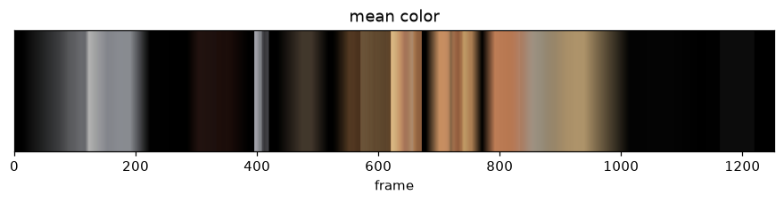{#fig-ch06-goal width=95%}

新しいノートブック `ch06.ipynb` をプロジェクトフォルダの直下に作り、カーネルに `.venv` を選んでください。
最初のセルで、この章で使うライブラリと、第4章で作った `videotools.py` の関数をまとめて読み込みます。

```python
import cv2
import numpy as np
import pandas as pd
import matplotlib.pyplot as plt

from videotools import video_info, iter_frames, read_frame, show

path = "data/sintel_trailer-480p.mp4"
print(cv2.__version__)
```

```{.default}
5.1.0
```

## RGBでは色を扱いにくい理由 {#sec-ch06-rgb}

### 4つの画素を調べる

まず、色のはっきりしたフレームを1枚選び、いくつかの画素の値を読んでみます。
750番目のフレームを読み込み、空、肌、髪、髪の影になった部分の4か所に印を付けて表示します。
位置は第3章と同じく `(y, x)`、つまり「上から何番目、左から何番目」の順で指定しています。

```python
frame = read_frame(path, 750)

points = {
    "sky": (100, 800),
    "skin": (200, 330),
    "hair": (150, 250),
    "hair (shadow)": (130, 300),
}

plt.figure(figsize=(8, 4.5))
show(frame, "frame 750")
for name, (y, x) in points.items():
    plt.plot(x, y, "o", color="white", markeredgecolor="black")
    plt.text(x + 14, y, name, color="white", backgroundcolor="black", va="center")
plt.show()
```

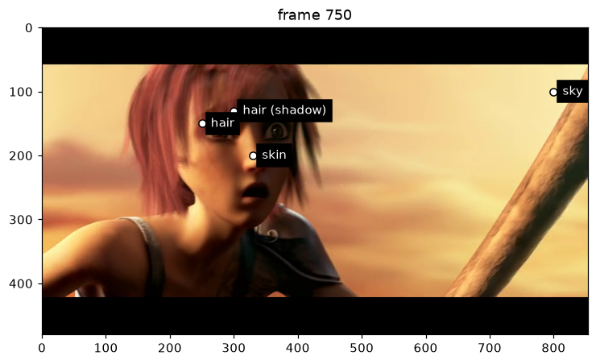{#fig-ch06-frame-750 width=85%}

`points.items()` は、辞書から、名前（キー）と位置（値）を1組ずつ取り出します。
`plt.plot` に `"o"` を指定すると、線ではなく丸い印を描きます。
`plt.text` は、図の中に文字を書き込みます。

4つの画素の値を表示します。

```python
for name, (y, x) in points.items():
    print(name, frame[y, x])
```

```{.default}
sky [170 233 248]
skin [102 177 243]
hair [ 43  55 133]
hair (shadow) [24 36 89]
```

第3章で見たとおり、OpenCVの画素値は青（B）・緑（G）・赤（R）の順に並んでいます。
空の画素は「青170、緑233、赤248」です。

### 3つの数字から色を読み取れるか

この数字を見て、次の問いに答えられるでしょうか。

- 空と肌では、どちらが鮮やかな色でしょうか。
- 髪と、髪の影になった部分は、同じ色みでしょうか。

空 `[170 233 248]` と肌 `[102 177 243]` は、どちらも赤がもっとも大きく、青がもっとも小さい並びです。
橙色の仲間らしいことは推測できますが、鮮やかさの違いを数字から直接読み取るのは困難です。

髪 `[43 55 133]` と髪の影 `[24 36 89]` は、人間の目には「同じ赤茶色の、明るい部分と暗い部分」に見えます。
ところが数値は、3つとも別の値に変わっています。
明るさが変わっただけで3つの値がすべて動いてしまうので、「同じ色みかどうか」を判定するには、3つの値の比率を見比べなければなりません。

BGR（あるいはRGB）の3つの値は、ディスプレイが光らせる3色の強さをそのまま表したものです。
機械には都合のよい表し方ですが、「何色か」「どれくらい鮮やかか」「どれくらい明るいか」という、人間が色について語るときの3つの観点は、3つの値の中に混ざり合っています。
そこで、この3つの観点をそれぞれ1つの数値に分けて表す方法を使います。

## HSV色空間——色相・彩度・明度 {#sec-ch06-hsv}

### 3つの成分

色を数値の組で表す方法を**色空間**（color space）と呼びます。
BGRも色空間の1つです。
ここで使う**HSV色空間**は、色を次の3つの成分で表します。

- **色相**（Hue、H）：赤、黄、緑、青といった色の種類です。色を円形に並べた**色相環**（hue circle）の上の角度で表します。
- **彩度**（Saturation、S）：色の鮮やかさです。0は灰色（色みがない）で、大きいほど鮮やかです。
- **明度**（Value、V）：明るさです。0は黒で、大きいほど明るくなります。

@fig-ch06-hue-wheel は色相環です。
赤を0°として、黄（60°）、緑（120°）、シアン（180°）、青（240°）、マゼンタ（300°）と進み、360°で赤に戻ります。
中心に近づくほど彩度が低く、白に近づきます。

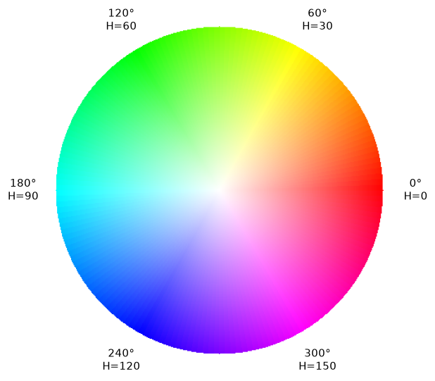{#fig-ch06-hue-wheel width=55%}

::: {.callout-tip collapse="true" title="色相環を描いたコード"}
@fig-ch06-hue-wheel は、HSVの値を持つ画像を作り、OpenCVでBGRに変換して描いたものです。
興味のある方は実行してみてください（この先の内容には影響しません）。

```python
size = 401
c = size // 2
yy, xx = np.mgrid[0:size, 0:size]                       # 各画素の縦位置と横位置
angle = np.degrees(np.arctan2(c - yy, xx - c)) % 360    # 中心から見た角度（右が0°、反時計回り）
radius = np.hypot(xx - c, yy - c) / c                   # 中心からの距離（縁が1）

wheel = np.zeros((size, size, 3), dtype=np.uint8)
wheel[:, :, 0] = angle / 2                      # H：角度の半分
wheel[:, :, 1] = np.clip(radius, 0, 1) * 255    # S：中心から離れるほど大きい
wheel[:, :, 2] = 255                            # V：最大
wheel_bgr = cv2.cvtColor(wheel, cv2.COLOR_HSV2BGR)
wheel_bgr[radius > 1] = 255                     # 円の外側は白にする

plt.figure(figsize=(5.5, 5.5))
show(wheel_bgr)
for deg in range(0, 360, 60):
    t = np.radians(deg)
    plt.text(c + 1.2 * c * np.cos(t), c - 1.2 * c * np.sin(t),
             f"{deg}°\nH={deg // 2}", ha="center", va="center")
plt.axis("off")
plt.show()
```
:::

### BGRからHSVに変換する

変換には、第3章で色の並び順を変えるときに使った `cv2.cvtColor` を使います。
変換の種類として `cv2.COLOR_BGR2HSV` を指定します。

```python
hsv = cv2.cvtColor(frame, cv2.COLOR_BGR2HSV)

print(hsv.shape, hsv.dtype)
```

```{.default}
(480, 854, 3) uint8
```

形もデータ型も、もとの画像と同じです。
変わったのは3つの値の意味で、`hsv[y, x]` は「H、S、V」の順に並んでいます。
先ほどの4つの画素を、変換の前後で並べてみます。

```python
for name, (y, x) in points.items():
    print(name, frame[y, x], "->", hsv[y, x])
```

```{.default}
sky [170 233 248] -> [ 24  80 248]
skin [102 177 243] -> [ 16 148 243]
hair [ 43  55 133] -> [  4 173 133]
hair (shadow) [24 36 89] -> [  6 186  89]
```

@sec-ch06-rgb の2つの問いに、今度は数字から答えられます。

- 空の彩度Sは80、肌は148です。肌のほうが鮮やかで、空は白に近い淡い色だとわかります。
- 髪と髪の影は、色相Hが4と6、彩度Sが173と186で、ほぼ同じです。大きく違うのは明度V（133と89）だけです。「同じ色みで、明るさだけが違う」という見た目の印象が、そのまま数値に表れています。

SとVがどう計算されているかも確かめておきます。
OpenCVの8ビット画像では、VはB・G・Rの**最大値**、Sは「最大値と最小値の差が、最大値に対してどれくらいの割合か」を255倍したものです。
肌の画素 `[102 177 243]` で計算してみます。

```python
b, g, r = frame[200, 330].astype(int)
largest = max(b, g, r)
smallest = min(b, g, r)

print(largest)
print(255 * (largest - smallest) / largest)
```

```{.default}
243
147.96296296296296
```

`cv2.cvtColor` の結果（V＝243、S＝148）と一致しました。
3つの値がそろっている（最大と最小の差が小さい）ほど灰色に近く、Sは小さくなります。

### 純色で値の範囲を確かめる

色相Hの値を理解するために、赤・黄・緑などの純色を変換してみます。
`np.uint8([[bgr]])` は、縦1画素・横1画素の画像を作る書き方です。

```python
pure = {
    "red": (0, 0, 255),
    "yellow": (0, 255, 255),
    "green": (0, 255, 0),
    "cyan": (255, 255, 0),
    "blue": (255, 0, 0),
    "magenta": (255, 0, 255),
    "white": (255, 255, 255),
    "gray": (128, 128, 128),
    "black": (0, 0, 0),
}

for name, bgr in pure.items():
    pixel = np.uint8([[bgr]])   # 縦1×横1画素の画像
    print(name, cv2.cvtColor(pixel, cv2.COLOR_BGR2HSV)[0, 0])
```

```{.default}
red [  0 255 255]
yellow [ 30 255 255]
green [ 60 255 255]
cyan [ 90 255 255]
blue [120 255 255]
magenta [150 255 255]
white [  0   0 255]
gray [  0   0 128]
black [0 0 0]
```

赤・黄・緑・シアン・青・マゼンタのHは、0、30、60、90、120、150です。
@fig-ch06-hue-wheel の角度（0°、60°、120°、…）の、ちょうど**半分**になっています。

これは、`uint8` には0から255までの値しか入らないためです。
0°から359°までの角度はそのままでは収まらないので、OpenCVは角度を2で割った値をHに入れます。
整理すると @tbl-ch06-hue のようになります。

| 色 | 色相環での角度 | OpenCVのH |
|---|---|---|
| 赤 | 0° | 0 |
| 黄 | 60° | 30 |
| 緑 | 120° | 60 |
| シアン | 180° | 90 |
| 青 | 240° | 120 |
| マゼンタ | 300° | 150 |

: 代表的な色の色相。OpenCVの8ビット画像では、Hは角度の半分になる {#tbl-ch06-hue}

Hの最大値が本当に179なのかも、実行して確かめます。
あらゆる色がまんべんなく含まれるように、乱数で100万画素の画像を作って変換し、各成分の最小値と最大値を調べます。

```python
rng = np.random.default_rng(0)
noise = rng.integers(0, 256, size=(1000, 1000, 3), dtype=np.uint8)
noise_hsv = cv2.cvtColor(noise, cv2.COLOR_BGR2HSV)

for i, name in enumerate(["H", "S", "V"]):
    print(name, noise_hsv[:, :, i].min(), noise_hsv[:, :, i].max())
```

```{.default}
H 0 179
S 0 255
V 2 255
```

`np.random.default_rng(0)` は、乱数を作る道具を用意します。
かっこの中の0は、毎回同じ乱数を得るための指定です（くわしくは @sec-ch06-kmeans で説明します）。
`rng.integers(0, 256, ...)` で、0から255までの整数の乱数を、指定した形の配列として作っています。

Hは0から179、SとVは255までの値をとることが確かめられました（Vの最小値が0でなく2なのは、乱数で作った100万画素の中に、3つの値がすべて1以下の画素がたまたまなかったためです）。

::: {.callout-warning title="OpenCVのHは0〜179（角度の半分）"}
OpenCVの8ビット画像（`uint8`）では、**Hは0〜179、SとVは0〜255**です。
Hだけ範囲が違い、しかも角度の半分であることは、HSVを使うときにもっとも間違えやすい点です。

- 角度に直すときは2倍します。H＝120は240°（青）です。
- 画像編集ソフトやほかのライブラリは、Hを0〜360、SとVを0〜100（%）で表すことがよくあります。それらの数値をOpenCVのコードに書き写すときは、Hを半分に、SとVを2.55倍にする必要があります。

なお、`cv2.COLOR_BGR2HSV` の代わりに `cv2.COLOR_BGR2HSV_FULL` を指定すると、Hを0〜255に引き伸ばした値が得られます。
紛らわしいので、本書では `cv2.COLOR_BGR2HSV` だけを使います。
:::

角度に直すときには、もう1つ注意があります。
Hの配列をそのまま2倍すると、第3章で見た `uint8` のオーバーフロー（桁あふれ）が起きます。

```python
h = np.uint8([10, 100, 150])

print(h * 2)
print(h.astype(int) * 2)
```

```{.default}
[ 20 200  44]
[ 20 200 300]
```

150の2倍は300ですが、`uint8` のままでは、255の次が0に戻るので、300−256＝44になってしまいます。
Hを使って計算するときは、`astype(int)` や `astype(float)` で型を変えてからにしましょう。

### フレームをH・S・Vに分けて眺める

750番目のフレームの3つの成分を、それぞれグレースケール画像として表示します。
`hsv[:, :, 0]` がH、`hsv[:, :, 1]` がS、`hsv[:, :, 2]` がVです。

```python
fig, axes = plt.subplots(1, 3, figsize=(14, 3))
for i, name in enumerate(["H", "S", "V"]):
    show(hsv[:, :, i], name, ax=axes[i])
plt.show()
```

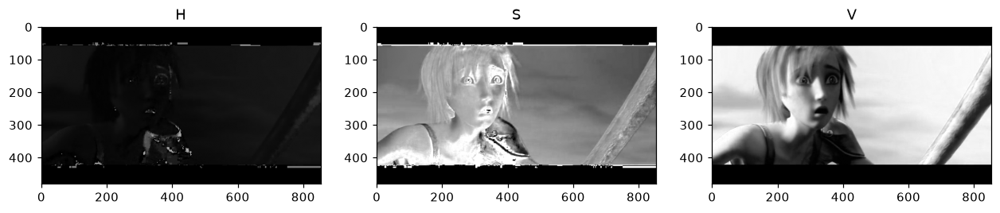{#fig-ch06-hsv-channels width=100%}

- **H**は全体に暗く表示されています。この場面は肌も髪も空も橙色の仲間で、Hの値が0〜30ほどの小さい数に集まっているためです。
- **S**では、髪や肌が白く（鮮やか）、空の明るい部分が暗く（淡い）なっています。
- **V**は、見た目の明るさに近い画像です。

::: {.callout-note title="明度Vと、第5章の輝度の違い"}
Vは第5章で扱った輝度と似ていますが、別の量です。
Vは3つの値の最大値なので、純粋な青 `(255, 0, 0)` でもVは255になります。
一方、グレースケールに変換した値は、人間の目に青が暗く見えることを反映して小さくなります。

```python
blue = np.uint8([[[255, 0, 0]]])

print(cv2.cvtColor(blue, cv2.COLOR_BGR2HSV)[0, 0])
print(cv2.cvtColor(blue, cv2.COLOR_BGR2GRAY)[0, 0])
```

```{.default}
[120 255 255]
29
```

明るさの分析には第5章の輝度を使い、Vは「色を3つの成分に分けたときの1つ」として扱うのがよいでしょう。
:::

## 色相ヒストグラムと、色相が「環」であることへの注意 {#sec-ch06-hue}

### そのまま数えると起きること

1枚のフレームにどの色相の画素がどれだけあるかを数えたものを、**色相ヒストグラム**（hue histogram）と呼びます。
第5章の輝度ヒストグラムの色相版です。

Hは0から179の整数ですから、それぞれの値の画素が何個あるかを数えれば済みます。
`np.bincount` は、整数の配列について「0が何個、1が何個、…」を数える関数です。
`ravel()` で画像を1列に並べ直してから渡し、`minlength=180` で結果の長さを180にそろえます。

```python
h = hsv[:, :, 0]
counts = np.bincount(h.ravel(), minlength=180)

print(counts[:6])
print(counts[0] / h.size)
```

```{.default}
[98527   551   986  4377 11637  8098]
0.2403566549570648
```

H＝0の画素が98,527個で、全体の24%を占めています。
しかし @fig-ch06-frame-750 に、純粋な赤（H＝0）がそれほど多いようには見えません。

原因は、画面の上下にある黒い帯です。
先ほどの純色の結果を見直してください。
白・灰色・黒は、どれも**Hが0、Sが0**でした。
色みのない画素には「色の種類」がありませんが、Hの欄を空にはできないので、OpenCVは0を入れます。
その結果、黒帯の画素のほとんどが「赤」として数えられてしまったのです。

色相ヒストグラムを作る前に、次の2つの手当てが必要です。

1. 黒帯を取り除く。
2. 灰色や黒に近い画素を、数える対象から外す。

### 黒帯（レターボックス）を切り落とす

この黒い帯は、第3章と第5章で見たレターボックスです。
第5章では、全フレームを調べて、絵が映っているのは58番目から421番目の行だと確かめました。
この章でも、同じ範囲を使います。

念のため、このフレームでも境目を確かめておきます。
`frame.mean(axis=(1, 2))` は、横方向と色の方向について平均をとる計算で、行ごとの平均の明るさが得られます。

```python
row_mean = frame.mean(axis=(1, 2))

print(row_mean[54:62].round(1))
print(row_mean[418:426].round(1))
```

```{.default}
[  0.6   0.9   1.8   1.7 166.9 166.6 165.9 165.6]
[75.1 75.4 77.1 77.   1.4  0.9  0.2  0.1]
```

第5章の結果のとおり、58番目から421番目の行までが明るく、その外側はほぼ0です。
第5章と同じように、この範囲を絵の部分として切り出します。

```python
TOP, BOTTOM = 58, 422

picture = frame[TOP:BOTTOM]
print(picture.shape)
```

```{.default}
(364, 854, 3)
```

縦364画素の画像になりました。
`TOP` と `BOTTOM` は、この章の最後まで使います。

::: {.callout-warning title="黒帯の位置は映像ごとに違う"}
`TOP, BOTTOM = 58, 422` は、この予告編のファイルだけに当てはまる値です。
自分の映像を分析するときは、第5章の方法で、境目を調べ直してください。

黒帯を含めたまま計算すると、色相だけでなく、平均の色や彩度も帯の面積の分だけ黒に引っ張られます。
:::

### 色みのない画素を除外する

次に、絵の部分に残っている「色みのない画素」を除外します。
除外すべきものは2種類あります。

- **彩度Sが低い画素**（白や灰色に近い）：B・G・Rの値がほとんど同じで、どれがわずかに大きいかによって色相が決まります。圧縮で生じる小さな誤差で、色相が大きく変わってしまいます。
- **明度Vが低い画素**（黒に近い）：値そのものが小さいので、1や2の違いで色相も彩度も大きく変わります。

そこで、「Sが40以上、かつVが40以上」の画素だけを数えることにします。
このように、判定の境目として使う値を、**しきい値**（threshold）と呼びます。
条件に合う画素を `True`、合わない画素を `False` で表した配列を作ります。
第3章で作ったマスクです。

```python
hsv = cv2.cvtColor(picture, cv2.COLOR_BGR2HSV)
h, s, v = hsv[:, :, 0], hsv[:, :, 1], hsv[:, :, 2]

mask = (s >= 40) & (v >= 40)
print(mask.shape, mask.dtype)
print(mask.mean())
```

```{.default}
(364, 854) bool
0.8934233214092698
```

`s >= 40` のように配列と数値を比べると、画素ごとの `True`／`False` が並んだ配列になります。
`&` は「かつ」を表し、2つの条件を両方とも満たす画素だけが `True` になります。
`mask.mean()` は `True` の割合で、絵の部分の約89%が「色みのある画素」と判定されました。

マスクを配列の添字に使うと、`True` の位置にある値だけを取り出せます。

```python
print(h.shape, h[mask].shape)
```

```{.default}
(364, 854) (277726,)
```

`h[mask]` は、色みのある277,726個の画素の色相を1列に並べた配列です。

ここまでに値を調べた7つの画素を例にして、このしくみを @fig-ch06-mask に示します。

::: {#fig-ch06-mask}

```{=html}
<svg viewBox="0 0 760 375" role="img" aria-label="マスクで色みのある画素だけを取り出すしくみ。7つの画素の色相、彩度、明度を並べた。空は24、80、248。肌は16、148、243。髪は4、173、133。髪の影は6、186、89。白は0、0、255。灰色は0、0、128。黒は0、0、0。彩度が40以上かどうかと、明度が40以上かどうかをそれぞれ調べ、両方がTrueの画素だけがマスクでTrueになる。空、肌、髪、髪の影の4つがTrueで、マスクを添字に使うと、その4つの色相24、16、4、6だけが取り出される。" style="width:100%;height:auto;font-family:inherit" fill="currentColor">
  <text x="268" y="42" font-size="12" text-anchor="middle" fill-opacity="0.8">空</text>
  <rect x="236" y="52" width="64" height="32" fill="currentColor" fill-opacity="0.04" stroke="currentColor" stroke-opacity="0.55" stroke-width="1"/>
  <text x="268" y="72.68" font-size="13" text-anchor="middle">24</text>
  <rect x="236" y="88" width="64" height="32" fill="currentColor" fill-opacity="0.04" stroke="currentColor" stroke-opacity="0.55" stroke-width="1"/>
  <text x="268" y="108.68" font-size="13" text-anchor="middle">80</text>
  <rect x="236" y="124" width="64" height="32" fill="currentColor" fill-opacity="0.04" stroke="currentColor" stroke-opacity="0.55" stroke-width="1"/>
  <text x="268" y="144.68" font-size="13" text-anchor="middle">248</text>
  <rect x="236" y="176" width="64" height="32" fill="#1f6fb2" stroke="currentColor" stroke-opacity="0.55" stroke-width="1"/>
  <text x="268" y="196.68" font-size="13" font-weight="700" text-anchor="middle" fill="#ffffff">True</text>
  <rect x="236" y="212" width="64" height="32" fill="#1f6fb2" stroke="currentColor" stroke-opacity="0.55" stroke-width="1"/>
  <text x="268" y="232.68" font-size="13" font-weight="700" text-anchor="middle" fill="#ffffff">True</text>
  <rect x="236" y="264" width="64" height="32" fill="#f0b84a" stroke="currentColor" stroke-opacity="0.55" stroke-width="1"/>
  <text x="268" y="284.68" font-size="13" font-weight="700" text-anchor="middle" fill="#1c1300">True</text>
  <text x="332" y="42" font-size="12" text-anchor="middle" fill-opacity="0.8">肌</text>
  <rect x="300" y="52" width="64" height="32" fill="currentColor" fill-opacity="0.04" stroke="currentColor" stroke-opacity="0.55" stroke-width="1"/>
  <text x="332" y="72.68" font-size="13" text-anchor="middle">16</text>
  <rect x="300" y="88" width="64" height="32" fill="currentColor" fill-opacity="0.04" stroke="currentColor" stroke-opacity="0.55" stroke-width="1"/>
  <text x="332" y="108.68" font-size="13" text-anchor="middle">148</text>
  <rect x="300" y="124" width="64" height="32" fill="currentColor" fill-opacity="0.04" stroke="currentColor" stroke-opacity="0.55" stroke-width="1"/>
  <text x="332" y="144.68" font-size="13" text-anchor="middle">243</text>
  <rect x="300" y="176" width="64" height="32" fill="#1f6fb2" stroke="currentColor" stroke-opacity="0.55" stroke-width="1"/>
  <text x="332" y="196.68" font-size="13" font-weight="700" text-anchor="middle" fill="#ffffff">True</text>
  <rect x="300" y="212" width="64" height="32" fill="#1f6fb2" stroke="currentColor" stroke-opacity="0.55" stroke-width="1"/>
  <text x="332" y="232.68" font-size="13" font-weight="700" text-anchor="middle" fill="#ffffff">True</text>
  <rect x="300" y="264" width="64" height="32" fill="#f0b84a" stroke="currentColor" stroke-opacity="0.55" stroke-width="1"/>
  <text x="332" y="284.68" font-size="13" font-weight="700" text-anchor="middle" fill="#1c1300">True</text>
  <text x="396" y="42" font-size="12" text-anchor="middle" fill-opacity="0.8">髪</text>
  <rect x="364" y="52" width="64" height="32" fill="currentColor" fill-opacity="0.04" stroke="currentColor" stroke-opacity="0.55" stroke-width="1"/>
  <text x="396" y="72.68" font-size="13" text-anchor="middle">4</text>
  <rect x="364" y="88" width="64" height="32" fill="currentColor" fill-opacity="0.04" stroke="currentColor" stroke-opacity="0.55" stroke-width="1"/>
  <text x="396" y="108.68" font-size="13" text-anchor="middle">173</text>
  <rect x="364" y="124" width="64" height="32" fill="currentColor" fill-opacity="0.04" stroke="currentColor" stroke-opacity="0.55" stroke-width="1"/>
  <text x="396" y="144.68" font-size="13" text-anchor="middle">133</text>
  <rect x="364" y="176" width="64" height="32" fill="#1f6fb2" stroke="currentColor" stroke-opacity="0.55" stroke-width="1"/>
  <text x="396" y="196.68" font-size="13" font-weight="700" text-anchor="middle" fill="#ffffff">True</text>
  <rect x="364" y="212" width="64" height="32" fill="#1f6fb2" stroke="currentColor" stroke-opacity="0.55" stroke-width="1"/>
  <text x="396" y="232.68" font-size="13" font-weight="700" text-anchor="middle" fill="#ffffff">True</text>
  <rect x="364" y="264" width="64" height="32" fill="#f0b84a" stroke="currentColor" stroke-opacity="0.55" stroke-width="1"/>
  <text x="396" y="284.68" font-size="13" font-weight="700" text-anchor="middle" fill="#1c1300">True</text>
  <text x="460" y="42" font-size="12" text-anchor="middle" fill-opacity="0.8">髪の影</text>
  <rect x="428" y="52" width="64" height="32" fill="currentColor" fill-opacity="0.04" stroke="currentColor" stroke-opacity="0.55" stroke-width="1"/>
  <text x="460" y="72.68" font-size="13" text-anchor="middle">6</text>
  <rect x="428" y="88" width="64" height="32" fill="currentColor" fill-opacity="0.04" stroke="currentColor" stroke-opacity="0.55" stroke-width="1"/>
  <text x="460" y="108.68" font-size="13" text-anchor="middle">186</text>
  <rect x="428" y="124" width="64" height="32" fill="currentColor" fill-opacity="0.04" stroke="currentColor" stroke-opacity="0.55" stroke-width="1"/>
  <text x="460" y="144.68" font-size="13" text-anchor="middle">89</text>
  <rect x="428" y="176" width="64" height="32" fill="#1f6fb2" stroke="currentColor" stroke-opacity="0.55" stroke-width="1"/>
  <text x="460" y="196.68" font-size="13" font-weight="700" text-anchor="middle" fill="#ffffff">True</text>
  <rect x="428" y="212" width="64" height="32" fill="#1f6fb2" stroke="currentColor" stroke-opacity="0.55" stroke-width="1"/>
  <text x="460" y="232.68" font-size="13" font-weight="700" text-anchor="middle" fill="#ffffff">True</text>
  <rect x="428" y="264" width="64" height="32" fill="#f0b84a" stroke="currentColor" stroke-opacity="0.55" stroke-width="1"/>
  <text x="460" y="284.68" font-size="13" font-weight="700" text-anchor="middle" fill="#1c1300">True</text>
  <text x="524" y="42" font-size="12" text-anchor="middle" fill-opacity="0.8">白</text>
  <rect x="492" y="52" width="64" height="32" fill="currentColor" fill-opacity="0.04" stroke="currentColor" stroke-opacity="0.55" stroke-width="1"/>
  <text x="524" y="72.68" font-size="13" text-anchor="middle">0</text>
  <rect x="492" y="88" width="64" height="32" fill="currentColor" fill-opacity="0.04" stroke="currentColor" stroke-opacity="0.55" stroke-width="1"/>
  <text x="524" y="108.68" font-size="13" text-anchor="middle">0</text>
  <rect x="492" y="124" width="64" height="32" fill="currentColor" fill-opacity="0.04" stroke="currentColor" stroke-opacity="0.55" stroke-width="1"/>
  <text x="524" y="144.68" font-size="13" text-anchor="middle">255</text>
  <rect x="492" y="176" width="64" height="32" fill="none" stroke-dasharray="4 3" stroke="currentColor" stroke-opacity="0.55" stroke-width="1"/>
  <text x="524" y="196.68" font-size="13" text-anchor="middle" fill-opacity="0.6">False</text>
  <rect x="492" y="212" width="64" height="32" fill="#1f6fb2" stroke="currentColor" stroke-opacity="0.55" stroke-width="1"/>
  <text x="524" y="232.68" font-size="13" font-weight="700" text-anchor="middle" fill="#ffffff">True</text>
  <rect x="492" y="264" width="64" height="32" fill="none" stroke-dasharray="4 3" stroke="currentColor" stroke-opacity="0.55" stroke-width="1"/>
  <text x="524" y="284.68" font-size="13" text-anchor="middle" fill-opacity="0.6">False</text>
  <text x="588" y="42" font-size="12" text-anchor="middle" fill-opacity="0.8">灰色</text>
  <rect x="556" y="52" width="64" height="32" fill="currentColor" fill-opacity="0.04" stroke="currentColor" stroke-opacity="0.55" stroke-width="1"/>
  <text x="588" y="72.68" font-size="13" text-anchor="middle">0</text>
  <rect x="556" y="88" width="64" height="32" fill="currentColor" fill-opacity="0.04" stroke="currentColor" stroke-opacity="0.55" stroke-width="1"/>
  <text x="588" y="108.68" font-size="13" text-anchor="middle">0</text>
  <rect x="556" y="124" width="64" height="32" fill="currentColor" fill-opacity="0.04" stroke="currentColor" stroke-opacity="0.55" stroke-width="1"/>
  <text x="588" y="144.68" font-size="13" text-anchor="middle">128</text>
  <rect x="556" y="176" width="64" height="32" fill="none" stroke-dasharray="4 3" stroke="currentColor" stroke-opacity="0.55" stroke-width="1"/>
  <text x="588" y="196.68" font-size="13" text-anchor="middle" fill-opacity="0.6">False</text>
  <rect x="556" y="212" width="64" height="32" fill="#1f6fb2" stroke="currentColor" stroke-opacity="0.55" stroke-width="1"/>
  <text x="588" y="232.68" font-size="13" font-weight="700" text-anchor="middle" fill="#ffffff">True</text>
  <rect x="556" y="264" width="64" height="32" fill="none" stroke-dasharray="4 3" stroke="currentColor" stroke-opacity="0.55" stroke-width="1"/>
  <text x="588" y="284.68" font-size="13" text-anchor="middle" fill-opacity="0.6">False</text>
  <text x="652" y="42" font-size="12" text-anchor="middle" fill-opacity="0.8">黒</text>
  <rect x="620" y="52" width="64" height="32" fill="currentColor" fill-opacity="0.04" stroke="currentColor" stroke-opacity="0.55" stroke-width="1"/>
  <text x="652" y="72.68" font-size="13" text-anchor="middle">0</text>
  <rect x="620" y="88" width="64" height="32" fill="currentColor" fill-opacity="0.04" stroke="currentColor" stroke-opacity="0.55" stroke-width="1"/>
  <text x="652" y="108.68" font-size="13" text-anchor="middle">0</text>
  <rect x="620" y="124" width="64" height="32" fill="currentColor" fill-opacity="0.04" stroke="currentColor" stroke-opacity="0.55" stroke-width="1"/>
  <text x="652" y="144.68" font-size="13" text-anchor="middle">0</text>
  <rect x="620" y="176" width="64" height="32" fill="none" stroke-dasharray="4 3" stroke="currentColor" stroke-opacity="0.55" stroke-width="1"/>
  <text x="652" y="196.68" font-size="13" text-anchor="middle" fill-opacity="0.6">False</text>
  <rect x="620" y="212" width="64" height="32" fill="none" stroke-dasharray="4 3" stroke="currentColor" stroke-opacity="0.55" stroke-width="1"/>
  <text x="652" y="232.68" font-size="13" text-anchor="middle" fill-opacity="0.6">False</text>
  <rect x="620" y="264" width="64" height="32" fill="none" stroke-dasharray="4 3" stroke="currentColor" stroke-opacity="0.55" stroke-width="1"/>
  <text x="652" y="284.68" font-size="13" text-anchor="middle" fill-opacity="0.6">False</text>
  <text x="14" y="73" font-size="13" font-weight="700">h（色相）</text>
  <text x="14" y="109" font-size="13" font-weight="700">s（彩度）</text>
  <text x="14" y="145" font-size="13" font-weight="700">v（明度）</text>
  <text x="14" y="197" font-size="13" font-weight="700">s &gt;= 40</text>
  <text x="14" y="233" font-size="13" font-weight="700">v &gt;= 40</text>
  <text x="14" y="278" font-size="13" font-weight="700">mask</text>
  <text x="14" y="293" font-size="12" fill-opacity="0.75">両方 True の画素</text>
  <line x1="268" y1="300" x2="268" y2="320" stroke="#1f6fb2" stroke-width="2"/>
  <path d="M268 328 l-5 -9 h10z" fill="#1f6fb2"/>
  <rect x="236" y="330" width="64" height="32" fill="#f0b84a" stroke="currentColor" stroke-opacity="0.55" stroke-width="1"/>
  <text x="268" y="350.68" font-size="13" font-weight="700" text-anchor="middle" fill="#1c1300">24</text>
  <line x1="332" y1="300" x2="332" y2="320" stroke="#1f6fb2" stroke-width="2"/>
  <path d="M332 328 l-5 -9 h10z" fill="#1f6fb2"/>
  <rect x="300" y="330" width="64" height="32" fill="#f0b84a" stroke="currentColor" stroke-opacity="0.55" stroke-width="1"/>
  <text x="332" y="350.68" font-size="13" font-weight="700" text-anchor="middle" fill="#1c1300">16</text>
  <line x1="396" y1="300" x2="396" y2="320" stroke="#1f6fb2" stroke-width="2"/>
  <path d="M396 328 l-5 -9 h10z" fill="#1f6fb2"/>
  <rect x="364" y="330" width="64" height="32" fill="#f0b84a" stroke="currentColor" stroke-opacity="0.55" stroke-width="1"/>
  <text x="396" y="350.68" font-size="13" font-weight="700" text-anchor="middle" fill="#1c1300">4</text>
  <line x1="460" y1="300" x2="460" y2="320" stroke="#1f6fb2" stroke-width="2"/>
  <path d="M460 328 l-5 -9 h10z" fill="#1f6fb2"/>
  <rect x="428" y="330" width="64" height="32" fill="#f0b84a" stroke="currentColor" stroke-opacity="0.55" stroke-width="1"/>
  <text x="460" y="350.68" font-size="13" font-weight="700" text-anchor="middle" fill="#1c1300">6</text>
  <text x="14" y="344" font-size="13" font-weight="700">h[mask]</text>
  <text x="14" y="359" font-size="12" fill-opacity="0.75">True の位置の色相だけ</text>
  <text x="506" y="351" font-size="12" fill-opacity="0.8">7個のうち4個が残る</text>
</svg>
```

マスクで色みのある画素だけを取り出す。上の3段がH・S・Vの値、中の2段がそれぞれの条件の結果、その下がマスク、最下段が取り出された色相
:::

::: {.callout-important title="しきい値の40は、分析者が決めた値"}
「Sが40以上、Vが40以上」という線引きに、決まった正解はありません。
40という値は、0〜255の範囲の約16%にあたり、「明らかに灰色や黒に見える画素を外す」ための目安として本書で選んだものです。
この値を変えると結果が変わることを、@sec-ch06-warmcool で実際に確かめます。
分析結果を報告するときは、使ったしきい値を必ず書き添えてください。
:::

ここまでの手順を関数にまとめておきます。

```python
def colored_hue(frame, s_min=40, v_min=40):
    """黒帯を除いた絵の部分のうち、色みのある画素の色相（0〜179）を1次元の配列で返す。"""
    hsv = cv2.cvtColor(frame[TOP:BOTTOM], cv2.COLOR_BGR2HSV)
    h, s, v = hsv[:, :, 0], hsv[:, :, 1], hsv[:, :, 2]
    return h[(s >= s_min) & (v >= v_min)]
```

### 色相ヒストグラムを描く

ヒストグラムの棒を、それぞれの色相の色で塗ることにします。
そのために、Hが0から179までの純色を180個作り、Matplotlibで使える形（RGBの順で、0から1の値）に直しておきます。
描く処理も関数にします。

```python
hue_strip = np.zeros((1, 180, 3), dtype=np.uint8)
hue_strip[0, :, 0] = np.arange(180)   # H：0, 1, 2, ..., 179
hue_strip[0, :, 1] = 255              # S：最大
hue_strip[0, :, 2] = 255              # V：最大
hue_colors = cv2.cvtColor(hue_strip, cv2.COLOR_HSV2RGB)[0] / 255


def plot_hue_hist(counts, ax, title=None):
    """色相ヒストグラムを、それぞれの色相の色で描く。"""
    ax.bar(np.arange(180), counts, width=1, color=hue_colors)
    ax.set_xlim(0, 180)
    ax.set_xlabel("hue H (OpenCV, 0-179)")
    ax.set_ylabel("pixels")
    ax.grid(alpha=0.3)
    if title is not None:
        ax.set_title(title)
```

750番目のフレームの色相ヒストグラムを描きます。

```python
counts = np.bincount(colored_hue(frame), minlength=180)

fig, ax = plt.subplots(figsize=(8, 3))
plot_hue_hist(counts, ax, "frame 750")
plt.show()
```

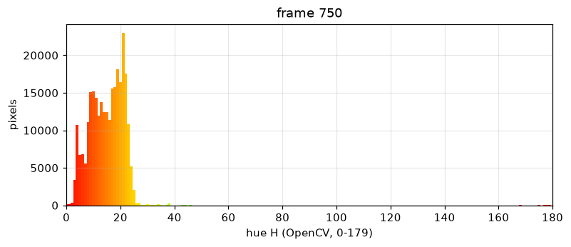{#fig-ch06-hue-hist-750 width=85%}

H＝0に集中していた約9.9万個の画素は消え、画素は0から30ほどの範囲に集まっています。
数値でも確かめます。

```python
print(counts.argmax())
print(counts[:30].sum() / counts.sum())
```

```{.default}
21
0.9963561207809135
```

`counts.argmax()` は、配列の中で値がもっとも大きい要素の位置を返します。
最大の値が複数ある場合は、そのうち最初の位置が返ります。
もっとも画素の多い色相はH＝21（角度では42°、黄色がかった橙）で、色みのある画素の99.6%がH＝0〜29（赤から黄まで）に入っています。
このフレームは、ほぼ橙色の濃淡だけでできているわけです。

### 映像全体の色相ヒストグラム

同じ計算をすべてのフレームについて行い、結果を足し合わせれば、映像全体の色相ヒストグラムになります。
第4章で作った `iter_frames` でフレームを順に取り出します。

```python
total = np.zeros(180, dtype=np.int64)
for n, img in iter_frames(path):
    total += np.bincount(colored_hue(img), minlength=180)

fig, ax = plt.subplots(figsize=(8, 3))
plot_hue_hist(total, ax, "all frames")
plt.show()
```

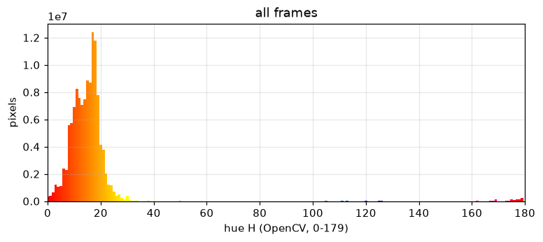{#fig-ch06-hue-hist-all width=85%}

```python
print(total[:30].sum() / total.sum())
print(total[75:135].sum() / total.sum())
```

```{.default}
0.9840212302354747
0.001616338485908285
```

予告編全体でも、色みのある画素の98.4%がH＝0〜29に入っています。
青緑から青にあたるH＝75〜134の画素は、0.16%しかありません。
この予告編の「色みのある画素」は、ほとんどが赤から黄までの範囲に収まっている、ということです。
この結果は @sec-ch06-warmcool でもう一度取り上げます。

### 色相は「環」である——平均が使えない

フレームの色相を1つの数値で代表させたいとき、まず思いつくのは平均です。
しかし、色相の平均には落とし穴があります。

色相は角度ですから、359°の次は0°に戻ります。
赤は0°の付近にあるので、少し紫寄りの赤は350°、少し橙寄りの赤は10°というように、**数値の両端に分かれます**。
この2つを平均してみます。

```python
print(np.mean([350, 10]))
```

```{.default}
180.0
```

180°はシアンです。
赤に近い2つの色を平均したのに、色相環の正反対の色が出てきてしまいました。
数直線の上では350と10の真ん中は180ですが、環の上では、350°と10°の真ん中は0°（赤）です。

実際のフレームでも同じことが起こります。
360番目のフレームを見てみましょう。

```python
frame360 = read_frame(path, 360)

plt.figure(figsize=(8, 4.5))
show(frame360, "frame 360")
plt.show()
```

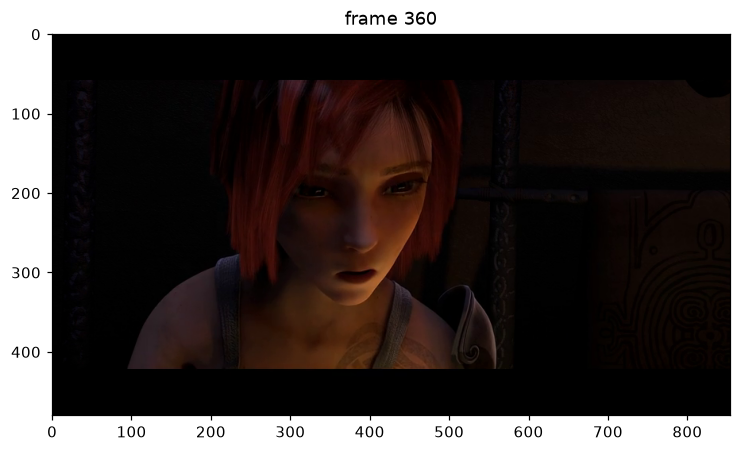{#fig-ch06-frame-360 width=85%}

暗がりの中に、赤い髪の人物が映っています。
色みのある画素の色相を取り出し、H＝0〜14、15〜164、165〜179の3つの範囲に分けて数えます。
あわせて、色相の単純な平均も計算します。

```python
h360 = colored_hue(frame360)
counts360 = np.bincount(h360, minlength=180)

print(counts360[:15].sum(), counts360[15:165].sum(), counts360[165:].sum())
print(h360.mean())
```

```{.default}
59243 942 8578
28.99586987187877
```

画素のほとんどは、0〜14（59,243個）と165〜179（8,578個）という、数値の両端に分かれています。
あいだの15〜164には942個しかありません。
それなのに、単純な平均は約29.0（角度では58°、黄色）です。
このフレームに黄色い画素はほとんどないのですから、この平均は何も代表していません。

### 円周上の平均

環の上にある値の平均は、次のように考えます（@fig-ch06-circular-mean）。

1. それぞれの色相を、色相環の中心からその角度の方向へ伸びる、長さ1の矢印に置き換えます。
2. すべての矢印の先端の位置を平均します。
3. 中心から見て、その平均の位置がある**方向**を、平均の色相とします。

::: {#fig-ch06-circular-mean}

```{=html}
<svg viewBox="0 0 700 300" role="img" aria-label="色相330度と30度を、円の中心から伸びる長さ1の矢印で表した図。2本の矢印の先端の平均は0度の方向にあり、これが円周上の平均になる。数値をそのまま平均した180度は、円の反対側になる。" style="width:100%;height:auto;font-family:inherit" fill="currentColor">
  <circle cx="170" cy="150" r="100" fill="none" stroke="currentColor" stroke-opacity="0.5" stroke-width="1.5"/>
  <line x1="50" y1="150" x2="290" y2="150" stroke="currentColor" stroke-opacity="0.25" stroke-width="1"/>
  <line x1="170" y1="30" x2="170" y2="270" stroke="currentColor" stroke-opacity="0.25" stroke-width="1"/>
  <line x1="256.6" y1="100" x2="256.6" y2="200" stroke="currentColor" stroke-opacity="0.6" stroke-width="1.2" stroke-dasharray="4 3"/>
  <line x1="170" y1="150" x2="248" y2="105" stroke="currentColor" stroke-width="2"/>
  <path d="M256.6 100 L248.7 110.3 L243.7 101.7z"/>
  <line x1="170" y1="150" x2="248" y2="195" stroke="currentColor" stroke-width="2"/>
  <path d="M256.6 200 L243.7 198.3 L248.7 189.7z"/>
  <line x1="170" y1="150" x2="246" y2="150" stroke="#e03131" stroke-width="4"/>
  <path d="M256.6 150 L243.6 143.5 L243.6 156.5z" fill="#e03131"/>
  <circle cx="70" cy="150" r="7" fill="none" stroke="#1098ad" stroke-width="3"/>
  <text x="264" y="94" font-size="14">30°</text>
  <text x="264" y="216" font-size="14">330°</text>
  <text x="296" y="155" font-size="13" fill-opacity="0.7">0°</text>
  <text x="170" y="22" font-size="13" text-anchor="middle" fill-opacity="0.7">90°</text>
  <text x="34" y="155" font-size="13" text-anchor="middle" fill-opacity="0.7">180°</text>
  <text x="170" y="290" font-size="13" text-anchor="middle" fill-opacity="0.7">270°</text>
  <line x1="360" y1="72" x2="396" y2="72" stroke="currentColor" stroke-width="2"/>
  <text x="408" y="77" font-size="14">各画素の色相（長さ1の矢印）</text>
  <line x1="360" y1="112" x2="396" y2="112" stroke="#e03131" stroke-width="4"/>
  <text x="408" y="110" font-size="14">矢印の先端の平均</text>
  <text x="408" y="130" font-size="13" fill-opacity="0.75">向き 0°（赤）が円周上の平均。長さ R ≈ 0.87</text>
  <circle cx="378" cy="168" r="7" fill="none" stroke="#1098ad" stroke-width="3"/>
  <text x="408" y="166" font-size="14">数値をそのまま平均した位置</text>
  <text x="408" y="186" font-size="13" fill-opacity="0.75">(330 + 30) ÷ 2 = 180°（シアン）</text>
</svg>
```

円周上の平均の考え方。見やすくするため、330°と30°の2つの色相で描いている。
:::

式で書くと次のようになります。
$N$ 個の画素の色相を角度で $\theta_1, \theta_2, \dots, \theta_N$ とします（OpenCVのHを2倍したものです）。

$$
\bar{x} = \frac{1}{N}\sum_{i=1}^{N} \cos\theta_i, \qquad
\bar{y} = \frac{1}{N}\sum_{i=1}^{N} \sin\theta_i
$$

$\cos\theta_i$ と $\sin\theta_i$ は、角度 $\theta_i$ の方向を向いた長さ1の矢印の、先端の横の位置と縦の位置です。
$\bar{x}$ と $\bar{y}$ はそれらの平均、つまり「矢印の先端の平均の位置」です。
この位置が中心から見てどの方向にあるかが平均の色相 $\bar{\theta}$ で、中心からの距離を $R$ とします。

$$
\bar{\theta} = \operatorname{atan2}(\bar{y},\ \bar{x}), \qquad
R = \sqrt{\bar{x}^2 + \bar{y}^2}
$$

$\operatorname{atan2}(y, x)$ は、点 $(x, y)$ が中心から見て何度の方向にあるかを返す関数です。
要するに、**角度のまま足し算をするのをやめ、いったん平面上の点に直してから平均し、最後に角度に戻す**という計算です。
この平均を**円周上の平均**（circular mean、円周平均）と呼びます。

$R$ は0から1の値をとり、色相の**集中度**（mean resultant length）を表します。
すべての画素が同じ色相なら、矢印がすべて同じ向きなので $R$ は1です。
色相がばらばらなら、矢印が互いに打ち消し合って $R$ は0に近づきます。
$R$ が小さいときは、平均の色相そのものに意味がないと判断できます。

関数として実装します。
`np.radians` は度をラジアン（`np.cos` や `np.sin` が使う角度の単位）に、`np.degrees` はラジアンを度に直します。
`np.arctan2` が上の式の $\operatorname{atan2}$、`np.hypot(x, y)` は $\sqrt{x^2 + y^2}$ です。
`np.arctan2` は −180°から180°の範囲で答えを返すので、`% 360` で0°から360°の範囲に直し、最後に2で割ってOpenCVのHの単位に戻しています。

```python
def circular_mean_hue(h):
    """色相（0〜179）の円周上の平均と、集中度R（0〜1）を返す。"""
    theta = np.radians(h.astype(float) * 2)   # 角度（ラジアン）に直す
    x = np.cos(theta).mean()                  # 矢印の横成分の平均
    y = np.sin(theta).mean()                  # 矢印の縦成分の平均
    mean_deg = np.degrees(np.arctan2(y, x)) % 360
    return mean_deg / 2, np.hypot(x, y)
```

まず、答えのわかっている例で確かめます。
H＝175（350°）とH＝15（30°）の2つです。
環の上での真ん中は10°、つまりH＝5のはずです。

```python
mean_h, r = circular_mean_hue(np.array([175, 15]))

print(np.mean([175, 15]))
print(round(mean_h, 2), round(r, 3))
```

```{.default}
95.0
5.0 0.94
```

単純な平均は95（190°、シアンの近く）ですが、円周上の平均は期待どおり5になりました。

360番目のフレームに適用し、ヒストグラムに2種類の平均を書き込みます。

```python
mean_h, r = circular_mean_hue(h360)
print(round(mean_h, 1), round(r, 3))

fig, ax = plt.subplots(figsize=(8, 3))
plot_hue_hist(counts360, ax, "frame 360")
ax.axvline(h360.mean(), color="black", linestyle="--", label="simple mean")
ax.axvline(mean_h, color="black", label="circular mean")
ax.legend()
plt.show()
```

```{.default}
5.2 0.969
```

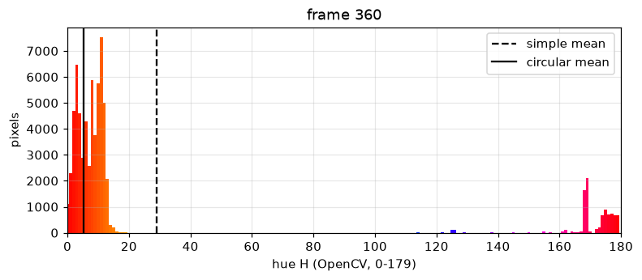{#fig-ch06-hue-hist-360 width=85%}

円周上の平均は5.2（約10°、赤）で、画素の多い山の中にあります。
右端（H＝165〜179）の山は、環の上では左端の山の続きですから、平均を少しだけ0の側へ引き寄せています。
集中度Rは0.969と1に近く、色相がよくそろっていることも読み取れます。

色相が0をまたがないフレームでは、2つの平均はほとんど同じになります。
750番目のフレームで、単純な平均、円周上の平均、Rの順に表示します。

```python
mean_h, r = circular_mean_hue(colored_hue(frame))

print(round(colored_hue(frame).mean(), 1), round(mean_h, 1), round(r, 3))
```

```{.default}
15.0 14.9 0.979
```

反対に、色相がばらばらな例として、@sec-ch06-hsv で作った乱数の画像を調べます。

```python
mean_h, r = circular_mean_hue(noise_hsv[:, :, 0])

print(round(mean_h, 1), round(r, 3))
```

```{.default}
9.3 0.001
```

Rはほぼ0です。
平均の色相として9.3という値は出ていますが、これは矢印がほぼ完全に打ち消し合った残りの向きにすぎず、意味はありません。
平均の色相を使うときは、Rもあわせて確認してください。

::: {.callout-tip title="環になっている量はほかにもある"}
同じ問題は、角度や周期を持つ量すべてに起こります。
第7章で扱う「動きの向き」も角度ですから、平均をとるときには同じ考え方が必要になります。
:::

## フレームの代表色を求める（k-means法） {#sec-ch06-kmeans}

### 代表色とは

色相ヒストグラムは色の種類の分布を教えてくれますが、「このフレームはどんな色でできているか」を人に伝えるには、数個の色を見本として並べるほうが直感的です。
フレームを代表する少数の色を**代表色**（dominant color）と呼び、それを並べたものを**パレット**（palette）と呼びます。

代表色を求めるには、似た色の画素をグループにまとめ、各グループの平均の色を取り出します。
このように、似たものどうしをグループに分けることを**クラスタリング**（clustering）といいます。
ここでは、もっとも基本的な方法である**k-means法**（k平均法）を使います。
kは、分けるグループの数です。

### k-means法のしくみ

1つの画素は、B・G・Rの3つの数値を持っています。
この3つの数値を座標とみなすと、1つの画素は3次元の空間の中の1つの点になります。
色の似た画素は近くの点に、色の違う画素は遠くの点になります。

k-means法は、この点の集まりを次の手順でk個のグループに分けます（@fig-ch06-kmeans）。

1. k個の「グループの中心」を、仮の位置に置きます。
2. すべての点を、もっとも近い中心のグループに割り当てます。
3. それぞれの中心を、自分のグループに属する点の平均の位置へ動かします。
4. 中心がほとんど動かなくなるまで、2と3を繰り返します。

::: {#fig-ch06-kmeans}

```{=html}
<svg viewBox="0 0 772 250" role="img" aria-label="k-means法の手順。仮の中心を置き、各点をもっとも近い中心に割り当て、中心をグループの平均の位置へ動かす。割り当てと移動を、中心が動かなくなるまで繰り返す。" style="width:100%;height:auto;font-family:inherit" fill="currentColor">
<g transform="translate(4 0)">
<text x="93.0" y="20" font-size="13.5" font-weight="700" text-anchor="middle">① 仮の中心を置く</text>
<rect x="0" y="32" width="186" height="176" rx="8" fill="none" stroke="currentColor" stroke-opacity="0.35" stroke-width="1.5"/>
<g transform="translate(-10 14)">
<circle cx="40" cy="62" r="5" fill="currentColor" fill-opacity="0.45"/>
<circle cx="55" cy="84" r="5" fill="currentColor" fill-opacity="0.45"/>
<circle cx="72" cy="56" r="5" fill="currentColor" fill-opacity="0.45"/>
<circle cx="62" cy="72" r="5" fill="currentColor" fill-opacity="0.45"/>
<circle cx="46" cy="96" r="5" fill="currentColor" fill-opacity="0.45"/>
<circle cx="84" cy="80" r="5" fill="currentColor" fill-opacity="0.45"/>
<circle cx="150" cy="120" r="5" fill="currentColor" fill-opacity="0.45"/>
<circle cx="170" cy="146" r="5" fill="currentColor" fill-opacity="0.45"/>
<circle cx="142" cy="150" r="5" fill="currentColor" fill-opacity="0.45"/>
<circle cx="166" cy="128" r="5" fill="currentColor" fill-opacity="0.45"/>
<circle cx="182" cy="136" r="5" fill="currentColor" fill-opacity="0.45"/>
<circle cx="128" cy="132" r="5" fill="currentColor" fill-opacity="0.45"/>
<circle cx="158" cy="160" r="5" fill="currentColor" fill-opacity="0.45"/>
<g stroke="#1f6fb2" stroke-width="3.5" stroke-linecap="round" stroke-opacity="1"><line x1="63.0" y1="133.0" x2="77.0" y2="147.0"/><line x1="63.0" y1="147.0" x2="77.0" y2="133.0"/></g>
<g stroke="#d99a2b" stroke-width="3.5" stroke-linecap="round" stroke-opacity="1"><line x1="143.0" y1="63.0" x2="157.0" y2="77.0"/><line x1="143.0" y1="77.0" x2="157.0" y2="63.0"/></g>
</g></g>
<g transform="translate(196 0)">
<text x="93.0" y="20" font-size="13.5" font-weight="700" text-anchor="middle">② 近い中心に割り当てる</text>
<rect x="0" y="32" width="186" height="176" rx="8" fill="none" stroke="currentColor" stroke-opacity="0.35" stroke-width="1.5"/>
<g transform="translate(-10 14)">
<line x1="40" y1="62" x2="70" y2="140" stroke="#1f6fb2" stroke-opacity="0.45" stroke-width="1"/>
<line x1="55" y1="84" x2="70" y2="140" stroke="#1f6fb2" stroke-opacity="0.45" stroke-width="1"/>
<line x1="72" y1="56" x2="150" y2="70" stroke="#d99a2b" stroke-opacity="0.45" stroke-width="1"/>
<line x1="62" y1="72" x2="70" y2="140" stroke="#1f6fb2" stroke-opacity="0.45" stroke-width="1"/>
<line x1="46" y1="96" x2="70" y2="140" stroke="#1f6fb2" stroke-opacity="0.45" stroke-width="1"/>
<line x1="84" y1="80" x2="70" y2="140" stroke="#1f6fb2" stroke-opacity="0.45" stroke-width="1"/>
<line x1="150" y1="120" x2="150" y2="70" stroke="#d99a2b" stroke-opacity="0.45" stroke-width="1"/>
<line x1="170" y1="146" x2="150" y2="70" stroke="#d99a2b" stroke-opacity="0.45" stroke-width="1"/>
<line x1="142" y1="150" x2="70" y2="140" stroke="#1f6fb2" stroke-opacity="0.45" stroke-width="1"/>
<line x1="166" y1="128" x2="150" y2="70" stroke="#d99a2b" stroke-opacity="0.45" stroke-width="1"/>
<line x1="182" y1="136" x2="150" y2="70" stroke="#d99a2b" stroke-opacity="0.45" stroke-width="1"/>
<line x1="128" y1="132" x2="70" y2="140" stroke="#1f6fb2" stroke-opacity="0.45" stroke-width="1"/>
<line x1="158" y1="160" x2="70" y2="140" stroke="#1f6fb2" stroke-opacity="0.45" stroke-width="1"/>
<circle cx="40" cy="62" r="5" fill="#1f6fb2"/>
<circle cx="55" cy="84" r="5" fill="#1f6fb2"/>
<circle cx="72" cy="56" r="5" fill="#d99a2b"/>
<circle cx="62" cy="72" r="5" fill="#1f6fb2"/>
<circle cx="46" cy="96" r="5" fill="#1f6fb2"/>
<circle cx="84" cy="80" r="5" fill="#1f6fb2"/>
<circle cx="150" cy="120" r="5" fill="#d99a2b"/>
<circle cx="170" cy="146" r="5" fill="#d99a2b"/>
<circle cx="142" cy="150" r="5" fill="#1f6fb2"/>
<circle cx="166" cy="128" r="5" fill="#d99a2b"/>
<circle cx="182" cy="136" r="5" fill="#d99a2b"/>
<circle cx="128" cy="132" r="5" fill="#1f6fb2"/>
<circle cx="158" cy="160" r="5" fill="#1f6fb2"/>
<g stroke="#1f6fb2" stroke-width="3.5" stroke-linecap="round" stroke-opacity="1"><line x1="63.0" y1="133.0" x2="77.0" y2="147.0"/><line x1="63.0" y1="147.0" x2="77.0" y2="133.0"/></g>
<g stroke="#d99a2b" stroke-width="3.5" stroke-linecap="round" stroke-opacity="1"><line x1="143.0" y1="63.0" x2="157.0" y2="77.0"/><line x1="143.0" y1="77.0" x2="157.0" y2="63.0"/></g>
</g></g>
<g transform="translate(388 0)">
<text x="93.0" y="20" font-size="13.5" font-weight="700" text-anchor="middle">③ 中心を平均へ動かす</text>
<rect x="0" y="32" width="186" height="176" rx="8" fill="none" stroke="currentColor" stroke-opacity="0.35" stroke-width="1.5"/>
<g transform="translate(-10 14)">
<circle cx="40" cy="62" r="5" fill="#1f6fb2"/>
<circle cx="55" cy="84" r="5" fill="#1f6fb2"/>
<circle cx="72" cy="56" r="5" fill="#d99a2b"/>
<circle cx="62" cy="72" r="5" fill="#1f6fb2"/>
<circle cx="46" cy="96" r="5" fill="#1f6fb2"/>
<circle cx="84" cy="80" r="5" fill="#1f6fb2"/>
<circle cx="150" cy="120" r="5" fill="#d99a2b"/>
<circle cx="170" cy="146" r="5" fill="#d99a2b"/>
<circle cx="142" cy="150" r="5" fill="#1f6fb2"/>
<circle cx="166" cy="128" r="5" fill="#d99a2b"/>
<circle cx="182" cy="136" r="5" fill="#d99a2b"/>
<circle cx="128" cy="132" r="5" fill="#1f6fb2"/>
<circle cx="158" cy="160" r="5" fill="#1f6fb2"/>
<g stroke="#1f6fb2" stroke-width="3.5" stroke-linecap="round" stroke-opacity="0.3"><line x1="63.0" y1="133.0" x2="77.0" y2="147.0"/><line x1="63.0" y1="147.0" x2="77.0" y2="133.0"/></g>
<line x1="70.0" y1="140.0" x2="89.4" y2="104.5" stroke="currentColor" stroke-width="1.5" stroke-dasharray="4 3"/>
<g stroke="#1f6fb2" stroke-width="3.5" stroke-linecap="round" stroke-opacity="1"><line x1="82.4" y1="97.5" x2="96.4" y2="111.5"/><line x1="82.4" y1="111.5" x2="96.4" y2="97.5"/></g>
<g stroke="#d99a2b" stroke-width="3.5" stroke-linecap="round" stroke-opacity="0.3"><line x1="143.0" y1="63.0" x2="157.0" y2="77.0"/><line x1="143.0" y1="77.0" x2="157.0" y2="63.0"/></g>
<line x1="150.0" y1="70.0" x2="148.0" y2="117.2" stroke="currentColor" stroke-width="1.5" stroke-dasharray="4 3"/>
<g stroke="#d99a2b" stroke-width="3.5" stroke-linecap="round" stroke-opacity="1"><line x1="141.0" y1="110.2" x2="155.0" y2="124.2"/><line x1="141.0" y1="124.2" x2="155.0" y2="110.2"/></g>
</g></g>
<g transform="translate(580 0)">
<text x="93.0" y="20" font-size="13.5" font-weight="700" text-anchor="middle">④ ②と③を繰り返す</text>
<rect x="0" y="32" width="186" height="176" rx="8" fill="none" stroke="currentColor" stroke-opacity="0.35" stroke-width="1.5"/>
<g transform="translate(-10 14)">
<circle cx="40" cy="62" r="5" fill="#1f6fb2"/>
<circle cx="55" cy="84" r="5" fill="#1f6fb2"/>
<circle cx="72" cy="56" r="5" fill="#1f6fb2"/>
<circle cx="62" cy="72" r="5" fill="#1f6fb2"/>
<circle cx="46" cy="96" r="5" fill="#1f6fb2"/>
<circle cx="84" cy="80" r="5" fill="#1f6fb2"/>
<circle cx="150" cy="120" r="5" fill="#d99a2b"/>
<circle cx="170" cy="146" r="5" fill="#d99a2b"/>
<circle cx="142" cy="150" r="5" fill="#d99a2b"/>
<circle cx="166" cy="128" r="5" fill="#d99a2b"/>
<circle cx="182" cy="136" r="5" fill="#d99a2b"/>
<circle cx="128" cy="132" r="5" fill="#d99a2b"/>
<circle cx="158" cy="160" r="5" fill="#d99a2b"/>
<g stroke="#1f6fb2" stroke-width="3.5" stroke-linecap="round" stroke-opacity="1"><line x1="52.8" y1="68.0" x2="66.8" y2="82.0"/><line x1="52.8" y1="82.0" x2="66.8" y2="68.0"/></g>
<g stroke="#d99a2b" stroke-width="3.5" stroke-linecap="round" stroke-opacity="1"><line x1="149.6" y1="131.9" x2="163.6" y2="145.9"/><line x1="149.6" y1="145.9" x2="163.6" y2="131.9"/></g>
</g></g>
<circle cx="250" cy="232" r="5" fill-opacity="0.45"/><text x="262" y="237" font-size="13">画素（色の値を座標とみなした点）</text>
<g transform="translate(500 232)"><g stroke="currentColor" stroke-width="3.5" stroke-linecap="round" stroke-opacity="1"><line x1="-7.0" y1="-7.0" x2="7.0" y2="7.0"/><line x1="-7.0" y1="7.0" x2="7.0" y2="-7.0"/></g></g><text x="514" y="237" font-size="13">グループの中心</text>
</svg>
```

k-means法の手順（k＝2の例）。図は平面に描いているが、実際の画素はB・G・Rの3つの値を持つので、3次元の空間で同じことを行う。
:::

最後に残ったk個の中心が、そのまま代表色になります。
中心は「グループに属する画素の平均」ですから、各グループの平均の色です。

この手順には、あらかじめ知っておくべき性質が2つあります。

- **kは自分で決める**必要があります。フレームに「本当は何色あるか」を、k-means法は教えてくれません。
- 最初に中心を置く位置（手順1）は**乱数で決まる**ので、実行するたびに結果が少し変わることがあります。

どちらも、あとで実際に確かめます。

### 計算の準備——縮小して、画素を1列に並べる

k-means法は、すべての画素と中心の距離を何度も計算するので、画素が多いと時間がかかります。
代表色を知るのに1画素単位の細かさは要りませんから、第4章と同じように `cv2.resize` で画像を縮小してから計算します。
ここでは横160画素に縮めます。

`cv2.kmeans` に渡すデータは、「1行が1つの点」になった、`float32` 型の配列でなければなりません。
`reshape(-1, 3)` で、縦×横に並んだ画素を「画素数×3」の形に並べ直します（`-1` は「残りから自動で決める」という意味です）。

```python
small = cv2.resize(picture, (160, 68), interpolation=cv2.INTER_AREA)
data = small.reshape(-1, 3).astype(np.float32)

print(small.shape)
print(data.shape, data.dtype)
```

```{.default}
(68, 160, 3)
(10880, 3) float32
```

縦68×横160＝10,880個の点ができました。
並べ直しのようすを、縦2×横2の小さな画像を例にして、@fig-ch06-reshape に示します。

::: {#fig-ch06-reshape}

```{=html}
<svg viewBox="0 0 760 240" role="img" aria-label="reshapeで画素を1列に並べるしくみ。縦2、横2の画像があり、左上の画素のB、G、Rは170、233、248、右上は102、177、243、左下は43、55、133、右下は24、36、89。reshape(-1, 3)で並べ直すと、4行3列の表になる。1行が1つの画素で、左上、右上、左下、右下の順に並ぶ。" style="width:100%;height:auto;font-family:inherit" fill="currentColor">
  <rect x="60" y="70" width="130" height="56" fill="#f8e9aa" stroke="currentColor" stroke-opacity="0.55" stroke-width="1"/>
  <text x="125" y="103.04" font-size="14" font-weight="700" text-anchor="middle" fill="#1c1300">[170 233 248]</text>
  <rect x="190" y="70" width="130" height="56" fill="#f3b166" stroke="currentColor" stroke-opacity="0.55" stroke-width="1"/>
  <text x="255" y="103.04" font-size="14" font-weight="700" text-anchor="middle" fill="#1c1300">[102 177 243]</text>
  <rect x="60" y="126" width="130" height="56" fill="#85372b" stroke="currentColor" stroke-opacity="0.55" stroke-width="1"/>
  <text x="125" y="159.04" font-size="14" font-weight="700" text-anchor="middle" fill="#ffffff">[43 55 133]</text>
  <rect x="190" y="126" width="130" height="56" fill="#592418" stroke="currentColor" stroke-opacity="0.55" stroke-width="1"/>
  <text x="255" y="159.04" font-size="14" font-weight="700" text-anchor="middle" fill="#ffffff">[24 36 89]</text>
  <text x="50" y="103" font-size="12" text-anchor="end" fill-opacity="0.75">行 0</text>
  <text x="50" y="159" font-size="12" text-anchor="end" fill-opacity="0.75">行 1</text>
  <text x="125" y="60" font-size="12" text-anchor="middle" fill-opacity="0.75">列 0</text>
  <text x="255" y="60" font-size="12" text-anchor="middle" fill-opacity="0.75">列 1</text>
  <text x="190" y="36" font-size="14" text-anchor="middle" font-weight="700">縦2×横2の画像</text>
  <text x="190" y="204" font-size="12" text-anchor="middle" fill-opacity="0.8">形は (2, 2, 3)</text>
  <line x1="336" y1="126" x2="408" y2="126" stroke="#1f6fb2" stroke-width="2"/>
  <path d="M416 126 l-9 -5 v10z" fill="#1f6fb2"/>
  <text x="376" y="114" font-size="12" text-anchor="middle" font-weight="700">reshape(-1, 3)</text>
  <rect x="470" y="32" width="64" height="26" fill="currentColor" fill-opacity="0.14" stroke="currentColor" stroke-opacity="0.55" stroke-width="1"/>
  <text x="502" y="49.68" font-size="13" font-weight="700" text-anchor="middle">B</text>
  <rect x="534" y="32" width="64" height="26" fill="currentColor" fill-opacity="0.14" stroke="currentColor" stroke-opacity="0.55" stroke-width="1"/>
  <text x="566" y="49.68" font-size="13" font-weight="700" text-anchor="middle">G</text>
  <rect x="598" y="32" width="64" height="26" fill="currentColor" fill-opacity="0.14" stroke="currentColor" stroke-opacity="0.55" stroke-width="1"/>
  <text x="630" y="49.68" font-size="13" font-weight="700" text-anchor="middle">R</text>
  <text x="460" y="80" font-size="12" text-anchor="end" font-weight="700">0</text>
  <rect x="470" y="58" width="64" height="34" fill="#f8e9aa" stroke="currentColor" stroke-opacity="0.55" stroke-width="1"/>
  <text x="502" y="80.04" font-size="14" text-anchor="middle" fill="#1c1300">170</text>
  <rect x="534" y="58" width="64" height="34" fill="#f8e9aa" stroke="currentColor" stroke-opacity="0.55" stroke-width="1"/>
  <text x="566" y="80.04" font-size="14" text-anchor="middle" fill="#1c1300">233</text>
  <rect x="598" y="58" width="64" height="34" fill="#f8e9aa" stroke="currentColor" stroke-opacity="0.55" stroke-width="1"/>
  <text x="630" y="80.04" font-size="14" text-anchor="middle" fill="#1c1300">248</text>
  <text x="672" y="80" font-size="12" fill-opacity="0.8">空</text>
  <text x="460" y="114" font-size="12" text-anchor="end" font-weight="700">1</text>
  <rect x="470" y="92" width="64" height="34" fill="#f3b166" stroke="currentColor" stroke-opacity="0.55" stroke-width="1"/>
  <text x="502" y="114.04" font-size="14" text-anchor="middle" fill="#1c1300">102</text>
  <rect x="534" y="92" width="64" height="34" fill="#f3b166" stroke="currentColor" stroke-opacity="0.55" stroke-width="1"/>
  <text x="566" y="114.04" font-size="14" text-anchor="middle" fill="#1c1300">177</text>
  <rect x="598" y="92" width="64" height="34" fill="#f3b166" stroke="currentColor" stroke-opacity="0.55" stroke-width="1"/>
  <text x="630" y="114.04" font-size="14" text-anchor="middle" fill="#1c1300">243</text>
  <text x="672" y="114" font-size="12" fill-opacity="0.8">肌</text>
  <text x="460" y="148" font-size="12" text-anchor="end" font-weight="700">2</text>
  <rect x="470" y="126" width="64" height="34" fill="#85372b" stroke="currentColor" stroke-opacity="0.55" stroke-width="1"/>
  <text x="502" y="148.04" font-size="14" text-anchor="middle" fill="#ffffff">43</text>
  <rect x="534" y="126" width="64" height="34" fill="#85372b" stroke="currentColor" stroke-opacity="0.55" stroke-width="1"/>
  <text x="566" y="148.04" font-size="14" text-anchor="middle" fill="#ffffff">55</text>
  <rect x="598" y="126" width="64" height="34" fill="#85372b" stroke="currentColor" stroke-opacity="0.55" stroke-width="1"/>
  <text x="630" y="148.04" font-size="14" text-anchor="middle" fill="#ffffff">133</text>
  <text x="672" y="148" font-size="12" fill-opacity="0.8">髪</text>
  <text x="460" y="182" font-size="12" text-anchor="end" font-weight="700">3</text>
  <rect x="470" y="160" width="64" height="34" fill="#592418" stroke="currentColor" stroke-opacity="0.55" stroke-width="1"/>
  <text x="502" y="182.04" font-size="14" text-anchor="middle" fill="#ffffff">24</text>
  <rect x="534" y="160" width="64" height="34" fill="#592418" stroke="currentColor" stroke-opacity="0.55" stroke-width="1"/>
  <text x="566" y="182.04" font-size="14" text-anchor="middle" fill="#ffffff">36</text>
  <rect x="598" y="160" width="64" height="34" fill="#592418" stroke="currentColor" stroke-opacity="0.55" stroke-width="1"/>
  <text x="630" y="182.04" font-size="14" text-anchor="middle" fill="#ffffff">89</text>
  <text x="672" y="182" font-size="12" fill-opacity="0.8">髪の影</text>
  <text x="566" y="24" font-size="12"></text>
  <text x="566" y="216" font-size="12" text-anchor="middle" fill-opacity="0.8">形は (4, 3)　1行が1つの画素</text>
</svg>
```

`reshape(-1, 3)` による並べ直し。箱の色は、その画素の実際の色。上の行から順に、左から右へ並ぶ
:::

### `cv2.kmeans` を実行する

k＝5として実行します。

```python
criteria = (cv2.TERM_CRITERIA_EPS + cv2.TERM_CRITERIA_MAX_ITER, 20, 1.0)

cv2.setRNGSeed(0)
compactness, labels, centers = cv2.kmeans(
    data, 5, None, criteria, 10, cv2.KMEANS_PP_CENTERS
)

print(labels.shape, labels.dtype)
print(centers)
```

```{.default}
(10880, 1) int32
[[102.846825 167.91302  227.62144 ]
 [ 44.10534   64.49395  127.8605  ]
 [ 78.5919   121.20289  196.26532 ]
 [143.27673  211.60924  243.5272  ]
 [ 10.959735  20.527876  39.977875]]
```

引数は順に次のとおりです。

- `data`：点の集まり。
- `5`：グループの数k。
- `None`：最初の割り当てを自分で指定するときに使う引数です。ここでは使わないので `None` を渡します。
- `criteria`：繰り返しをやめる条件です。`(種類, 20, 1.0)` で「20回繰り返すか、中心の移動が1.0未満になったらやめる」という指定になります。
- `10`：最初の中心の位置を変えて全体を10回やり直し、いちばんよい結果を採用します。
- `cv2.KMEANS_PP_CENTERS`：最初の中心を、互いに離れた位置に置く方法（k-means++）を選びます [@arthur2007]。

直前の `cv2.setRNGSeed(0)` は、乱数を固定するための1行です。
理由はすぐあとで説明します。

戻り値は3つです。

- `compactness`：各点から、所属するグループの中心までの距離の2乗を合計した値です。小さいほど、グループがよくまとまっています。
- `labels`：各点がどのグループ（0〜4）に割り当てられたかを表す番号です。
- `centers`：5つの中心の位置、つまり5つの代表色（B、G、Rの順）です。

グループの順番には意味がないので、属する画素の多い順に並べ替えます。
`np.argsort` は「小さい順に並べたときの番号」を返す関数で、`[::-1]` で逆順（大きい順）にしています。

```python
sizes = np.bincount(labels.ravel(), minlength=5)
order = np.argsort(sizes)[::-1]   # 画素数の多い順に並べる番号

colors = np.round(centers[order]).astype(np.uint8)
shares = sizes[order] / sizes.sum()

print(colors)
print(shares.round(3))
```

```{.default}
[[143 212 244]
 [ 11  21  40]
 [103 168 228]
 [ 79 121 196]
 [ 44  64 128]]
[0.336 0.208 0.168 0.159 0.129]
```

もっとも大きなグループは `[143 212 244]`（明るい淡い橙色）で、全体の33.6%を占めています。
並べ替えのようすを @fig-ch06-argsort に示します。

::: {#fig-ch06-argsort}

```{=html}
<svg viewBox="0 0 760 320" role="img" aria-label="argsortで代表色を画素の多い順に並べ替えるしくみ。グループ0から4の中心の色と、画素の割合0.168、0.129、0.159、0.336、0.208がある。割合の大きい順に並べたときのもとの番号は3、4、0、2、1で、これがorderになる。この順に並べ替えると、割合は0.336、0.208、0.168、0.159、0.129の順になる。" style="width:100%;height:auto;font-family:inherit" fill="currentColor">
  <text x="285" y="36" font-size="12" text-anchor="middle" font-weight="700">0</text>
  <rect x="236" y="46" width="98" height="36" fill="#e4a867" stroke="currentColor" stroke-opacity="0.55" stroke-width="1"/>
  <text x="285" y="68.68" font-size="13" font-weight="700" text-anchor="middle" fill="#1c1300">103 168 228</text>
  <rect x="236" y="84" width="98" height="36" fill="currentColor" fill-opacity="0.04" stroke="currentColor" stroke-opacity="0.55" stroke-width="1"/>
  <text x="285" y="106.68" font-size="13" text-anchor="middle">0.168</text>
  <text x="383" y="36" font-size="12" text-anchor="middle" font-weight="700">1</text>
  <rect x="334" y="46" width="98" height="36" fill="#80402c" stroke="currentColor" stroke-opacity="0.55" stroke-width="1"/>
  <text x="383" y="68.68" font-size="13" font-weight="700" text-anchor="middle" fill="#fff">44 64 128</text>
  <rect x="334" y="84" width="98" height="36" fill="currentColor" fill-opacity="0.04" stroke="currentColor" stroke-opacity="0.55" stroke-width="1"/>
  <text x="383" y="106.68" font-size="13" text-anchor="middle">0.129</text>
  <text x="481" y="36" font-size="12" text-anchor="middle" font-weight="700">2</text>
  <rect x="432" y="46" width="98" height="36" fill="#c4794f" stroke="currentColor" stroke-opacity="0.55" stroke-width="1"/>
  <text x="481" y="68.68" font-size="13" font-weight="700" text-anchor="middle" fill="#1c1300">79 121 196</text>
  <rect x="432" y="84" width="98" height="36" fill="currentColor" fill-opacity="0.04" stroke="currentColor" stroke-opacity="0.55" stroke-width="1"/>
  <text x="481" y="106.68" font-size="13" text-anchor="middle">0.159</text>
  <text x="579" y="36" font-size="12" text-anchor="middle" font-weight="700">3</text>
  <rect x="530" y="46" width="98" height="36" fill="#f4d48f" stroke="currentColor" stroke-opacity="0.55" stroke-width="1"/>
  <text x="579" y="68.68" font-size="13" font-weight="700" text-anchor="middle" fill="#1c1300">143 212 244</text>
  <rect x="530" y="84" width="98" height="36" fill="currentColor" fill-opacity="0.04" stroke="currentColor" stroke-opacity="0.55" stroke-width="1"/>
  <text x="579" y="106.68" font-size="13" text-anchor="middle">0.336</text>
  <text x="677" y="36" font-size="12" text-anchor="middle" font-weight="700">4</text>
  <rect x="628" y="46" width="98" height="36" fill="#28150b" stroke="currentColor" stroke-opacity="0.55" stroke-width="1"/>
  <text x="677" y="68.68" font-size="13" font-weight="700" text-anchor="middle" fill="#fff">11 21 40</text>
  <rect x="628" y="84" width="98" height="36" fill="currentColor" fill-opacity="0.04" stroke="currentColor" stroke-opacity="0.55" stroke-width="1"/>
  <text x="677" y="106.68" font-size="13" text-anchor="middle">0.208</text>
  <line x1="579" y1="124" x2="285" y2="184" stroke="currentColor" stroke-width="1.6" stroke-opacity="0.5"/>
  <text x="285" y="198" font-size="12" text-anchor="middle" font-weight="700">3</text>
  <rect x="236" y="206" width="98" height="36" fill="#f4d48f" stroke="currentColor" stroke-opacity="0.55" stroke-width="1"/>
  <text x="285" y="228.68" font-size="13" font-weight="700" text-anchor="middle" fill="#1c1300">143 212 244</text>
  <rect x="236" y="244" width="98" height="36" fill="currentColor" fill-opacity="0.04" stroke="currentColor" stroke-opacity="0.55" stroke-width="1"/>
  <text x="285" y="266.68" font-size="13" text-anchor="middle">0.336</text>
  <line x1="677" y1="124" x2="383" y2="184" stroke="currentColor" stroke-width="1.6" stroke-opacity="0.5"/>
  <text x="383" y="198" font-size="12" text-anchor="middle" font-weight="700">4</text>
  <rect x="334" y="206" width="98" height="36" fill="#28150b" stroke="currentColor" stroke-opacity="0.55" stroke-width="1"/>
  <text x="383" y="228.68" font-size="13" font-weight="700" text-anchor="middle" fill="#fff">11 21 40</text>
  <rect x="334" y="244" width="98" height="36" fill="currentColor" fill-opacity="0.04" stroke="currentColor" stroke-opacity="0.55" stroke-width="1"/>
  <text x="383" y="266.68" font-size="13" text-anchor="middle">0.208</text>
  <line x1="285" y1="124" x2="481" y2="184" stroke="currentColor" stroke-width="1.6" stroke-opacity="0.5"/>
  <text x="481" y="198" font-size="12" text-anchor="middle" font-weight="700">0</text>
  <rect x="432" y="206" width="98" height="36" fill="#e4a867" stroke="currentColor" stroke-opacity="0.55" stroke-width="1"/>
  <text x="481" y="228.68" font-size="13" font-weight="700" text-anchor="middle" fill="#1c1300">103 168 228</text>
  <rect x="432" y="244" width="98" height="36" fill="currentColor" fill-opacity="0.04" stroke="currentColor" stroke-opacity="0.55" stroke-width="1"/>
  <text x="481" y="266.68" font-size="13" text-anchor="middle">0.168</text>
  <line x1="481" y1="124" x2="579" y2="184" stroke="currentColor" stroke-width="1.6" stroke-opacity="0.5"/>
  <text x="579" y="198" font-size="12" text-anchor="middle" font-weight="700">2</text>
  <rect x="530" y="206" width="98" height="36" fill="#c4794f" stroke="currentColor" stroke-opacity="0.55" stroke-width="1"/>
  <text x="579" y="228.68" font-size="13" font-weight="700" text-anchor="middle" fill="#1c1300">79 121 196</text>
  <rect x="530" y="244" width="98" height="36" fill="currentColor" fill-opacity="0.04" stroke="currentColor" stroke-opacity="0.55" stroke-width="1"/>
  <text x="579" y="266.68" font-size="13" text-anchor="middle">0.159</text>
  <line x1="383" y1="124" x2="677" y2="184" stroke="currentColor" stroke-width="1.6" stroke-opacity="0.5"/>
  <text x="677" y="198" font-size="12" text-anchor="middle" font-weight="700">1</text>
  <rect x="628" y="206" width="98" height="36" fill="#80402c" stroke="currentColor" stroke-opacity="0.55" stroke-width="1"/>
  <text x="677" y="228.68" font-size="13" font-weight="700" text-anchor="middle" fill="#fff">44 64 128</text>
  <rect x="628" y="244" width="98" height="36" fill="currentColor" fill-opacity="0.04" stroke="currentColor" stroke-opacity="0.55" stroke-width="1"/>
  <text x="677" y="266.68" font-size="13" text-anchor="middle">0.129</text>
  <text x="222" y="36" font-size="12" text-anchor="end" font-weight="700">グループの番号</text>
  <text x="14" y="68" font-size="13" font-weight="700">centers（B G R）</text>
  <text x="14" y="99" font-size="13" font-weight="700">画素の割合</text>
  <text x="14" y="115" font-size="11" fill-opacity="0.8">sizes ÷ 合計</text>
  <text x="222" y="198" font-size="12" text-anchor="end" font-weight="700">order</text>
  <text x="14" y="228" font-size="13" font-weight="700">colors</text>
  <text x="14" y="266" font-size="13" font-weight="700">shares</text>
  <text x="481" y="302" font-size="12" text-anchor="middle" fill-opacity="0.9">order ＝ [3, 4, 0, 2, 1]：画素の多い順に並べたときの、もとの番号</text>
</svg>
```

`np.argsort` による並べ替え。箱の色は、その代表色の実際の色。値は丸めて表示してある
:::
2番目は `[11 21 40]`（黒に近い焦げ茶）で20.8%です。

### 結果の揺れと再現性

`cv2.setRNGSeed(0)` を付けた理由を確かめます。
乱数の影響が見えやすいように、やり直しの回数を1回にし、最初の中心を完全に乱数で決める方法（`cv2.KMEANS_RANDOM_CENTERS`）で、4回続けて実行します。

```python
for i in range(4):
    compactness, labels, centers = cv2.kmeans(
        data, 5, None, criteria, 1, cv2.KMEANS_RANDOM_CENTERS
    )
    print(round(compactness))
```

```{.default}
6360074
6702107
6342657
6703488
```

同じデータ、同じ設定なのに、`compactness` が実行のたびに違います（このセルをもう一度実行すると、また別の数値になります）。
最初の中心の位置によって、たどり着く分け方が変わるためです。
k-means法が見つけるのは「中心がもう動かない分け方」の1つであって、いちばんよい分け方とは限りません。

これでは、分析をやり直すたびに結果が変わってしまいます。
そこで、`cv2.kmeans` を呼ぶ直前に `cv2.setRNGSeed` で乱数の出発点（**シード**、seed）を指定します。

```python
for i in range(4):
    cv2.setRNGSeed(0)
    compactness, labels, centers = cv2.kmeans(
        data, 5, None, criteria, 1, cv2.KMEANS_RANDOM_CENTERS
    )
    print(round(compactness))
```

```{.default}
6728962
6728962
6728962
6728962
```

4回とも同じ結果になりました。
シードを固定すれば、同じデータからは同じ結果が得られます。
このように、同じ手順で同じ結果を得られることを**再現性**（reproducibility）といいます。

もう1つの対策が、やり直しの回数を増やすことです。
シードを固定せずに、最初に使った設定（やり直し10回、k-means++）で4回実行してみます。

```python
for i in range(4):
    compactness, labels, centers = cv2.kmeans(
        data, 5, None, criteria, 10, cv2.KMEANS_PP_CENTERS
    )
    print(round(compactness))
```

```{.default}
6342521
6339121
6339339
6341649
```

実行ごとの違いは残っていますが、1回だけのときに比べてはるかに小さく、値もよく（小さく）なっています。
10回のうちでいちばんよい結果を採用するので、たまたま悪い分け方に行き着くことが減るのです。

本書では、**やり直しを10回にしたうえで、シードも固定する**ことにします。

::: {.callout-warning title="シードは cv2.kmeans を呼ぶたびに指定する"}
`cv2.setRNGSeed(0)` は、その時点で乱数を出発点に戻すだけです。
`cv2.kmeans` を1回実行すると乱数は先へ進むので、ノートブックの先頭で1度だけ指定しても、2回目以降の結果はセルを実行した順番や回数に左右されます。
毎回、`cv2.kmeans` の直前で指定してください。
:::

### 関数にまとめ、パレットを描く

ここまでの処理を関数にします。
シードの指定も関数の中に入れておきます。

```python
def dominant_colors(image, k=5, seed=0):
    """画像の代表色をk個求め、画素数の多い順に（色, 割合）を返す。"""
    data = image.reshape(-1, 3).astype(np.float32)
    cv2.setRNGSeed(seed)
    compactness, labels, centers = cv2.kmeans(
        data, k, None, criteria, 10, cv2.KMEANS_PP_CENTERS
    )
    sizes = np.bincount(labels.ravel(), minlength=k)
    order = np.argsort(sizes)[::-1]
    colors = np.round(centers[order]).astype(np.uint8)
    shares = sizes[order] / sizes.sum()
    return colors, shares
```

この関数は、関数の外で定義した `criteria` を使っています。
別のノートブックにこの関数を写して使うときは、`criteria = ...` の行も一緒に写してください。

結果を目で確かめるために、代表色を割合に応じた幅で並べた画像（パレット）を作る関数も用意します。
`np.cumsum` は累積の和を求める関数で、割合 `[0.3, 0.2, 0.5]` を `[0.3, 0.5, 1.0]` のように「どこまで塗るか」の位置に変換しています。

```python
def draw_palette(colors, shares, width=854, height=80):
    """代表色を、割合に応じた幅で左から並べた画像を作る。"""
    palette = np.zeros((height, width, 3), dtype=np.uint8)
    edges = np.round(np.cumsum(shares) * width).astype(int)
    left = 0
    for color, right in zip(colors, edges):
        palette[:, left:right] = color
        left = right
    return palette
```

3つの色を、割合0.3、0.2、0.5で塗る場合を、@fig-ch06-cumsum に示します。

::: {#fig-ch06-cumsum}

```{=html}
<svg viewBox="0 0 760 315" role="img" aria-label="cumsumでパレットの塗る位置を決めるしくみ。割合が0.3、0.2、0.5のとき、cumsumで先頭からの合計を求めると0.3、0.5、1.0になる。これに幅の854を掛けて丸めると256、427、854になる。パレットは、0から256までを1つ目の色、256から427までを2つ目の色、427から854までを3つ目の色で塗る。" style="width:100%;height:auto;font-family:inherit" fill="currentColor">
  <rect x="200" y="40" width="90" height="36" fill="currentColor" fill-opacity="0.04" stroke="currentColor" stroke-opacity="0.55" stroke-width="1"/>
  <text x="245" y="63.04" font-size="14" text-anchor="middle">0.3</text>
  <rect x="200" y="96" width="90" height="36" fill="#1f6fb2" stroke="currentColor" stroke-opacity="0.55" stroke-width="1"/>
  <text x="245" y="119.04" font-size="14" font-weight="700" text-anchor="middle" fill="#ffffff">0.3</text>
  <rect x="200" y="152" width="90" height="36" fill="#f0b84a" stroke="currentColor" stroke-opacity="0.55" stroke-width="1"/>
  <text x="245" y="175.04" font-size="14" font-weight="700" text-anchor="middle" fill="#1c1300">256</text>
  <rect x="290" y="40" width="90" height="36" fill="currentColor" fill-opacity="0.04" stroke="currentColor" stroke-opacity="0.55" stroke-width="1"/>
  <text x="335" y="63.04" font-size="14" text-anchor="middle">0.2</text>
  <rect x="290" y="96" width="90" height="36" fill="#1f6fb2" stroke="currentColor" stroke-opacity="0.55" stroke-width="1"/>
  <text x="335" y="119.04" font-size="14" font-weight="700" text-anchor="middle" fill="#ffffff">0.5</text>
  <rect x="290" y="152" width="90" height="36" fill="#f0b84a" stroke="currentColor" stroke-opacity="0.55" stroke-width="1"/>
  <text x="335" y="175.04" font-size="14" font-weight="700" text-anchor="middle" fill="#1c1300">427</text>
  <rect x="380" y="40" width="90" height="36" fill="currentColor" fill-opacity="0.04" stroke="currentColor" stroke-opacity="0.55" stroke-width="1"/>
  <text x="425" y="63.04" font-size="14" text-anchor="middle">0.5</text>
  <rect x="380" y="96" width="90" height="36" fill="#1f6fb2" stroke="currentColor" stroke-opacity="0.55" stroke-width="1"/>
  <text x="425" y="119.04" font-size="14" font-weight="700" text-anchor="middle" fill="#ffffff">1.0</text>
  <rect x="380" y="152" width="90" height="36" fill="#f0b84a" stroke="currentColor" stroke-opacity="0.55" stroke-width="1"/>
  <text x="425" y="175.04" font-size="14" font-weight="700" text-anchor="middle" fill="#1c1300">854</text>
  <text x="14" y="55" font-size="13" font-weight="700">shares</text>
  <text x="14" y="71" font-size="11" fill-opacity="0.8">それぞれの色の割合</text>
  <text x="14" y="111" font-size="13" font-weight="700">np.cumsum(shares)</text>
  <text x="14" y="127" font-size="11" fill-opacity="0.8">先頭からの合計</text>
  <text x="14" y="167" font-size="13" font-weight="700">edges</text>
  <text x="14" y="183" font-size="11" fill-opacity="0.8">幅854を掛けて丸める</text>
  <text x="484" y="118" font-size="12" fill-opacity="0.85">0.3、0.3＋0.2、0.3＋0.2＋0.5</text>
  <rect x="110" y="236" width="167.869" height="40" fill="#f4d48f" stroke="currentColor" stroke-opacity="0.55" stroke-width="1"/>
  <text x="193.934" y="260.68" font-size="13" font-weight="700" text-anchor="middle" fill="#1c1300">[:, 0:256]</text>
  <rect x="277.869" y="236" width="112.131" height="40" fill="#28150b" stroke="currentColor" stroke-opacity="0.55" stroke-width="1"/>
  <text x="333.934" y="260.68" font-size="13" font-weight="700" text-anchor="middle" fill="#fff">[:, 256:427]</text>
  <rect x="390" y="236" width="280" height="40" fill="#e4a867" stroke="currentColor" stroke-opacity="0.55" stroke-width="1"/>
  <text x="530" y="260.68" font-size="13" font-weight="700" text-anchor="middle" fill="#1c1300">[:, 427:854]</text>
  <line x1="110" y1="276" x2="110" y2="284" stroke="currentColor" stroke-width="1.3" stroke-opacity="0.7"/>
  <text x="110" y="299" font-size="12" text-anchor="middle" font-weight="700">0</text>
  <line x1="277.869" y1="276" x2="277.869" y2="284" stroke="currentColor" stroke-width="1.3" stroke-opacity="0.7"/>
  <text x="277.869" y="299" font-size="12" text-anchor="middle" font-weight="700">256</text>
  <line x1="390" y1="276" x2="390" y2="284" stroke="currentColor" stroke-width="1.3" stroke-opacity="0.7"/>
  <text x="390" y="299" font-size="12" text-anchor="middle" font-weight="700">427</text>
  <line x1="670" y1="276" x2="670" y2="284" stroke="currentColor" stroke-width="1.3" stroke-opacity="0.7"/>
  <text x="670" y="299" font-size="12" text-anchor="middle" font-weight="700">854</text>
  <text x="14" y="260" font-size="13" font-weight="700">palette</text>
  <text x="390" y="226" font-size="12" text-anchor="middle" fill-opacity="0.85">edges の位置まで、左から順に塗る</text>
</svg>
```

`np.cumsum` で、塗る位置を決める。`palette[:, 0:256]` は、0番目から255番目までの列を表す
:::

フレームとパレットを上下に並べて表示します。

```python
colors, shares = dominant_colors(small, k=5)

fig, axes = plt.subplots(2, 1, figsize=(8, 4.6), height_ratios=[364, 80])
show(picture, "frame 750", ax=axes[0])
show(draw_palette(colors, shares), ax=axes[1])
axes[1].axis("off")
plt.show()
```

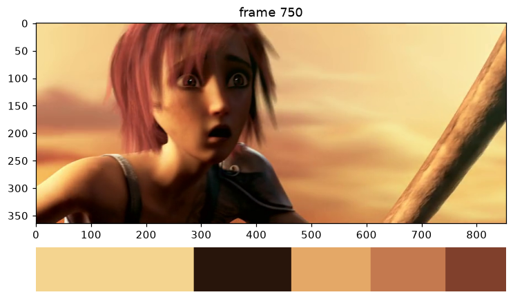{#fig-ch06-palette-750 width=85%}

空の淡い橙、暗部の焦げ茶、肌の橙、髪の赤茶など、フレームを構成する色が取り出されています。

### kを変えると

kを1、3、5、8と変えて、パレットを比べます。

```python
fig, axes = plt.subplots(4, 1, figsize=(8, 3.6))
for ax, k in zip(axes, [1, 3, 5, 8]):
    colors, shares = dominant_colors(small, k=k)
    show(draw_palette(colors, shares), f"k = {k}", ax=ax)
    ax.axis("off")
plt.tight_layout()
plt.show()
```

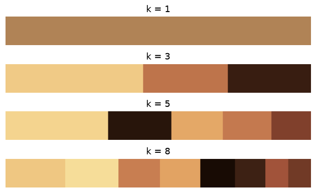{#fig-ch06-palette-k width=85%}

kを増やすと、1つの色が似た色に細かく分かれていきます。
どのkが正しいということはなく、「何色で要約したいか」という目的に応じて決めます。

k＝1のパレットは、すべての画素を1つのグループにまとめた結果ですから、フレーム全体の平均の色と同じです。

```python
colors, shares = dominant_colors(small, k=1)

print(colors[0])
print(small.mean(axis=(0, 1)).round(1))
```

```{.default}
[ 86 131 176]
[ 85.9 131.2 176.1]
```

1行目がk＝1の代表色、2行目が `mean` で直接計算した平均の色で、四捨五入すれば一致します。
この平均の色は、フレームの中にほとんど存在しない、くすんだ茶色です。
明るい空と暗い影を混ぜ合わせた結果だからです。
平均の色と代表色のこの違いは、次の節でも現れます。

::: {.callout-note title="k-means法が測っている「色の近さ」"}
ここでは、B・G・Rの値の差をそのまま「色の遠さ」として使いました。
この距離は、人間が感じる色の違いの大きさとは、必ずしも一致しません。
人間の感じ方に近づけた色空間（Lab色空間など）に変換してからクラスタリングする方法もありますが、本書では扱いません。
:::

### 縮小の効果を確かめる

最後に、縮小によってどれだけ計算が軽くなり、結果がどれだけ変わるのかを確かめます。
`time.perf_counter()` は、その時点の時刻を秒で返す関数です。
前後の差が、かかった時間になります。

```python
import time

t0 = time.perf_counter()
colors_full, shares_full = dominant_colors(picture, k=5)
t1 = time.perf_counter()
colors_small, shares_small = dominant_colors(small, k=5)
t2 = time.perf_counter()

print(picture.shape[0] * picture.shape[1], round(t1 - t0, 3))
print(small.shape[0] * small.shape[1], round(t2 - t1, 3))
```

```{.default}
310856 0.315
10880 0.013
```

左の数字が画素数、右がかかった秒数です。
秒数はパソコンによって変わりますが、筆者の環境では、縮小しない場合が約0.3秒、縮小した場合が約0.01秒でした。
結果も比べます。
1行目が縮小なし、2行目が縮小ありで、それぞれ最大のグループの色と、5つのグループの割合です。

```python
print(colors_full[0], shares_full.round(3))
print(colors_small[0], shares_small.round(3))
```

```{.default}
[144 212 244] [0.337 0.207 0.165 0.161 0.13 ]
[143 212 244] [0.336 0.208 0.168 0.159 0.129]
```

最大のグループの色の違いは1、割合の違いは0.3ポイント以内です（ポイントは、パーセントで表した値どうしの差です。33.6%と33.7%の差が、0.1ポイントです）。
1枚なら待てる時間でも、1253枚すべてに適用するなら、この差は大きく効いてきます。

## 映像全体を1枚の帯にする——カラーバーコード {#sec-ch06-barcode}

### フレームごとの平均色を集める

ここまでは1枚のフレームを調べてきました。
ここからは映像全体に進みます。

各フレームを1つの色で代表させ、その色の縦線を時間の順に横へ並べると、映像全体の色の移り変わりを1枚の帯として眺められます。
これが、章の冒頭で紹介した**カラーバーコード**です。

フレームを代表する色として、まずはもっとも単純な**平均色**（average color）を使います。
黒帯を除いた部分について、B・G・Rそれぞれの平均を求めます。
`mean(axis=(0, 1))` は、縦と横の方向について平均をとり、色の方向だけを残す計算です。

```python
mean_colors = []
for n, img in iter_frames(path):
    mean_colors.append(img[TOP:BOTTOM].mean(axis=(0, 1)))
mean_colors = np.array(mean_colors)

print(mean_colors.shape)
print(mean_colors[750].round(1))
```

```{.default}
(1253, 3)
[ 85.9 131.2 176.1]
```

1253行3列の配列になりました。
1行が1フレームの平均色（B、G、R）です。
750番目のフレームの値は、先ほどk＝1で求めた色と一致しています。

### 帯の画像を作る

この配列は、見方を変えると「縦1画素・横1253画素の画像」です。
これを縦に引き伸ばせば、帯になります。
`[np.newaxis, :, :]` は先頭に長さ1の次元を付け加えて形を `(1, 1253, 3)` にする書き方、`np.repeat` は同じ行を指定した回数だけ繰り返す関数です。

```python
def make_barcode(colors, height=200):
    """フレームごとの色（N行3列）を、縦線として横に並べた画像を作る。"""
    row = np.round(colors).astype(np.uint8)[np.newaxis, :, :]   # 縦1×横N画素の画像
    return np.repeat(row, height, axis=0)                       # 縦に引き伸ばす
```

```python
barcode_mean = make_barcode(mean_colors)
print(barcode_mean.shape)

plt.figure(figsize=(10, 2.4))
show(barcode_mean, "mean color")
plt.xlabel("frame")
plt.yticks([])
plt.show()
```

```{.default}
(200, 1253, 3)
```

{width=95%}

横軸はフレーム番号です。
予告編を観た記憶と照らし合わせると、次のように読めます。

- フレーム50〜220付近の灰色は、冒頭の雪山の場面です。色みがほとんどありません。
- フレーム400付近の細く明るい線は、黒い画面に挟まれた、1秒ほどの短い雪の場面です。第2章で表示した400番目のフレームは、ここにあたります。
- フレーム540〜620付近の暗い茶色は、街の場面です。
- フレーム620〜860付近は橙色から薄い黄色で、夕焼けの空の下の場面です。
- フレーム870〜1000付近の黄土色は、砂丘の場面です。
- フレーム1000以降は、黒い背景にタイトルと文字が出る部分です。

帯のあちこちに入る黒い線は、場面の合間の黒い画面です。

この画像は普通の画像ですから、`cv2.imwrite` で保存できます。

```python
print(cv2.imwrite("out/ch06_barcode.png", barcode_mean))
```

```{.default}
True
```

`True` が表示されれば、`out` フォルダに `ch06_barcode.png` が保存されています。

### 代表色のバーコードと比べる

平均色の代わりに、@sec-ch06-kmeans の代表色を使うとどうなるでしょうか。
各フレームをk＝3で分け、もっとも画素の多いグループの色を、そのフレームの色とします。
1253回のk-means法を実行するので、フレームは横64画素まで縮小します。

```python
dominant = []
for n, img in iter_frames(path):
    tiny = cv2.resize(img[TOP:BOTTOM], (64, 27), interpolation=cv2.INTER_AREA)
    colors, shares = dominant_colors(tiny, k=3)
    dominant.append(colors[0])   # もっとも画素数の多いグループの色
dominant = np.array(dominant)

print(dominant.shape)
print(dominant[750])
```

```{.default}
(1253, 3)
[134 202 240]
```

2つのバーコードを上下に並べます。

```python
fig, axes = plt.subplots(2, 1, figsize=(10, 4.4), sharex=True)
show(make_barcode(mean_colors), "mean color", ax=axes[0])
show(make_barcode(dominant), "dominant color (k-means, k = 3)", ax=axes[1])
axes[0].set_yticks([])
axes[1].set_yticks([])
axes[1].set_xlabel("frame")
plt.show()
```

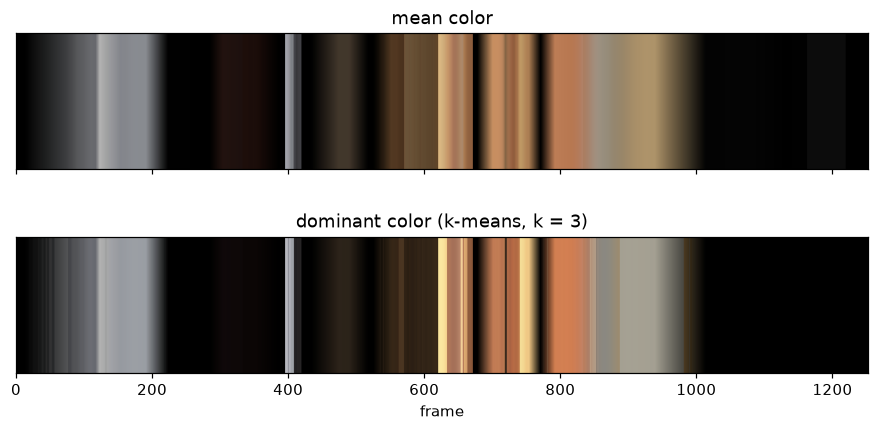{#fig-ch06-barcode-compare width=95%}

全体の流れは同じですが、細部は違います。
2つの色がもっとも大きく食い違うフレームを探してみます。
B・G・Rのうち、差がもっとも大きい成分の差を、フレームごとの食い違いの大きさとします。

```python
diff = np.abs(mean_colors - dominant).max(axis=1)

print(diff.argmax(), diff.max().round(1))
print(mean_colors[diff.argmax()].round(1), dominant[diff.argmax()])
```

```{.default}
721 80.4
[ 70.9 103.6 143.4] [32 45 63]
```

721番目のフレームでは、平均色が `[71 104 143]`（中くらいの明るさの茶色）、代表色が `[32 45 63]`（暗い焦げ茶）です。
このフレームでは、もっとも大きなグループが暗い部分だったのです。

2つの方法の性質をまとめると、次のようになります。

- **平均色**は、すべての画素を混ぜた色です。フレームの中に実際にはない色になることがあり、明るい色と暗い色、あるいは違う色相の色が混ざると、くすんだ中間の色になります。そのかわり、画面が少しずつ変化すれば平均色も少しずつ変化するので、帯はなめらかです。
- **代表色**は、実際にフレームの広い面積を占めている色に近くなります。ただし「いちばん大きいグループ」を選んでいるだけなので、背景の暗がりや空のように、面積は広いが目を引かない部分の色になることがあります。また、2つのグループの大きさが逆転すると、色が突然入れ替わります。

「いちばん面積の広い色」と「いちばん印象に残る色」は別のものです。
代表色のバーコードが示すのは前者であることに注意してください。

## 暖色と寒色、彩度の時間変化 {#sec-ch06-warmcool}

### 暖色と寒色を定義する

映像の色づかいを語るとき、「暖色が多い」「寒色でまとめられている」という言い方をよくします。
赤・橙・黄の系統を**暖色**（warm color）、青や青緑の系統を**寒色**（cool color）と呼ぶのが一般的です。
これを数値にするには、色相環のどこからどこまでを暖色・寒色とするかを決めなければなりません。

ここで、正直に言っておくべきことがあります。
**暖色と寒色の境目に、決まった定義はありません。**
黄緑や紫をどちらに入れるか（あるいはどちらにも入れないか）は、文献によっても人によっても違います。
本書では @tbl-ch06-warmcool のように定義して話を進め、そのあとで、定義を変えると結果がどう変わるかを確かめます。

| 区分 | 色相環での角度 | OpenCVのH | 含まれる色 |
|---|---|---|---|
| 暖色 | 330°〜90° | 165〜179、0〜44 | 赤、橙、黄、黄緑の一部 |
| 寒色 | 150°〜270° | 75〜134 | 青緑、シアン、青 |
| どちらでもない | 90°〜150°、270°〜330° | 45〜74、135〜164 | 緑、紫、マゼンタ |

: 本書での暖色と寒色の定義。これは1つの決め方であって、標準ではない {#tbl-ch06-warmcool}

暖色の範囲は0をまたいでいます。
@sec-ch06-hue で見たとおり、色相は環ですから、「165以上、**または**45未満」という条件で表さなければなりません。
範囲が0をまたぐ場合とまたがない場合の両方を扱える関数を作ります。
`|` は「または」を表します。

```python
def in_hue_range(h, start, stop):
    """色相hが、startからstopの手前までの範囲（環を数字の増える向きに進む）に入っているかを返す。"""
    if start <= stop:
        return (h >= start) & (h < stop)
    return (h >= start) | (h < stop)   # 0をまたぐ範囲
```

いくつかの値で確かめます。
1行目が暖色の範囲、2行目が寒色の範囲に入っているかどうかです。

```python
test = np.array([0, 20, 44, 45, 100, 164, 165, 179])

print(in_hue_range(test, 165, 45))
print(in_hue_range(test, 75, 135))
```

```{.default}
[ True  True  True False False False  True  True]
[False False False False  True False False False]
```

0、20、44と165、179が暖色、100が寒色と判定されています。
境目の45と164はどちらにも入っていません。
色相の帯の上で見ると、@fig-ch06-hue-range のようになります。

::: {#fig-ch06-hue-range}

```{=html}
<svg viewBox="0 0 760 290" role="img" aria-label="暖色と寒色の範囲。色相Hの0から179を帯にすると、暖色は左端の0から44と右端の165から179の2か所に分かれ、寒色は75から134のひと続きになる。179の次は0に戻るので、暖色は「165以上、または45未満」という条件で表す。8つの値0、20、44、45、100、164、165、179を調べると、暖色かどうかはTrue、True、True、False、False、False、True、True。寒色かどうかは100だけがTrue。" style="width:100%;height:auto;font-family:inherit" fill="currentColor">
  <defs><linearGradient id="huegrad-ch06" x1="0" x2="1" y1="0" y2="0"><stop offset="0.0000" stop-color="#ff0000"/><stop offset="0.1667" stop-color="#ffff00"/><stop offset="0.3333" stop-color="#00ff00"/><stop offset="0.5000" stop-color="#00ffff"/><stop offset="0.6667" stop-color="#0000ff"/><stop offset="0.8333" stop-color="#ff00ff"/><stop offset="1.0000" stop-color="#ff0000"/></linearGradient></defs>
  <rect x="110" y="60" width="540" height="30" fill="url(#huegrad-ch06)" stroke="currentColor" stroke-opacity="0.55"/>
  <line x1="110" y1="90" x2="110" y2="98" stroke="currentColor" stroke-width="1.3" stroke-opacity="0.7"/>
  <text x="110" y="112" font-size="12" text-anchor="middle" fill-opacity="0.8">0</text>
  <line x1="245" y1="90" x2="245" y2="98" stroke="currentColor" stroke-width="1.3" stroke-opacity="0.7"/>
  <text x="245" y="112" font-size="12" text-anchor="middle" fill-opacity="0.8">45</text>
  <line x1="335" y1="90" x2="335" y2="98" stroke="currentColor" stroke-width="1.3" stroke-opacity="0.7"/>
  <text x="335" y="112" font-size="12" text-anchor="middle" fill-opacity="0.8">75</text>
  <line x1="515" y1="90" x2="515" y2="98" stroke="currentColor" stroke-width="1.3" stroke-opacity="0.7"/>
  <text x="515" y="112" font-size="12" text-anchor="middle" fill-opacity="0.8">135</text>
  <line x1="605" y1="90" x2="605" y2="98" stroke="currentColor" stroke-width="1.3" stroke-opacity="0.7"/>
  <text x="605" y="112" font-size="12" text-anchor="middle" fill-opacity="0.8">165</text>
  <line x1="650" y1="90" x2="650" y2="98" stroke="currentColor" stroke-width="1.3" stroke-opacity="0.7"/>
  <text x="650" y="112" font-size="12" text-anchor="middle" fill-opacity="0.8">179</text>
  <text x="98" y="80" font-size="13" text-anchor="end" font-weight="700">色相 H</text>
  <path d="M113 52 v-6 h129 v6" fill="none" stroke="currentColor" stroke-width="1.3" stroke-opacity="0.6"/>
  <text x="177.5" y="38" font-size="12" text-anchor="middle" font-weight="700">暖色（0〜44）</text>
  <path d="M608 52 v-6 h39 v6" fill="none" stroke="currentColor" stroke-width="1.3" stroke-opacity="0.6"/>
  <text x="653" y="38" font-size="12" text-anchor="end" font-weight="700">暖色（165〜179）</text>
  <path d="M338 52 v-6 h174 v6" fill="none" stroke="currentColor" stroke-width="1.3" stroke-opacity="0.6"/>
  <text x="425" y="38" font-size="12" text-anchor="middle" font-weight="700">寒色（75〜134）</text>
  <text x="660" y="74" font-size="11" fill-opacity="0.8">179の次は</text>
  <text x="660" y="88" font-size="11" fill-opacity="0.8">0に戻る</text>
  <rect x="196" y="156" width="60" height="32" fill="currentColor" fill-opacity="0.04" stroke="currentColor" stroke-opacity="0.55" stroke-width="1"/>
  <text x="226" y="177.04" font-size="14" text-anchor="middle">0</text>
  <rect x="196" y="198" width="60" height="32" fill="#f0b84a" stroke="currentColor" stroke-opacity="0.55" stroke-width="1"/>
  <text x="226" y="218.68" font-size="13" font-weight="700" text-anchor="middle" fill="#1c1300">True</text>
  <rect x="196" y="240" width="60" height="32" fill="none" stroke-dasharray="4 3" stroke="currentColor" stroke-opacity="0.55" stroke-width="1"/>
  <text x="226" y="260.68" font-size="13" text-anchor="middle" fill-opacity="0.6">False</text>
  <rect x="256" y="156" width="60" height="32" fill="currentColor" fill-opacity="0.04" stroke="currentColor" stroke-opacity="0.55" stroke-width="1"/>
  <text x="286" y="177.04" font-size="14" text-anchor="middle">20</text>
  <rect x="256" y="198" width="60" height="32" fill="#f0b84a" stroke="currentColor" stroke-opacity="0.55" stroke-width="1"/>
  <text x="286" y="218.68" font-size="13" font-weight="700" text-anchor="middle" fill="#1c1300">True</text>
  <rect x="256" y="240" width="60" height="32" fill="none" stroke-dasharray="4 3" stroke="currentColor" stroke-opacity="0.55" stroke-width="1"/>
  <text x="286" y="260.68" font-size="13" text-anchor="middle" fill-opacity="0.6">False</text>
  <rect x="316" y="156" width="60" height="32" fill="currentColor" fill-opacity="0.04" stroke="currentColor" stroke-opacity="0.55" stroke-width="1"/>
  <text x="346" y="177.04" font-size="14" text-anchor="middle">44</text>
  <rect x="316" y="198" width="60" height="32" fill="#f0b84a" stroke="currentColor" stroke-opacity="0.55" stroke-width="1"/>
  <text x="346" y="218.68" font-size="13" font-weight="700" text-anchor="middle" fill="#1c1300">True</text>
  <rect x="316" y="240" width="60" height="32" fill="none" stroke-dasharray="4 3" stroke="currentColor" stroke-opacity="0.55" stroke-width="1"/>
  <text x="346" y="260.68" font-size="13" text-anchor="middle" fill-opacity="0.6">False</text>
  <rect x="376" y="156" width="60" height="32" fill="currentColor" fill-opacity="0.04" stroke="currentColor" stroke-opacity="0.55" stroke-width="1"/>
  <text x="406" y="177.04" font-size="14" text-anchor="middle">45</text>
  <rect x="376" y="198" width="60" height="32" fill="none" stroke-dasharray="4 3" stroke="currentColor" stroke-opacity="0.55" stroke-width="1"/>
  <text x="406" y="218.68" font-size="13" text-anchor="middle" fill-opacity="0.6">False</text>
  <rect x="376" y="240" width="60" height="32" fill="none" stroke-dasharray="4 3" stroke="currentColor" stroke-opacity="0.55" stroke-width="1"/>
  <text x="406" y="260.68" font-size="13" text-anchor="middle" fill-opacity="0.6">False</text>
  <rect x="436" y="156" width="60" height="32" fill="currentColor" fill-opacity="0.04" stroke="currentColor" stroke-opacity="0.55" stroke-width="1"/>
  <text x="466" y="177.04" font-size="14" text-anchor="middle">100</text>
  <rect x="436" y="198" width="60" height="32" fill="none" stroke-dasharray="4 3" stroke="currentColor" stroke-opacity="0.55" stroke-width="1"/>
  <text x="466" y="218.68" font-size="13" text-anchor="middle" fill-opacity="0.6">False</text>
  <rect x="436" y="240" width="60" height="32" fill="#1f6fb2" stroke="currentColor" stroke-opacity="0.55" stroke-width="1"/>
  <text x="466" y="260.68" font-size="13" font-weight="700" text-anchor="middle" fill="#ffffff">True</text>
  <rect x="496" y="156" width="60" height="32" fill="currentColor" fill-opacity="0.04" stroke="currentColor" stroke-opacity="0.55" stroke-width="1"/>
  <text x="526" y="177.04" font-size="14" text-anchor="middle">164</text>
  <rect x="496" y="198" width="60" height="32" fill="none" stroke-dasharray="4 3" stroke="currentColor" stroke-opacity="0.55" stroke-width="1"/>
  <text x="526" y="218.68" font-size="13" text-anchor="middle" fill-opacity="0.6">False</text>
  <rect x="496" y="240" width="60" height="32" fill="none" stroke-dasharray="4 3" stroke="currentColor" stroke-opacity="0.55" stroke-width="1"/>
  <text x="526" y="260.68" font-size="13" text-anchor="middle" fill-opacity="0.6">False</text>
  <rect x="556" y="156" width="60" height="32" fill="currentColor" fill-opacity="0.04" stroke="currentColor" stroke-opacity="0.55" stroke-width="1"/>
  <text x="586" y="177.04" font-size="14" text-anchor="middle">165</text>
  <rect x="556" y="198" width="60" height="32" fill="#f0b84a" stroke="currentColor" stroke-opacity="0.55" stroke-width="1"/>
  <text x="586" y="218.68" font-size="13" font-weight="700" text-anchor="middle" fill="#1c1300">True</text>
  <rect x="556" y="240" width="60" height="32" fill="none" stroke-dasharray="4 3" stroke="currentColor" stroke-opacity="0.55" stroke-width="1"/>
  <text x="586" y="260.68" font-size="13" text-anchor="middle" fill-opacity="0.6">False</text>
  <rect x="616" y="156" width="60" height="32" fill="currentColor" fill-opacity="0.04" stroke="currentColor" stroke-opacity="0.55" stroke-width="1"/>
  <text x="646" y="177.04" font-size="14" text-anchor="middle">179</text>
  <rect x="616" y="198" width="60" height="32" fill="#f0b84a" stroke="currentColor" stroke-opacity="0.55" stroke-width="1"/>
  <text x="646" y="218.68" font-size="13" font-weight="700" text-anchor="middle" fill="#1c1300">True</text>
  <rect x="616" y="240" width="60" height="32" fill="none" stroke-dasharray="4 3" stroke="currentColor" stroke-opacity="0.55" stroke-width="1"/>
  <text x="646" y="260.68" font-size="13" text-anchor="middle" fill-opacity="0.6">False</text>
  <text x="14" y="177" font-size="13" font-weight="700">test</text>
  <text x="14" y="212" font-size="13" font-weight="700">暖色か</text>
  <text x="14" y="227" font-size="11" fill-opacity="0.8">165以上、または45未満</text>
  <text x="14" y="254" font-size="13" font-weight="700">寒色か</text>
  <text x="14" y="269" font-size="11" fill-opacity="0.8">75以上、かつ135未満</text>
</svg>
```

暖色と寒色の範囲。暖色は、帯の両端の2か所に分かれる
:::

次に、フレームの中で暖色と寒色がそれぞれどれだけの割合を占めるかを求める関数を作ります。
割合の分母は、**絵の部分のすべての画素**とします。
色みのない画素（灰色や黒）は、暖色にも寒色にも数えません。

```python
def warm_cool(frame, s_min=40, v_min=40, warm=(165, 45), cool=(75, 135)):
    """黒帯を除いた絵の部分の全画素に対する、暖色の画素と寒色の画素の割合を返す。"""
    h = colored_hue(frame, s_min, v_min)
    n_pixels = (BOTTOM - TOP) * frame.shape[1]
    warm_ratio = in_hue_range(h, warm[0], warm[1]).sum() / n_pixels
    cool_ratio = in_hue_range(h, cool[0], cool[1]).sum() / n_pixels
    return warm_ratio, cool_ratio
```

```python
warm, cool = warm_cool(frame)

print(round(warm, 3), round(cool, 3))
```

```{.default}
0.893 0.0
```

750番目のフレームは、画素の89.3%が暖色で、寒色は0です。

### 彩度の代表値

彩度についても、フレームごとの代表値を決めます。
素直に考えれば、Sの平均です。
ただし、暗い画素の彩度には注意が必要です。

```python
dark = np.uint8([[[0, 0, 2]]])

print(cv2.cvtColor(dark, cv2.COLOR_BGR2HSV)[0, 0])
```

```{.default}
[  0 255   2]
```

`(0, 0, 2)` は、目にはまったくの黒にしか見えない画素ですが、彩度は最大の255になります。
Sは「最大値に対する割合」なので、値そのものが小さいと、わずかな差が大きな彩度になってしまうのです。
暗い場面でこのような画素が混ざると、平均の彩度が見た目と無関係に大きくなります。

そこで、明度Vが40以上の画素だけで、Sの平均を求めることにします。
該当する画素が1つもないフレーム（真っ黒な画面）では彩度を決められないので、「値がない」ことを表す `np.nan` を返します。

```python
def mean_saturation(frame, v_min=40):
    """黒帯を除いた絵の部分のうち、暗すぎない画素の彩度Sの平均を返す。該当する画素がなければNaN。"""
    hsv = cv2.cvtColor(frame[TOP:BOTTOM], cv2.COLOR_BGR2HSV)
    s, v = hsv[:, :, 1], hsv[:, :, 2]
    bright = v >= v_min
    if not bright.any():
        return np.nan
    return s[bright].mean()
```

`bright.any()` は、配列の中に `True` が1つでもあれば `True` を返します。
ここでは、暗すぎない画素が1つもないフレーム（真っ黒な画面）で、平均が計算できなくなるのを防いでいます。

```python
print(round(mean_saturation(frame), 1))
print(mean_saturation(read_frame(path, 0)))
```

```{.default}
137.7
nan
```

750番目のフレームは137.7、真っ黒な0番目のフレームは `nan` です。

### 映像全体について計算する

第5章と同じように、フレームごとの値を辞書にしてリストにため、最後にDataFrameにします。

```python
fps = video_info(path)["fps"]

rows = []
for n, img in iter_frames(path):
    warm, cool = warm_cool(img)
    rows.append({
        "frame": n,
        "time": n / fps,
        "warm": warm,
        "cool": cool,
        "saturation": mean_saturation(img),
    })
df = pd.DataFrame(rows)

print(df.iloc[748:753].round(3))
```

`df.iloc[748:753]` は、表の748番目から752番目までの行を取り出します。
第5章で使った `loc` が行の名前で指定するのに対し、`iloc` は位置で指定します。
スライスの終わりを含まない点は、NumPyの配列と同じです。

```{.default}
     frame    time   warm   cool  saturation
748    748  31.167  0.900  0.001     133.528
749    749  31.208  0.896  0.000     135.723
750    750  31.250  0.893  0.000     137.695
751    751  31.292  0.891  0.000     138.214
752    752  31.333  0.888  0.000     139.103
```

```python
print(df[["warm", "cool"]].mean().round(4))
print(df["cool"].max().round(3), df["cool"].idxmax())
```

```{.default}
warm    0.3172
cool    0.0005
dtype: float64
0.064 657
```

予告編全体を平均すると、暖色の画素が31.7%、寒色の画素は0.05%です。
寒色がもっとも多い657番目のフレームでも、6.4%にすぎません。

時間変化をグラフにします。
割合と彩度は単位が違うので、上下に分けて描きます。

```python
fig, axes = plt.subplots(2, 1, figsize=(9, 5), sharex=True)

axes[0].plot(df["time"], df["warm"], color="tab:red", linewidth=1.2, label="warm")
axes[0].plot(df["time"], df["cool"], color="tab:blue", linewidth=1.2, label="cool")
axes[0].set_ylabel("ratio of pixels")
axes[0].set_ylim(0, 1)
axes[0].legend()
axes[0].grid(alpha=0.3)

axes[1].plot(df["time"], df["saturation"], linewidth=1.2)
axes[1].set_ylabel("mean saturation S")
axes[1].set_ylim(0, 255)
axes[1].set_xlabel("time [s]")
axes[1].grid(alpha=0.3)
plt.show()
```

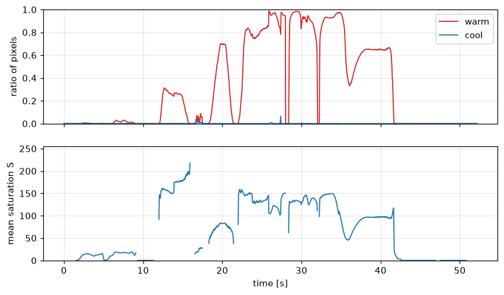{#fig-ch06-warm-cool width=90%}

- 暖色の割合は、12秒付近で30%ほどになったあと、19秒から急に増えます。26秒から35秒にかけては、ほとんどのフレームで80%を超えます（この区間の中央値は93%です）。夕焼けの空の下の場面です。途中で0まで落ちる細い谷は、場面の合間の黒い画面です。
- 寒色の線は、ほぼ0に張り付いています。
- 彩度は、12秒から16秒あたりの暗い場面でも高くなっています。画面は暗いのですが、明かりの当たった部分が濃い橙色だからです。42秒以降は、黒い背景に白い文字だけになるので、彩度は0に近くなります。

### 定義を変えると結果が変わる

@fig-ch06-warm-cool を見ると、この予告編に寒色はほとんど存在しないことになります。
しかし、冒頭の雪山の場面を思い出してください。

```python
frame150 = read_frame(path, 150)

plt.figure(figsize=(8, 4.5))
show(frame150, "frame 150")
plt.show()
```

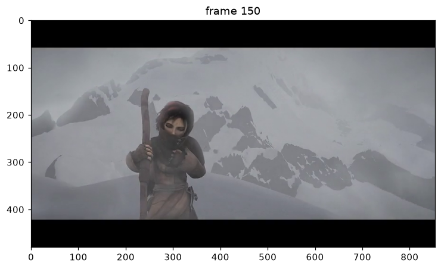{#fig-ch06-frame-150 width=85%}

筆者には、この場面は「寒々しい」「青みがかった灰色」に見えます。
数値を見てみます。
1行目が暖色と寒色の割合、2行目が平均彩度です。

```python
warm, cool = warm_cool(frame150)

print(round(warm, 3), round(cool, 3))
print(round(mean_saturation(frame150), 1))
```

```{.default}
0.005 0.0
13.9
```

寒色の割合は0です。
理由は平均彩度の13.9という値にあります。
この場面の画素はほとんどが彩度40未満で、「色みのない画素」として数える対象から外されていたのです。

彩度のしきい値 `s_min` を、40から10に下げて計算し直します。

```python
warm, cool = warm_cool(frame150, s_min=10)

print(round(warm, 3), round(cool, 3))
```

```{.default}
0.052 0.81
```

今度は、画素の81%が寒色になりました。
しきい値を下げて数えた画素の色相を調べると、多い順に次のようになります。

```python
h150 = colored_hue(frame150, s_min=10)
counts150 = np.bincount(h150, minlength=180)

print(np.argsort(counts150)[::-1][:5])
```

```{.default}
[105 115 111 120 113]
```

H＝105〜120、角度では210°〜240°ですから、青です。
雪山の場面は、**ごく淡い青**でできていたことになります。
しきい値が40のときは「灰色」として切り捨てられ、10にすると「寒色」として数えられる、という違いです。

映像全体でも計算し直して、2つの結果を並べます。

```python
rows = []
for n, img in iter_frames(path):
    warm, cool = warm_cool(img, s_min=10)
    rows.append({"warm_s10": warm, "cool_s10": cool})
df[["warm_s10", "cool_s10"]] = pd.DataFrame(rows)

print(df[["warm", "cool", "warm_s10", "cool_s10"]].mean().round(4))
```

```{.default}
warm        0.3172
cool        0.0005
warm_s10    0.3612
cool_s10    0.0924
dtype: float64
```

```python
fig, axes = plt.subplots(2, 1, figsize=(9, 5), sharex=True)

axes[0].plot(df["time"], df["warm"], color="tab:red", linewidth=1.2, label="warm")
axes[0].plot(df["time"], df["cool"], color="tab:blue", linewidth=1.2, label="cool")
axes[0].set_title("s_min = 40")

axes[1].plot(df["time"], df["warm_s10"], color="tab:red", linewidth=1.2, label="warm")
axes[1].plot(df["time"], df["cool_s10"], color="tab:blue", linewidth=1.2, label="cool")
axes[1].set_title("s_min = 10")
axes[1].set_xlabel("time [s]")

for ax in axes:
    ax.set_ylabel("ratio of pixels")
    ax.set_ylim(0, 1)
    ax.legend()
    ax.grid(alpha=0.3)
plt.tight_layout()
plt.show()
```

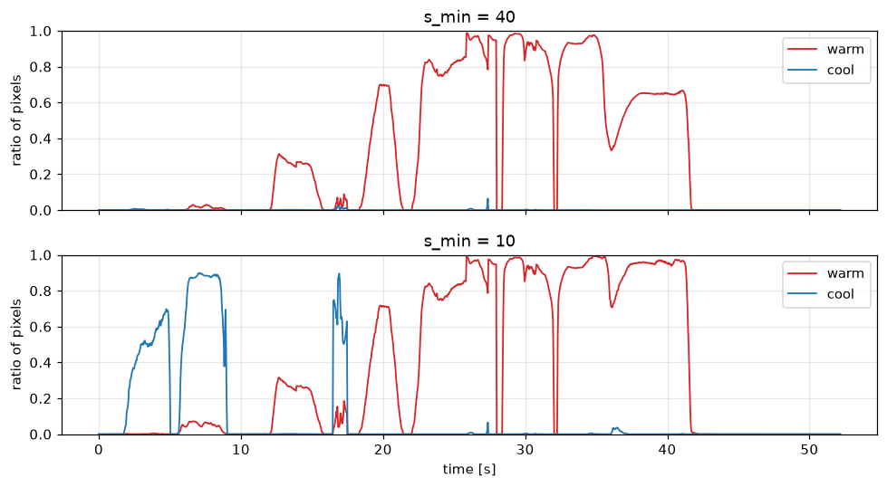{#fig-ch06-warm-cool-smin width=90%}

しきい値が40なら「寒色のほとんどない映像」、10なら「寒色の場面で始まり、暖色の場面へ移る映像」です。
予告編全体での寒色の割合は、0.05%から9.2%へと、180倍ほどに変わりました。
同じ映像、同じ計算方法で、しきい値を1つ変えただけです。

どちらが正しいのでしょうか。
どちらも、定義どおりに正しく計算された結果です。
しきい値を低くすれば淡い色みも拾えますが、彩度の低い画素の色相は、@sec-ch06-hue で述べたとおり不安定です。
実際、上の結果でも色相は105、111、113、115、120と飛び飛びの値に偏っており、細かい区別には使えません。
しきい値を高くすれば色相は信頼できますが、淡い色の場面を見落とします。

色相の範囲のほうも変えてみます。
暖色を330°〜60°（黄色まで）、寒色を180°〜270°（シアンから青まで）と、どちらも狭くした定義です。

```python
rows = []
for n, img in iter_frames(path):
    warm, cool = warm_cool(img, warm=(165, 30), cool=(90, 135))
    rows.append({"warm_narrow": warm, "cool_narrow": cool})
df[["warm_narrow", "cool_narrow"]] = pd.DataFrame(rows)

print(df[["warm", "warm_narrow", "cool", "cool_narrow"]].mean().round(4))
print((df["warm"] - df["warm_narrow"]).max().round(3), (df["warm"] - df["warm_narrow"]).idxmax())
```

```{.default}
warm           0.3172
warm_narrow    0.3156
cool           0.0005
cool_narrow    0.0005
dtype: float64
0.121 626
```

全体の平均は、暖色が31.72%から31.56%へと、ほとんど変わりません。
この予告編では色相がH＝0〜29に集中していて（@fig-ch06-hue-hist-all）、境目の付近に画素が少ないためです。
ただし、フレーム単位では最大で12.1ポイントの差が出ています（626番目のフレーム）。
黄色や黄緑の多い映像なら、範囲の決め方は結果を大きく左右するはずです。

::: {.callout-important title="定義を書かずに「暖色が何%」と言わない"}
暖色・寒色の割合は、次の3つを決めてはじめて計算できる数値です。

- 色相のどの範囲を暖色・寒色とするか
- 彩度と明度のしきい値をいくつにするか
- 割合の分母を何にするか（全画素か、色みのある画素だけか）

結果を報告するときは、この3つを必ず書き添えてください。
また、作品どうしを比べるときは、すべての作品に同じ定義を使ってください。
定義が違えば、数値の違いが作品の違いなのか定義の違いなのか、区別できなくなります。
:::

## 色と印象——数値から言えること、言えないこと {#sec-ch06-meaning}

この章では、色についてのさまざまな数値を計算しました。
最後に、これらの数値を使って何が言え、何が言えないのかを整理しておきます。

### 言えること

数値から言えるのは、**画面にどんな色の画素がどれだけあるか**という事実です。
たとえば次のような記述は、この章の計算で裏づけられます。

- この予告編の色みのある画素（S≥40、V≥40）は、98.4%が赤から黄までの色相（H＝0〜29）に入っている。
- 冒頭の雪山の場面は平均彩度が低く（150番目のフレームで13.9）、26秒から35秒の場面は高い（750番目のフレームで137.7）。
- 暖色の画素の割合は、26秒から35秒にかけて、ほとんどのフレームで80%を超える。

これらは**記述**です。
定義と手順を明示すれば、ほかの人が同じ映像から同じ数値を得られます。
また、同じ定義で測れば、場面どうし、作品どうしを比べることができます。
「印象ではこう感じる」という主張を、ほかの人が確かめられる形に置き換えられることが、数値にする利点です。

### 言えないこと

一方、数値から直接には言えないことがあります。

**第一に、観客がその色をどう感じるかです。**
画素の値と、人間が知覚する色は同じではありません。
雪山の場面は、彩度の数値で見ればほぼ灰色でした。
それでも青みがかって冷たく見えるのは、淡い青であっても画面全体が同じ傾向にそろっていること、雪や防寒着といった映っている内容、そして後に続く橙色の場面との対比などが、合わさって働くからだと考えられます。
色の見え方は、周囲の色、直前に見ていた色、上映や表示の環境にも左右されます。
画素の集計には、こうした要因は含まれていません。

**第二に、その色が何を意味するかです。**
「暖色は喜びや安心を、寒色は悲しみや不安を表す」といった対応づけを見かけることがありますが、色と感情の結びつきは、文化、時代、ジャンル、そして作品の中での文脈によって変わります。
たとえば白は、祝いの色として使われる文化もあれば、喪の色として使われる文化もあります。
ある作品の中で、物語の進行につれて同じ色の意味が変わっていくことも珍しくありません。

この予告編そのものが、よい例になります。
街や竜の登場する動きの激しい場面（フレーム540〜859）と、静かな砂丘の場面（フレーム870〜989）について、暖色の割合と彩度の平均を比べてみます。

```python
battle = df[(df["frame"] >= 540) & (df["frame"] < 860)]
dunes = df[(df["frame"] >= 870) & (df["frame"] < 990)]

print(battle[["warm", "cool", "saturation"]].mean().round(3))
print(dunes[["warm", "cool", "saturation"]].mean().round(3))
```

```{.default}
warm            0.824
cool            0.001
saturation    129.101
dtype: float64
warm           0.610
cool           0.000
saturation    91.093
dtype: float64
```

どちらも寒色はほぼ0で、暖色が画面の大半（82%と61%）を占めています。
数値のうえでは、どちらも「暖色の場面」です。
しかし、2つの場面から受ける印象が同じだと言う人は少ないでしょう。
「暖色＝ある決まった感情」という対応表があったとしても、この2つを区別することはできません。

**第三に、作り手の意図です。**
ある場面が橙色であることは数値で示せますが、なぜ橙色にしたのかは、数値からはわかりません。
また、分析しているのは手元のファイルの画素値です。
同じ作品でも、配信や放送、ソフトの版によって色の調整が違うことがあります。
どの版のどのファイルを測ったのかも、記録しておくべき情報です。

### 数値をどう使うか

数値は解釈の代わりにはなりませんが、解釈の出発点と裏づけになります。
本書では、次のような使い方を勧めます。

1. 数値やグラフで、変化の大きいところ、ほかと違うところを見つけます。
2. その場面を実際に観て、何が起きているかを確かめます。
3. 解釈を述べるときは、数値で示せる事実（記述）と、自分の読み（解釈）を分けて書きます。

たとえば「26秒から35秒にかけて、暖色の画素の割合は中央値で93%に達する（記述）。この区間は、夕焼けの空の下で物語が大きく動く場面にあたる（場面の観察）。筆者はこの色調を、…という効果として読む（解釈）」という書き方です。
数値は、解釈のうち「どこまでが誰でも確かめられる事実か」をはっきりさせるために使います。

## まとめ {#sec-ch06-summary}

- B・G・Rの3つの値には、色の種類・鮮やかさ・明るさが混ざり合っています。**HSV色空間**に変換すると、**色相**（H）・**彩度**（S）・**明度**（V）に分けて扱えます。
- OpenCVの8ビット画像では、**Hは0〜179（角度の半分）、SとVは0〜255**です。Hを計算に使うときは、`uint8` のあふれを避けるために型を変えます。
- 白・灰色・黒の画素は、Hが0になります。色相を集計するときは、黒帯（レターボックス）を切り落とし、彩度や明度の低い画素を**マスク**で除外します。
- 色相は環になっているので、単純な平均は使えません。角度を矢印に置き換えて平均する**円周上の平均**を使い、集中度Rもあわせて確認します。
- **k-means法**（`cv2.kmeans`）で、フレームの**代表色**を求められます。kは自分で決める値です。結果は乱数に左右されるので、やり直しの回数を増やし、`cv2.setRNGSeed` を `cv2.kmeans` の直前で呼んで再現性を確保します。
- フレームごとの色を縦線として並べると、映像全体の色の移り変わりを表す**カラーバーコード**になります。平均色は実在しない中間の色になりやすく、代表色は面積の広い色を拾います。
- 暖色・寒色の割合は、色相の範囲、彩度と明度のしきい値、分母の3つを決めてはじめて計算できます。定義を変えると結果は変わるので、定義を必ず明記します。
- 色の数値は画面の**記述**であり、観客の感じ方や色の意味の**解釈**ではありません。色と感情の対応は、文化や文脈によって変わります。

## 演習 {#sec-ch06-exercises}

1. 600番目と900番目のフレームについて、色相ヒストグラムと5色のパレットを作ってください。750番目のフレームと比べて、どこが似ていて、どこが違うでしょうか。
2. `colored_hue` のしきい値を `s_min=20, v_min=20` や `s_min=80, v_min=80` に変えて、750番目と150番目のフレームの色相ヒストグラムを描き直してください。数える対象になる画素の割合と、ヒストグラムの形はどう変わるでしょうか。
3. すべてのフレームについて `circular_mean_hue` で円周上の平均と集中度Rを求め、DataFrameにまとめて時系列グラフにしてください。Rが小さいのはどのような場面でしょうか（色みのある画素が1つもないフレームでは結果が `nan` になり、警告が表示されます。そのようなフレームをどう扱うかも考えてください）。
4. 代表色のバーコードは、色が突然入れ替わることがありました。各フレームのk＝3の代表色を、明るい順に上から3段に積んだバーコードを作ってみましょう。`dominant_colors` の戻り値を、色の明るさ（B・G・Rの平均など）で並べ替えるのが手がかりです。
5. 自分の映像でカラーバーコードを作ってください。最初に、黒帯があるかどうかを行ごと・列ごとの平均で確かめ、`TOP` と `BOTTOM` を決め直します。次に、暖色・寒色の割合を、本章の定義と、自分で決めた別の定義の2通りで計算し、結果がどれくらい違うかを比べてください。長い映像では、`iter_frames` の `step` でフレームを間引くと時間を節約できます。
