# 動き {#sec-motion}

明るさと色は、フレームを1枚ずつ調べれば測ることができました。
この章で扱う「動き」は、そうはいきません。
動きは1枚のフレームの中にはなく、**隣り合う2枚のフレームのあいだ**にあるからです。

そこでこの章では、2枚のフレームを比べる方法を2つ学びます。
1つは、画素ごとに引き算をする**フレーム間差分**（frame differencing）です。
もう1つは、各画素がどちらへどれだけ動いたかを推定する**オプティカルフロー**（optical flow）です。
前者は単純で速く、後者は手間がかかるかわりに、動きの「大きさ」と「向き」を教えてくれます。
どちらにも得意・不得意がありますので、うまくいかない例も実際に確かめながら進めます。

::: {.callout-note title="この章のゴール"}
Sintel予告編の全フレームについて「動き量」を計算し、時系列グラフに描きます（@fig-ch07-motion-timeline）。
上段はフレーム間差分、下段はオプティカルフローから求めた動き量です。
このグラフから動きの激しい場面を特定し、あわせて、グラフに現れる鋭い山の多くが「動き」ではないことを理解します。
:::

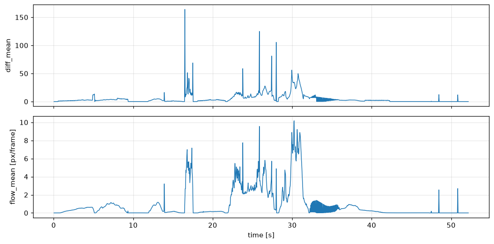{#fig-ch07-motion-timeline width=85%}

## フレーム間差分——引き算で動きを捉える {#sec-ch07-diff}

### 準備

新しいノートブック `ch07.ipynb` をプロジェクトフォルダの直下に作り、カーネルに `.venv` を選んでください。
最初のセルで、この章で使うライブラリと、第4章で作った `videotools.py` の関数を読み込みます。

```python
import time

import cv2
import matplotlib.pyplot as plt
import numpy as np
import pandas as pd

from videotools import video_info, iter_frames, read_frame, show

VIDEO = "data/sintel_trailer-480p.mp4"
info = video_info(VIDEO)
fps = info["fps"]
print(info["width"], info["height"], fps, info["frame_count"])
```

```{.default}
854 480 24.0 1253
```

### 上下の黒帯を取り除く

本題に入る前に、1つ下ごしらえをします。
第5章（@sec-brightness）で調べたとおり、この予告編には上下に黒帯があり、絵が映っているのは58行目から421行目まででした。
黒帯は決して動きませんから、動きを測るときにも計算から外しておきます。
第5章と同じ `TOP`、`BOTTOM` と、黒帯を除いたグレースケール画像を返す関数 `to_gray` を、このノートブックでも定義します。

```python
TOP, BOTTOM = 58, 422

def to_gray(frame):
    """黒帯を除いたグレースケール画像を返す。"""
    gray = cv2.cvtColor(frame, cv2.COLOR_BGR2GRAY)
    return gray[TOP:BOTTOM]
```

以降、この章ではすべてのフレームを `to_gray` に通してから使います。
動きを調べるのに色は必要ありませんので、グレースケールにして、扱う数値の量を3分の1にしています。

::: {.callout-tip title="自分の映像を使うとき"}
黒帯の有無と位置は映像によって違います。
黒帯のない映像では `TOP, BOTTOM = 0, 高さ` とすれば、以降のコードはそのまま使えます。
:::

### 2枚のフレームを引き算する

隣り合う2枚として、702番目と703番目のフレームを取り出します。

```python
gray_a = to_gray(read_frame(VIDEO, 702))
gray_b = to_gray(read_frame(VIDEO, 703))
print(gray_a.shape, gray_a.dtype)
```

```{.default}
(364, 854) uint8
```

黒帯を除いたので、縦は480ではなく364になっています。

考え方は単純です。
2枚のフレームで何も動いていなければ、同じ位置の画素は同じ値のはずです。
逆に、値が変わった画素があれば、そこで何かが起きています。
そこで、同じ位置の画素どうしを引き算し、その結果を画像として眺めます。
これが**フレーム間差分**です。

ただし、`uint8` のまま引き算をしてはいけません。
第3章（@sec-ch03-overflow）で確かめた、オーバーフロー（桁あふれ）が起こるからです。
ある1つの画素で、おさらいしておきます。

```python
print(gray_a[104, 80], gray_b[104, 80])

wrong = gray_b - gray_a
print(wrong[104, 80])
```

```{.default}
201 157
212
```

この画素は、201から157へと暗くなりました。
差は 157 − 201 = −44 のはずですが、結果は212です。
`uint8` は0から255までしか表せないので、−44は256を足した212に化けてしまいます。
「少し暗くなった」画素が「非常に大きく変化した」画素として記録されることになり、これでは使いものになりません。

動きを調べるうえで知りたいのは、明るくなったか暗くなったかではなく、**どれだけ変わったか**です。
つまり、差の絶対値がほしいのです。
そこで、第3章の終わりに予告したとおり、オーバーフローを起こさずに差の絶対値を求める `cv2.absdiff` を使います。

```python
diff = cv2.absdiff(gray_a, gray_b)
print(diff[104, 80], diff.dtype)
```

```{.default}
44 uint8
```

正しく44が得られました。
結果は0から255に収まるので、型は `uint8` のままです。

### 差分画像を見る

2枚のフレームと、誤った引き算、正しい差分を並べて表示します。

```python
fig, axes = plt.subplots(2, 2, figsize=(11, 5))
show(gray_a, "frame 702", ax=axes[0, 0])
show(gray_b, "frame 703", ax=axes[0, 1])
show(wrong, "gray_b - gray_a (uint8)", ax=axes[1, 0])
show(diff, "cv2.absdiff", ax=axes[1, 1])
plt.tight_layout()
plt.show()
```

{#fig-ch07-diff width=95%}

@fig-ch07-diff の上段の2枚は、見比べてもほとんど違いがわかりません。
24分の1秒しか離れていないのですから当然です。

左下の誤った引き算では、画面のあちこちが白くなっています。
わずかに暗くなっただけの画素が、オーバーフローによって255に近い値になったためです。

右下の正しい差分画像では、ほとんどの場所が黒（差が0に近い）で、人物の輪郭と、空を飛ぶ小さな竜のところだけが明るくなっています。
人物の腕と竜の翼が動いたことが、引き算だけで取り出せました。

ここで、差分画像の読み方について1つ注意しておきます。
明るくなっているのは、人物の「全体」ではなく「輪郭」です。
差分が示すのは「物が動いた場所」ではなく、**「画素の値が変わった場所」**だからです。
一様な色の面が少し動いても、面の内側では値が変わらないので、差分には現れません。
この性質は、章の後半でもう一度問題になります。

## 差分から「動き量」を定義する {#sec-ch07-amount}

### 1枚の差分画像を1つの数にする

差分画像は、画素の数だけ値を持っています。
映像全体の移り変わりを見るには、第5章で平均輝度を求めたときと同じように、これを1つの数に要約する必要があります。
ここでは2通りの要約を試します。

```python
print(diff.mean())
print((diff > 20).mean())
```

```{.default}
6.576089893712845
0.06979759116761458
```

1つ目は、**差分の平均**です。
「1画素あたり、平均してどれだけ値が変わったか」を表し、単位は輝度の階調です。

2つ目は、**大きく変化した画素の割合**です。
`diff > 20` は、差が20を超えた画素を `True`、それ以外を `False` とする配列を作ります。
その平均は、第3章で見たとおり、`True` の割合になります。
このフレーム対では、画素の約7%が20階調を超えて変化しました。
基準にした20が、第6章でも使った、しきい値です。

2つの違いは、小さな変化の扱いにあります。
差分の平均は、画面全体のごくわずかな変化もすべて足し込みます。
割合のほうは、しきい値に満たない変化を無視します。
どちらがよいかは目的によりますので、両方を計算して比べることにします。

本書では、このように2枚のフレームの違いを1つの数にしたものを**動き量**と呼ぶことにします。
ただし、この呼び名には注意が必要で、この数が本当に「動き」を表しているかどうかは、これから確かめていきます。

### 全フレームについて計算する

すべての隣り合うフレームについて、2つの動き量を計算します。
ループの中で「1つ前のフレーム」を覚えておくために、変数 `prev` を使います。

```python
records = []
prev = None
for n, frame in iter_frames(VIDEO):
    gray = to_gray(frame)
    if prev is not None:
        diff = cv2.absdiff(prev, gray)
        records.append({
            "frame": n,
            "time": n / fps,
            "brightness": gray.mean(),
            "diff_mean": diff.mean(),
            "diff_ratio": (diff > 20).mean(),
        })
    prev = gray

df = pd.DataFrame(records).set_index("frame")
print(len(df))
print(df.loc[700:704])
```

```{.default}
1252
            time  brightness  diff_mean  diff_ratio
frame
700    29.166667  151.238689  17.865845    0.160666
701    29.208333  153.863393   9.639135    0.118820
702    29.250000  154.146820   7.381029    0.080063
703    29.291667  153.860434   6.576090    0.069798
704    29.333333  153.681235   5.102655    0.049139
```

要点は次のとおりです。

- 最初のフレームには「1つ前」がありませんから、`prev` が `None` のあいだは計算を飛ばします。そのため、1253枚のフレームから得られる値は1252個です。
- `frame` が `n` の行には、**`n − 1` 番目から `n` 番目への変化**を記録しています。703の行の `diff_mean` が、先ほど求めた6.576と一致していることを確認してください。
- あとで使うので、平均輝度 `brightness` も一緒に記録しました。
- `set_index("frame")` でフレーム番号を表の見出し（インデックス）にしたので、`df.loc[700:704]` のようにフレーム番号で行を取り出せます。

フレームと表の行の対応は、@fig-ch07-prev-pairs のとおりです。

::: {#fig-ch07-prev-pairs}

```{=html}
<svg viewBox="0 0 760 250" role="img" aria-label="隣り合うフレームの対と、表の行の対応。フレームは0番目から1252番目までの1253枚。表の1の行には0番目と1番目のフレームの差、2の行には1番目と2番目の差、というように、nの行にはn−1番目とn番目の差が入る。0番目には1つ前のフレームがないので行がなく、表は1252行になる。" style="width:100%;height:auto;font-family:inherit" fill="currentColor">
  <rect x="122" y="44" width="70" height="42" fill="#f0b84a" stroke="currentColor" stroke-opacity="0.55" stroke-width="1"/>
  <text x="157" y="70.4" font-size="15" font-weight="700" text-anchor="middle" fill="#1c1300">0</text>
  <rect x="122" y="168" width="70" height="42" fill="none" stroke-dasharray="4 3" stroke="currentColor" stroke-opacity="0.55" stroke-width="1"/>
  <text x="157" y="193.68" font-size="13" text-anchor="middle" fill-opacity="0.6">なし</text>
  <rect x="214" y="44" width="70" height="42" fill="#f0b84a" stroke="currentColor" stroke-opacity="0.55" stroke-width="1"/>
  <text x="249" y="70.4" font-size="15" font-weight="700" text-anchor="middle" fill="#1c1300">1</text>
  <rect x="214" y="168" width="70" height="42" fill="#1f6fb2" stroke="currentColor" stroke-opacity="0.55" stroke-width="1"/>
  <text x="249" y="194.4" font-size="15" font-weight="700" text-anchor="middle" fill="#ffffff">1</text>
  <line x1="157" y1="89" x2="241" y2="164" stroke="#1f6fb2" stroke-width="1.8"/>
  <line x1="249" y1="89" x2="251" y2="164" stroke="#1f6fb2" stroke-width="1.8"/>
  <rect x="306" y="44" width="70" height="42" fill="#f0b84a" stroke="currentColor" stroke-opacity="0.55" stroke-width="1"/>
  <text x="341" y="70.4" font-size="15" font-weight="700" text-anchor="middle" fill="#1c1300">2</text>
  <rect x="306" y="168" width="70" height="42" fill="#1f6fb2" stroke="currentColor" stroke-opacity="0.55" stroke-width="1"/>
  <text x="341" y="194.4" font-size="15" font-weight="700" text-anchor="middle" fill="#ffffff">2</text>
  <line x1="249" y1="89" x2="333" y2="164" stroke="#1f6fb2" stroke-width="1.8"/>
  <line x1="341" y1="89" x2="343" y2="164" stroke="#1f6fb2" stroke-width="1.8"/>
  <rect x="398" y="44" width="70" height="42" fill="#f0b84a" stroke="currentColor" stroke-opacity="0.55" stroke-width="1"/>
  <text x="433" y="70.4" font-size="15" font-weight="700" text-anchor="middle" fill="#1c1300">3</text>
  <rect x="398" y="168" width="70" height="42" fill="#1f6fb2" stroke="currentColor" stroke-opacity="0.55" stroke-width="1"/>
  <text x="433" y="194.4" font-size="15" font-weight="700" text-anchor="middle" fill="#ffffff">3</text>
  <line x1="341" y1="89" x2="425" y2="164" stroke="#1f6fb2" stroke-width="1.8"/>
  <line x1="433" y1="89" x2="435" y2="164" stroke="#1f6fb2" stroke-width="1.8"/>
  <rect x="490" y="44" width="70" height="42" fill="currentColor" fill-opacity="0.04" stroke="currentColor" stroke-opacity="0.55" stroke-width="1"/>
  <text x="525" y="70.4" font-size="15" font-weight="700" text-anchor="middle">…</text>
  <rect x="490" y="168" width="70" height="42" fill="currentColor" fill-opacity="0.04" stroke="currentColor" stroke-opacity="0.55" stroke-width="1"/>
  <text x="525" y="194.4" font-size="15" font-weight="700" text-anchor="middle">…</text>
  <line x1="433" y1="89" x2="517" y2="164" stroke="#1f6fb2" stroke-width="1.8" stroke-opacity="0.35"/>
  <line x1="525" y1="89" x2="527" y2="164" stroke="#1f6fb2" stroke-width="1.8" stroke-opacity="0.35"/>
  <rect x="582" y="44" width="70" height="42" fill="#f0b84a" stroke="currentColor" stroke-opacity="0.55" stroke-width="1"/>
  <text x="617" y="70.4" font-size="15" font-weight="700" text-anchor="middle" fill="#1c1300">1251</text>
  <rect x="582" y="168" width="70" height="42" fill="#1f6fb2" stroke="currentColor" stroke-opacity="0.55" stroke-width="1"/>
  <text x="617" y="194.4" font-size="15" font-weight="700" text-anchor="middle" fill="#ffffff">1251</text>
  <line x1="525" y1="89" x2="609" y2="164" stroke="#1f6fb2" stroke-width="1.8" stroke-opacity="0.35"/>
  <line x1="617" y1="89" x2="619" y2="164" stroke="#1f6fb2" stroke-width="1.8" stroke-opacity="0.35"/>
  <rect x="674" y="44" width="70" height="42" fill="#f0b84a" stroke="currentColor" stroke-opacity="0.55" stroke-width="1"/>
  <text x="709" y="70.4" font-size="15" font-weight="700" text-anchor="middle" fill="#1c1300">1252</text>
  <rect x="674" y="168" width="70" height="42" fill="#1f6fb2" stroke="currentColor" stroke-opacity="0.55" stroke-width="1"/>
  <text x="709" y="194.4" font-size="15" font-weight="700" text-anchor="middle" fill="#ffffff">1252</text>
  <line x1="617" y1="89" x2="701" y2="164" stroke="#1f6fb2" stroke-width="1.8"/>
  <line x1="709" y1="89" x2="711" y2="164" stroke="#1f6fb2" stroke-width="1.8"/>
  <text x="14" y="63" font-size="13" font-weight="700">フレーム</text>
  <text x="14" y="80" font-size="12" fill-opacity="0.75">1253枚</text>
  <text x="14" y="187" font-size="13" font-weight="700">表 df の行</text>
  <text x="14" y="204" font-size="12" fill-opacity="0.75">1252行</text>
  <text x="157" y="228" font-size="12" text-anchor="middle" fill-opacity="0.75">1つ前がない</text>
  <text x="283" y="131" font-size="12" text-anchor="end" font-weight="700">prev</text>
  <text x="349" y="131" font-size="12" font-weight="700">gray</text>
  <text x="503" y="232" font-size="13" text-anchor="middle">n の行には、n − 1 番目から n 番目への変化を記録する</text>
</svg>
```

隣り合うフレームの対と、表 `df` の行の対応。箱の中の数は、上段がフレーム番号、下段が表のインデックス
:::

この表 `df` には、あとの節で列を足していきます。
このセルをあとから実行し直すと、`df` が作り直されて、足した列は消えます。
その場合は、列を足すセルも、もう一度実行してください。

### 時系列グラフを描く

2つの動き量を、縦に並べたグラフにします。

```python
fig, axes = plt.subplots(2, 1, figsize=(10, 5), sharex=True)
axes[0].plot(df["time"], df["diff_mean"], linewidth=1)
axes[0].set_ylabel("diff_mean")
axes[1].plot(df["time"], df["diff_ratio"], linewidth=1)
axes[1].set_ylabel("diff_ratio")
axes[1].set_xlabel("time [s]")
for ax in axes:
    ax.grid(alpha=0.3)
plt.tight_layout()
plt.show()
```

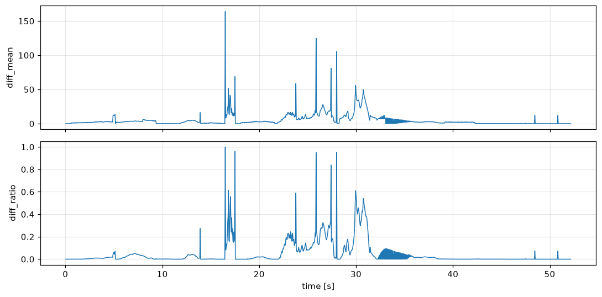{#fig-ch07-diff-timeline width=85%}

@fig-ch07-diff-timeline を見ると、16秒から18秒と、22秒から32秒のあたりで値が大きく、それ以外は小さいことがわかります。
予告編を観たときの「中盤が激しい」という印象と合っています。

しかし、それ以上に目を引くのは、針のように鋭く立ち上がる山です。
これは何でしょうか。

### 鋭い山の正体

`diff_mean` の大きい順に、5つのフレームを取り出します。

```python
print(df.nlargest(5, "diff_mean"))
print(df["diff_mean"].median())
```

```{.default}
            time  brightness   diff_mean  diff_ratio
frame
396    16.500000  164.028637  164.028521    1.000000
621    25.875000  187.336172  124.955420    0.950968
672    28.000000    0.000000  105.475992    0.952679
658    27.416667  135.606458   81.091869    0.839640
420    17.500000    0.000000   68.737242    0.961204
2.2221880870885555
```

`diff_mean` の中央値は約2.2ですから、これらのフレームでは、ふだんの30倍から70倍あまりの変化が起きています。
`diff_ratio` も0.84から1.0で、画面のほぼ全体が一度に変化しています。
このうち621番目と672番目について、直前のフレームと並べて表示します。

```python
fig, axes = plt.subplots(2, 2, figsize=(11, 5.5))
for ax, n in zip(axes.ravel(), [620, 621, 671, 672]):
    show(read_frame(VIDEO, n), f"frame {n}", ax=ax)
plt.tight_layout()
plt.show()
```

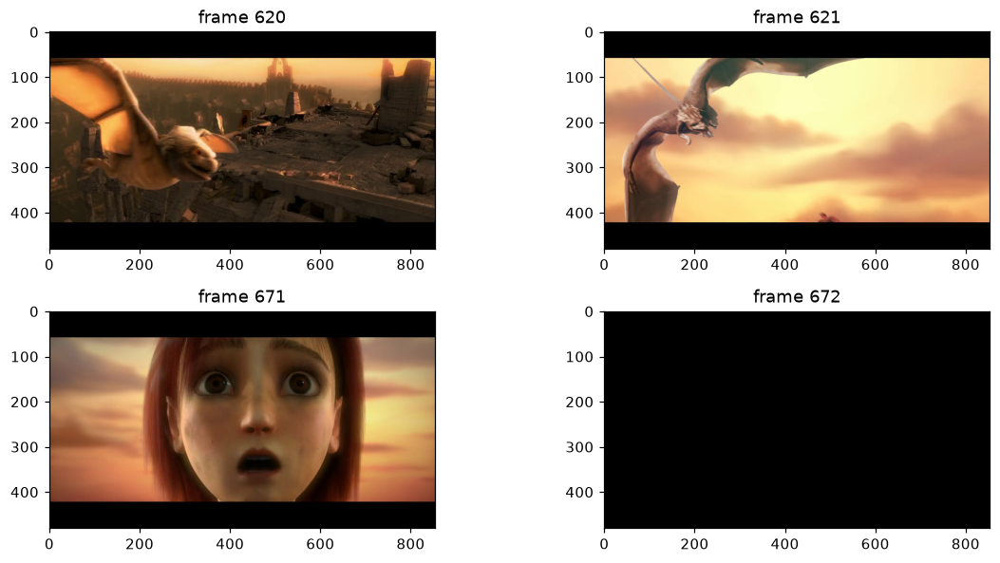{#fig-ch07-cuts width=90%}

@fig-ch07-cuts のとおり、620番目と621番目ではまったく別の画面になっています。
671番目から672番目では、人物の顔から真っ黒な画面に切り替わっています。
どちらも、画面の中で何かが動いたのではありません。
**ショットが切り替わった**のです。
第1章で述べたように、ショットとショットの境目を**カット点**と呼びます。

ここから、2つのことがわかります。

- フレーム間差分は、「被写体の動き」と「画面の切り替わり」を区別できません。どちらも「画素の値が変わった」という点では同じだからです。したがって、鋭い山を「動きが激しい瞬間」と読むのは誤りです。
- 見方を変えれば、差分が跳ね上がる場所を探すことで、カット点を自動で見つけられそうです。これが第8章（@sec-cuts）の出発点になります。

### 明るさの変化も「動き」に見える

差分には、もう1つ限界があります。
フレーム150から240の範囲を拡大して、平均輝度と一緒に見てみます。

```python
part = df.loc[150:240]
fig, axes = plt.subplots(3, 1, figsize=(10, 6), sharex=True)
for ax, col in zip(axes, ["brightness", "diff_mean", "diff_ratio"]):
    ax.plot(part.index, part[col], linewidth=1)
    ax.set_ylabel(col)
    ax.grid(alpha=0.3)
axes[2].set_xlabel("frame")
plt.tight_layout()
plt.show()
```

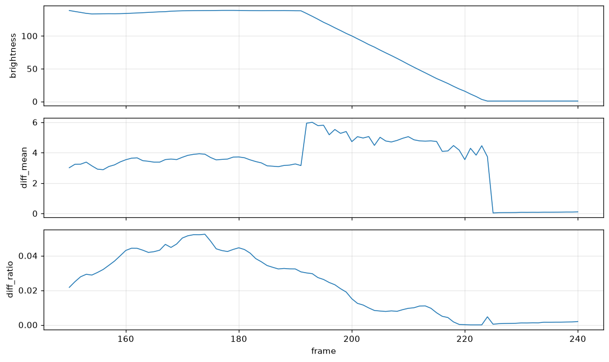{#fig-ch07-fade width=85%}

@fig-ch07-fade の上段を見ると、フレーム192あたりから平均輝度が一定の速さで下がり、224あたりでほぼ0になっています。
画面がしだいに暗くなって消えていく**フェードアウト**です。

このとき、中段の `diff_mean` は下がるどころか、フェードが始まった瞬間に上がっています。
フェードの前と最中で、平均を比べてみます。

```python
print(df.loc[170:190, ["diff_mean", "diff_ratio"]].mean())
print(df.loc[195:215, ["diff_mean", "diff_ratio"]].mean())
```

```{.default}
diff_mean     3.513385
diff_ratio    0.041953
dtype: float64
diff_mean     4.976638
diff_ratio    0.012822
dtype: float64
```

`diff_mean` は、フェードの前が約3.5、フェード中が約5.0です。
画面全体が1フレームごとに4階調ほど暗くなっていくので、何も動いていなくても、すべての画素に4程度の差が生じます。
`diff_mean` はそれを足し込んでしまうのです。

一方、`diff_ratio` はフェード中に約0.04から約0.01へ下がっています。
1フレームあたり4階調という変化は、しきい値の20に届かないため、数えられないからです。
しきい値を使う方法は、ゆっくりした明るさの変化の影響を受けにくいことがわかります。
ただし、カット点のように一瞬で大きく変わる場合には、どちらの方法も同じように跳ね上がります。

::: {.callout-note title="フレーム間差分のまとめ"}
フレーム間差分が測っているのは「動き」そのものではなく、「画素の値の変化」です。
被写体の動き、カメラの動き、カット、フェード、照明の変化は、どれも差分を大きくします。
計算は速く、全体の傾向をつかむには十分ですが、値の意味を読むときにはこの点を忘れないようにしてください。
:::

::: {.callout-tip title="1フレームおきに上下する区間"}
@fig-ch07-diff-timeline の32秒から36秒のあたりでは、線が太く塗りつぶされたように見えます。
拡大すると、値が1フレームおきに上下しています。

```python
print(df.loc[794:799, "diff_mean"].round(2))
```

```{.default}
frame
794    0.03
795    8.18
796    0.02
797    8.07
798    0.02
799    7.92
Name: diff_mean, dtype: float64
```

1つおきに差分がほぼ0になっています。
フレーム794〜812では、同じ絵が2フレーム続けて記録されているのです。
その前後（フレーム778〜860のあたり）でも、これより弱い形で、値が1フレームおきに上下しています。
映像の作られ方が、動き量にそのまま現れた例です。
グラフに不自然な模様を見つけたら、数値とフレームそのものを確かめる習慣をつけましょう。
:::

## オプティカルフローの考え方 {#sec-ch07-flow-idea}

フレーム間差分は、「どこが変わったか」は教えてくれますが、「どちらへ、どれだけ動いたか」は教えてくれません。
右へ動いても左へ動いても、差分は同じように明るくなるだけです。

動きの向きと大きさを知るには、発想を変える必要があります。
1枚目のフレームのある画素に映っていたものが、2枚目のフレームでは**どこへ移ったか**を調べるのです。
移動を矢印で表し、画面のすべての画素についてこの矢印を求めたものを**オプティカルフロー**と呼びます（以下、単にフローとも呼びます）。
@fig-ch07-flow-idea を見てください。

::: {#fig-ch07-flow-idea}

```{=html}
<svg viewBox="0 0 760 290" role="img" aria-label="オプティカルフローの考え方。フレームtにあった模様が、フレームt+1では右下に移動している。同じ明るさの模様を探して移動を矢印で表す。すべての画素について矢印を求めたものがオプティカルフローである。" style="width:100%;height:auto;font-family:inherit" fill="currentColor">
  <text x="120" y="24" font-size="15" text-anchor="middle" font-weight="700">フレーム t</text>
  <rect x="20" y="36" width="200" height="150" rx="4" fill="none" stroke="currentColor" stroke-opacity="0.6" stroke-width="1.5"/>
  <g>
    <rect x="50" y="62" width="48" height="48" fill="#1f6fb2" fill-opacity="0.25" stroke="#1f6fb2" stroke-width="1.5"/>
    <rect x="50" y="62" width="24" height="24" fill="#1f6fb2" fill-opacity="0.8"/>
    <rect x="74" y="86" width="24" height="24" fill="#1f6fb2" fill-opacity="0.8"/>
  </g>
  <text x="120" y="208" font-size="13" text-anchor="middle">ある位置 (x, y) の模様</text>
  <text x="380" y="24" font-size="15" text-anchor="middle" font-weight="700">フレーム t+1</text>
  <rect x="280" y="36" width="200" height="150" rx="4" fill="none" stroke="currentColor" stroke-opacity="0.6" stroke-width="1.5"/>
  <rect x="310" y="62" width="48" height="48" fill="none" stroke="currentColor" stroke-opacity="0.55" stroke-width="1.2" stroke-dasharray="4 4"/>
  <g>
    <rect x="380" y="106" width="48" height="48" fill="#1f6fb2" fill-opacity="0.25" stroke="#1f6fb2" stroke-width="1.5"/>
    <rect x="380" y="106" width="24" height="24" fill="#1f6fb2" fill-opacity="0.8"/>
    <rect x="404" y="130" width="24" height="24" fill="#1f6fb2" fill-opacity="0.8"/>
  </g>
  <line x1="334" y1="86" x2="394" y2="124" stroke="#d9772b" stroke-width="2.5"/>
  <path d="M404 130 l-15 -3 l7 -11z" fill="#d9772b"/>
  <text x="352" y="134" font-size="13" text-anchor="middle" fill="#d9772b" font-weight="700">(dx, dy)</text>
  <text x="380" y="208" font-size="13" text-anchor="middle">同じ模様を探し、移動を矢印にする</text>
  <text x="640" y="24" font-size="15" text-anchor="middle" font-weight="700">オプティカルフロー</text>
  <rect x="540" y="36" width="200" height="150" rx="4" fill="none" stroke="currentColor" stroke-opacity="0.6" stroke-width="1.5"/>
  <g stroke="#d9772b" stroke-width="1.8">
    <line x1="560" y1="60" x2="574" y2="69"/><line x1="600" y1="60" x2="614" y2="69"/><line x1="640" y1="60" x2="654" y2="69"/><line x1="680" y1="60" x2="694" y2="69"/><line x1="716" y1="60" x2="728" y2="68"/>
    <line x1="560" y1="96" x2="574" y2="105"/><line x1="600" y1="96" x2="614" y2="105"/><line x1="640" y1="96" x2="654" y2="105"/><line x1="680" y1="96" x2="694" y2="105"/><line x1="716" y1="96" x2="728" y2="104"/>
    <line x1="560" y1="132" x2="574" y2="141"/><line x1="600" y1="132" x2="614" y2="141"/><line x1="640" y1="132" x2="654" y2="141"/><line x1="680" y1="132" x2="694" y2="141"/><line x1="716" y1="132" x2="728" y2="140"/>
    <line x1="560" y1="166" x2="574" y2="175"/><line x1="600" y1="166" x2="614" y2="175"/><line x1="640" y1="166" x2="654" y2="175"/><line x1="680" y1="166" x2="694" y2="175"/><line x1="716" y1="166" x2="728" y2="174"/>
  </g>
  <g fill="#d9772b">
    <circle cx="574" cy="69" r="2.6"/><circle cx="614" cy="69" r="2.6"/><circle cx="654" cy="69" r="2.6"/><circle cx="694" cy="69" r="2.6"/><circle cx="728" cy="68" r="2.6"/>
    <circle cx="574" cy="105" r="2.6"/><circle cx="614" cy="105" r="2.6"/><circle cx="654" cy="105" r="2.6"/><circle cx="694" cy="105" r="2.6"/><circle cx="728" cy="104" r="2.6"/>
    <circle cx="574" cy="141" r="2.6"/><circle cx="614" cy="141" r="2.6"/><circle cx="654" cy="141" r="2.6"/><circle cx="694" cy="141" r="2.6"/><circle cx="728" cy="140" r="2.6"/>
    <circle cx="574" cy="175" r="2.6"/><circle cx="614" cy="175" r="2.6"/><circle cx="654" cy="175" r="2.6"/><circle cx="694" cy="175" r="2.6"/><circle cx="728" cy="174" r="2.6"/>
  </g>
  <text x="640" y="208" font-size="13" text-anchor="middle">すべての画素に矢印を1本ずつ</text>
  <text x="640" y="228" font-size="12" text-anchor="middle" fill-opacity="0.7">（丸のついた側が矢印の先）</text>
  <rect x="20" y="244" width="720" height="38" rx="6" fill="none" stroke="currentColor" stroke-opacity="0.35" stroke-width="1.2"/>
  <text x="380" y="268" font-size="13" text-anchor="middle">前提：物が動いても、その明るさは変わらない　→　「同じ明るさの模様」を手がかりに行き先を探せる</text>
</svg>
```

オプティカルフローの考え方。フレーム t の模様がフレーム t+1 のどこへ移ったかを探し、移動を矢印 (dx, dy) で表す
:::

### 「明るさは動いても変わらない」という仮定

行き先を探すための手がかりは、明るさです。
オプティカルフローの計算は、次の仮定の上に成り立っています。

> 物が動いても、その明るさは変わらない。

式で書くと、次のようになります。

$$
I(x,\ y,\ t) = I(x + dx,\ y + dy,\ t + 1)
$$

$I(x, y, t)$ は、フレーム $t$ の位置 $(x, y)$ にある画素の明るさです。
$dx$ と $dy$ は、横方向と縦方向の移動量（画素数）です。
要するに、「フレーム $t$ で $(x, y)$ にあった明るさは、次のフレームでは $(dx, dy)$ だけずれた位置に、同じ値のまま見つかる」という意味です。
この式を満たす $(dx, dy)$ を画素ごとに探すのが、オプティカルフローの計算です。

### 仮定から予想できる弱点

実際の計算に入る前に、この仮定からどんな弱点が予想できるかを考えておきます。
計算結果を読むときに、必ず役に立ちます。

- **明るさが変わる場面**では、仮定そのものが崩れます。フェードや照明の変化、カット点がこれにあたります。カット点では、そもそも「同じ物」が次のフレームに存在しません。
- **模様のない領域**では、行き先を決められません。一様な色の空や壁は、どこへずらしても同じ明るさに見えるからです。1個の画素だけでは手がかりが足りないので、実際の計算では周囲の画素をまとめて使いますが、周囲まで含めて一様であれば、やはり決まりません。
- **大きすぎる動き**は見つけにくくなります。探す範囲には限りがあるためです。

なお、フローの求め方にはいくつもの方式があります。
画面全体のすべての画素について求めるものを**密なオプティカルフロー**（dense optical flow）、角などの特徴的な点だけを選んで追跡するものを**疎なオプティカルフロー**（sparse optical flow）と呼びます。
映像全体の動きの量を測りたい本書では、密なオプティカルフローを使います。

## 密なオプティカルフロー（Farnebäck法）を計算する {#sec-ch07-farneback}

OpenCVには、密なオプティカルフローを計算する `cv2.calcOpticalFlowFarneback` という関数があります。
名前は、この方法を2003年に発表したGunnar Farnebäck（ファーネベック）氏に由来します [@farneback2003]。

### 例に使うフレーム

ここからは、555番目と556番目のフレームを例にします。

```python
gray_c = to_gray(read_frame(VIDEO, 555))
gray_d = to_gray(read_frame(VIDEO, 556))

fig, axes = plt.subplots(1, 2, figsize=(11, 2.8))
show(gray_c, "frame 555", ax=axes[0])
show(gray_d, "frame 556", ax=axes[1])
plt.tight_layout()
plt.show()
```

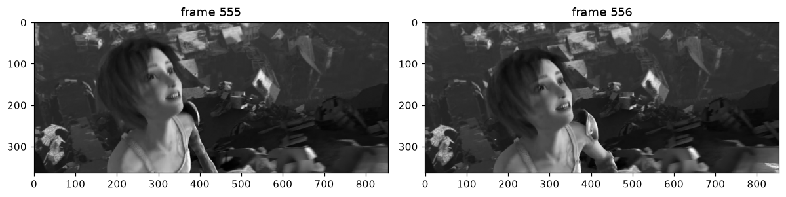{#fig-ch07-pair width=95%}

主人公が画面の左寄りにいて、背景には瓦礫の街が広がっています。
背景に細かい模様が多いことが、この場面を選んだ理由です。

### 計算して、戻り値の形を調べる

```python
flow = cv2.calcOpticalFlowFarneback(
    gray_c, gray_d, None,
    pyr_scale=0.5, levels=3, winsize=15,
    iterations=3, poly_n=5, poly_sigma=1.2, flags=0,
)
print(flow.shape, flow.dtype)
```

```{.default}
(364, 854, 2) float32
```

戻り値は、形が `(364, 854, 2)` の配列です。
縦364×横854は入力画像と同じ大きさで、最後の2は、画素ごとに2つの数を持っていることを表します。
型は、小数を扱える `float32` です。

1つの画素の値を見てみましょう。

```python
print(flow[40, 500])
```

```{.default}
[-4.749334   1.4945753]
```

2つの数は、順に横方向の移動量 `dx` と縦方向の移動量 `dy` です。
この画素（上から40、左から500の位置）に映っていたものは、次のフレームで、左へ約4.7画素、下へ約1.5画素動いたと推定されました。
向きの決まりは次のとおりです。

- `flow[..., 0]` が `dx` です。**正の値は右**、負の値は左への動きを表します。
- `flow[..., 1]` が `dy` です。**正の値は下**、負の値は上への動きを表します。画像の座標は左上が原点で、下へ行くほど数が大きくなるためです。

`flow[..., 0]` の `...` は「それより前の添字はすべて」という意味で、`flow[:, :, 0]` と同じです。

### 引数の意味

引数は多いのですが、最初の3つと、あとの7つに分けて考えると整理できます。

最初の3つは、1枚目の画像、2枚目の画像、そして結果を書き込む配列です。
画像は**グレースケール**（1チャンネルの `uint8`）でなければなりません。
3つ目に `None` を渡すと、結果の配列は関数が新しく作って返してくれます。

残りの7つは計算の細かさを決める値で、@tbl-ch07-farneback のとおりです。
これらには既定値がなく、省略するとエラーになるので、すべて指定します。

| 引数 | 本書の値 | 意味 |
|---|---|---|
| `pyr_scale` | 0.5 | 画像を段階的に縮小するときの倍率。0.5なら半分ずつ縮小します。 |
| `levels` | 3 | 縮小した画像を含めて何段階の大きさで計算するか。 |
| `winsize` | 15 | 行き先を探すときにまとめて使う周囲の範囲（画素数）。大きいほどノイズに強く、速い動きも捉えやすくなりますが、結果はぼやけます。 |
| `iterations` | 3 | 各段階で計算を繰り返す回数。 |
| `poly_n` | 5 | 各画素のまわりの明るさの変化を式で近似するときに使う範囲。5か7が一般的です。 |
| `poly_sigma` | 1.2 | 上の近似で使うぼかしの強さ。`poly_n` が5なら1.1〜1.2程度にします。 |
| `flags` | 0 | 特別な動作の指定。通常は0です。 |

: `cv2.calcOpticalFlowFarneback` の引数（4つ目以降） {#tbl-ch07-farneback}

`pyr_scale` と `levels` は、大きな動きに対応するためのしくみです。
前節で述べたように、大きすぎる動きは見つけにくくなります。
そこでこの関数は、まず縮小した画像で大まかな動きを求め、それを手がかりにして、元の大きさの画像で細かく求め直します。
画像を半分に縮小すれば、10画素の動きは5画素の動きになり、見つけやすくなるからです。

なお、前節では「行き先を探す」と説明しましたが、この関数は、候補の位置を1つずつ試して探し回るわけではありません。
各画素のまわりの明るさの変化を式で近似し（`poly_n`、`poly_sigma`）、その式から移動量を計算で求めます。
「明るさは動いても変わらない」という仮定に立っていることと、そこから生じる弱点は、前節で述べたとおりです。

本書で使う値は、OpenCVの公式チュートリアルのサンプルコードと同じ組み合わせです [@opencv-optflow]。
はじめのうちは、この値のまま使ってかまいません。

::: {.callout-warning title="カラー画像を渡すとエラーになる"}
`read_frame` で読んだカラー画像をそのまま渡すと、`Assertion failed` を含む長いエラーメッセージが表示されます。
必ずグレースケールに変換してから渡してください。
2枚の画像の大きさが違う場合も、同じエラーになります。
:::

### 計算時間と縮小の兼ね合い

オプティカルフローは、これまでの章で扱ったどの計算よりも重い処理です。
第4章（@sec-ch04-speed）で学んだように、画像を縮小すれば速くなるはずです。
どのくらい違うのか、実際に測ってみます。

次の関数は、2枚の画像を指定した倍率で縮小してからフローを計算します。

```python
def flow_at_scale(a, b, scale):
    if scale != 1:
        a = cv2.resize(a, None, fx=scale, fy=scale, interpolation=cv2.INTER_AREA)
        b = cv2.resize(b, None, fx=scale, fy=scale, interpolation=cv2.INTER_AREA)
    return cv2.calcOpticalFlowFarneback(a, b, None, 0.5, 3, 15, 3, 5, 1.2, 0)
```

引数の名前を省いて値だけを並べましたが、内容は先ほどと同じです。
倍率1、0.5、0.25のそれぞれについて、10回計算した平均の時間を測ります。
あわせて、画面全体の `dx` と `dy` の中央値を、元の解像度の画素数に換算して表示します。
半分に縮小した画像での1画素は元の画像の2画素にあたるので、倍率で割れば換算できます。

```python
for scale in [1, 0.5, 0.25]:
    start = time.perf_counter()
    for i in range(10):
        f = flow_at_scale(gray_c, gray_d, scale)
    ms = (time.perf_counter() - start) / 10 * 1000
    dx = np.median(f[..., 0]) / scale
    dy = np.median(f[..., 1]) / scale
    print(f"scale={scale}  shape={f.shape}  {ms:.1f} ms  dx={dx:.2f}  dy={dy:.2f}")
```

```{.default}
scale=1  shape=(364, 854, 2)  71.9 ms  dx=-3.37  dy=1.17
scale=0.5  shape=(182, 427, 2)  16.8 ms  dx=-4.86  dy=1.44
scale=0.25  shape=(91, 214, 2)  4.6 ms  dx=-5.13  dy=1.55
```

時間は環境によって変わりますが、比率はおおむね同じになるはずです。
半分に縮小すると画素数は4分の1になり、計算時間もほぼ4分の1になりました。
元の大きさでは1対あたり約72ミリ秒ですから、1252対で約90秒かかります。
半分にすれば20秒ほどです。

注目してほしいのは、**倍率によって結果も変わる**ことです。
`dx` の中央値は、元の大きさでは−3.37、半分では−4.86、4分の1では−5.13でした。
同じ2枚のフレームなのに、3割以上の開きがあります。

どれが正しいのでしょうか。
この場面の遠くの背景がフレーム間で実際にどれだけずれているかを、フローとは別の方法（画像の一部を切り出し、次のフレームでもっともよく一致する位置を探す方法。@sec-ch07-camera で使います）で調べたところ、左へ5画素、下へ2画素でした。
この場面に限っていえば、縮小したほうが実際の動きに近い値になっています。
縮小した画像では動きが小さくなり、限られた範囲の中で行き先を見つけやすくなるためです。

ただし、縮小すればするほどよいわけではありません。
縮小すると細部がつぶれ、小さな物の動きは捉えられなくなります。

ここで覚えておいてほしいのは、次の2点です。

- フローの値は、画像の大きさや引数によって変わる**推定値**です。物差しで測ったような確定した値ではありません。
- したがって、複数の場面や作品を比べるときは、**画像の大きさと引数をそろえる**必要があります。

本書では、速さと細かさの釣り合いを考えて、**半分に縮小した画像**で計算することにします。
そのための関数を2つ用意します。

```python
def to_small(gray):
    return cv2.resize(gray, None, fx=0.5, fy=0.5, interpolation=cv2.INTER_AREA)

def calc_flow(prev, curr):
    return cv2.calcOpticalFlowFarneback(prev, curr, None, 0.5, 3, 15, 3, 5, 1.2, 0)

small_c = to_small(gray_c)
small_d = to_small(gray_d)
flow = calc_flow(small_c, small_d)
print(small_c.shape, flow.shape)
```

```{.default}
(182, 427) (182, 427, 2)
```

以降、フローの値の単位は「**縮小後の画像**（427×182）での、1フレームあたりの画素数」です。
元の解像度での画素数に直すには2倍します。

### 答えのわかっている動きで確かめる

推定値である以上、どのくらい信用できるのかを確かめておきたいところです。
そこで、答えのわかっている動きを自分で作って、フローを計算してみます。

`np.roll` は、配列の中身を指定した数だけずらす関数です。
これを使って、555番目のフレームを右に3画素ずらした画像を作り、元の画像とのあいだでフローを求めます。
正しく計算できれば、ほぼすべての画素で `dx` が3、`dy` が0になるはずです。
`np.roll` は、右端からはみ出した3列を左端に回すので、左端の3列だけは例外です。

```python
shifted = np.roll(small_c, 3, axis=1)
test_c = calc_flow(small_c, shifted)

print(np.median(test_c[..., 0]), np.median(test_c[..., 1]))
print((np.abs(test_c[..., 0] - 3) < 0.3).mean())
```

```{.default}
2.982474 -1.716896e-06
0.7582288905473917
```

`dx` の中央値は2.98、`dy` の中央値はほぼ0で、正解の (3, 0) とよく合っています。
「正の `dx` は右」という向きの決まりも、これで確かめられました。
2行目は、`dx` が正解の3から0.3以内に収まった画素の割合で、約76%です。
裏を返せば、4分の1ほどの画素では、ずれた値が出ています。

同じ実験を、@sec-ch07-diff で使った702番目のフレームでも行います。

```python
small_a = to_small(gray_a)
test_a = calc_flow(small_a, np.roll(small_a, 3, axis=1))

print(np.median(test_a[..., 0]), np.median(test_a[..., 1]))
print((np.abs(test_a[..., 0] - 3) < 0.3).mean())
```

```{.default}
1.2159874 -5.077475e-06
0.2585763182952879
```

こちらは `dx` の中央値が1.22で、正解の3から大きく外れました。
正解に近い値が出た画素は約26%しかありません。
どこで外れているのかを、画像にして確かめます。

```python
fig, axes = plt.subplots(2, 2, figsize=(11, 5))
show(small_c, "frame 555", ax=axes[0, 0])
show(small_a, "frame 702", ax=axes[0, 1])
for ax, t in zip(axes[1], [test_c, test_a]):
    im = ax.imshow(t[..., 0], cmap="gray", vmin=0, vmax=3)
    ax.set_title("estimated dx (true value: 3)")
fig.colorbar(im, ax=axes, shrink=0.6)
plt.show()
```

{#fig-ch07-known-answer width=95%}

@fig-ch07-known-answer の下段は、白いところが正しく3と推定できた場所、黒いところが0（動いていない）と推定された場所です。
左の555番目のフレームでは、大部分が白くなっています。
右の702番目のフレームでは、人物と竜のところだけが白く、空の部分はほとんど黒です。

これは、@sec-ch07-flow-idea で予想した弱点そのものです。
やわらかい雲が広がる空には、行き先を決める手がかりになる模様がありません。
画像全体を確かに3画素ずらしたのに、空の部分は「動いていない」と推定されてしまいました。

::: {.callout-important title="フローが0でも、動いていないとは限らない"}
オプティカルフローは、模様のない領域の動きを捉えられません。
フローが0に近い領域は、「動いていない」のかもしれませんし、「動いているが手がかりがない」のかもしれません。
空、雪原、霧、暗がりの多い場面では、動きが実際より小さく見積もられると考えてください。
:::

## フローの可視化——矢印と色 {#sec-ch07-visualize}

フローは、画素ごとに2つの数を持つ配列です。
数のままでは全体のようすがつかめませんので、目で見える形にします。
よく使われる方法は2つあります。

### 矢印で描く

1つ目は、文字どおり矢印を描く方法です。
すべての画素に矢印を描くと画面が埋まってしまうので、12画素おきに間引いて描きます。

まず、矢印を描く位置の座標を作ります。

```python
step = 12
h, w = flow.shape[:2]
ys, xs = np.mgrid[step // 2:h:step, step // 2:w:step]
print(xs.shape)
```

```{.default}
(15, 36)
```

`np.mgrid` は、格子状に並んだ点の座標を作る関数です。
ここでは、縦方向に6, 18, 30, …、横方向にも6, 18, 30, …と、12画素おきの点を作りました。
`ys` と `xs` は、それぞれの点の縦と横の座標を並べた配列で、縦15×横36の540個の点があります。

Matplotlibの `quiver` は、指定した位置に矢印を描く関数です。

```python
fig, ax = plt.subplots(figsize=(10, 4.5))
show(small_c, "flow 555 -> 556 (arrows x3)", ax=ax)
ax.quiver(xs, ys, flow[ys, xs, 0], flow[ys, xs, 1], color="yellow",
          angles="xy", scale_units="xy", scale=1 / 3, width=0.002)
plt.show()
```

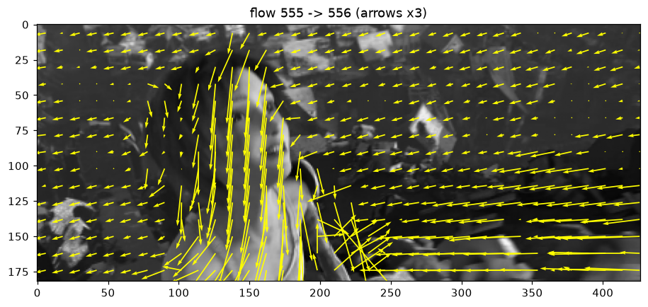{#fig-ch07-arrows width=90%}

`quiver` の最初の4つの引数は、矢印の始点の横座標・縦座標と、矢印の横成分・縦成分です。
`flow[ys, xs, 0]` は、格子の点の位置にある `dx` だけを取り出しています。
残りの引数は次のような意味です。

- `angles="xy"` と `scale_units="xy"` は、矢印の向きと長さを画像の座標に合わせる指定です。これを付けないと、下向きの動きが上向きの矢印として描かれてしまいます。
- `scale=1 / 3` は、矢印を3倍の長さで描く指定です。数画素の動きは、そのままの長さでは短すぎて見えないためです。

@fig-ch07-arrows からは、次のことが読み取れます。

- 背景の矢印は、ほぼすべて**左向き**で、長さもそろっています。
- 主人公の顔と体の矢印は**下向き**で、背景より長くなっています。
- 画面右下の矢印は左向きですが、ほかの背景よりずっと長くなっています。
- 矢印がほとんど見えない点も、ところどころにあります。フローがほぼ0と推定された場所です。

背景全体が同じ向きに流れているのは、背景が動いたからではありません。
この意味は @sec-ch07-camera で考えます。

### 色で描く

矢印による表示は直感的ですが、間引いているので細部は見えません。
すべての画素のフローを一度に見るには、色を使います。

第6章（@sec-color）で学んだHSV色空間を思い出してください。
色相は0度から360度の**角度**で表され、ぐるりと一周して元に戻るのでした。
動きの向きも、0度から360度の角度です。
そこで、次のように割り当てます。

- **色相**（H）← 動きの向き
- **明度**（V）← 動きの大きさ
- **彩度**（S）← 常に最大

こうすると、動いていない画素は黒、大きく動いた画素は明るい色になり、色合いが向きを表します。

矢印の横成分と縦成分 (`dx`, `dy`) から、大きさと向きを求めるには `cv2.cartToPolar` を使います。
これを使って、フローを色の画像に変換する関数を作ります。

```python
def flow_to_color(flow, max_mag=10):
    mag, ang = cv2.cartToPolar(flow[..., 0], flow[..., 1], angleInDegrees=True)
    hsv = np.zeros(flow.shape[:2] + (3,), dtype=np.uint8)
    hsv[..., 0] = (ang / 2).astype(np.uint8)
    hsv[..., 1] = 255
    hsv[..., 2] = np.clip(mag / max_mag * 255, 0, 255).astype(np.uint8)
    return cv2.cvtColor(hsv, cv2.COLOR_HSV2BGR)
```

1行ずつ説明します。

- `cv2.cartToPolar` は、大きさ `mag` と向き `ang` の2つの配列を返します。`angleInDegrees=True` を指定すると、向きは0から360までの度数になります。
- `hsv` は、フローと同じ縦横の大きさを持つ、3チャンネルの空の画像です。`flow.shape[:2]` は（縦, 横）で、それに `(3,)` をつなげて（縦, 横, 3）という形を作っています。
- OpenCVの `uint8` のHSV画像では、色相を0〜179で表すのでした。そこで角度を2で割って色相にします。
- 彩度は、すべての画素で最大の255にします。
- 明度は、大きさが `max_mag`（ここでは10画素）のときに255になるように換算します。`np.clip` は、値を指定した範囲に収める関数で、10画素を超える動きは255で頭打ちになります。
- 最後に、表示のためにHSVからBGRへ変換します。

色と向きの対応がわからなければ図を読めませんので、凡例も一緒に作ります。
中心からの位置がそのまま (`dx`, `dy`) になるような人工のフローを作り、同じ関数で色に変換します。

```python
yy, xx = np.mgrid[-10:10.01:0.1, -10:10.01:0.1].astype(np.float32)
key = np.dstack([xx, yy])
key[np.hypot(xx, yy) > 10] = 0

fig, axes = plt.subplots(1, 2, figsize=(11, 3.4), width_ratios=[3, 1])
show(flow_to_color(flow), "flow 555 -> 556", ax=axes[0])
show(flow_to_color(key), "color key", ax=axes[1])
axes[1].set_xticks([0, 100, 200], [-10, 0, 10])
axes[1].set_yticks([0, 100, 200], [-10, 0, 10])
axes[1].set_xlabel("dx")
axes[1].set_ylabel("dy")
plt.tight_layout()
plt.show()
```

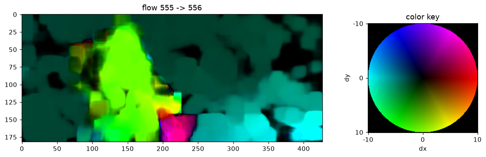{#fig-ch07-color width=95%}

`np.dstack` は2つの配列を重ねて、フローと同じ形（縦×横×2）にしています。
`np.hypot(xx, yy)` は中心からの距離で、10を超える部分を0にして円形に切り抜きました。

@fig-ch07-color の右の凡例は、中心から見た方向と色の対応を示しています。
右向きの動きは赤、下向きは黄緑、左向きは水色、上向きは青紫です。
縦軸は画像と同じく下が正であることに注意してください。

左の図を凡例と照らし合わせると、矢印の図で読み取ったことが、すべての画素について確かめられます。

- 背景は暗い青緑です。左向きの、小さな動きです。
- 主人公は明るい黄緑です。下向きの、大きな動きです。
- 右下は明るい水色です。左向きの、大きな動きです。

主人公のすぐ右下には、明るい赤紫のかたまりもあります。
凡例で見ると右上向きの大きな動きですが、そのように動いた物は画面にありません。
矢印の図でも、このあたりだけ矢印の向きがばらばらでした。
主人公と、手前の瓦礫との境目にあたる場所です。
動きの違う物どうしの境目では、片方のフレームにしか映っていない部分ができます。
そこには行き先がないので、フローが当てにならない値になったと考えられます。

色による表示では、主人公の形がはっきりと浮かび上がっています。
動きの違いによって、被写体と背景が分かれて見えるのです。
一方で、輪郭はブロック状に粗くなっています。
周囲の画素をまとめて使う（`winsize`）ために、フローは細かい形までは再現できません。

::: {.callout-tip title="2つの可視化の使い分け"}
矢印は、向きと長さを直接読めるので、少数のフレームを詳しく説明するのに向いています。
色は、全画素を一度に見渡せるので、動いている領域の形を見るのに向いています。
色を使うときは、必ず凡例を添えてください。
:::

## 動きの大きさと向きを集計する {#sec-ch07-aggregate}

可視化によって、フローが何を捉えているかがわかりました。
次は、これを数値に要約します。

### 大きさと向きに分ける

`flow_to_color` の中で使った `cv2.cartToPolar` を、あらためて単独で使います。

```python
mag, ang = cv2.cartToPolar(flow[..., 0], flow[..., 1], angleInDegrees=True)
print(flow[20, 250], mag[20, 250], ang[20, 250])
```

```{.default}
[-2.3812168   0.73353744] 2.49164 162.87534
```

上から20、左から250の位置の画素では、(`dx`, `dy`) が (−2.38, 0.73) でした。
これを大きさと向きに直すと、大きさが2.49画素、向きが162.9度です。

- **大きさ**は矢印の長さで、$\sqrt{dx^2 + dy^2}$ で求められます。三平方の定理です。
- **向き**は、右向きを0度として測った角度です。画像では下が正なので、**90度が下、180度が左、270度が上**になります。162.9度は「左、やや下」です。

### 大きさの集計

1枚のフレーム対の動きの大きさを、1つの数に要約します。

```python
print(mag.mean(), np.median(mag), mag.max())
```

```{.default}
4.8010154 2.8494022 28.598242
```

大きさの平均は4.80画素、中央値は2.85画素、最大は28.6画素です。
平均が中央値よりかなり大きいのは、主人公や画面右下のように大きく動く領域が、平均を引き上げているためです。
平均と中央値の違いは、@sec-ch07-stats であらためて取り上げます。

### 向きの集計

向きについては、「どの向きの画素がどれだけあるか」を数えます。
第6章で色相ヒストグラムを作ったのと同じ考え方です。

ただし、ほとんど動いていない画素の向きには意味がありません。
長さ0.01の矢印がどちらを向いていても、それは誤差にすぎないからです。
そこで、大きさが1画素を超える画素だけを数えます。

向きは、右、右下、下、…の8方向に分けます。
「右」を0度の前後22.5度ずつ（337.5度から22.5度まで）としたいので、角度に22.5を足してから360で割った余りをとり、45度ずつに区切ります。

```python
moving = mag > 1
print(moving.mean())

ang_shift = (ang + 22.5) % 360
hist, edges = np.histogram(ang_shift[moving], bins=8, range=(0, 360))
share = hist / hist.sum()

labels = ["right", "down-right", "down", "down-left", "left", "up-left", "up", "up-right"]
for name, s in zip(labels, share):
    print(f"{name:11s}{s:.3f}")
```

```{.default}
0.9161412358133669
right      0.004
down-right 0.008
down       0.193
down-left  0.059
left       0.711
up-left    0.002
up         0.001
up-right   0.022
```

`{name:11s}` は、向きの名前を11文字ぶんの幅にそろえて表示する書式です。
1行目から、画素の約92%が1画素を超えて動いていることがわかります。
画面のほぼ全体が動いているのです。
向きの内訳は、左が71%、下が19%で、この2つで9割を占めます。
棒グラフにしておきます。

```python
fig, ax = plt.subplots(figsize=(8, 3))
ax.bar(labels, share)
ax.set_ylabel("share of moving pixels")
ax.tick_params(axis="x", labelrotation=30)
ax.grid(alpha=0.3, axis="y")
plt.show()
```

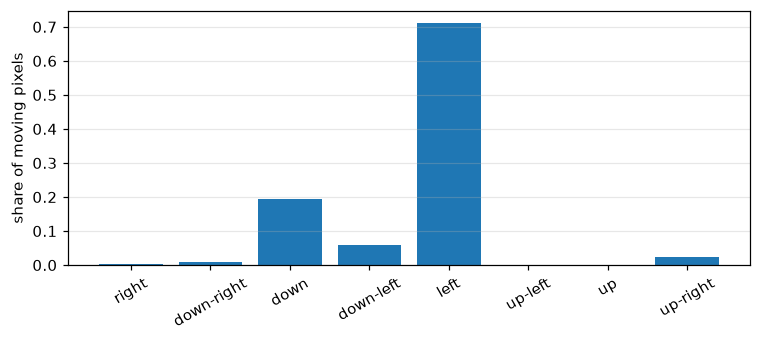{#fig-ch07-direction width=75%}

@fig-ch07-direction の「左」は背景、「下」は主人公にあたります。
可視化で見た内容が、数値として要約できました。

::: {.callout-warning title="向きは単純に平均できない"}
向きを要約するのに、角度の平均を使ってはいけません。
第6章で色相について見たとおり、角度は一周して元に戻る「環」だからです。
たとえば350度と10度はどちらもほぼ右向きですが、単純に平均すると180度、つまり左向きになってしまいます。
向きを要約するときは、ここで行ったようにヒストグラムを使うか、次節のように `dx` と `dy` のまま集計します。
`dx` と `dy` のまま集計するのは、第6章の「円周上の平均」で、角度を矢印に置き換えてから平均したのと同じ考え方です。
:::

### 全フレームについて計算する

フローの大きさの平均を、全フレームについて計算します。
この値を `flow_mean` という名前で、@sec-ch07-amount で作った表 `df` に追加します。
ループの形は、フレーム間差分のときと同じです。

```python
start = time.perf_counter()
flow_mean = {}
prev = None
for n, frame in iter_frames(VIDEO):
    small = to_small(to_gray(frame))
    if prev is not None:
        flow = calc_flow(prev, small)
        flow_mean[n] = np.hypot(flow[..., 0], flow[..., 1]).mean()
    prev = small

df["flow_mean"] = pd.Series(flow_mean)
print(f"{time.perf_counter() - start:.1f} s")
print(df.loc[554:557, ["time", "diff_mean", "flow_mean"]])
```

```{.default}
23.9 s
            time  diff_mean  flow_mean
frame
554    23.083333  13.527170   3.828126
555    23.125000  14.954960   4.863327
556    23.166667  15.603768   4.801015
557    23.208333  13.245416   3.560017
```

筆者の環境では約24秒かかりました。
パソコンによっては1分以上かかることもありますので、終わるまで待ってください。
大きさだけが必要なので、ここでは `cv2.cartToPolar` のかわりに、第6章でも使った `np.hypot` で $\sqrt{dx^2 + dy^2}$ を求めています。
`pd.Series(flow_mean)` は、辞書をSeriesに変えます。辞書のキー（フレーム番号）がインデックスになるので、`df` の同じフレーム番号の行に値が入ります。
556の行の `flow_mean` が、先ほど求めた4.80と一致しています。

フレーム間差分による動き量と並べて描きます。

```python
fig, axes = plt.subplots(2, 1, figsize=(10, 5), sharex=True)
axes[0].plot(df["time"], df["diff_mean"], linewidth=1)
axes[0].set_ylabel("diff_mean")
axes[1].plot(df["time"], df["flow_mean"], linewidth=1)
axes[1].set_ylabel("flow_mean [px/frame]")
axes[1].set_xlabel("time [s]")
for ax in axes:
    ax.grid(alpha=0.3)
plt.tight_layout()
plt.show()
```

章の冒頭に掲げた @fig-ch07-motion-timeline と同じグラフができました。
2つの動き量は、全体としてはよく似た形をしています。
どちらも16秒から18秒、22秒から32秒のあたりで大きく、それ以外では小さくなっています。

違いもあります。
まず、縦軸の単位です。
`diff_mean` は輝度の階調、`flow_mean` は画素数で、後者のほうが「どれだけ動いたか」として解釈しやすい量です。

次に、カット点での振る舞いです。
`diff_mean` が大きかった5つのフレームについて、`flow_mean` の値を見てみます。

```python
cuts = df.nlargest(5, "diff_mean").index
print(df.loc[cuts, ["diff_mean", "flow_mean"]])
```

```{.default}
        diff_mean  flow_mean
frame
396    164.028521   1.315848
621    124.955420   9.555861
672    105.475992   4.882266
658     81.091869   5.712914
420     68.737242   2.611974
```

`flow_mean` も大きめの値になっていますが、`diff_mean` ほど突出してはいません。
しかし、これを「フローはカットに強い」と読んではいけません。
カット点の前後は別の画面ですから、「同じ物の行き先」はそもそも存在しません。
ここで得られた1.3や9.6という値は、存在しない対応を無理に探した結果であり、**意味のない数**です。
グラフに残っている鋭い山の多くは、こうしたカット点です。

最後に、フェードです。
@fig-ch07-fade で見たフェードアウトの前と最中を比べます。

```python
print(df.loc[170:190, ["diff_mean", "flow_mean"]].mean())
print(df.loc[195:215, ["diff_mean", "flow_mean"]].mean())
```

```{.default}
diff_mean    3.513385
flow_mean    1.000376
dtype: float64
diff_mean    4.976638
flow_mean    0.569670
dtype: float64
```

`diff_mean` はフェード中に増えましたが、`flow_mean` は約1.0から約0.57へ減っています。
この場面では、フローは明るさの変化を動きと取り違えませんでした。
ただし、フェードが進むと画面が暗くなって模様が見えにくくなり、フローは実際の動きより小さく見積もられていきます。
値が減ったのは、動きが収まったからとは限りません。

## カメラの動きと被写体の動き {#sec-ch07-camera}

### 画面全体が同じ向きに動いているとき

@fig-ch07-arrows をもう一度見てください。
背景の矢印は、どれも左向きで、長さもそろっていました。
瓦礫の街がいっせいに左へ動いたのでしょうか。
もちろん、そうではありません。
**カメラが右へ動いた**ので、画面に映る背景が左へ流れたのです。

画面の中の動きには、2つの原因があります。

- **カメラの動き**：カメラが向きを変えたり（パン、ティルト）、移動したりすると、画面全体が動きます。
- **被写体の動き**：人物や物が動くと、その部分だけが動きます。

オプティカルフローは、この2つを区別しません。
どちらも「画素の行き先」として同じように現れます。
しかし、映像の分析では、この2つは意味がまったく違います。
「登場人物が激しく動く場面」と「カメラが激しく動く場面」は、別のものとして扱いたいところです。

区別の手がかりは、動きの**そろい方**にあります。
画面全体が同じ向き・同じ大きさで動いていれば、カメラの動きと考えるのが自然です。
一部だけが違う動きをしていれば、それが被写体の動きです。

### 中央値を「全体の動き」とみなす

この考え方を、もっとも簡単な形で実行してみます。
画面全体の `dx` と `dy` の**中央値**を、「全体の動き」、つまりカメラによる動きとみなします。

```python
flow = calc_flow(small_c, small_d)
cam_dx = np.median(flow[..., 0])
cam_dy = np.median(flow[..., 1])
print(cam_dx, cam_dy)
```

```{.default}
-2.4294853 0.72233075
```

全体の動きは、左へ2.43画素、下へ0.72画素と推定されました。

平均ではなく中央値を使うのには理由があります。
中央値は、第5章で見たとおり、値を大きさの順に並べたときの真ん中の値です。
背景が画面の半分以上を占めていれば、主人公がどれだけ大きく動いても、中央値は背景の動きを指します。
平均では、主人公の大きな動きに引きずられてしまいます。

この推定がどのくらい正しいかは、すでに確かめてあります。
@sec-ch07-farneback で触れたように、遠くの背景の実際のずれは、元の解像度で左へ5画素、下へ2画素でした。
半分に縮小した画像では、左へ2.5画素、下へ1画素にあたります。
中央値による推定 (−2.43, 0.72) は、これとよく合っています。

### 全体の動きを差し引く

すべての画素のフローから、全体の動きを引き算します。
残ったものが、カメラの動きを取り除いた「被写体の動き」のはずです。

```python
residual = flow - np.array([cam_dx, cam_dy], dtype=np.float32)

fig, axes = plt.subplots(3, 1, figsize=(7, 9.5))
show(small_c, "frame 555", ax=axes[0])
show(flow_to_color(flow), "flow", ax=axes[1])
show(flow_to_color(residual), "flow - median", ax=axes[2])
plt.tight_layout()
plt.show()
```

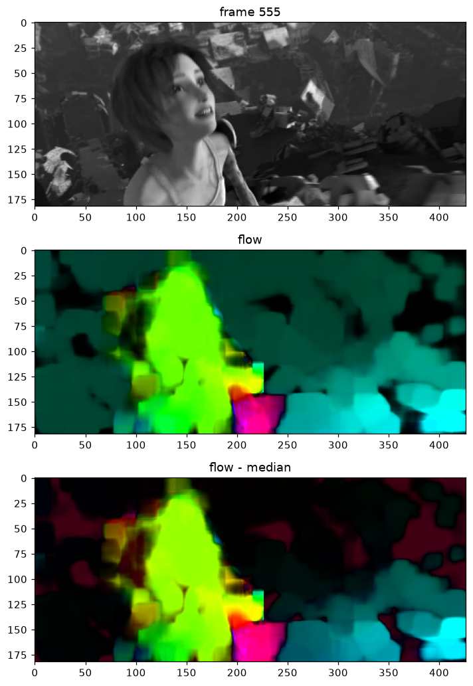{#fig-ch07-residual width=70%}

@fig-ch07-residual の中段と下段を比べてください。
中段で暗い青緑だった背景の大部分が、下段では黒くなりました。
背景の動きが打ち消されたのです。
主人公は、下段でも明るい黄緑のまま残っています。
一方、中段で黒かった部分（フローがほぼ0と推定された部分）は、下段では暗い赤になりました。
0から全体の動きを引いたために、逆向きの動きとして現れたものです。
数値でも確かめます。

```python
res_mag = np.hypot(residual[..., 0], residual[..., 1])
print(mag.mean(), res_mag.mean())
print((mag < 1).mean(), (res_mag < 1).mean())
```

```{.default}
4.8010154 3.3757532
0.08385876418663304 0.45206783848470034
```

大きさの平均は4.80から3.38に下がりました。
大きさが1画素未満の「ほぼ動いていない」画素は、差し引く前は8%でしたが、差し引いたあとは45%になっています。
画面の半分近くが、カメラの動きだけで説明できたことになります。

### 限界その1：奥行きによる動きの違い

うまくいったように見えますが、@fig-ch07-residual の下段をよく見ると、主人公以外にも色の残っている場所があります。
とくに目立つのは、右下の明るい水色です。
ここは手前にある瓦礫で、被写体が動いているわけではありません。
遠くの背景と、右下の領域とで、フローの中央値を比べてみます。

```python
far = flow[20:60, 250:400]
near = flow[150:180, 300:420]
print(np.median(far[..., 0]), np.median(far[..., 1]))
print(np.median(near[..., 0]), np.median(near[..., 1]))
```

```{.default}
-2.430191 0.73562455
-9.075762 0.071195185
```

遠くの背景は左へ2.4画素、手前の瓦礫は左へ9.1画素で、4倍近い差があります。

電車の窓から外を眺めると、近くの電柱は速く流れ、遠くの山はゆっくり動きます。
これと同じで、カメラが**移動**すると、近くの物ほど画面の中で大きく動きます。
この現象を**視差**（parallax）と呼びます。
この場面のカメラは、移動しているのです。

視差があると、「全体の動き」は1つの値では表せません。
中央値を引いても、奥行きの違う領域は残ってしまいます。

### 限界その2：ズーム

もう1つの限界は、ズームです。
ここでは、ズームにあたる動きを人工的に作って確かめます。
555番目のフレームを、中心を基準に1.03倍に拡大します。

```python
M = cv2.getRotationMatrix2D((w / 2, h / 2), 0, 1.03)
zoomed = cv2.warpAffine(small_c, M, (w, h))
flow_zoom = calc_flow(small_c, zoomed)

print(np.median(flow_zoom[..., 0]), np.median(flow_zoom[..., 1]))
print(np.hypot(flow_zoom[..., 0], flow_zoom[..., 1]).mean())
```

```{.default}
-0.02598969 -3.521214e-05
3.0172994
```

`cv2.getRotationMatrix2D` は、指定した点を中心に回転・拡大する変換を作る関数です。
ここでは回転角を0度、倍率を1.03としました。
`cv2.warpAffine` が、その変換を画像に適用します。

結果を見ると、大きさの平均は3.0画素あり、画面は確かに動いています。
ところが、`dx` と `dy` の中央値はほぼ0です。
矢印で描いてみると、理由がわかります。

```python
fig, ax = plt.subplots(figsize=(10, 4.5))
show(small_c, "synthetic zoom x1.03 (arrows x3)", ax=ax)
ax.quiver(xs, ys, flow_zoom[ys, xs, 0], flow_zoom[ys, xs, 1], color="yellow",
          angles="xy", scale_units="xy", scale=1 / 3, width=0.002)
plt.show()
```

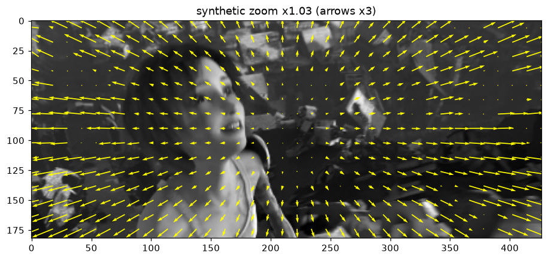{#fig-ch07-zoom width=90%}

@fig-ch07-zoom のとおり、ズームでは矢印が中心から外へ向かって放射状に広がります。
左半分は左向き、右半分は右向きなので、打ち消し合って中央値は0になります。
全体の動きが0と推定されるので、差し引いても何も変わりません。
画面全体がカメラの操作で動いているのに、すべてが「被写体の動き」として残ってしまいます。

### 限界その3：模様のない背景

3つ目の限界は、@sec-ch07-farneback で見た弱点から生じます。
@sec-ch07-diff で使った702番目と703番目のフレームについて、全体の動きを推定します。

```python
small_b = to_small(gray_b)
flow_ab = calc_flow(small_a, small_b)
print(np.median(flow_ab[..., 0]), np.median(flow_ab[..., 1]))
```

```{.default}
0.32097784 0.00029677892
```

全体の動きは、右へ0.32画素と推定されました。
カメラはほとんど動いていない、という結果です。

これを、フローとは別の方法で確かめます。
702番目のフレームから空の一部を切り出し、703番目のフレームの中で、それともっともよく一致する場所を探します。
`cv2.matchTemplate` は、小さな画像（テンプレート）を大きな画像の上で少しずつずらしながら、一致の度合いを計算する関数です。

```python
patch = small_a[10:50, 125:225]
result = cv2.matchTemplate(small_b, patch, cv2.TM_CCOEFF_NORMED)
_, score, _, (x, y) = cv2.minMaxLoc(result)
print(x - 125, y - 10, round(score, 3))
```

```{.default}
3 0 1.0
```

`cv2.minMaxLoc` は、一致の度合いが最大になった位置を返します。
切り出した領域は、元の位置から**右へ3画素**ずれたところで、ほぼ完全に（一致の度合い1.0で）見つかりました。

つまり、この場面の背景は、実際には1フレームあたり3画素（元の解像度では6画素）の速さで右へ流れています。
カメラが左へ動いているのです。
しかし、背景はやわらかい雲ばかりで模様に乏しいため、フローの大部分は0になり、中央値は0.32にしかなりませんでした。
中央値による推定は、実際の動きの1割ほどしか捉えていません。

@fig-ch07-diff の差分画像を思い出してください。
あの図でも、背景はほとんど黒でした。
人物と竜だけが動いている場面のように見えましたが、実際にはカメラも動いていたのです。
フレーム間差分もオプティカルフローも、模様のない背景の動きは見逃します。

### 予告編全体で試す

限界を理解したうえで、予告編全体について全体の動きを計算してみます。
もう一度すべてのフレームのフローを計算しますので、先ほどと同じだけ時間がかかります。

```python
records = []
prev = None
for n, frame in iter_frames(VIDEO):
    small = to_small(to_gray(frame))
    if prev is not None:
        flow = calc_flow(prev, small)
        dx = np.median(flow[..., 0])
        dy = np.median(flow[..., 1])
        residual = flow - np.array([dx, dy], dtype=np.float32)
        records.append({
            "frame": n,
            "cam_dx": dx,
            "cam_dy": dy,
            "resid_mean": np.hypot(residual[..., 0], residual[..., 1]).mean(),
        })
    prev = small

cam = pd.DataFrame(records).set_index("frame")
for name in cam.columns:
    df[name] = cam[name]
print(df.columns.tolist())
```

```{.default}
['time', 'brightness', 'diff_mean', 'diff_ratio', 'flow_mean', 'cam_dx', 'cam_dy', 'resid_mean']
```

最後の3行では、表 `cam` の列を1つずつ、同じ名前の列として `df` に加えています。
インデックス（ここではフレーム番号）が同じ行どうしが対応づけられます。
全体の動きの推定値 `cam_dx`、`cam_dy` と、それを差し引いたあとの大きさの平均 `resid_mean` が加わりました。

```python
fig, ax = plt.subplots(figsize=(10, 3.2))
ax.plot(df["time"], df["cam_dx"], linewidth=1, label="cam_dx")
ax.plot(df["time"], df["cam_dy"], linewidth=1, label="cam_dy")
ax.set_xlabel("time [s]")
ax.set_ylabel("median flow [px/frame]")
ax.legend()
ax.grid(alpha=0.3)
plt.show()
```

{#fig-ch07-camera-timeline width=85%}

@fig-ch07-camera-timeline では、ほとんどの時間で値が0に近く、ところどころで0から離れています。
22秒から25秒にかけて `cam_dx` が負になっています。その前半が、先ほどから例にしてきた場面です。
画面が左へ流れ続けており、カメラが右へ動いていることを示しています。
この区間で、差し引きの効果を確かめます。

```python
print(df.loc[545:565, ["cam_dx", "cam_dy", "flow_mean", "resid_mean"]].mean())
```

```{.default}
cam_dx       -1.940147
cam_dy        1.019061
flow_mean     4.147271
resid_mean    3.108242
dtype: float32
```

全体の動きを差し引くと、大きさの平均は4.15から3.11へ、およそ4分の3になりました。
減ったのは4分の1だけです。
残った4分の3は、主人公の動きと、視差による手前の瓦礫の動きです。

グラフでもっとも大きな値を示しているのは、31秒付近（`cam_dx` が9を超えるところ）です。
ここも確かめます。

```python
print(df.loc[743:750, ["cam_dx", "cam_dy", "flow_mean", "resid_mean"]].mean())
```

```{.default}
cam_dx        6.843922
cam_dy       -0.363958
flow_mean     6.931694
resid_mean    6.465988
dtype: float32
```

全体の動きは右へ6.8画素と大きく推定されていますが、差し引いても大きさの平均は6.93から6.47へと、ほとんど減っていません。
差し引きがうまく働かなかった例です。
この区間の1対（744番目と745番目）について、フローの内訳を調べます。

```python
small_e = to_small(to_gray(read_frame(VIDEO, 744)))
small_f = to_small(to_gray(read_frame(VIDEO, 745)))
flow_ef = calc_flow(small_e, small_f)

print((flow_ef[..., 0] > 5).mean())
print((np.hypot(flow_ef[..., 0], flow_ef[..., 1]) < 1).mean())
```

```{.default}
0.5462850966363847
0.38536171088864296
```

右へ5画素を超えて動いている画素が55%、ほとんど動いていない（1画素未満の）画素が39%です。
745番目のフレームを表示してみると、前者は画面の左に大きく映った主人公の顔と、右を斜めに横切る竜の体で、後者は模様のない空であることがわかります。
画素は、大きく動く集団と、フローが0の集団の2つにはっきり分かれています。
中央値は前者の値になるので、それを引くと、動いていた部分は小さくなるかわりに、0だった空が逆向きに動いているように現れます。
結果として、大きさの平均はほとんど変わりません。
限界その3で見た「模様のない背景」が、ここでも効いています。

::: {.callout-note title="この節の方法の位置づけ"}
フローの中央値を差し引く方法は、次の条件がそろったときにだけ、カメラの動きをうまく取り除けます。

- カメラの動きが、向きを変える動き（パン、ティルト）に近いこと。ズームや、視差の大きい移動には対応できません。
- 背景が画面の半分以上を占めていること。
- 背景に十分な模様があること。

カメラの動きをより正確に推定する方法（画面の拡大・回転まで含めたモデルをあてはめる方法など）もありますが、本書の範囲を超えます。
ここで大切なのは、「フローの大きさ」には被写体の動きとカメラの動きが混ざっており、簡単には分けられない、と知っておくことです。
:::

## 動き量の代表値——平均、中央値、分布 {#sec-ch07-stats}

最後に、作品全体の動きを少数の数で要約することを考えます。
「この予告編の動きの大きさは、平均していくつか」という問いです。
作品どうしを比べるとき（第10章、@sec-project）には、こうした代表値が必要になります。

### 平均と中央値

2つの動き量について、平均、中央値、最大値を求めます。

```python
print(df[["diff_mean", "flow_mean"]].agg(["mean", "median", "max"]))
```

```{.default}
         diff_mean  flow_mean
mean      4.948805   0.922890
median    2.222188   0.195934
max     164.028521  10.177238
```

`agg` は、列ごとに複数の集計をまとめて行うメソッドです。
どちらの動き量でも、平均と中央値が大きく食い違っています。
`diff_mean` では平均が中央値の約2.2倍、`flow_mean` では約4.7倍です。
どちらを「この予告編の動き量」とするかで、結論が変わってしまいます。

### カット点の影響

食い違いの原因の1つは、カット点です。
@sec-ch07-amount で見たように、カット点では `diff_mean` が桁違いに大きくなります。
このように、ほかの値から極端に離れた値を**外れ値**（outlier）と呼びます。

カット点はほかにもありますが（すべてを見つける方法は第8章で扱います）、ここでは影響の大きい5つだけを除きます。
`diff_mean` の大きい5つのフレーム（変数 `cuts` に入れてあります）を取り除いて、平均と中央値を計算し直します。

```python
no_cuts = df.drop(cuts)
print(no_cuts[["diff_mean", "flow_mean"]].agg(["mean", "median"]))
```

```{.default}
        diff_mean  flow_mean
mean     4.532169   0.907281
median   2.207681   0.192984
```

`df.drop(cuts)` は、インデックスが `cuts` に含まれる行を除いた表を返します。もとの `df` は変わりません。
取り除いたのは、1252個のうちの5個、全体の0.4%にすぎません。
それだけで、`diff_mean` の平均は4.95から4.53へ、8%も下がりました。
一方、中央値は2.222から2.208へと、1%も変わっていません。

平均は、すべての値を足し合わせるので、極端な値が1つあるだけで引きずられます。
中央値は真ん中の値ですから、端にある値がどれだけ大きくても影響を受けません。
この性質を、中央値は外れ値に対して**頑健**（robust）である、といいます。

カット点での動き量は、動きを表していない、意味のない値でした。
その値に左右されない中央値のほうが、動き量の代表値としては安心して使えます。
`flow_mean` のほうは、カット点での値がそれほど突出しないので、取り除いても平均はあまり変わりません（0.923から0.907）。

### 分布を見る

とくに大きい5つのカット点を取り除いても、平均と中央値の食い違いは残っています。
もう1つの原因を知るには、値がどのように散らばっているか、つまり**分布**（distribution）を見る必要があります。
`flow_mean` のヒストグラムを描き、平均と中央値の位置に線を引きます。

```python
fig, ax = plt.subplots(figsize=(8, 3.5))
ax.hist(df["flow_mean"], bins=50)
ax.axvline(df["flow_mean"].mean(), color="tab:red", linewidth=1.5, label="mean")
ax.axvline(df["flow_mean"].median(), color="tab:orange", linewidth=1.5, label="median")
ax.set_xlabel("flow_mean [px/frame]")
ax.set_ylabel("number of frames")
ax.legend()
ax.grid(alpha=0.3)
plt.show()
```

{#fig-ch07-hist width=75%}

@fig-ch07-hist は、左端に高い山があり、右へ長く裾を引く形をしています。
数値でも確かめます。

```python
print((df["flow_mean"] < 0.1).mean())
print((df["flow_mean"] > 4).mean())
print(df["flow_mean"].quantile([0.25, 0.5, 0.75, 0.9]))
```

```{.default}
0.3913738019169329
0.07108626198083066
0.25    0.006047
0.50    0.195934
0.75    0.870052
0.90    2.915938
Name: flow_mean, dtype: float64
```

`flow_mean` が0.1に満たないフレームが、全体の39%を占めています。
冒頭の黒い画面や、動かない題字、終わりのクレジットなど、ほとんど何も動かないフレームです。
一方で、4を超えるフレームは7%しかありません。
`quantile` は、小さい順に並べたときに指定した割合の位置にくる値（分位数）を求めるメソッドです。
0.5の位置が中央値で、0.9の位置（上位10%の境目）は2.92です。

つまり、この予告編は「大部分はほとんど動かず、ごく一部で激しく動く」という構成になっています。
このような偏った分布では、平均は、多数を占める静かなフレームのようすも、少数の激しいフレームのようすも表しません。
平均の0.92という値に近いフレームは、実際にはあまり多くないのです。

したがって、動き量を要約するときは、次のようにするのがよいでしょう。

- 代表値には**中央値**を使う。
- 中央値だけでなく、**分布**（ヒストグラムや分位数）もあわせて示す。「激しい場面がどのくらいあるか」は、上位10%の境目のような値で表せます。
- 平均を使う場合は、カット点の影響を受けていることを断っておく。

### 動きの激しい場面を特定する

中央値の頑健さは、時系列をならすときにも役に立ちます。
第5章では、移動平均を使ってグラフをなめらかにしました。
ここでは、平均のかわりに中央値を使う**移動中央値**（moving median）を試します。
`rolling(...).mean()` を `rolling(...).median()` に変えるだけです。

```python
df["flow_smooth"] = df["flow_mean"].rolling(24, center=True).median()
peak = df["flow_smooth"].idxmax()
print(peak, df.loc[peak, "time"], df.loc[peak, "flow_smooth"])
```

```{.default}
734 30.583333333333332 7.322187423706055
```

窓の幅は24フレーム、つまり1秒です。
`idxmax` は、値が最大になる行のインデックスを返します。
そのフレームを中心とする1秒間の動き量の中央値がもっとも大きいのは、734番目のフレーム（30.6秒）で、その値は7.3画素でした。

```python
fig, ax = plt.subplots(figsize=(10, 3.2))
ax.plot(df["time"], df["flow_mean"], linewidth=1, alpha=0.4, label="flow_mean")
ax.plot(df["time"], df["flow_smooth"], linewidth=1.5, label="rolling median (24 frames)")
ax.axvline(df.loc[peak, "time"], color="gray", linewidth=1, linestyle="--")
ax.set_xlabel("time [s]")
ax.set_ylabel("flow magnitude [px/frame]")
ax.legend()
ax.grid(alpha=0.3)
plt.show()
```

{#fig-ch07-smooth width=85%}

@fig-ch07-smooth では、画面が一瞬で切り替わる箇所の鋭い山（14秒、48秒、51秒付近など）が、移動中央値の線からはきれいに消えています。
1フレームだけの外れ値は、まわりの24フレームの「真ん中の値」には影響しないからです。
移動平均では、山は低く広がるだけで、消えはしません。

最大となったフレームと、その前後12フレームを表示します。

```python
fig, axes = plt.subplots(1, 3, figsize=(12, 2.6))
for ax, n in zip(axes, [peak - 12, peak, peak + 12]):
    show(read_frame(VIDEO, n), f"frame {n}", ax=ax)
plt.tight_layout()
plt.show()
```

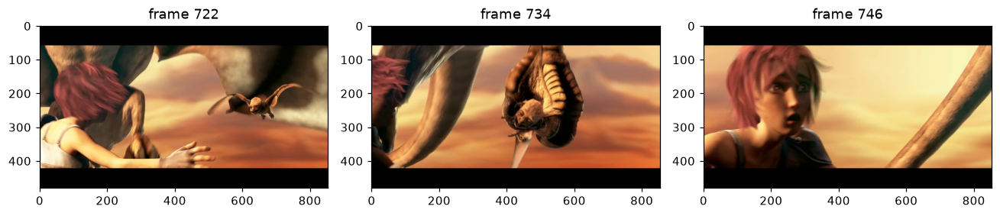{#fig-ch07-peak width=100%}

@fig-ch07-peak のとおり、主人公と竜が争う場面です。
3枚はどれも構図が異なり、1秒のあいだに画面が次々と変わっています。
どのフレームでも、被写体が画面に大きく映っています。
「予告編の中で、動きのもっとも激しい場面はここである」と、数値にもとづいて言えるようになりました。

ただし、ここまでに確かめた限界は、この結論にもあてはまります。
この値には、被写体の動きとカメラの動きが混ざっています。
また、空や雪原の多い場面の動きは、小さく見積もられています。
「数値がもっとも大きい場面」と「観客がもっとも激しいと感じる場面」が一致するとは限らないことを、心に留めておいてください。

## まとめ {#sec-ch07-summary}

- 動きは、隣り合う2枚のフレームを比べることで測ります。
- **フレーム間差分**は、同じ位置の画素の引き算です。`uint8` のまま引くとオーバーフローを起こすので、`cv2.absdiff` を使います。
- 差分の平均や、しきい値を超えた画素の割合を**動き量**として、時系列にできます。ただし、差分が測っているのは「画素の値の変化」であり、カット点やフェードでも大きくなります。カット点での鋭い山は、第8章のカット点検出の手がかりになります。
- **オプティカルフロー**は、各画素がどこへ動いたかを矢印 (`dx`, `dy`) で表したものです。「物が動いても明るさは変わらない」という仮定にもとづいています。
- `cv2.calcOpticalFlowFarneback` は、グレースケールの2枚の画像から、形が（縦, 横, 2）、型が `float32` の配列を返します。正の `dx` は右、正の `dy` は下です。
- フローは推定値です。画像の大きさや引数で値が変わり、模様のない領域では0になり、カット点では意味のない値になります。場面や作品を比べるときは、条件をそろえます。
- フローは、矢印（`quiver`）や、色（向きを色相、大きさを明度にしたHSV表現）で可視化できます。
- `cv2.cartToPolar` で大きさと向きに分けて集計します。向きは環なので、平均せずにヒストグラムで要約します。
- フローには、カメラの動きと被写体の動きが混ざっています。フローの中央値を差し引く方法は、条件がよければカメラの動きを取り除けますが、視差、ズーム、模様のない背景、画面を占める被写体には対応できません。
- 動き量の分布は大きく偏っており、カット点の外れ値も含みます。代表値には頑健な**中央値**を使い、分布もあわせて示します。

## 演習 {#sec-ch07-exercises}

1. `diff_ratio` のしきい値を20から5や50に変えて、時系列グラフを描き直してください。フェードアウトの区間（フレーム192〜224）や、カット点での値はどう変わるでしょうか。
2. 予告編の好きな場面から隣り合う2枚のフレームを選び、フローを矢印と色の両方で可視化してください。雪原の場面（たとえば160番目と161番目）と、路地の場面（たとえば480番目と481番目）では、フローの現れ方にどんな違いがあるでしょうか。
3. `calc_flow` の中の `winsize` を15から5や45に変えて、555番目と556番目のフレームのフローを色で表示してください。主人公の輪郭の細かさと、背景の黒い抜けの量は、どう変わるでしょうか。
4. 隣り合うフレームではなく、2フレーム離れたフレーム（555番目と557番目）でフローを計算してください。全体の動きの中央値は、隣り合うフレームのときのおよそ2倍になるでしょうか。4フレーム、8フレームと離していくと、どうなるでしょうか。
5. 自分の映像について、`diff_mean` と `flow_mean` の時系列グラフを描いてください（黒帯の範囲 `TOP`、`BOTTOM` を映像に合わせて直すのを忘れないでください）。移動中央値が最大になる場面を表示し、それが自分の感じる「もっとも動きの激しい場面」と一致するかどうかを確かめましょう。一致しない場合は、この章で学んだ限界のうち、どれが関係していそうかを考えてください。
