# カット点検出 {#sec-cuts}

映像は、**ショット**（カメラが切り替わらずに続くひと続きの映像）をつなぎ合わせて作られています。
ショットとショットの境目を見つけることができれば、「この作品にはショットがいくつあるか」「1つのショットは平均して何秒か」といった、編集についての問いに数値で答えられるようになります。
この章では、ショットの境目を自動で見つける方法を作り、その結果がどれだけ正しいかを、自分の目で作った正解と突き合わせて評価します。

第7章では、隣り合うフレームの差分がカットの位置で跳ね上がることを観察しました。
この章はその観察を出発点にして、「跳ね上がり」をどう測り、どこからをカットとみなすかを、順を追って決めていきます。

::: {.callout-note title="この章のゴール"}
フレームどうしの「違いの大きさ」を表す指標を計算し、その時系列からカット点を検出します（@fig-ch08-goal）。
検出結果は、適合率と再現率という2つの数値で評価します。
最後に、映像全体の検出結果を `out/bbb_cuts.csv` に保存します。
このファイルは第9章で使います。
:::

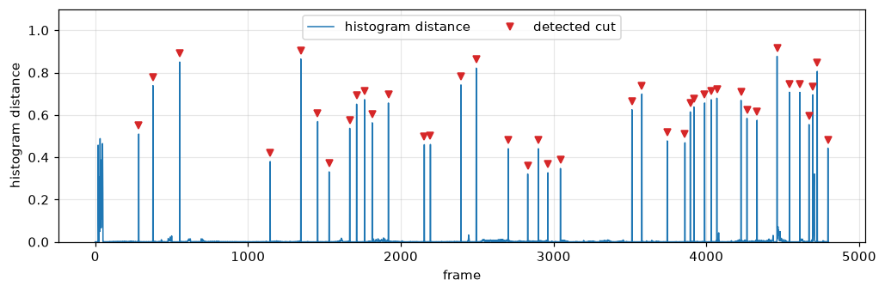{#fig-ch08-goal width=95%}

## 準備——新しいサンプル映像を入手する {#sec-ch08-prepare .unnumbered}

### Big Buck Bunny をダウンロードする {.unnumbered}

これまで使ってきたSintelの予告編は52秒しかなく、ショットの数も限られています。
この章からは、約10分の短編アニメーション **Big Buck Bunny** の本編を使います。
Sintelと同じくBlender Foundationが制作した作品（2008年公開）で、クリエイティブ・コモンズの「表示 3.0」ライセンス（CC BY 3.0）で公開されています。

::: {.callout-note title="クレジット"}
Big Buck Bunny — © copyright 2008, Blender Foundation | [www.bigbuckbunny.org](https://www.bigbuckbunny.org/)
:::

VS Codeのターミナルで、次の2行を実行します。
カレントフォルダがプロジェクトフォルダ（`C:\work\video-analysis`）であることを確認してから実行してください。

```{.default}
> curl.exe -L -o data\BigBuckBunny_320x180.mp4.zip https://download.blender.org/peach/bigbuckbunny_movies/BigBuckBunny_320x180.mp4.zip
> Expand-Archive data\BigBuckBunny_320x180.mp4.zip -DestinationPath data
```

1行目でダウンロードされるのは、動画を圧縮したzipファイルです（約64MB）。
2行目の `Expand-Archive` は、zipファイルを展開するPowerShellの命令です。
展開すると、`data` フォルダの中に `BigBuckBunny_320x180.mp4` というファイルが1つできます。
展開が終われば、zipファイルは削除してかまいません。

ダウンロードした映像は、分析を始める前に、一度通して観ておいてください。
この章では「どこでショットが切り替わったか」を自分の目で判断する場面が何度も出てきます。

### ノートブックを用意する {.unnumbered}

新しいノートブック `ch08.ipynb` を作り、カーネルに `.venv` を選びます。
最初のセルで、この章で使うライブラリをまとめて読み込みます。

```python
import os

import cv2
import matplotlib.pyplot as plt
import numpy as np
import pandas as pd

from videotools import iter_frames, read_frame, show, video_info
```

映像の基本情報を確認します。

```python
BBB = "data/BigBuckBunny_320x180.mp4"
info = video_info(BBB)
info
```

```{.default}
{'width': 320, 'height': 180, 'fps': 24.0, 'frame_count': 14315, 'duration': 596.4583333333334}
```

解像度は320×180、フレームレートは24fps、総フレーム数は14,315です。
解像度が小さいので、10分の映像でも1回の読み通しは数秒から十数秒で終わります。

この章では、離れた場所にあるフレームを何枚か取り出して横に並べる、という作業を繰り返します。
そのための関数を2つ、先に用意しておきます。

```python
def get_frames(path, numbers):
    """指定した番号のフレームを読み、{番号: 画像} の辞書で返す。"""
    wanted = set(numbers)
    frames = {}
    for n, frame in iter_frames(path, start=min(wanted), stop=max(wanted) + 1):
        if n in wanted:
            frames[n] = frame
    return frames


def show_strip(path, numbers):
    """指定した番号のフレームを横1列に並べて表示する。"""
    frames = get_frames(path, numbers)
    fig, axes = plt.subplots(1, len(numbers), figsize=(2.2 * len(numbers), 1.6))
    for ax, n in zip(axes, numbers):
        show(frames[n], title=str(n), ax=ax)
        ax.axis("off")
    plt.tight_layout()
    plt.show()
```

`get_frames` は、必要なフレームのうち最初のものから最後のものまでを1回だけ読み通し、指定された番号のフレームだけを辞書に残します。
`show_strip` は、それを `plt.subplots` で横に並べ、各フレームの上にフレーム番号を表示します。

## カット、ディゾルブ、フェード——切り替わりの種類 {#sec-ch08-types}

ショットの切り替わり方には、いくつかの種類があります。
まず、Big Buck Bunnyの中から筆者があらかじめ見つけておいた実例を見てみましょう。

### カット

もっとも多いのが**カット**です。
あるフレームまでは前のショット、次のフレームからは別のショット、というように、1フレームで瞬時に切り替わります。

```python
show_strip(BBB, [1142, 1143, 1144, 1145, 1146, 1147])
```

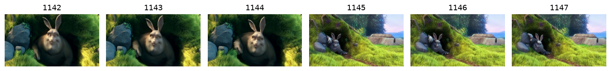{#fig-ch08-type-cut width=100%}

@fig-ch08-type-cut では、フレーム1144と1145の間にカットがあります。
本書では、カットの位置を**新しいショットの最初のフレームの番号**で表すことにします。
この例なら、カット点は1145です。

### ディゾルブ

**ディゾルブ**は、前のショットが少しずつ薄くなり、それに重なって次のショットが少しずつ濃くなっていく切り替わりです。
途中のフレームでは、2つのショットが重なって見えます。

```python
show_strip(BBB, [745, 757, 769, 781, 793, 805, 817])
```

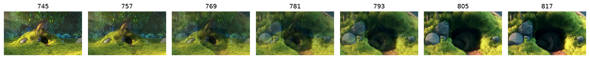{#fig-ch08-type-dissolve width=100%}

@fig-ch08-type-dissolve は12フレームおきに並べたものです。
カットと違って、「ここが境目」と言える1枚がありません。

### フェード

**フェード**は、画面が少しずつ暗くなって真っ黒になる（フェードアウト）、あるいは真っ黒な画面から少しずつ映像が現れる（フェードイン）切り替わりです。
場面や時間の区切りを示すためによく使われます。

```python
show_strip(BBB, [7164, 7169, 7174, 7190, 7212, 7217, 7224])
```

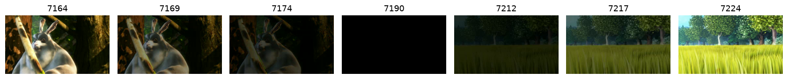{#fig-ch08-type-fade width=100%}

### ワイプ

このほかに、画面の一部から次の映像（あるいは黒）が広がっていく**ワイプ**（wipe）があります。
Big Buck Bunnyでは、本編の最後に、円が閉じていく形のワイプ（アイリスアウト）が使われています。

```python
show_strip(BBB, [11724, 11730, 11736, 11742, 11748, 11754, 11760])
```

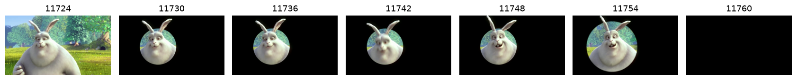{#fig-ch08-type-wipe width=100%}

### この章で扱う範囲

4種類を整理すると @tbl-ch08-types のようになります。

| 種類 | 切り替わり方 | かかる時間 | この章での扱い |
|---|---|---|---|
| カット | 瞬時に切り替わる | 1フレーム | 主な検出対象（@sec-ch08-diff から @sec-ch08-errors まで） |
| フェード | 黒い画面を経由する | 数フレーム〜数秒 | 暗転を手がかりに検出（@sec-ch08-gradual） |
| ディゾルブ | 2つの映像が重なりながら移る | 数フレーム〜数秒 | 簡易な方法を試し、限界を確かめる（@sec-ch08-gradual） |
| ワイプ | 画面の一部から置き換わる | 数フレーム〜数秒 | 扱わない |

: ショットの切り替わりの種類 {#tbl-ch08-types}

カットは1フレームで起こるので、「隣り合う2枚のフレームが大きく違う場所」を探せば見つかりそうです。
一方、ディゾルブやフェードのような**ゆるやかな切り替わり**（gradual transition）では、変化が何フレームにもわたって少しずつ進むので、この考え方がそのままでは使えません。
まずカットの検出に集中し、ゆるやかな切り替わりは @sec-ch08-gradual で取り上げます。

## 隣り合うフレームの「違い」を測る {#sec-ch08-diff}

### 画素の差分

カットを見つけるには、隣り合う2枚のフレームがどれだけ違うかを、1つの数値で表す必要があります。
もっとも素直な方法は、第7章で使ったフレーム間差分です。
2枚のフレームをグレースケールにして、同じ位置の画素どうしの差の絶対値をとり、画面全体で平均します。

```python
def pixel_diff(a, b):
    """2枚のフレームについて、画素ごとの差の絶対値の平均を返す。"""
    gray_a = cv2.cvtColor(a, cv2.COLOR_BGR2GRAY)
    gray_b = cv2.cvtColor(b, cv2.COLOR_BGR2GRAY)
    return cv2.absdiff(gray_a, gray_b).mean()
```

値は0から255の範囲をとり、2枚がまったく同じなら0になります。

この関数を、映像の冒頭200秒（4,800フレーム）に適用します。
`diff[n]` には、フレーム `n - 1` とフレーム `n` の違いを入れることにします。
こうしておくと、`diff[n]` が大きいとき、`n` が「新しいショットの最初のフレーム」の候補になります。

```python
STOP = 4800  # 冒頭の200秒

diff = np.zeros(STOP)
prev = None
for n, frame in iter_frames(BBB, stop=STOP):
    if prev is not None:
        diff[n] = pixel_diff(prev, frame)
    prev = frame
```

結果をグラフにします。

```python
plt.figure(figsize=(11, 3))
plt.plot(diff, linewidth=1)
plt.xlabel("frame")
plt.ylabel("pixel difference")
plt.grid(alpha=0.3)
plt.show()
```

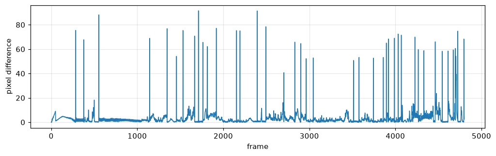{#fig-ch08-pixel-diff width=95%}

@fig-ch08-pixel-diff には、鋭く突き出た線が40本ほど見えます。
@fig-ch08-type-cut で見たカット点1145の値を確かめてみましょう。

```python
print(diff[1143:1148].round(1))
```

```{.default}
[ 6.1  5.5 69.   0.9  1.6]
```

フレーム1145の値だけが69.0と飛び抜けて大きく、その前後は1〜6程度です。
カットの位置では、たしかに差分が跳ね上がっています。

### 画素の差分は動きに弱い

ところが、差分が大きくなるのはカットのときだけではありません。
グラフの右端近く、フレーム4700付近を拡大して見てみます。

```python
print(diff[4696:4710].round(1))
```

```{.default}
[ 1.7 60.6 20.  29.6 35.5 42.9 48.3 37.6 54.3 39.4 34.4 35.8 39.4 11.1]
```

フレーム4697が60.6で、これはカットです。
しかしその後も、フレーム4698から4708まで、20から54という大きな値が11フレーム続いています。
この区間のフレームを並べてみます。

```python
show_strip(BBB, [4699, 4700, 4701, 4702, 4703, 4704, 4705])
```

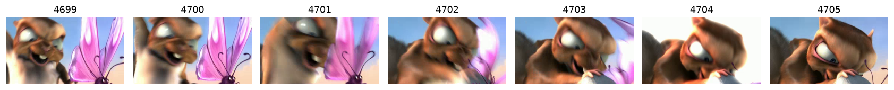{#fig-ch08-whip width=100%}

@fig-ch08-whip を見ると、この区間ではショットは切り替わっていません。
カメラがモモンガの顔に急激に寄り、その直後に背景が白く光っているだけです。
それでも、画面の中のものが大きく動けば、同じ位置の画素の値は大きく変わります。
画素の差分は「同じ位置の画素を比べる」ので、**ショットが変わったのか、ショットの中で被写体やカメラが動いたのかを区別できない**のです。

フレーム4702の差分は48.3で、先ほど確かめたカット点1145の69.0と比べても、極端に小さいわけではありません。
もっと静かなカット（差分の小さいカット）があれば、動きの激しい場面と見分けがつかなくなります。

## ヒストグラムの比較とカイ2乗統計量 {#sec-ch08-hist}

### 位置を捨てて、分布を比べる

動きに強い指標を作るには、「どの位置にあるか」を無視して、「どんな値の画素がどれだけあるか」だけを比べればよさそうです。
これは、第5章で扱った**ヒストグラム**そのものです。
被写体が画面の中で移動しても、画面に映っているものが同じなら、明るい画素と暗い画素の割合はあまり変わりません。
一方、ショットが切り替われば、映っているものが変わるので、割合も変わるはずです。

実際に確かめてみます。
フレームをグレースケールにして、輝度のヒストグラムを作る関数を用意します。
第5章では `np.histogram` を使いましたが、ここでは、後で色のヒストグラムにも使える `cv2.calcHist` を使います。

```python
def gray_hist(frame, bins=64):
    """輝度のヒストグラム（各ビンに入る画素の個数）を返す。"""
    gray = cv2.cvtColor(frame, cv2.COLOR_BGR2GRAY)
    hist = cv2.calcHist([gray], [0], None, [bins], [0, 256])
    return hist.ravel()
```

`cv2.calcHist` の引数は、順に「画像のリスト」「使うチャンネルの番号」「マスク（使わないので `None`）」「ビンの数」「値の範囲」です。
輝度の0〜255を64個の**ビン**（bin、区間）に分け、それぞれのビンに入る画素の個数を数えています。
結果は縦に長い2次元配列で返ってくるので、`ravel()` で1次元にしています。

これを使って、2組のフレームを比べます。
1組目は先ほどの動きの激しい場面（フレーム4701と4702）、2組目はカット（フレーム1144と1145）です。

```python
frames = get_frames(BBB, [1144, 1145, 4701, 4702])

fig, axes = plt.subplots(2, 3, figsize=(11, 4.6))
for row, (m, n) in enumerate([(4701, 4702), (1144, 1145)]):
    show(frames[m], title=str(m), ax=axes[row, 0])
    show(frames[n], title=str(n), ax=axes[row, 1])
    axes[row, 0].axis("off")
    axes[row, 1].axis("off")
    axes[row, 2].plot(gray_hist(frames[m]), linewidth=1.2, label=str(m))
    axes[row, 2].plot(gray_hist(frames[n]), linewidth=1.2, label=str(n))
    axes[row, 2].set_ylabel("pixels")
    axes[row, 2].grid(alpha=0.3)
    axes[row, 2].legend()
axes[1, 2].set_xlabel("bin (brightness)")
plt.tight_layout()
plt.show()
```

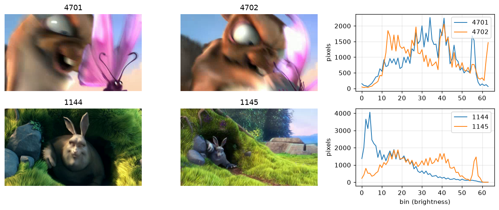{#fig-ch08-hist-compare width=100%}

@fig-ch08-hist-compare の上の段では、画面の中身が大きく動いていて、2本のヒストグラムにも細かな食い違いはありますが、山の位置と広がりはよく似ています。
下の段のカットでは、2本のヒストグラムは形そのものが違います。
画素の差分で見ると、上の段は48.3、下の段は69.0で、1.4倍の違いしかありませんでした。
ヒストグラムの違いを数値にできれば、この2つをもっとはっきり区別できそうです。

### カイ2乗統計量

2つのヒストグラムの違いを1つの数値にする方法として、ここでは**カイ2乗統計量**（chi-square statistic）を使います。
もともとは統計学で、「観測された度数」と「期待される度数」のずれを測るために作られた量です。

ヒストグラムのビンの数を $K$ とし、1枚目のフレームの $i$ 番目のビンの値を $a_i$、2枚目のフレームのそれを $b_i$ と書くことにします。
カイ2乗統計量は次の式で定義されます。

$$
\chi^2 = \sum_{i=1}^{K} \frac{(a_i - b_i)^2}{a_i}
$$

記号 $\sum$ は「$i$ を1から $K$ まで変えながら、右側の値をすべて足し合わせる」という意味です。
式がしていることは、次の3段階に分けられます。

1. ビンごとに、2つのヒストグラムの差 $a_i - b_i$ を求め、2乗する。2乗するので、どちらが大きくても正の値になります。
2. それを $a_i$ で割る。もともと1,000個の画素が入っているビンで100個違うのと、100個しか入っていないビンで100個違うのとでは、後者のほうが大きな変化です。割り算は、差を「もとの大きさに対する割合」に近い形に直す働きをします。
3. すべてのビンについて足し合わせる。

要するに、**ビンごとのずれを、そのビンの大きさに見合った重みで足し合わせたもの**です。
2つのヒストグラムが完全に同じなら0になり、違いが大きいほど値が大きくなります。

この式を、NumPyでそのまま計算してみます。
$a_i$ が0のビンは割り算ができないので、計算から除きます。

```python
a = gray_hist(frames[1144])
b = gray_hist(frames[1145])

use = a > 0
manual = np.sum((a[use] - b[use]) ** 2 / a[use])
print(manual)
```

```{.default}
112239.65
```

### `cv2.compareHist` で計算する

OpenCVには、2つのヒストグラムを比べる関数 `cv2.compareHist` があります。
第3引数に `cv2.HISTCMP_CHISQR` を指定すると、カイ2乗統計量を計算します。

```python
print(cv2.compareHist(a, b, cv2.HISTCMP_CHISQR))
```

```{.default}
112239.64585124532
```

手計算と同じ値になりました（末尾の桁の違いは、計算の途中で使う小数の精度の違いによるものです）。
`cv2.HISTCMP_CHISQR` は、上の式のとおり、第1引数のヒストグラムで割り算をしていることが確かめられました。

ここで1つ問題があります。
この式は、$a$ と $b$ を入れ替えると値が変わります。

```python
print(cv2.compareHist(b, a, cv2.HISTCMP_CHISQR))
```

```{.default}
102070.60719268637
```

入れ替えただけで、値が1割ほど変わりました。
この例ではまだ小さな違いですが、暗い画像では違いが極端になります。
冒頭のフェードインの途中にある、フレーム20と21で試してみます。

```python
dark_pair = get_frames(BBB, [20, 21])
c = gray_hist(dark_pair[20])
d = gray_hist(dark_pair[21])
print(cv2.compareHist(c, d, cv2.HISTCMP_CHISQR))
print(cv2.compareHist(d, c, cv2.HISTCMP_CHISQR))
```

```{.default}
197037195.98268002
330870.2464166353
```

同じ2枚を比べているのに、順番によって約600倍も違う値になりました。
もともとのカイ2乗統計量は、「期待される度数」という基準があって、それに対する観測値のずれを測るものでした。
だから、基準である $a_i$ だけで割るのです。
しかし、2枚のフレームのどちらかが基準というわけではありません。
しかも、$a_i$ がごく小さいビンに $b_i$ がたくさん入ると、小さな数で割ることになり、値が極端に大きくなります。
フレーム20と21で起きたのは、これです。

そこで、分母を $a_i + b_i$ に変えて、2つのヒストグラムを対等に扱う形がよく使われます。
OpenCVでは `cv2.HISTCMP_CHISQR_ALT` がこれにあたり、次の式を計算します。

$$
\chi^2_{\mathrm{alt}} = 2 \sum_{i=1}^{K} \frac{(a_i - b_i)^2}{a_i + b_i}
$$

これも手計算と突き合わせておきます。

```python
use = (a + b) > 0
manual_alt = 2 * np.sum((a[use] - b[use]) ** 2 / (a[use] + b[use]))
print(manual_alt)
print(cv2.compareHist(a, b, cv2.HISTCMP_CHISQR_ALT))
print(cv2.compareHist(b, a, cv2.HISTCMP_CHISQR_ALT))
```

```{.default}
50459.312
50459.3114634793
50459.3114634793
```

手計算と一致し、入れ替えても値は変わりません。
本書では、こちらの対称な形を使います。

::: {.callout-note title="OpenCVの定義は実行して確かめる"}
`cv2.compareHist` の比較方法には、ほかにも相関（`HISTCMP_CORREL`）や交差（`HISTCMP_INTERSECT`）などがあります。
同じ「カイ2乗」という名前でも、ライブラリによって分母や係数が違うことがあります。
ここでしたように、小さな例で手計算と突き合わせておくと、自分が何を計算しているのかを取り違えずにすみます。
:::

### 0から1の範囲に収める

ここまでに計算した値は、数万から数億という大きな数で、このままでは解像度の違う映像どうしで比べられません。
画素数が4倍になれば、ヒストグラムの値も、カイ2乗統計量も4倍になるからです。

そこで、ヒストグラムを画素数で割って、「個数」ではなく「割合」に直します。
割合に直したヒストグラムを $p_i$、$q_i$ と書くと、どちらも合計が1になります。
このとき、次の量 $d$ は必ず0から1の範囲に収まります。

$$
d = \frac{1}{2} \sum_{i=1}^{K} \frac{(p_i - q_i)^2}{p_i + q_i}
$$

2つのヒストグラムが同じなら $d = 0$ です。
2つのヒストグラムにまったく重なりがない（一方に画素があるビンには、もう一方の画素が1つもない）とき、各項は $p_i$ か $q_i$ そのものになるので、合計は $1 + 1 = 2$、その半分で $d = 1$ になります。
`HISTCMP_CHISQR_ALT` の式と見比べると、$d$ は `HISTCMP_CHISQR_ALT` の値を4で割ったものです。

```python
def hist_distance(p, q):
    """合計1に正規化した2つのヒストグラムの違いを、0〜1の値で返す。"""
    return cv2.compareHist(p, q, cv2.HISTCMP_CHISQR_ALT) / 4
```

以下では、この $d$ を**ヒストグラム距離**（histogram distance）と呼ぶことにします。
@fig-ch08-hist-compare の2組について計算してみます。

```python
def normalize(hist):
    """ヒストグラムを合計1に正規化する。"""
    return hist / hist.sum()


for m, n in [(4701, 4702), (1144, 1145)]:
    p = normalize(gray_hist(frames[m]))
    q = normalize(gray_hist(frames[n]))
    print(m, n, round(hist_distance(p, q), 3))
```

```{.default}
4701 4702 0.066
1144 1145 0.219
```

動きの激しい場面は0.066、カットは0.219で、3倍以上の開きがあります。
画素の差分では1.4倍だったので、区別がつきやすくなりました。

::: {.callout-important title="ここでは統計的検定をしているのではありません"}
カイ2乗統計量は、統計学では**カイ2乗検定**（chi-square test。2つの分布が同じとみなせるかどうかを確率で判断する手続き）に使われます。
しかし、フレームのヒストグラムにカイ2乗検定をそのまま当てはめることはできません。
検定は、1つひとつのデータが互いに無関係に（独立に）得られたことを前提にしていますが、画像の画素は隣どうしでよく似た値をとり、互いに無関係ではないからです。
隣り合う2枚のフレームも、同じ場面を続けて写したもので、無関係な2組のデータではありません。

実際に計算してみると、前提が成り立っていないことがわかります。
同じショットの中の、ほとんど動きのない2枚（フレーム1225と1226）で、SciPyの検定を実行してみます。

```python
from scipy.stats import chi2_contingency

pair = get_frames(BBB, [1225, 1226])
table = np.array([gray_hist(pair[1225]), gray_hist(pair[1226])])
table = table[:, table.sum(axis=0) > 0]  # どちらも0のビンを除く
result = chi2_contingency(table)
print(round(result.statistic, 1), result.dof)
```

```{.default}
2.5 60
```

検定の前提が成り立っていれば、分布が同じ2組のデータから計算した統計量は、平均すると2番目の数（自由度と呼ばれる値で、ここでは60）くらいになります。
ところが実際の値は2.5で、それよりはるかに小さくなっています。
2枚のフレームは「同じ分布から別々に得た2組のデータ」ではなく、ほとんど同じ画素を2回数えたものだからです。

そこで本書では、カイ2乗統計量を、**2つのヒストグラムの違いの大きさを表す指標**としてだけ使います。
「確率何%で有意」といった判断には使いません。
どこからを「大きい」とみなすかは、次の節で、データを見ながら決めます。
:::

### 色のヒストグラムを使う

ここまでは輝度のヒストグラムを使ってきました。
しかし、輝度だけでは区別できないカットがあります。
次の2枚を見てください。

```python
show_strip(BBB, [6226, 6227, 6228, 6229])
```

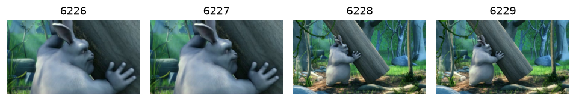{#fig-ch08-gray-miss width=80%}

フレーム6227と6228の間は明らかにカットです。
ところが、輝度のヒストグラム距離を計算すると、先ほどの「動きの激しい場面」の0.066よりも小さな値になります。

```python
pair = get_frames(BBB, [6227, 6228])
p = normalize(gray_hist(pair[6227]))
q = normalize(gray_hist(pair[6228]))
print(round(hist_distance(p, q), 3))
```

```{.default}
0.028
```

2つのショットは、映っているものは違っても、明るい画素と暗い画素の割合がたまたま似ているのです。
ヒストグラムは位置の情報を捨てているので、このようなことが起こります。

そこで、輝度だけでなく色も使うことにします。
B、G、Rの値をそれぞれ8段階に分け、その組み合わせ（8×8×8＝512通り）のそれぞれに、画素がいくつ入るかを数えます。
輝度が同じでも、緑がかった画素と青みがかった画素は別のビンに入るので、区別できる場面が増えます。

```python
def color_hist(frame, bins=8):
    """B, G, R を bins 段階ずつに分けた色ヒストグラム（合計1）を返す。"""
    hist = cv2.calcHist(
        [frame], [0, 1, 2], None, [bins, bins, bins], [0, 256, 0, 256, 0, 256]
    )
    hist = hist.ravel()
    return hist / hist.sum()
```

`cv2.calcHist` に3つのチャンネルを指定すると、8×8×8の3次元配列が返ってきます。
これを `ravel()` で長さ512の1次元配列に直し、合計が1になるように正規化しています。

同じ2枚で試します。

```python
p = color_hist(pair[6227])
q = color_hist(pair[6228])
print(p.shape, round(hist_distance(p, q), 3))
```

```{.default}
(512,) 0.209
```

色のヒストグラムでは、距離は0.209になりました。
以下では、この色ヒストグラムの距離を使います。

### 映像全体について計算する

準備ができたので、映像全体を1回読み通して、フレームごとの値を計算します。
画素の差分（`diff`）とヒストグラム距離（`chi`）の両方を求め、後で使う平均輝度（`brightness`）も一緒に記録しておきます。
各フレームのヒストグラムも、@sec-ch08-gradual で使うので `hists` に残しておきます。

```python
rows = []
hists = []
prev_gray = None
for n, frame in iter_frames(BBB):
    gray = cv2.cvtColor(frame, cv2.COLOR_BGR2GRAY)
    hist = color_hist(frame)
    if prev_gray is None:
        d_pixel, d_hist = 0.0, 0.0
    else:
        d_pixel = cv2.absdiff(gray, prev_gray).mean()
        d_hist = hist_distance(hists[-1], hist)
    rows.append(
        {"frame": n, "brightness": gray.mean(), "diff": d_pixel, "chi": d_hist}
    )
    hists.append(hist)
    prev_gray = gray

hists = np.array(hists)
df = pd.DataFrame(rows)
df["time"] = df["frame"] / info["fps"]
df.round(4).head()
```

```{.default}
   frame  brightness    diff  chi    time
0      0      0.0000  0.0000  0.0  0.0000
1      1      0.0000  0.0000  0.0  0.0417
2      2      0.0000  0.0000  0.0  0.0833
3      3      0.0000  0.0000  0.0  0.1250
4      4      0.4188  0.4188  0.0  0.1667
```

最初のフレーム（フレーム0）には「1つ前のフレーム」がないので、`diff` と `chi` は0にしています。
時間のかかる計算なので、結果をファイルに保存しておきます。

```python
os.makedirs("out", exist_ok=True)
df.to_csv("out/bbb_features.csv", index=False)
```

`os.makedirs("out", exist_ok=True)` は、第4章と第5章でも使った、`out` フォルダがなければ作る命令です。

冒頭200秒について、2つの指標を縦に並べて描きます。

```python
head = df[df["frame"] < STOP]

fig, axes = plt.subplots(2, 1, figsize=(11, 5), sharex=True)
axes[0].plot(head["frame"], head["diff"], linewidth=1)
axes[0].set_ylabel("pixel difference")
axes[1].plot(head["frame"], head["chi"], linewidth=1)
axes[1].set_ylabel("histogram distance")
axes[1].set_xlabel("frame")
for ax in axes:
    ax.grid(alpha=0.3)
plt.tight_layout()
plt.show()
```

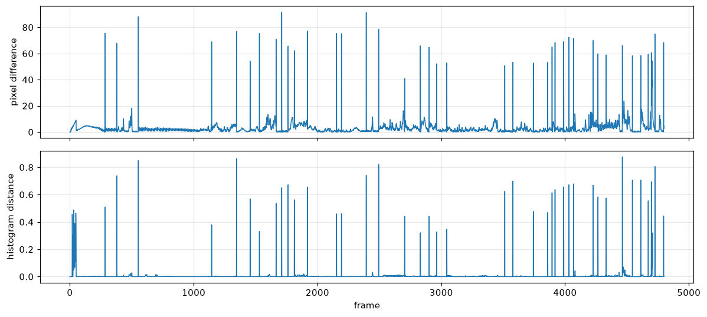{#fig-ch08-two-metrics width=95%}

@fig-ch08-two-metrics の上下を見比べると、次のことがわかります。

- 突き出た線の位置は、上下でほぼ一致しています。カットの位置では、どちらの指標も跳ね上がります。
- カット以外の場所では、画素の差分（上）は場面によって0から20程度の幅でうねっています。動きの大きさを反映しているためです。ヒストグラム距離（下）は、ほとんど0に張りついています。
- ただし、下のグラフの左端（フレーム0〜50）には、上のグラフにはない山があります。ここは映像の冒頭のフェードインです。

3点目は、ヒストグラム距離の弱点を示しています。
フェードでは、画面全体の明るさが変わるので、動きがなくてもヒストグラムが大きく変わります。
ヒストグラム距離は動きに強い代わりに、**画面全体の明るさや色の変化には敏感**なのです。
この点は @sec-ch08-errors で詳しく見ます。

## しきい値をどう決めるか {#sec-ch08-threshold}

指標ができたので、次は「どこからをカットとみなすか」を決めます。
この境目の値を**しきい値**と呼びます。

### 指標の分布を見る

しきい値を決めるには、指標がどのような値をとっているかを知る必要があります。
ヒストグラム距離の、映像全体での分布を描いてみます。
ほとんどの値が0の近くに集中しているので、縦軸は対数目盛にします。

```python
plt.figure(figsize=(8, 3.2))
plt.hist(df["chi"], bins=50, range=(0, 1), log=True)
plt.xlabel("histogram distance")
plt.ylabel("number of frames")
plt.grid(alpha=0.3)
plt.show()
```

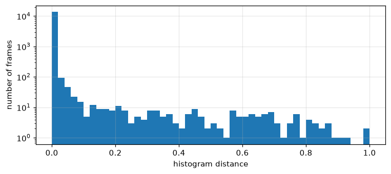{#fig-ch08-chi-dist width=75%}

いちばん左のビン（0〜0.02）に大半のフレームが入っていて、残りは0.02から1まで薄く広がっています。
数値でも確かめておきます。

```python
print((df["chi"] < 0.02).sum(), (df["chi"] >= 0.02).sum())
print(df["chi"].quantile([0.5, 0.9, 0.99]).round(4).to_list())
```

```{.default}
13932 383
[0.0008, 0.0047, 0.2428]
```

14,315フレームのうち13,932フレームは、距離が0.02未満です。
全フレームの99%では、距離が0.25に届きません。
大きな値をとるフレームは全体のごく一部です。
とはいえ、@fig-ch08-chi-dist を見ると、0.1から上にはどの値にも数フレームずつが散らばっていて、「ここから上がカット」と言える明確な谷はありません。

### 固定しきい値

もっとも単純な方法は、1つの値を決めて、それを超えたフレームをすべてカットとみなすことです。
これを**固定しきい値**（fixed threshold）と呼びます。
@fig-ch08-two-metrics の下のグラフでは、カットらしい線はおおむね0.3を超えているので、ひとまず0.3をしきい値にしてみます。

```python
fixed = df.loc[df["chi"] > 0.3, "frame"].to_list()
print(len(fixed))
print(fixed[:24])
```

```{.default}
133
[19, 20, 26, 32, 33, 38, 40, 41, 45, 48, 49, 285, 378, 553, 1145, 1346, 1456, 1531, 1666, 1711, 1763, 1813, 1919, 2154]
```

133個のフレームが検出されました。
ところが、先頭を見ると、19、20、26、32……と、冒頭のフェードインの中のフレームがいくつも検出されています。
明らかにカットではありません。

しきい値を上げれば、こうした誤りは減ります。
しかしそうすると、今度は値の小さい本物のカットを取りこぼします。
固定しきい値では、どこに線を引いても、どちらかの誤りが残ります。

### 周囲との比で決める——適応的なしきい値

@fig-ch08-two-metrics をもう一度見ると、カットには「値が大きい」ことのほかに、もう1つ特徴があります。
**前後のフレームでは値が小さく、その1フレームだけが突き出ている**ことです。
これに対して、フェードインの区間では、大きめの値が何フレームも続いています。

そこで、値そのものではなく、周囲と比べてどれだけ突き出ているかで判断することにします。
具体的には、次の2つの条件を両方とも満たすフレームを、カットとみなします。

1. ヒストグラム距離が、最低限の値 `t_min` を超えている。
2. ヒストグラム距離が、前後 `w` フレーム（自分自身は除く）の最大値の `k` 倍を超えている。

条件2のように、周囲の値に応じて基準が変わるしきい値を、**適応的なしきい値**（adaptive threshold）と呼びます。
条件1は、ほとんど変化のない場面で、ごく小さな値どうしの比が偶然大きくなる場合を除くためのものです。

まず、各フレームについて「前後 `w` フレームの最大値」を求める関数を書きます。

```python
def neighbor_max(values, w):
    """各要素について、前後 w 個（自分自身は除く）の最大値を返す。"""
    values = np.asarray(values)
    result = np.zeros(len(values))
    for i in range(len(values)):
        before = values[max(i - w, 0) : i]
        after = values[i + 1 : i + 1 + w]
        result[i] = np.concatenate([before, after]).max()
    return result
```

`before` は自分より前の `w` 個、`after` は自分より後の `w` 個です。
配列の端では個数が足りなくなりますが、スライスは範囲からはみ出した分を無視するので、そのまま計算できます。

パラメータは、ひとまず次のように決めます。

- `w = 5`：前後5フレーム（約0.2秒）と比べます。これは、「5フレーム以内に2つのカットが続くことはない」と仮定していることになります。
- `k = 3`：周囲の最大値の3倍を超えたら、突き出ているとみなします。
- `t_min = 0.1`：距離が0.1以下の変化は、カットの候補にしません。

```python
T_MIN, K, W = 0.1, 3, 5

df["neighbor"] = neighbor_max(df["chi"], W)
df["is_cut"] = (df["chi"] > T_MIN) & (df["chi"] > K * df["neighbor"])
adaptive = df.loc[df["is_cut"], "frame"].to_list()
print(len(adaptive))
print(adaptive[:24])
```

```{.default}
125
[285, 378, 553, 1145, 1346, 1456, 1531, 1666, 1711, 1763, 1813, 1919, 2154, 2194, 2394, 2494, 2704, 2831, 2901, 2963, 3045, 3513, 3578, 3744]
```

検出されたのは125個で、フェードインの中のフレームは1つも含まれていません。
先頭の285、378、553は、いずれも映像を見て確かめられる本物のカットです。

カット点1145の周辺と、フェードインの途中について、計算の中身を見ておきます。

```python
cols = ["frame", "chi", "neighbor", "is_cut"]
print(df.loc[1143:1147, cols].round(3))
print(df.loc[31:33, cols].round(3))
```

```{.default}
      frame    chi  neighbor  is_cut
1143   1143  0.001     0.380   False
1144   1144  0.001     0.380   False
1145   1145  0.380     0.001    True
1146   1146  0.000     0.380   False
1147   1147  0.000     0.380   False
    frame    chi  neighbor  is_cut
31     31  0.063     0.488   False
32     32  0.488     0.313   False
33     33  0.313     0.488   False
```

フレーム1145では、距離0.380に対して周囲の最大値は0.001しかなく、300倍以上突き出ています。
フレーム32は、距離が0.488と1145より大きいのに、すぐ隣に0.313という値があり、その3倍には届かないので、カットとは判定されません。
2つの場合を @fig-ch08-adaptive に示します。

::: {#fig-ch08-adaptive}

```{=html}
<svg viewBox="0 0 760 300" role="img" aria-label="適応的なしきい値のしくみ。箱の中はヒストグラム距離。上はカット点1145の前後で、1145の値0.380に対して、前後5フレームずつの最大は0.001。その3倍の0.003を超えているので、カットとみなす。下はフェードインの途中のフレーム32の前後で、32の値0.488に対して、前後5フレームずつの最大は0.313。その3倍の0.939を超えていないので、カットとみなさない。" style="width:100%;height:auto;font-family:inherit" fill="currentColor">
  <text x="196" y="37" font-size="11" text-anchor="middle" fill-opacity="0.75">1140</text>
  <rect x="170" y="46" width="52" height="36" fill="#f0b84a" stroke="currentColor" stroke-opacity="0.55" stroke-width="1"/>
  <text x="196" y="68.32" font-size="12" text-anchor="middle" fill="#1c1300">0.001</text>
  <text x="248" y="37" font-size="11" text-anchor="middle" fill-opacity="0.75">1141</text>
  <rect x="222" y="46" width="52" height="36" fill="#f0b84a" stroke="currentColor" stroke-opacity="0.55" stroke-width="1"/>
  <text x="248" y="68.32" font-size="12" text-anchor="middle" fill="#1c1300">0.001</text>
  <text x="300" y="37" font-size="11" text-anchor="middle" fill-opacity="0.75">1142</text>
  <rect x="274" y="46" width="52" height="36" fill="#f0b84a" stroke="currentColor" stroke-opacity="0.55" stroke-width="1"/>
  <text x="300" y="68.32" font-size="12" text-anchor="middle" fill="#1c1300">0.001</text>
  <text x="352" y="37" font-size="11" text-anchor="middle" fill-opacity="0.75">1143</text>
  <rect x="326" y="46" width="52" height="36" fill="#f0b84a" stroke="currentColor" stroke-opacity="0.55" stroke-width="1"/>
  <text x="352" y="68.32" font-size="12" text-anchor="middle" fill="#1c1300">0.001</text>
  <text x="404" y="37" font-size="11" text-anchor="middle" fill-opacity="0.75">1144</text>
  <rect x="378" y="46" width="52" height="36" fill="#f0b84a" stroke="currentColor" stroke-opacity="0.55" stroke-width="1"/>
  <text x="404" y="68.32" font-size="12" text-anchor="middle" fill="#1c1300">0.001</text>
  <text x="456" y="37" font-size="11" text-anchor="middle" font-weight="700">1145</text>
  <rect x="430" y="46" width="52" height="36" fill="#1f6fb2" stroke="currentColor" stroke-opacity="0.55" stroke-width="1"/>
  <text x="456" y="68.32" font-size="12" font-weight="700" text-anchor="middle" fill="#ffffff">0.380</text>
  <text x="508" y="37" font-size="11" text-anchor="middle" fill-opacity="0.75">1146</text>
  <rect x="482" y="46" width="52" height="36" fill="#f0b84a" stroke="currentColor" stroke-opacity="0.55" stroke-width="1"/>
  <text x="508" y="68.32" font-size="12" text-anchor="middle" fill="#1c1300">0.000</text>
  <text x="560" y="37" font-size="11" text-anchor="middle" fill-opacity="0.75">1147</text>
  <rect x="534" y="46" width="52" height="36" fill="#f0b84a" stroke="currentColor" stroke-opacity="0.55" stroke-width="1"/>
  <text x="560" y="68.32" font-size="12" text-anchor="middle" fill="#1c1300">0.000</text>
  <text x="612" y="37" font-size="11" text-anchor="middle" fill-opacity="0.75">1148</text>
  <rect x="586" y="46" width="52" height="36" fill="#f0b84a" stroke="currentColor" stroke-opacity="0.55" stroke-width="1"/>
  <text x="612" y="68.32" font-size="12" text-anchor="middle" fill="#1c1300">0.000</text>
  <text x="664" y="37" font-size="11" text-anchor="middle" fill-opacity="0.75">1149</text>
  <rect x="638" y="46" width="52" height="36" fill="#f0b84a" stroke="currentColor" stroke-opacity="0.55" stroke-width="1"/>
  <text x="664" y="68.32" font-size="12" text-anchor="middle" fill="#1c1300">0.001</text>
  <text x="716" y="37" font-size="11" text-anchor="middle" fill-opacity="0.75">1150</text>
  <rect x="690" y="46" width="52" height="36" fill="#f0b84a" stroke="currentColor" stroke-opacity="0.55" stroke-width="1"/>
  <text x="716" y="68.32" font-size="12" text-anchor="middle" fill="#1c1300">0.001</text>
  <path d="M174 90 v6 h252 v-6" fill="none" stroke="currentColor" stroke-width="1.3" stroke-opacity="0.6"/>
  <path d="M486 90 v6 h252 v-6" fill="none" stroke="currentColor" stroke-width="1.3" stroke-opacity="0.6"/>
  <text x="300" y="113" font-size="11" text-anchor="middle" fill-opacity="0.8">前の5フレーム</text>
  <text x="612" y="113" font-size="11" text-anchor="middle" fill-opacity="0.8">後の5フレーム</text>
  <text x="456" y="113" font-size="11" text-anchor="middle" fill-opacity="0.8">自分</text>
  <text x="14" y="61" font-size="13" font-weight="700">カット点</text>
  <text x="14" y="79" font-size="11" fill-opacity="0.8">フレーム1145</text>
  <text x="456" y="138" font-size="13" text-anchor="middle" font-weight="700">周囲の最大 0.001 × 3 ＝ 0.003 ＜ 0.380　→　カットとみなす</text>
  <text x="196" y="191" font-size="11" text-anchor="middle" fill-opacity="0.75">27</text>
  <rect x="170" y="200" width="52" height="36" fill="#f0b84a" stroke="currentColor" stroke-opacity="0.55" stroke-width="1"/>
  <text x="196" y="222.32" font-size="12" text-anchor="middle" fill="#1c1300">0.264</text>
  <text x="248" y="191" font-size="11" text-anchor="middle" fill-opacity="0.75">28</text>
  <rect x="222" y="200" width="52" height="36" fill="#f0b84a" stroke="currentColor" stroke-opacity="0.55" stroke-width="1"/>
  <text x="248" y="222.32" font-size="12" text-anchor="middle" fill="#1c1300">0.214</text>
  <text x="300" y="191" font-size="11" text-anchor="middle" fill-opacity="0.75">29</text>
  <rect x="274" y="200" width="52" height="36" fill="#f0b84a" stroke="currentColor" stroke-opacity="0.55" stroke-width="1"/>
  <text x="300" y="222.32" font-size="12" text-anchor="middle" fill="#1c1300">0.215</text>
  <text x="352" y="191" font-size="11" text-anchor="middle" fill-opacity="0.75">30</text>
  <rect x="326" y="200" width="52" height="36" fill="#f0b84a" stroke="currentColor" stroke-opacity="0.55" stroke-width="1"/>
  <text x="352" y="222.32" font-size="12" text-anchor="middle" fill="#1c1300">0.050</text>
  <text x="404" y="191" font-size="11" text-anchor="middle" fill-opacity="0.75">31</text>
  <rect x="378" y="200" width="52" height="36" fill="#f0b84a" stroke="currentColor" stroke-opacity="0.55" stroke-width="1"/>
  <text x="404" y="222.32" font-size="12" text-anchor="middle" fill="#1c1300">0.063</text>
  <text x="456" y="191" font-size="11" text-anchor="middle" font-weight="700">32</text>
  <rect x="430" y="200" width="52" height="36" fill="#16181c" stroke="currentColor" stroke-opacity="0.55" stroke-width="1"/>
  <text x="456" y="222.32" font-size="12" font-weight="700" text-anchor="middle" fill="#f2f2f2">0.488</text>
  <text x="508" y="191" font-size="11" text-anchor="middle" fill-opacity="0.75">33</text>
  <rect x="482" y="200" width="52" height="36" fill="#f0b84a" stroke="currentColor" stroke-opacity="0.55" stroke-width="1"/>
  <text x="508" y="222.32" font-size="12" text-anchor="middle" fill="#1c1300">0.313</text>
  <text x="560" y="191" font-size="11" text-anchor="middle" fill-opacity="0.75">34</text>
  <rect x="534" y="200" width="52" height="36" fill="#f0b84a" stroke="currentColor" stroke-opacity="0.55" stroke-width="1"/>
  <text x="560" y="222.32" font-size="12" text-anchor="middle" fill="#1c1300">0.126</text>
  <text x="612" y="191" font-size="11" text-anchor="middle" fill-opacity="0.75">35</text>
  <rect x="586" y="200" width="52" height="36" fill="#f0b84a" stroke="currentColor" stroke-opacity="0.55" stroke-width="1"/>
  <text x="612" y="222.32" font-size="12" text-anchor="middle" fill="#1c1300">0.234</text>
  <text x="664" y="191" font-size="11" text-anchor="middle" fill-opacity="0.75">36</text>
  <rect x="638" y="200" width="52" height="36" fill="#f0b84a" stroke="currentColor" stroke-opacity="0.55" stroke-width="1"/>
  <text x="664" y="222.32" font-size="12" text-anchor="middle" fill="#1c1300">0.224</text>
  <text x="716" y="191" font-size="11" text-anchor="middle" fill-opacity="0.75">37</text>
  <rect x="690" y="200" width="52" height="36" fill="#f0b84a" stroke="currentColor" stroke-opacity="0.55" stroke-width="1"/>
  <text x="716" y="222.32" font-size="12" text-anchor="middle" fill="#1c1300">0.214</text>
  <path d="M174 244 v6 h252 v-6" fill="none" stroke="currentColor" stroke-width="1.3" stroke-opacity="0.6"/>
  <path d="M486 244 v6 h252 v-6" fill="none" stroke="currentColor" stroke-width="1.3" stroke-opacity="0.6"/>
  <text x="300" y="267" font-size="11" text-anchor="middle" fill-opacity="0.8">前の5フレーム</text>
  <text x="612" y="267" font-size="11" text-anchor="middle" fill-opacity="0.8">後の5フレーム</text>
  <text x="456" y="267" font-size="11" text-anchor="middle" fill-opacity="0.8">自分</text>
  <text x="14" y="215" font-size="13" font-weight="700">フェードインの途中</text>
  <text x="14" y="233" font-size="11" fill-opacity="0.8">フレーム32</text>
  <text x="456" y="292" font-size="13" text-anchor="middle" font-weight="700">周囲の最大 0.313 × 3 ＝ 0.939 ＞ 0.488　→　カットとみなさない</text>
</svg>
```

適応的なしきい値による判定。箱の上がフレーム番号、箱の中がヒストグラム距離。中央の箱を、前後5フレームずつの最大値と比べる
:::

これで、もっともらしい結果が得られました。
しかし、「もっともらしい」だけでは、分析の土台にするには不十分です。
次の節で、この結果がどれだけ正しいのかを測ります。

## 正解データを作り、適合率と再現率で評価する {#sec-ch08-eval}

### 正解は自分の目で作る

検出結果が正しいかどうかを調べるには、正しい答え、つまり**正解データ**（ground truth）が必要です。
カット点の正解は、人が映像を見て決めるしかありません。
手間のかかる作業ですが、これを省くと、検出の方法やしきい値の良し悪しを判断する根拠がなくなります。

映像全体について正解を作るのは大変なので、ここでは冒頭の200秒（フレーム0〜4799）に範囲を絞ります。
作業は2段階で進めます。

**第1段階：粗く見て、切り替わりのある区間を探す。**
フレームを一定の間隔で取り出して並べた画像を作ります。
このような一覧を**コンタクトシート**（contact sheet）と呼びます。

```python
def contact_sheet(path, start, stop, step, ncols=10):
    """start 以上 stop 未満のフレームを step 枚おきに並べて表示する。"""
    numbers = list(range(start, stop, step))
    frames = get_frames(path, numbers)
    nrows = int(np.ceil(len(numbers) / ncols))
    fig, axes = plt.subplots(nrows, ncols, figsize=(1.5 * ncols, 1.05 * nrows))
    for ax in axes.ravel():
        ax.axis("off")
    for ax, n in zip(axes.ravel(), numbers):
        show(frames[n], ax=ax)
        ax.set_title(str(n), fontsize=7, pad=1)
    plt.subplots_adjust(wspace=0.03, hspace=0.25)
    plt.show()
```

フレーム1120から1600までを、8フレームおきに並べてみます。

```python
contact_sheet(BBB, 1120, 1600, 8)
```

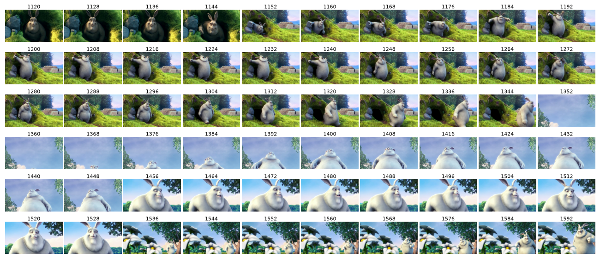{#fig-ch08-sheet width=100%}

@fig-ch08-sheet を左上から順に見ていくと、絵柄が切り替わる場所が4つ見つかります。
1144と1152の間、1344と1352の間、1448と1456の間、1528と1536の間です。

**第2段階：その区間を1フレームずつ見て、位置を確定する。**
切り替わりのある区間が8フレームの幅でわかったので、その前後を1フレームずつ並べます。
4つ目の区間で試します。

```python
show_strip(BBB, [1527, 1528, 1529, 1530, 1531, 1532, 1533])
```

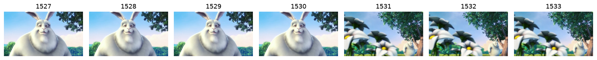{#fig-ch08-pin width=100%}

フレーム1531が新しいショットの最初のフレームなので、カット点は1531と確定できます。

筆者はこの手順を冒頭の4,800フレームすべてについて行い、カット点を1つずつ確定させました。
8フレームおきのコンタクトシートでは、8フレームより短いショットを見落とすおそれがあります。
そこで、画素の差分かヒストグラム距離が大きいフレームについても、その前後を1フレームずつ見て、カットでないことを確かめています。

::: {.callout-warning title="検出結果を見ながら正解を作らない"}
正解データは、検出結果とは独立に作らなければなりません。
「プログラムがここをカットと言っているから、たぶんカットだろう」という決め方をすると、プログラムの誤りがそのまま正解に入り込み、評価が実際よりもよく見えてしまいます。
指標の値は「見落としがないかを確かめる場所の候補」として使うだけにして、カットかどうかの判断は、必ず自分の目でフレームを見て行います。
:::

### 正解データ

こうして作った正解データが、次の表です。
VS Codeで `data` フォルダに `bbb_truth.csv` という名前の新しいファイルを作り、内容を貼り付けて保存してください。

```{.default filename="data/bbb_truth.csv"}
start,end,kind
0,50,fade
285,285,cut
378,378,cut
553,553,cut
750,810,dissolve
1145,1145,cut
1346,1346,cut
1456,1456,cut
1531,1531,cut
1666,1666,cut
1711,1711,cut
1763,1763,cut
1813,1813,cut
1919,1919,cut
2154,2154,cut
2194,2194,cut
2394,2394,cut
2494,2494,cut
2704,2704,cut
2831,2831,cut
2901,2901,cut
2963,2963,cut
3045,3045,cut
3513,3513,cut
3578,3578,cut
3744,3744,cut
3860,3860,cut
3895,3895,cut
3919,3919,cut
3989,3989,cut
4032,4032,cut
4069,4069,cut
4227,4227,cut
4266,4266,cut
4332,4332,cut
4463,4463,cut
4544,4544,cut
4612,4612,cut
4672,4672,cut
4697,4697,cut
4726,4726,cut
4796,4796,cut
```

保存すると、プロジェクトフォルダは次のようになります。
正解データは、映像と同じ `data` フォルダの中に置きます。

```{.default}
C:\work\video-analysis
├── .venv
├── __pycache__
├── data
│   ├── bbb_truth.csv             … いま作ったファイル
│   ├── BigBuckBunny_320x180.mp4
│   ├── frame400.png
│   └── sintel_trailer-480p.mp4
├── out                           … これまでの章で保存したファイル
├── ch02.ipynb
├── …                         … ch03.ipynb 〜 ch07.ipynb
├── ch08.ipynb
├── pyproject.toml
├── uv.lock
└── videotools.py
```

各行が1つの切り替わりを表します。
`kind` が `cut` の行では、`start` と `end` はどちらも新しいショットの最初のフレームの番号です。
ゆるやかな切り替わりは2つあり、`start` と `end` に始まりと終わりのフレームを入れています。

- フレーム0〜50：冒頭のフェードイン。
- フレーム750〜810：@fig-ch08-type-dissolve で見たディゾルブ。

ディゾルブの始まりと終わりは、目で見ても数フレームの幅でしか決められません。
750と810という数字は、おおよその値です。
このほかに、フレーム500〜740付近では、クレジットや題名の文字が映像に重なって現れては消えますが、文字の出入りそのものは、切り替わりには数えていません。

ファイルを読み込み、カットだけを取り出します。

```python
truth = pd.read_csv("data/bbb_truth.csv")
truth_cuts = truth.loc[truth["kind"] == "cut", "start"].to_list()
print(len(truth_cuts))
```

```{.default}
40
```

冒頭200秒には、カットが40個あります。

### 検出結果の3つの分類

検出結果を正解と突き合わせると、1つひとつの結果は次の3種類に分けられます。

- **正しい検出**（TP：true positive）：検出されたフレームが、正解のカットと一致する。
- **誤検出**（FP：false positive）：検出されたが、正解にはカットがない。
- **見逃し**（FN：false negative）：正解にはカットがあるのに、検出されなかった。

@fig-ch08-tpfpfn は、この3つの関係を図にしたものです。

::: {#fig-ch08-tpfpfn}

```{=html}
<svg viewBox="0 0 760 190" role="img" aria-label="正解のカット点と検出結果を時間軸の上に並べた図。正解と検出が一致すれば正しい検出、検出だけがあれば誤検出、正解だけがあれば見逃しになる。" style="width:100%;height:auto;font-family:inherit" fill="currentColor">
  <text x="14" y="58" font-size="15">正解</text>
  <text x="14" y="118" font-size="15">検出</text>
  <line x1="80" y1="52" x2="740" y2="52" stroke="currentColor" stroke-opacity="0.45" stroke-width="1.5"/>
  <line x1="80" y1="112" x2="740" y2="112" stroke="currentColor" stroke-opacity="0.45" stroke-width="1.5"/>
  <g stroke="currentColor" stroke-width="3">
    <line x1="150" y1="38" x2="150" y2="66"/>
    <line x1="290" y1="38" x2="290" y2="66"/>
    <line x1="570" y1="38" x2="570" y2="66"/>
    <line x1="680" y1="38" x2="680" y2="66"/>
  </g>
  <g stroke="#d1495b" stroke-width="3">
    <line x1="150" y1="98" x2="150" y2="126"/>
    <line x1="290" y1="98" x2="290" y2="126"/>
    <line x1="430" y1="98" x2="430" y2="126"/>
    <line x1="680" y1="98" x2="680" y2="126"/>
  </g>
  <g font-size="14" text-anchor="middle">
    <text x="150" y="156">正しい検出</text>
    <text x="150" y="176" fill-opacity="0.7">TP</text>
    <text x="290" y="156">正しい検出</text>
    <text x="290" y="176" fill-opacity="0.7">TP</text>
    <text x="430" y="156">誤検出</text>
    <text x="430" y="176" fill-opacity="0.7">FP</text>
    <text x="570" y="156">見逃し</text>
    <text x="570" y="176" fill-opacity="0.7">FN</text>
    <text x="680" y="156">正しい検出</text>
    <text x="680" y="176" fill-opacity="0.7">TP</text>
  </g>
  <text x="740" y="24" font-size="13" text-anchor="end" fill-opacity="0.7">時間 →</text>
</svg>
```

正解と検出結果の突き合わせ。この例では、TPが3、FPが1、FNが1です。
:::

### 適合率、再現率、F値

TP、FP、FNの個数から、検出の良さを表す2つの数値を計算します。

**適合率**（precision）は、「検出したもののうち、正しかったものの割合」です。

$$
\text{適合率} = \frac{\mathrm{TP}}{\mathrm{TP} + \mathrm{FP}}
$$

分母の $\mathrm{TP} + \mathrm{FP}$ は、検出した個数の合計です。
誤検出が多いほど、適合率は下がります。

**再現率**（recall）は、「正解のうち、見つけられたものの割合」です。

$$
\text{再現率} = \frac{\mathrm{TP}}{\mathrm{TP} + \mathrm{FN}}
$$

分母の $\mathrm{TP} + \mathrm{FN}$ は、正解の個数の合計です。
見逃しが多いほど、再現率は下がります。

@fig-ch08-tpfpfn の例では、適合率は $3 / (3 + 1) = 0.75$、再現率も $3 / (3 + 1) = 0.75$ です。

2つの数値が必要なのは、片方だけなら簡単に上げられるからです。
しきい値を極端に下げて、すべてのフレームをカットと判定すれば、見逃しはなくなり、再現率は1になります。
しかし誤検出だらけになり、適合率はほぼ0です。
逆に、しきい値を極端に上げて、いちばんはっきりしたカットを1つだけ検出すれば、適合率は1になりますが、再現率はほぼ0です。
良い検出とは、**両方が同時に高い**検出です。

2つを1つの数値にまとめたいときは、**F値**（F1スコア）を使います。

$$
F = \frac{2 \times \text{適合率} \times \text{再現率}}{\text{適合率} + \text{再現率}}
$$

これは適合率と再現率の調和平均と呼ばれるもので、どちらか一方でも低いと、F値も低くなります。
両方が1のときだけ、F値は1になります。

### 評価する関数を書く

検出結果と正解を突き合わせて、TP、FP、FNを数える関数を書きます。

```python
def evaluate(detected, truth, tol=0):
    """検出結果と正解を突き合わせ、TP・FP・FNの個数を返す。

    検出と正解のフレーム番号の差が tol 以下なら、一致したとみなす。
    """
    remaining = list(truth)
    tp = 0
    for d in detected:
        near = [t for t in remaining if abs(t - d) <= tol]
        if near:
            remaining.remove(near[0])
            tp += 1
    fp = len(detected) - tp
    fn = len(remaining)
    return tp, fp, fn
```

検出されたフレーム `d` を1つずつ取り出し、まだ使われていない正解の中に、`d` との差が `tol` 以下のものがあるかを調べます。
あれば、その正解を「使用済み」として `remaining` から取り除き、TPを1つ増やします。
1つの正解に2つの検出が対応することがないように、使った正解を取り除いている点に注意してください。
最後まで残った正解が、見逃しです。
引数 `tol` の意味は、すぐ後で説明します。

適合率、再現率、F値を計算する関数も用意します。

```python
def scores(tp, fp, fn):
    """適合率、再現率、F値を返す。"""
    precision = tp / (tp + fp) if tp + fp > 0 else 0.0
    recall = tp / (tp + fn) if tp + fn > 0 else 0.0
    if precision + recall == 0:
        return precision, recall, 0.0
    return precision, recall, 2 * precision * recall / (precision + recall)
```

### 3つの方法を評価する

正解があるのは冒頭の4,800フレームだけなので、検出結果もその範囲に絞って評価します。
ここまでに出てきた方法のうち、次の3つを比べます。

- 画素の差分に固定しきい値（50）を使う方法
- ヒストグラム距離に固定しきい値（0.3）を使う方法
- ヒストグラム距離に適応的なしきい値を使う方法

```python
methods = {
    "pixel diff > 50": df.loc[df["diff"] > 50, "frame"].to_list(),
    "chi > 0.3": fixed,
    "chi adaptive": adaptive,
}

for name, detected in methods.items():
    detected = [d for d in detected if d < STOP]
    tp, fp, fn = evaluate(detected, truth_cuts)
    p, r, f = scores(tp, fp, fn)
    print(f"{name:16s} TP={tp:2d} FP={fp:2d} FN={fn:2d}  P={p:.3f} R={r:.3f} F={f:.3f}")
```

```{.default}
pixel diff > 50  TP=39 FP= 1 FN= 1  P=0.975 R=0.975 F=0.975
chi > 0.3        TP=40 FP=13 FN= 0  P=0.755 R=1.000 F=0.860
chi adaptive     TP=40 FP= 0 FN= 0  P=1.000 R=1.000 F=1.000
```

結果を整理すると、次のようになります。

- **画素の差分（固定しきい値）**：誤検出が1つ、見逃しが1つあります。
- **ヒストグラム距離（固定しきい値）**：40個のカットをすべて見つけていますが、誤検出が13個あります。適合率は0.755です。
- **ヒストグラム距離（適応的なしきい値）**：40個すべてを見つけ、誤検出はありません。

適応的なしきい値では、適合率も再現率も1になりました。
ただし、この数字は割り引いて受け取る必要があります。
理由は @sec-ch08-errors の最後にまとめます。

### 許容誤差

`evaluate` の引数 `tol` は、検出と正解のフレーム番号が何フレームまでずれていても一致とみなすかを決める、**許容誤差**（tolerance）です。
ここまでは `tol=0`、つまり1フレームのずれも許さない設定で評価しました。

許容誤差が必要になる場面は、2つあります。

1つ目は、カット点の表し方の違いです。
本書では「新しいショットの最初のフレーム」をカット点としていますが、「前のショットの最後のフレーム」を記録する流儀もあります。
この場合、番号は1つずれます。
試しに、正解をすべて1つ前にずらして評価してみます。

```python
shifted = [t - 1 for t in truth_cuts]
head_adaptive = [d for d in adaptive if d < STOP]
print(evaluate(head_adaptive, shifted, tol=0))
print(evaluate(head_adaptive, shifted, tol=1))
```

```{.default}
(0, 40, 40)
(40, 0, 0)
```

`tol=0` では、40個すべてが誤検出かつ見逃しという、最悪の結果になります。
`tol=1` にすれば、すべて正しい検出になります。
最初のカット点（285番目）を例にすると、@fig-ch08-tolerance のようになります。

::: {#fig-ch08-tolerance}

```{=html}
<svg viewBox="0 0 760 280" role="img" aria-label="許容誤差のはたらき。正解のカット点が284番目、検出したカット点が285番目で、1フレームずれている。tol=0では番号が一致しないので、正解は見逃し、検出は誤検出と数えられる。tol=1では正解の前後1フレームまでを一致とみなすので、285番目の検出は正しい検出と数えられる。" style="width:100%;height:auto;font-family:inherit" fill="currentColor">
  <text x="235" y="39" font-size="12" text-anchor="middle" fill-opacity="0.8">282</text>
  <rect x="200" y="48" width="70" height="34" fill="currentColor" fill-opacity="0.04" stroke="currentColor" stroke-opacity="0.55" stroke-width="1"/>
  <rect x="200" y="88" width="70" height="34" fill="currentColor" fill-opacity="0.04" stroke="currentColor" stroke-opacity="0.55" stroke-width="1"/>
  <text x="305" y="39" font-size="12" text-anchor="middle" fill-opacity="0.8">283</text>
  <rect x="270" y="48" width="70" height="34" fill="currentColor" fill-opacity="0.04" stroke="currentColor" stroke-opacity="0.55" stroke-width="1"/>
  <rect x="270" y="88" width="70" height="34" fill="currentColor" fill-opacity="0.04" stroke="currentColor" stroke-opacity="0.55" stroke-width="1"/>
  <text x="375" y="39" font-size="12" text-anchor="middle" fill-opacity="0.8">284</text>
  <rect x="340" y="48" width="70" height="34" fill="#f0b84a" stroke="currentColor" stroke-opacity="0.55" stroke-width="1"/>
  <text x="375" y="69.68" font-size="13" font-weight="700" text-anchor="middle" fill="#1c1300">正解</text>
  <rect x="340" y="88" width="70" height="34" fill="currentColor" fill-opacity="0.04" stroke="currentColor" stroke-opacity="0.55" stroke-width="1"/>
  <text x="445" y="39" font-size="12" text-anchor="middle" fill-opacity="0.8">285</text>
  <rect x="410" y="48" width="70" height="34" fill="currentColor" fill-opacity="0.04" stroke="currentColor" stroke-opacity="0.55" stroke-width="1"/>
  <rect x="410" y="88" width="70" height="34" fill="#1f6fb2" stroke="currentColor" stroke-opacity="0.55" stroke-width="1"/>
  <text x="445" y="109.68" font-size="13" font-weight="700" text-anchor="middle" fill="#ffffff">検出</text>
  <text x="515" y="39" font-size="12" text-anchor="middle" fill-opacity="0.8">286</text>
  <rect x="480" y="48" width="70" height="34" fill="currentColor" fill-opacity="0.04" stroke="currentColor" stroke-opacity="0.55" stroke-width="1"/>
  <rect x="480" y="88" width="70" height="34" fill="currentColor" fill-opacity="0.04" stroke="currentColor" stroke-opacity="0.55" stroke-width="1"/>
  <text x="585" y="39" font-size="12" text-anchor="middle" fill-opacity="0.8">287</text>
  <rect x="550" y="48" width="70" height="34" fill="currentColor" fill-opacity="0.04" stroke="currentColor" stroke-opacity="0.55" stroke-width="1"/>
  <rect x="550" y="88" width="70" height="34" fill="currentColor" fill-opacity="0.04" stroke="currentColor" stroke-opacity="0.55" stroke-width="1"/>
  <text x="14" y="64" font-size="14" font-weight="700">tol=0</text>
  <text x="14" y="84" font-size="11" fill-opacity="0.8">正解（1つ前にずらしたもの）</text>
  <text x="14" y="110" font-size="11" fill-opacity="0.8">検出したカット点</text>
  <text x="636" y="90" font-size="13" font-weight="700">見逃し＋誤検出</text>
  <text x="235" y="181" font-size="12" text-anchor="middle" fill-opacity="0.8">282</text>
  <rect x="200" y="190" width="70" height="34" fill="currentColor" fill-opacity="0.04" stroke="currentColor" stroke-opacity="0.55" stroke-width="1"/>
  <rect x="200" y="230" width="70" height="34" fill="currentColor" fill-opacity="0.04" stroke="currentColor" stroke-opacity="0.55" stroke-width="1"/>
  <text x="305" y="181" font-size="12" text-anchor="middle" fill-opacity="0.8">283</text>
  <rect x="270" y="190" width="70" height="34" fill="currentColor" fill-opacity="0.14" stroke="currentColor" stroke-opacity="0.55" stroke-width="1"/>
  <rect x="270" y="230" width="70" height="34" fill="currentColor" fill-opacity="0.04" stroke="currentColor" stroke-opacity="0.55" stroke-width="1"/>
  <text x="375" y="181" font-size="12" text-anchor="middle" fill-opacity="0.8">284</text>
  <rect x="340" y="190" width="70" height="34" fill="#f0b84a" stroke="currentColor" stroke-opacity="0.55" stroke-width="1"/>
  <text x="375" y="211.68" font-size="13" font-weight="700" text-anchor="middle" fill="#1c1300">正解</text>
  <rect x="340" y="230" width="70" height="34" fill="currentColor" fill-opacity="0.04" stroke="currentColor" stroke-opacity="0.55" stroke-width="1"/>
  <text x="445" y="181" font-size="12" text-anchor="middle" fill-opacity="0.8">285</text>
  <rect x="410" y="190" width="70" height="34" fill="currentColor" fill-opacity="0.14" stroke="currentColor" stroke-opacity="0.55" stroke-width="1"/>
  <rect x="410" y="230" width="70" height="34" fill="#1f6fb2" stroke="currentColor" stroke-opacity="0.55" stroke-width="1"/>
  <text x="445" y="251.68" font-size="13" font-weight="700" text-anchor="middle" fill="#ffffff">検出</text>
  <text x="515" y="181" font-size="12" text-anchor="middle" fill-opacity="0.8">286</text>
  <rect x="480" y="190" width="70" height="34" fill="currentColor" fill-opacity="0.04" stroke="currentColor" stroke-opacity="0.55" stroke-width="1"/>
  <rect x="480" y="230" width="70" height="34" fill="currentColor" fill-opacity="0.04" stroke="currentColor" stroke-opacity="0.55" stroke-width="1"/>
  <text x="585" y="181" font-size="12" text-anchor="middle" fill-opacity="0.8">287</text>
  <rect x="550" y="190" width="70" height="34" fill="currentColor" fill-opacity="0.04" stroke="currentColor" stroke-opacity="0.55" stroke-width="1"/>
  <rect x="550" y="230" width="70" height="34" fill="currentColor" fill-opacity="0.04" stroke="currentColor" stroke-opacity="0.55" stroke-width="1"/>
  <path d="M274 168 v-6 h202 v6" fill="none" stroke="currentColor" stroke-width="1.3" stroke-opacity="0.6"/>
  <text x="375" y="154" font-size="12" text-anchor="middle" font-weight="700">前後1フレームまで一致とみなす</text>
  <text x="14" y="206" font-size="14" font-weight="700">tol=1</text>
  <text x="14" y="226" font-size="11" fill-opacity="0.8">正解（1つ前にずらしたもの）</text>
  <text x="14" y="252" font-size="11" fill-opacity="0.8">検出したカット点</text>
  <text x="636" y="232" font-size="13" font-weight="700">正しい検出</text>
  <text x="188" y="39" font-size="11" text-anchor="end" fill-opacity="0.8">フレーム番号</text>
</svg>
```

許容誤差のはたらき。正解と検出が1フレームずれている場合
:::
検出の中身は何も変わっていないのに、番号の付け方が1つ違うだけで、評価が正反対になってしまうのです。
他人が作った正解データや、他のソフトウェアの出力と比べるときには、まずこの点を確かめる必要があります。

2つ目は、人の判断のゆれです。
動きの速い場面や、暗い場面のカットでは、どのフレームから新しいショットなのかを1フレームの精度で決めにくいことがあります。
ショット長の統計をとるという目的からすれば、1〜2フレーム（0.1秒未満）のずれは結果にほとんど影響しません。

そのため、カット点検出の評価では、数フレームの許容誤差を設けるのが普通です。
ただし、許容誤差を大きくしすぎると、短いショットの前後にある別々のカットを取り違えるおそれがあります。
今回の正解データと検出結果は同じ流儀で作っているので、以下でも `tol=0` のまま評価を続けます。

## 誤検出と見逃しを観察する——フラッシュ、激しい動き {#sec-ch08-errors}

適合率や再現率は、検出の良さを要約した数値です。
しかし、数値だけを見ていても、なぜ誤るのかはわかりません。
**誤った箇所を1つずつ、実際の映像で確かめる**ことが、方法を改善する手がかりになり、結果をどこまで信用できるかの判断材料にもなります。

誤検出と見逃しのフレーム番号を取り出す関数を用意します。

```python
def errors(detected, truth):
    """誤検出と見逃しのフレーム番号を、それぞれリストで返す。"""
    fp = sorted(set(detected) - set(truth))
    fn = sorted(set(truth) - set(detected))
    return fp, fn
```

### 固定しきい値の誤検出——フェードとフラッシュ

まず、ヒストグラム距離に固定しきい値を使った場合の、13個の誤検出を見ます。

```python
fp, fn = errors([d for d in fixed if d < STOP], truth_cuts)
print(fp)
```

```{.default}
[19, 20, 26, 32, 33, 38, 40, 41, 45, 48, 49, 4705, 4708]
```

13個は2つのグループに分かれています。

1つ目のグループは、フレーム19から49までの11個です。
これは冒頭のフェードインです。

```python
show_strip(BBB, [16, 20, 24, 28, 32, 36, 40])
```

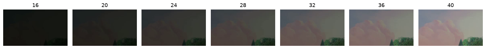{#fig-ch08-fp-fade width=100%}

画面の中のものは動いていませんが、全体が少しずつ明るくなっています。
この場面は濃淡の差が小さく、ほとんどの画素が、ヒストグラムのごく少数のビンに集中しています。
全体の明るさが変わってビンの境界をまたぐと、その画素がまとめて隣のビンに移るので、ヒストグラム距離が大きくなるのです。
同じ区間の画素の差分は10以下で、こちらの指標ではまったく問題になりません。

2つ目のグループは、フレーム4705と4708です。

```python
show_strip(BBB, [4703, 4704, 4705, 4706, 4707, 4708, 4709])
```

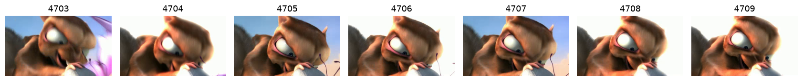{#fig-ch08-fp-flash width=100%}

@fig-ch08-fp-flash では、モモンガの背景が1フレームごとに白くなったり青くなったりしています。
衝撃を表す演出としての**フラッシュ**です。
画面の広い範囲の色が一瞬で変わるので、ヒストグラムも大きく変わります。
実写の映像でも、カメラのフラッシュ、雷、爆発などで同じことが起こります。

フェードもフラッシュも、「ショットは変わらないのに、画面全体の明るさや色が変わる」という点が共通しています。
これが、ヒストグラム距離の弱点です。
適応的なしきい値では、どちらも「大きな値が何フレームも続く」ために、カットとは判定されませんでした。

### 画素の差分の誤検出と見逃し

次に、画素の差分に固定しきい値50を使った場合です。

```python
fp, fn = errors(df.loc[(df["diff"] > 50) & (df["frame"] < STOP), "frame"], truth_cuts)
print(fp, fn)
print(df.loc[[2704, 4704], ["frame", "diff", "chi"]].round(3))
```

```{.default}
[4704] [2704]
      frame    diff    chi
2704   2704  40.747  0.441
4704   4704  54.262  0.262
```

誤検出はフレーム4704で、先ほどのフラッシュが始まるフレームです。
見逃しはフレーム2704のカットで、画素の差分は40.7しかありません。

```python
show_strip(BBB, [2701, 2702, 2703, 2704, 2705, 2706])
```

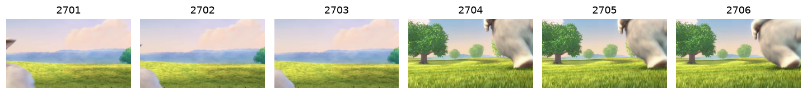{#fig-ch08-fn-pixel width=100%}

@fig-ch08-fn-pixel を見ると、カットの前後どちらのショットも、上半分が淡い色の空、下半分が黄緑の草原という似た構図です。
同じ位置の画素の値が近いので、ショットが切り替わっても、画素の差分はあまり大きくなりません。
このカットの差分（40.7）は、@sec-ch08-diff で見た、カットのない区間の値（フレーム4702の48.3や、フレーム4704の54.3）を下回っています。
つまり、画素の差分では、どこにしきい値を置いても、この2つを正しく分けることはできません。

### 適応的なしきい値でも見逃すカット

適応的なしきい値は、冒頭200秒では誤りがありませんでした。
しかし、この方法にも原理的に見つけられないカットがあります。

条件2は、「周囲 `w` フレームに、同じくらい大きな値がない」ことを要求します。
ということは、**カットのすぐ近くに別の大きな変化があると、本物のカットも捨てられてしまう**はずです。
これを確かめるために、パラメータを変えたときの結果を調べてみます。

```python
for w in [5, 8, 12]:
    for k in [2, 3, 4]:
        nb = neighbor_max(df["chi"], w)
        hit = df.loc[(df["chi"] > T_MIN) & (df["chi"] > k * nb), "frame"]
        tp, fp, fn = evaluate([d for d in hit if d < STOP], truth_cuts)
        print(f"w={w:2d} k={k}  TP={tp} FP={fp} FN={fn}  total={len(hit)}")
```

```{.default}
w= 5 k=2  TP=40 FP=0 FN=0  total=127
w= 5 k=3  TP=40 FP=0 FN=0  total=125
w= 5 k=4  TP=39 FP=0 FN=1  total=122
w= 8 k=2  TP=40 FP=0 FN=0  total=125
w= 8 k=3  TP=39 FP=0 FN=1  total=122
w= 8 k=4  TP=39 FP=0 FN=1  total=121
w=12 k=2  TP=40 FP=0 FN=0  total=122
w=12 k=3  TP=39 FP=0 FN=1  total=119
w=12 k=4  TP=39 FP=0 FN=1  total=117
```

9通りの組み合わせのうち5通りで、見逃しが1つ出ています。
`w` を広げるほど、また `k` を大きくするほど、見逃しやすくなる傾向が見えます。
`w = 8`、`k = 3` の場合について、どのカットを見逃したのかを調べます。

```python
nb = neighbor_max(df["chi"], 8)
hit = df.loc[(df["chi"] > T_MIN) & (df["chi"] > 3 * nb), "frame"]
fp, fn = errors([d for d in hit if d < STOP], truth_cuts)
print(fn)
print(df.loc[4696:4706, "chi"].round(3).to_list())
```

```{.default}
[4697]
[0.001, 0.695, 0.005, 0.014, 0.032, 0.153, 0.207, 0.063, 0.262, 0.317, 0.29]
```

見逃したのはフレーム4697のカットです。
このカットの距離は0.695と十分に大きいのですが、7フレーム後の4704から、先ほどのフラッシュが始まります。
`w = 8` では、フラッシュの値（約0.3）が「周囲の最大値」に入り、その3倍（約0.95）を超えられないので、カットと判定されなくなります。
`w = 5`、`k = 3` ではフラッシュが比較の範囲に入らないので、検出できていたわけです。
見逃しの出たほかの4通りでも、見逃したのは同じフレーム4697でした。

では、`w` は小さいほどよいのでしょうか。
そうとも言えません。
`w` を小さくすると、フェードやフラッシュのような「数フレーム続く変化」の端のフレームが、突き出ていると誤って判定されやすくなります。
また、`w = 5` でも、5フレーム以内に2つのカットが続けば、互いに打ち消し合います。
正解データのない区間ですが、そのような例を1つ見つけてあります。

```python
print(df.loc[10610:10615, ["frame", "chi", "neighbor", "is_cut"]].round(3))
```

```{.default}
       frame    chi  neighbor  is_cut
10610  10610  0.005     0.646   False
10611  10611  0.067     0.646   False
10612  10612  0.631     0.646   False
10613  10613  0.646     0.631   False
10614  10614  0.026     0.646   False
10615  10615  0.008     0.646   False
```

フレーム10612と10613は、どちらも距離が0.6を超えているのに、カットと判定されていません。

```python
show_strip(BBB, [10609, 10610, 10611, 10612, 10613, 10614])
```

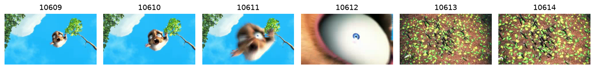{#fig-ch08-fn-oneframe width=100%}

@fig-ch08-fn-oneframe のとおり、フレーム10612は、わずか1フレームだけのショットです。
その前後の2つのカット（10612と10613）は隣り合っているので、互いが互いの「周囲の最大値」になり、どちらも条件2を満たしません。
この方法では、`w` フレーム以下の短いショットは検出できないのです。

### 評価結果の受け取り方

ここまでの観察をまとめると、@tbl-ch08-weakness のようになります。

| 場面 | 画素の差分 | ヒストグラム距離（固定） | ヒストグラム距離（適応的） |
|---|---|---|---|
| 激しい動き、急なカメラ移動 | 誤検出しやすい | 強い | 強い |
| フェード（明るさの変化） | 強い | 誤検出しやすい | 強い |
| フラッシュ | 誤検出しやすい | 誤検出しやすい | 強い |
| 構図や色の似たショット間のカット | 見逃しやすい | 見逃しやすい | 見逃しやすい |
| 別の大きな変化の直後・直前のカット | 影響なし | 影響なし | 見逃す |
| ごく短いショット | 影響なし | 影響なし | 見逃す |

: 各方法の弱点。この章でBig Buck Bunnyについて観察した範囲でのまとめ {#tbl-ch08-weakness}

冒頭200秒での評価は、適合率・再現率ともに1でした。
しかし、この結果をそのまま「この方法は完璧だ」と受け取ってはいけません。
理由は3つあります。

- **パラメータを、評価に使ったのと同じデータを見ながら決めた**。`w = 5` で4697のカットを拾えたのは、フラッシュがたまたま7フレーム後だったからです。別の映像で同じ値がうまく働く保証はありません。
- **正解データは映像の3分の1にすぎない**。残りの区間には、いま見た1フレームのショットのように、冒頭200秒にはなかった種類の場面があります。
- **Big Buck Bunnyは、検出しやすい映像である**。CGアニメーションなので、実写の映像にあるノイズや手持ちカメラの揺れがなく、ショットごとの色づかいもはっきり違います。

自分の研究対象の映像にこの方法を使うときは、その映像の一部について正解データを作り、同じ手順で評価してください。
評価の数値と、誤りの実例の両方を手元に持っていることが、分析結果を説明するときの根拠になります。

## ゆるやかな切り替わりへの対応 {#sec-ch08-gradual}

ここまでの方法は、隣り合う2枚のフレームを比べるものでした。
ディゾルブでは、隣り合う2枚の違いはごくわずかなので、この方法では見つかりません。
フェードでは、値が大きくなることはあっても、1フレームだけが突き出る形にはなりません。
正解データに記録したディゾルブ（フレーム750〜810）の区間で、ヒストグラム距離の最大値を確かめます。

```python
print(df.loc[750:810, "chi"].max().round(4))
```

```{.default}
0.0037
```

最大でも0.004で、`t_min` の0.1にはまったく届きません。

### 離れたフレームどうしを比べる

1フレームあたりの変化は小さくても、ディゾルブの始まりと終わりでは、画面は大きく変わっています。
それなら、隣どうしではなく、**何フレームか離れたフレームどうし**を比べれば、変化を捉えられるかもしれません。

フレーム `n - lag` とフレーム `n` のヒストグラム距離を計算する関数を書きます。
各フレームのヒストグラムは `hists` に残してあるので、映像を読み直す必要はありません。

```python
def lag_distance(hists, lag):
    """lag フレーム離れたフレームどうしのヒストグラム距離を返す。"""
    d = np.zeros(len(hists))
    for n in range(lag, len(hists)):
        d[n] = hist_distance(hists[n - lag], hists[n])
    return d
```

比べるフレームの組は、@fig-ch08-lag のとおりです。

::: {#fig-ch08-lag}

```{=html}
<svg viewBox="0 0 760 235" role="img" aria-label="離れたフレームどうしを比べるしくみ。lagが1のときは1つ前のフレームn−1と、lagが8のときは8つ前のフレームn−8と、lagが24のときは24個前のフレームn−24と、いまのフレームnのヒストグラムを比べる。" style="width:100%;height:auto;font-family:inherit" fill="currentColor">
  <rect x="50" y="150" width="74" height="40" fill="#f0b84a" stroke="currentColor" stroke-opacity="0.55" stroke-width="1"/>
  <text x="87" y="174.68" font-size="13" font-weight="700" text-anchor="middle" fill="#1c1300">n − 24</text>
  <rect x="146" y="150" width="74" height="40" fill="currentColor" fill-opacity="0.04" stroke="currentColor" stroke-opacity="0.55" stroke-width="1"/>
  <text x="183" y="174.68" font-size="13" font-weight="700" text-anchor="middle">…</text>
  <rect x="242" y="150" width="74" height="40" fill="#f0b84a" stroke="currentColor" stroke-opacity="0.55" stroke-width="1"/>
  <text x="279" y="174.68" font-size="13" font-weight="700" text-anchor="middle" fill="#1c1300">n − 8</text>
  <rect x="338" y="150" width="74" height="40" fill="currentColor" fill-opacity="0.04" stroke="currentColor" stroke-opacity="0.55" stroke-width="1"/>
  <text x="375" y="174.68" font-size="13" font-weight="700" text-anchor="middle">…</text>
  <rect x="434" y="150" width="74" height="40" fill="#f0b84a" stroke="currentColor" stroke-opacity="0.55" stroke-width="1"/>
  <text x="471" y="174.68" font-size="13" font-weight="700" text-anchor="middle" fill="#1c1300">n − 1</text>
  <rect x="530" y="150" width="74" height="40" fill="#1f6fb2" stroke="currentColor" stroke-opacity="0.55" stroke-width="1"/>
  <text x="567" y="174.68" font-size="13" font-weight="700" text-anchor="middle" fill="#ffffff">n</text>
  <path d="M471 146 C471 116, 553 116, 553 138" fill="none" stroke="#d6453d" stroke-width="1.8"/>
  <path d="M553 147 l-5 -9 h10z" fill="#d6453d"/>
  <text x="512" y="119.48" font-size="12" text-anchor="middle" font-weight="700">lag = 1</text>
  <path d="M279 146 C279 76, 567 76, 567 138" fill="none" stroke="#d6453d" stroke-width="1.8"/>
  <path d="M567 147 l-5 -9 h10z" fill="#d6453d"/>
  <text x="423" y="88.28" font-size="12" text-anchor="middle" font-weight="700">lag = 8</text>
  <path d="M87 146 C87 36, 581 36, 581 138" fill="none" stroke="#d6453d" stroke-width="1.8"/>
  <path d="M581 147 l-5 -9 h10z" fill="#d6453d"/>
  <text x="334" y="57.08" font-size="12" text-anchor="middle" font-weight="700">lag = 24</text>
  <text x="616" y="175" font-size="12" fill-opacity="0.85">いまのフレーム</text>
  <text x="338" y="216" font-size="12" text-anchor="middle" fill-opacity="0.9">lag フレーム前のフレームと、いまのフレームのヒストグラムを比べる</text>
</svg>
```

`lag` フレーム離れたフレームどうしを比べる
:::

間隔を1、8、24フレームと変えて、ディゾルブの前後（フレーム650〜1000）を描いてみます。

```python
fig, axes = plt.subplots(3, 1, figsize=(10, 5.5), sharex=True)
for ax, lag in zip(axes, [1, 8, 24]):
    d = lag_distance(hists, lag)
    ax.plot(range(650, 1000), d[650:1000], linewidth=1.2)
    ax.axvspan(750, 810, alpha=0.15)
    ax.set_ylim(0, 0.3)
    ax.set_ylabel(f"lag = {lag}")
    ax.grid(alpha=0.3)
axes[2].set_xlabel("frame")
plt.tight_layout()
plt.show()
```

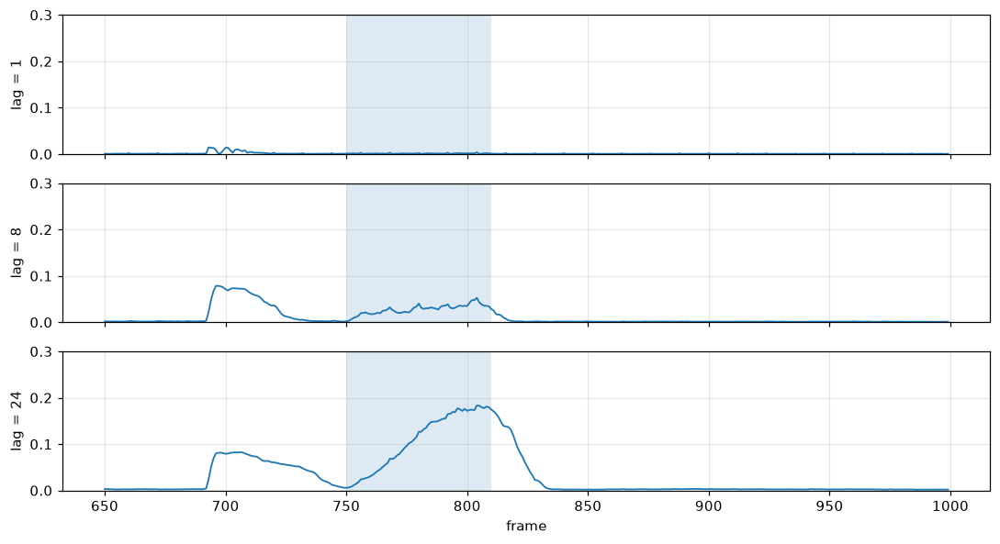{#fig-ch08-lag width=90%}

@fig-ch08-lag のいちばん上（間隔1）では、ディゾルブの区間は平らなままです。
間隔を広げると、ディゾルブの区間に山が現れます。
離れたフレームを比べることで、ゆるやかな変化が見えるようになりました。

しかし、これで検出できるかというと、そう簡単ではありません。
同じグラフの左側、フレーム690〜740付近にも山があります。
ここは題名の文字が消えていく場面で、ショットの切り替わりではありません。
さらに、被写体やカメラが動く場面でも、離れたフレームどうしの違いは大きくなります。
ディゾルブの区間と、画面の手前にいる動物が画面の外へ出ていくだけの区間（フレーム2430〜2470）で、最大値を比べてみます。

```python
for lag in [1, 8, 24]:
    d = lag_distance(hists, lag)
    print(lag, d[750:835].max().round(3), d[2430:2470].max().round(3))
```

```{.default}
1 0.004 0.032
8 0.053 0.221
24 0.183 0.233
```

```python
show_strip(BBB, [2436, 2440, 2444, 2448, 2452, 2456])
```

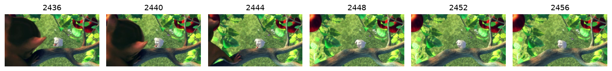{#fig-ch08-pan width=100%}

間隔を24フレームに広げると、ディゾルブでの最大値は0.004から0.183へと、40倍以上になります。
ところが、ショットの切り替わらない @fig-ch08-pan の場面でも0.233になり、ディゾルブを上回ってしまいます。
離れたフレームを比べると、ゆるやかな切り替わりが見えるようになる代わりに、**動きに強いというヒストグラムの利点が失われる**のです。
しきい値をどこに置いても、ディゾルブだけを取り出すことはできません。

ディゾルブを確実に検出するには、「2つの映像が混ざり合っている」というディゾルブ特有の性質を使う、より手の込んだ方法が必要です。
本書では扱いません。
以下では、ディゾルブは検出できないものとして先に進み、それが結果にどう影響するかを第9章で考えます。

### フェードは暗転を手がかりにする

フェードには、ディゾルブにはない、わかりやすい手がかりがあります。
途中で画面が真っ黒になることです。
フレームの平均輝度は、最初の読み通しのときに `brightness` として記録してあります。
これが小さいフレームを探せば、暗転している区間がわかります。

平均輝度が10未満のフレームを「暗い」とみなし、暗いフレームが続く区間を取り出します。
まず、条件を満たす要素が連続する区間を求める関数を書きます。

```python
def find_runs(flags):
    """True が連続する区間を、(最初の位置, 最後の位置) のリストで返す。"""
    runs = []
    start = None
    for i, flag in enumerate(flags):
        if flag and start is None:
            start = i
        if not flag and start is not None:
            runs.append((start, i - 1))
            start = None
    if start is not None:
        runs.append((start, len(flags) - 1))
    return runs
```

変数 `start` に「いま続いている区間の最初の位置」を覚えておき、`True` が途切れたところで区間を1つ記録する、というしくみです。

```python
DARK = 10

dark_runs = find_runs(df["brightness"] < DARK)
print(dark_runs)
```

```{.default}
[(0, 12), (7176, 7209), (11059, 11089), (11757, 11771), (13920, 13941), (14314, 14314)]
```

暗い区間が6つ見つかりました。
それぞれが何であるかを、映像で確かめた結果が @tbl-ch08-dark です。

| 区間 | 内容 |
|---|---|
| 0〜12 | 冒頭のフェードインの始まり |
| 7176〜7209 | 場面の区切りの暗転（@fig-ch08-type-fade） |
| 11059〜11089 | 場面の区切りの暗転 |
| 11757〜11771 | 本編の終わり（@fig-ch08-type-wipe のワイプの後）からエンドクレジットへ |
| 13920〜13941 | エンドクレジットの終わりから、最後の短い場面へ |
| 14314〜14314 | 映像の最後の1フレーム（真っ黒なフレーム） |

: 暗い区間と、その内容 {#tbl-ch08-dark}

映像の最初と最後にかかる区間を除いた4つが、ショットの境目です。
そこで、次の規則で、カットの検出結果と組み合わせることにします。

- 暗い区間の中、およびその直後のフレームで検出されたカットは、取り除く。暗転の一部であって、独立したカットではないからです。
- 映像の最初と最後にかからない暗い区間については、**暗転が明けた最初のフレーム**を、新しいショットの始まりとして記録する。種類は `fade` とする。

```python
n_frames = len(df)
cut_frames = set(adaptive)
fade_frames = []
for a, b in dark_runs:
    cut_frames -= set(range(a, b + 2))
    if a > 0 and b < n_frames - 1:
        fade_frames.append(b + 1)

print(len(cut_frames), fade_frames)
```

```{.default}
123 [7210, 11090, 11772, 13942]
```

125個あったカットのうち、2個が取り除かれました。
5つ目の暗い区間（13920〜13941）を例にすると、このコードがしていることは @fig-ch08-dark-run のとおりです。

::: {#fig-ch08-dark-run}

```{=html}
<svg viewBox="0 0 760 255" role="img" aria-label="暗転からフェードの位置を決めるしくみ。フレーム13917から13943の平均輝度は、66.4、40.7、10.2と下がり、13920から13941までが0.0、13942から193.3になる。平均輝度が10未満の暗い区間は13920から13941まで。その直後の13942を、フェードの位置として記録する。13920から13942までの範囲で検出されたカットは取り除く。" style="width:100%;height:auto;font-family:inherit" fill="currentColor">
  <text x="101" y="87" font-size="11" text-anchor="middle" fill-opacity="0.8">13917</text>
  <rect x="70" y="96" width="62" height="38" fill="currentColor" fill-opacity="0.04" stroke="currentColor" stroke-opacity="0.55" stroke-width="1"/>
  <text x="101" y="119.68" font-size="13" text-anchor="middle">66.4</text>
  <text x="163" y="87" font-size="11" text-anchor="middle" fill-opacity="0.8">13918</text>
  <rect x="132" y="96" width="62" height="38" fill="currentColor" fill-opacity="0.04" stroke="currentColor" stroke-opacity="0.55" stroke-width="1"/>
  <text x="163" y="119.68" font-size="13" text-anchor="middle">40.7</text>
  <text x="225" y="87" font-size="11" text-anchor="middle" fill-opacity="0.8">13919</text>
  <rect x="194" y="96" width="62" height="38" fill="currentColor" fill-opacity="0.04" stroke="currentColor" stroke-opacity="0.55" stroke-width="1"/>
  <text x="225" y="119.68" font-size="13" text-anchor="middle">10.2</text>
  <text x="287" y="87" font-size="11" text-anchor="middle" fill-opacity="0.8">13920</text>
  <rect x="256" y="96" width="62" height="38" fill="#16181c" stroke="currentColor" stroke-opacity="0.55" stroke-width="1"/>
  <text x="287" y="119.68" font-size="13" text-anchor="middle" fill="#f2f2f2">0.0</text>
  <text x="349" y="87" font-size="11" text-anchor="middle" fill-opacity="0.8">13921</text>
  <rect x="318" y="96" width="62" height="38" fill="#16181c" stroke="currentColor" stroke-opacity="0.55" stroke-width="1"/>
  <text x="349" y="119.68" font-size="13" text-anchor="middle" fill="#f2f2f2">0.0</text>
  <text x="411" y="87" font-size="11" text-anchor="middle" fill-opacity="0.8">…</text>
  <rect x="380" y="96" width="62" height="38" fill="#16181c" stroke="currentColor" stroke-opacity="0.55" stroke-width="1"/>
  <text x="411" y="119.68" font-size="13" text-anchor="middle" fill="#f2f2f2">…</text>
  <text x="473" y="87" font-size="11" text-anchor="middle" fill-opacity="0.8">13940</text>
  <rect x="442" y="96" width="62" height="38" fill="#16181c" stroke="currentColor" stroke-opacity="0.55" stroke-width="1"/>
  <text x="473" y="119.68" font-size="13" text-anchor="middle" fill="#f2f2f2">0.0</text>
  <text x="535" y="87" font-size="11" text-anchor="middle" fill-opacity="0.8">13941</text>
  <rect x="504" y="96" width="62" height="38" fill="#16181c" stroke="currentColor" stroke-opacity="0.55" stroke-width="1"/>
  <text x="535" y="119.68" font-size="13" text-anchor="middle" fill="#f2f2f2">0.0</text>
  <text x="597" y="87" font-size="11" text-anchor="middle" fill-opacity="0.8">13942</text>
  <rect x="566" y="96" width="62" height="38" fill="#1f6fb2" stroke="currentColor" stroke-opacity="0.55" stroke-width="1"/>
  <text x="597" y="119.68" font-size="13" font-weight="700" text-anchor="middle" fill="#ffffff">193.3</text>
  <text x="659" y="87" font-size="11" text-anchor="middle" fill-opacity="0.8">13943</text>
  <rect x="628" y="96" width="62" height="38" fill="currentColor" fill-opacity="0.04" stroke="currentColor" stroke-opacity="0.55" stroke-width="1"/>
  <text x="659" y="119.68" font-size="13" text-anchor="middle">193.3</text>
  <text x="62" y="87" font-size="11"></text>
  <text x="14" y="62" font-size="12" fill-opacity="0.8">箱の上：フレーム番号　箱の中：平均輝度</text>
  <path d="M260 142 v6 h302 v-6" fill="none" stroke="currentColor" stroke-width="1.3" stroke-opacity="0.6"/>
  <text x="411" y="166" font-size="12" text-anchor="middle" font-weight="700">暗い区間（平均輝度が10未満）　a ＝ 13920、b ＝ 13941</text>
  <path d="M260 184 v6 h364 v-6" fill="none" stroke="currentColor" stroke-width="1.3" stroke-opacity="0.6"/>
  <text x="442" y="208" font-size="12" text-anchor="middle">この範囲で検出されたカットは取り除く　range(a, b + 2)</text>
  <line x1="597" y1="44" x2="597" y2="72" stroke="#1f6fb2" stroke-width="2"/>
  <path d="M597 74 l-5 -9 h10z" fill="#1f6fb2"/>
  <text x="597" y="36" font-size="12" text-anchor="middle" font-weight="700">b + 1 ＝ 13942：フェードの位置として記録</text>
</svg>
```

暗い区間から、フェードの位置を決める。黒い箱が暗い区間、青い箱がフェードの位置として記録されるフレーム
:::
暗転の直後のフレーム13942と、映像の最後の真っ黒なフレーム14314です。
代わりに、暗転による境目が4つ加わりました。
合わせて127個が、この章で検出できたショットの境目です。

::: {.callout-note title="フェードの境目の位置について"}
フェードでは、前のショットがどこで終わり、次のショットがどこから始まるのかを、1フレームの精度で決めることはできません。
ここでは「暗転が明けた最初のフレーム」という規則を選びましたが、「暗い区間の中央」とする決め方もあります。
どちらを選んでも、ショットの長さが十数フレーム変わるだけですが、**どの規則を使ったかを記録しておく**ことが大切です。
:::

## 既存ライブラリ（PySceneDetect）との比較 {#sec-ch08-pyscenedetect}

カット点検出には、広く使われている既存のライブラリがあります。
ここでは、その1つである**PySceneDetect** [@pyscenedetect] の結果と、ここまでに作った方法の結果を比べます。
自分で作った方法を既存の道具と比べることは、誤りを見つける有効な手段です。

### インストールする

ターミナルで、プロジェクトにPySceneDetectを追加します。
ライブラリの名前は `scenedetect` です。

```{.default}
> uv add scenedetect
```

本書の執筆時点でのバージョンは0.7.3です。

### 検出する

PySceneDetectには、検出の方法がいくつか用意されています。
ここでは、代表的な2つを使います。

- `ContentDetector`：隣り合うフレームの色（色相・彩度・明度）の変化の大きさを計算し、固定しきい値と比べます。
- `AdaptiveDetector`：同じ変化の大きさを、前後のフレームの平均と比べます。本章の「適応的なしきい値」と同じ考え方です。

```python
from scenedetect import AdaptiveDetector, ContentDetector, detect

scenes = detect(BBB, ContentDetector())
print(len(scenes))
print(scenes[1][0].frame_num, scenes[1][1].frame_num)
```

```{.default}
143
285 378
```

`detect` は、検出した区間のリストを返します。
PySceneDetectはこの区間を「シーン」と呼んでいますが、本書の用語ではショットにあたります。
各区間は「始まり」と「終わり」の組で、`frame_num` でフレーム番号を取り出せます。
2番目の区間はフレーム285から始まっていて、本章で最初に検出したカット点285と一致します。

2番目以降の区間の「始まり」を集めれば、カット点のリストになります。

```python
def scene_starts(scenes):
    """PySceneDetectの結果から、カット点のフレーム番号のリストを作る。"""
    return [start.frame_num for start, end in scenes[1:]]


psd_content = scene_starts(scenes)
psd_adaptive = scene_starts(detect(BBB, AdaptiveDetector()))
print(len(psd_content), len(psd_adaptive))
```

```{.default}
142 127
```

### 正解データで評価する

冒頭200秒の正解データで、同じように評価します。

```python
for name, detected in [("ContentDetector", psd_content), ("AdaptiveDetector", psd_adaptive)]:
    tp, fp, fn = evaluate([d for d in detected if d < STOP], truth_cuts)
    p, r, f = scores(tp, fp, fn)
    print(f"{name:16s} TP={tp:2d} FP={fp:2d} FN={fn:2d}  P={p:.3f} R={r:.3f} F={f:.3f}")
```

```{.default}
ContentDetector  TP=40 FP= 0 FN= 0  P=1.000 R=1.000 F=1.000
AdaptiveDetector TP=40 FP= 0 FN= 0  P=1.000 R=1.000 F=1.000
```

どちらも、40個のカットを過不足なく検出しました。
フレーム番号の流儀も本書と同じ（新しいショットの最初のフレーム）で、許容誤差なしで一致しています。
冒頭200秒については、3つの方法の結果は完全に同じです。

### 映像全体で比べる

違いが出るのは、正解データのない残りの区間です。
本章の方法（カット123個と暗転4個）と、PySceneDetectの2つの方法とで、一方だけが検出したフレームを調べます。

```python
ours = sorted(cut_frames | set(fade_frames))

for name, detected in [("ContentDetector", psd_content), ("AdaptiveDetector", psd_adaptive)]:
    print(name)
    print("  only PySceneDetect:", sorted(set(detected) - set(ours)))
    print("  only ours:         ", sorted(set(ours) - set(detected)))
```

```{.default}
ContentDetector
  only PySceneDetect: [6650, 7182, 7206, 7399, 7953, 8908, 10612, 10674, 10868, 10999, 11061, 11086, 11727, 11763, 12924, 13008, 13032, 13104, 13137, 13152, 13173, 13284, 13918, 14314]
  only ours:          [5307, 7210, 7400, 8091, 9584, 9593, 10468, 11090, 11772]
AdaptiveDetector
  only PySceneDetect: [7206, 10999, 11728, 11763, 13920]
  only ours:          [7210, 8091, 9584, 11090, 11772]
```

食い違いのあるフレームを、1つずつ映像で確かめました。
主なものを @tbl-ch08-compare にまとめます。

| フレーム | 映像で確かめた内容 | 本章の方法 | Content | Adaptive |
|---|---|---|---|---|
| 5307 | カット | 検出 | 見逃し | 検出 |
| 9584、9593 | 9フレームずつの短いショットが続く | 検出 | 見逃し | 9584を見逃し |
| 10612 | 1フレームだけのショット | 見逃し | 検出 | 見逃し |
| 10468 | カット | 検出 | 見逃し | 検出 |
| 10999 | カット（似た色のショットどうし） | 見逃し | 検出 | 検出 |
| 6650、7953、8908、10674、10868 | 激しい動き（カットではない） | 検出なし | 誤検出 | 検出なし |
| 12924〜13284 | エンドクレジット（文字が流れる） | 検出なし | 8個を誤検出 | 検出なし |

: 映像全体での検出結果の主な食い違い {#tbl-ch08-compare}

@tbl-ch08-compare から読み取れることを挙げます。

- 本章の方法は、フレーム10999のカットを見逃しています。このカットのヒストグラム距離は0.085で、`t_min` の0.1にわずかに届きません。前後のショットの色づかいがよく似ているためです。
- PySceneDetectが9584や9593を見逃すのは、「ショットは最低15フレーム続く」という初期設定（`min_scene_len`）があるためです。本章の方法の `w` と同じく、短いショットをどこまで拾うかの設定が結果を左右します。
- `ContentDetector` は固定しきい値を使うので、激しい動きの場面や、エンドクレジットのように文字が画面いっぱいに流れ続ける場面で、誤検出が出ています。

表に挙げなかった食い違いは、次の3種類です。
フレーム7399と7400のように、同じカットを1フレームずれて検出しているもの。
暗転やワイプの前後で、どのフレームを境目とするかが違うもの。
そして、フレーム8091のように、激しい動きの途中にあって、カットかどうかを目で見ても判断しにくいものです。

どの方法にも、得意な場面と不得意な場面があります。
既存のライブラリを使う場合でも、**初期設定のまま結果を信じるのではなく、自分の映像で評価する**という手順は変わりません。
本書では、しくみを自分で説明できることを重視して、以降の章でも本章で作った方法を使います。

## 検出の手順を関数にまとめる {#sec-ch08-module}

最後に、この章で作った手順を、ほかの章から使える形にまとめます。
第4章で `videotools.py` を作ったのと同じように、プロジェクトフォルダの直下に `cutdetect.py` というファイルを作り、次の内容を保存してください。

```{.python filename="cutdetect.py"}
"""カット点検出のための関数（第8章で作成）。"""

import cv2
import numpy as np
import pandas as pd

from videotools import iter_frames, video_info


def color_hist(frame, bins=8):
    """B, G, R を bins 段階ずつに分けた色ヒストグラム（合計1）を返す。"""
    hist = cv2.calcHist(
        [frame], [0, 1, 2], None, [bins, bins, bins], [0, 256, 0, 256, 0, 256]
    )
    hist = hist.ravel()
    return hist / hist.sum()


def hist_distance(p, q):
    """合計1に正規化した2つのヒストグラムの違いを、0〜1の値で返す。"""
    return cv2.compareHist(p, q, cv2.HISTCMP_CHISQR_ALT) / 4


def frame_features(path):
    """フレームごとの平均輝度、画素の差分、ヒストグラム距離を表にして返す。"""
    rows = []
    prev_gray = None
    prev_hist = None
    for n, frame in iter_frames(path):
        gray = cv2.cvtColor(frame, cv2.COLOR_BGR2GRAY)
        hist = color_hist(frame)
        if prev_gray is None:
            d_pixel, d_hist = 0.0, 0.0
        else:
            d_pixel = cv2.absdiff(gray, prev_gray).mean()
            d_hist = hist_distance(prev_hist, hist)
        rows.append(
            {"frame": n, "brightness": gray.mean(), "diff": d_pixel, "chi": d_hist}
        )
        prev_gray = gray
        prev_hist = hist
    df = pd.DataFrame(rows)
    df["time"] = df["frame"] / video_info(path)["fps"]
    return df


def neighbor_max(values, w):
    """各要素について、前後 w 個（自分自身は除く）の最大値を返す。"""
    values = np.asarray(values)
    result = np.zeros(len(values))
    for i in range(len(values)):
        before = values[max(i - w, 0) : i]
        after = values[i + 1 : i + 1 + w]
        result[i] = np.concatenate([before, after]).max()
    return result


def find_runs(flags):
    """True が連続する区間を、(最初の位置, 最後の位置) のリストで返す。"""
    runs = []
    start = None
    for i, flag in enumerate(flags):
        if flag and start is None:
            start = i
        if not flag and start is not None:
            runs.append((start, i - 1))
            start = None
    if start is not None:
        runs.append((start, len(flags) - 1))
    return runs


def detect_cuts(features, t_min=0.1, k=3, w=5, dark=10):
    """frame_features の表から、ショットの境目を検出して表で返す。

    カット（kind が "cut"）は、ヒストグラム距離が t_min を超え、かつ
    前後 w フレームの最大値の k 倍を超えるフレーム。
    暗転（kind が "fade"）は、平均輝度が dark 未満の区間が明けた最初のフレーム。
    どちらも、新しいショットの最初のフレームの番号を frame に入れる。
    """
    chi = features["chi"].to_numpy()
    is_cut = (chi > t_min) & (chi > k * neighbor_max(chi, w))
    kinds = {int(n): "cut" for n in np.flatnonzero(is_cut)}

    n_frames = len(features)
    for a, b in find_runs(features["brightness"].to_numpy() < dark):
        for n in range(a, b + 2):
            kinds.pop(n, None)
        if a > 0 and b < n_frames - 1:
            kinds[b + 1] = "fade"

    frames = sorted(kinds)
    return pd.DataFrame(
        {
            "frame": frames,
            "time": features["time"].to_numpy()[frames].round(3),
            "kind": [kinds[n] for n in frames],
        }
    )
```

保存すると、プロジェクトフォルダは次のようになります。
`cutdetect.py` は、`videotools.py` と同じ階層に置きます。

```{.default}
C:\work\video-analysis
├── .venv
├── __pycache__
├── data
│   ├── bbb_truth.csv
│   ├── BigBuckBunny_320x180.mp4
│   ├── frame400.png
│   └── sintel_trailer-480p.mp4
├── out
├── ch02.ipynb
├── …                         … ch03.ipynb 〜 ch07.ipynb
├── ch08.ipynb
├── cutdetect.py                  … いま作ったファイル
├── pyproject.toml
├── uv.lock
└── videotools.py
```

`frame_features` は映像を1回読み通して、フレームごとの数値の表を作ります。
`detect_cuts` は、その表を受け取って、ショットの境目の表を返します。
2つに分けてあるのは、時間のかかる読み通しを1回ですませ、しきい値を変えた検出を何度でもすぐに試せるようにするためです。

`detect_cuts` の中では、検出したフレーム番号と種類を辞書 `kinds` に入れています。
`kinds.pop(n, None)` は、「キー `n` があれば取り除き、なければ何もしない」という命令です。

ノートブックから読み込んで、映像全体に適用します。

```python
from cutdetect import detect_cuts, frame_features

features = frame_features(BBB)
cuts = detect_cuts(features)
print(len(cuts))
print(cuts["kind"].value_counts().to_dict())
cuts.head()
```

```{.default}
127
{'cut': 123, 'fade': 4}
   frame    time kind
0    285  11.875  cut
1    378  15.750  cut
2    553  23.042  cut
3   1145  47.708  cut
4   1346  56.083  cut
```

@sec-ch08-gradual で求めたものと同じ、127個の境目（カット123個、暗転4個）が得られました。
念のため、フレーム番号が完全に一致することも確かめておきます。

```python
ours = sorted(cut_frames | set(fade_frames))
print(cuts["frame"].to_list() == ours)
```

```{.default}
True
```

結果をファイルに保存します。

```python
cuts.to_csv("out/bbb_cuts.csv", index=False)
```

::: {.callout-tip title="`cutdetect.py` を書き換えたら、カーネルを再起動する"}
ノートブックは、一度 `import` したファイルの内容を覚えています。
`cutdetect.py` を後から書き換えても、そのままでは反映されません。
書き換えたときは、ノートブック上部の［再起動］でカーネルを再起動し、最初のセルから実行し直してください。
:::

章の冒頭に掲げた @fig-ch08-goal は、この結果を使って次のように描いたものです。

```python
head = features[features["frame"] < STOP]
head_cuts = cuts[cuts["frame"] < STOP]

plt.figure(figsize=(11, 3.2))
plt.plot(head["frame"], head["chi"], linewidth=1, label="histogram distance")
plt.plot(
    head_cuts["frame"],
    head["chi"].to_numpy()[head_cuts["frame"]] + 0.04,
    "v",
    color="tab:red",
    markersize=5,
    label="detected cut",
)
plt.xlabel("frame")
plt.ylabel("histogram distance")
plt.ylim(0, 1.1)
plt.grid(alpha=0.3)
plt.legend(loc="upper center", ncol=2)
plt.show()
```

### この検出結果について覚えておくこと

`out/bbb_cuts.csv` は、第9章でショット長の統計をとるための土台になります。
この結果がどのようなものかを、ここで整理しておきます。

- 冒頭200秒の正解データに対しては、カット40個をすべて検出し、誤検出はありませんでした。
- 映像全体については正解データがありません。検出した127個のフレームは、筆者が前後のフレームを見て確認しましたが、見逃しをすべて調べたわけではありません。
- 少なくとも、次の5つの見逃しがあることがわかっています。フレーム750〜810のディゾルブ、フレーム11183〜11193の短いディゾルブ、フレーム10612と10613のカット（1フレームだけのショットの前後）、フレーム10999のカット。2つ目のディゾルブは、第9章でショットの一覧を作る過程で見つかったものです。
- フレーム8091は、激しい動きの途中で、カットかどうかを目で見ても判断しにくい箇所です。

つまり、本当のショットの数は、検出された数より少なくとも5つは多いことになります。
この「数個の誤り」がショット長の統計にどの程度影響するかは、第9章で確かめます。

## まとめ {#sec-ch08-summary}

- ショットの切り替わりには、瞬時に切り替わるカットのほかに、ディゾルブ、フェード、ワイプといったゆるやかな切り替わりがあります。
- 画素の差分は、ショットの切り替わりと、ショットの中の動きを区別できません。
- ヒストグラムは位置の情報を捨てるので、動きに強くなります。その代わり、フェードやフラッシュのような画面全体の明るさ・色の変化には敏感で、色づかいの似たショットどうしのカットは見分けにくくなります。
- 2つのヒストグラムの違いは、カイ2乗統計量で測れます。`cv2.HISTCMP_CHISQR` は第1引数で割る非対称な式、`cv2.HISTCMP_CHISQR_ALT` は対称な式です。ここでは統計的検定としてではなく、違いの大きさを表す指標として使いました。
- 固定しきい値では、誤検出と見逃しのどちらかが残ります。前後のフレームと比べて突き出ているかどうかで判断する適応的なしきい値は、フェードやフラッシュによる誤検出を減らします。
- 検出結果は、自分の目で作った正解データと突き合わせ、適合率（検出のうち正しかった割合）と再現率（正解のうち見つけられた割合）で評価します。
- 評価の数値だけでなく、誤検出と見逃しの実例を映像で確かめることで、方法の弱点と、結果をどこまで信用できるかがわかります。
- 映像全体の検出結果を `out/bbb_cuts.csv` に、検出のための関数を `cutdetect.py` に保存しました。

## 演習 {#sec-ch08-exercises}

1. `detect_cuts` の引数 `t_min` を0.05、0.1、0.2、0.3と変えて、冒頭200秒での適合率・再現率・F値を計算してください。また、映像全体で検出される個数がどう変わるかを調べ、`t_min = 0.05` で新たに検出されるフレームのうちいくつかを `show_strip` で表示して、カットかどうかを確かめてください。
2. `color_hist` のビンの数を、4段階（4×4×4＝64ビン）と16段階（16×16×16＝4,096ビン）に変えて、同じ評価をしてください。冒頭のフェードインの区間（フレーム0〜50）で、ヒストグラム距離の大きさがどう変わるかも調べてください。
3. 第6章で学んだHSV色空間を使い、色相と彩度の2次元ヒストグラムで `color_hist` を作り直してください。暗いフレーム（たとえばフレーム5〜16）でヒストグラム距離がどのような値になるかを調べ、その理由を考えてください。
4. Sintelの予告編（`data/sintel_trailer-480p.mp4`）に `frame_features` と `detect_cuts` を適用してください。コンタクトシートを使って映像全体の正解データを自分で作り、適合率と再現率を計算してください。Big Buck Bunnyのときと比べて、どのような誤りが増えるでしょうか。
5. 自分の研究対象の映像から2〜3分の区間を選び、正解データを作って、本章の方法を評価してください。誤検出と見逃しをすべて映像で確かめ、@tbl-ch08-weakness のどれにあたるか、あるいは表にない新しい種類の誤りかを記録してください。
