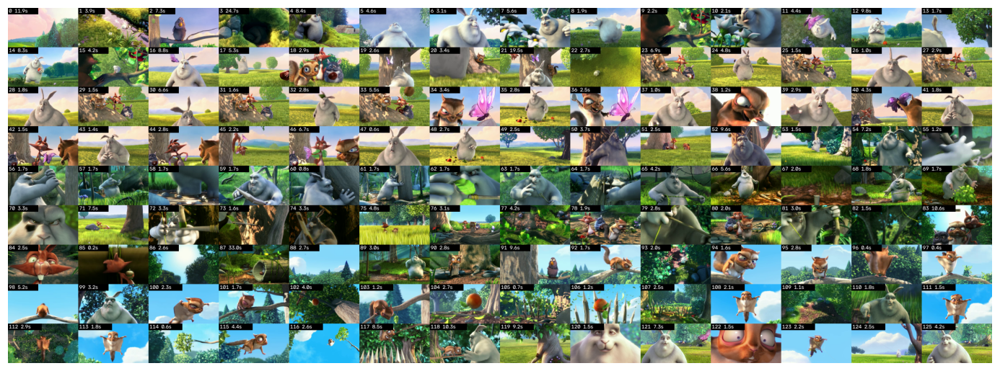
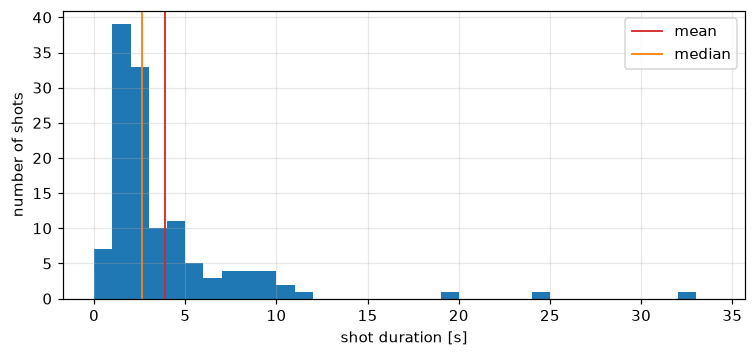
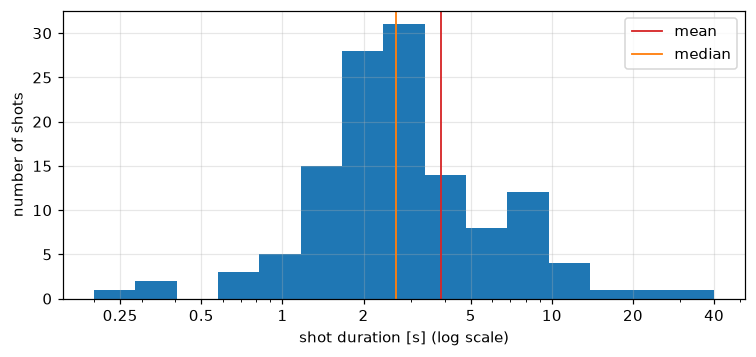
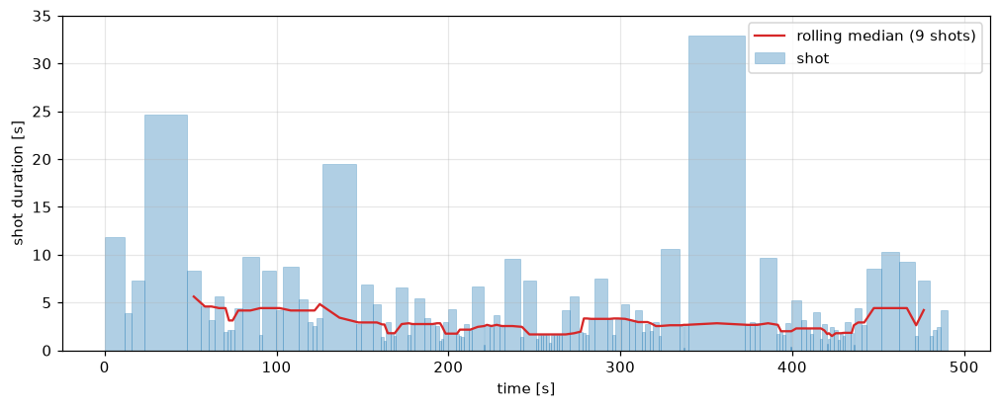
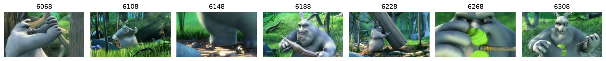
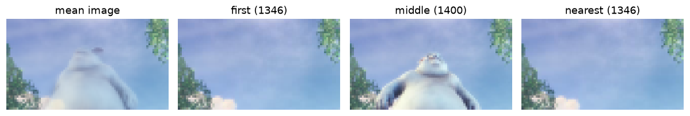
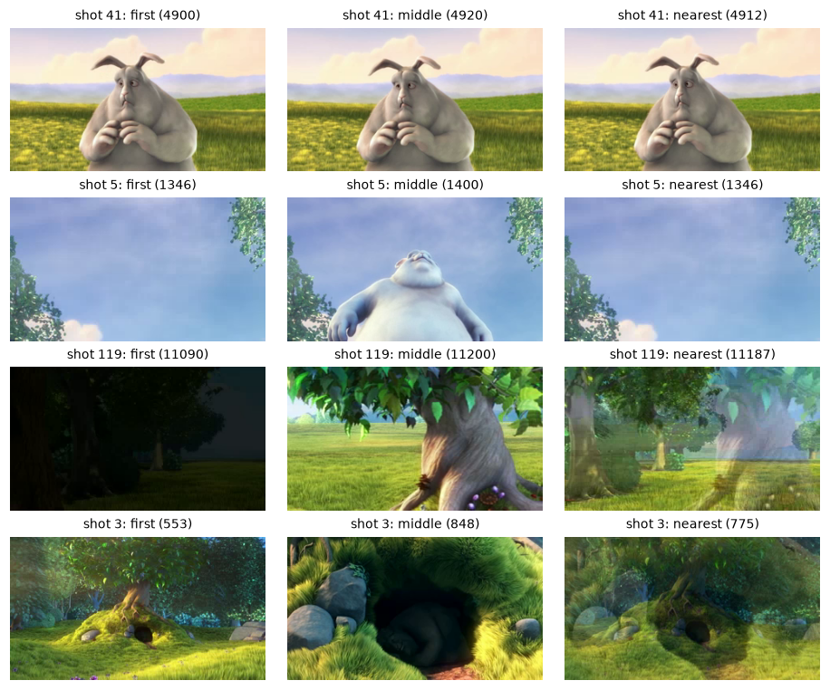
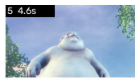
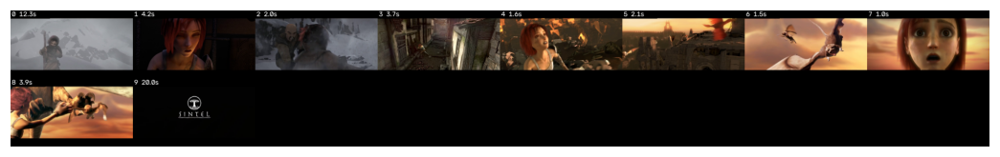

# ショットの統計とキーフレーム {#sec-shots}

第8章では、Big Buck Bunnyのショットの境目を検出し、`out/bbb_cuts.csv` に保存しました。
この章では、その結果を使って、作品の**編集**を数値と図で要約します。

境目のリストは、そのままでは数字の並びにすぎません。
これを「何番目のショットが、どこから始まり、何秒続くか」という表に直すと、ショットの長さの平均や分布、作品の中でのテンポの変化を調べられるようになります。
さらに、各ショットを代表する1枚のフレームを選んで並べれば、作品全体を1枚の画像で見渡すことができます。

::: {.callout-note title="この章のゴール"}
カット点のリストからショットの表を作り、平均ショット長（ASL）などの統計量と、ショット長の分布を求めます。
そのうえで、各ショットの代表フレームを並べたショット一覧（@fig-ch09-goal）を作ります。
あわせて、これらの数値が第8章の検出結果にどれだけ左右されるかを確かめます。
:::

{#fig-ch09-goal width=100%}

## カット点のリストからショットの表を作る {#sec-ch09-table}

### 準備

新しいノートブック `ch09.ipynb` を作り、カーネルに `.venv` を選びます。
最初のセルで、この章で使うライブラリを読み込みます。

```python
import cv2
import matplotlib.pyplot as plt
import numpy as np
import pandas as pd

from videotools import iter_frames, show, video_info
```

映像の基本情報と、第8章で保存した検出結果を読み込みます。

```python
BBB = "data/BigBuckBunny_320x180.mp4"
info = video_info(BBB)
fps = info["fps"]
n_frames = info["frame_count"]

cuts = pd.read_csv("out/bbb_cuts.csv")
print(len(cuts))
cuts.head()
```

```{.default}
127
   frame    time kind
0    285  11.875  cut
1    378  15.750  cut
2    553  23.042  cut
3   1145  47.708  cut
4   1346  56.083  cut
```

`cuts` の各行が、ショットの境目を1つ表しています。
`frame` は**新しいショットの最初のフレームの番号**、`kind` は境目の種類（カットなら `cut`、暗転なら `fade`）でした。

::: {.callout-warning title="`out/bbb_cuts.csv` がない場合"}
このファイルは、第8章の最後で作ったものです。
第8章を飛ばして読んでいる場合は、第8章の「検出の手順を関数にまとめる」の節にある `cutdetect.py` を作り、その節のコードを実行して、先にファイルを作ってください。
:::

### 境目からショットへ

境目のリストをショットの表に直す考え方を、小さな例で確かめます。
全部で8フレームの映像があり、フレーム3とフレーム5にカットがあるとします（@fig-ch09-fence）。

::: {#fig-ch09-fence}

```{=html}
<svg viewBox="0 0 760 170" role="img" aria-label="0から7までの8フレームが横に並んでいる。フレーム3と5にカットがあり、フレーム0から2、3から4、5から7の3つのショットに分かれる。" style="width:100%;height:auto;font-family:inherit" fill="currentColor">
  <g font-size="16" text-anchor="middle">
    <rect x="60" y="50" width="76" height="48" fill="#1f6fb2" fill-opacity="0.18" stroke="currentColor" stroke-opacity="0.6"/>
    <rect x="136" y="50" width="76" height="48" fill="#1f6fb2" fill-opacity="0.18" stroke="currentColor" stroke-opacity="0.6"/>
    <rect x="212" y="50" width="76" height="48" fill="#1f6fb2" fill-opacity="0.18" stroke="currentColor" stroke-opacity="0.6"/>
    <rect x="296" y="50" width="76" height="48" fill="#d1495b" fill-opacity="0.18" stroke="currentColor" stroke-opacity="0.6"/>
    <rect x="372" y="50" width="76" height="48" fill="#d1495b" fill-opacity="0.18" stroke="currentColor" stroke-opacity="0.6"/>
    <rect x="456" y="50" width="76" height="48" fill="#2a9d8f" fill-opacity="0.18" stroke="currentColor" stroke-opacity="0.6"/>
    <rect x="532" y="50" width="76" height="48" fill="#2a9d8f" fill-opacity="0.18" stroke="currentColor" stroke-opacity="0.6"/>
    <rect x="608" y="50" width="76" height="48" fill="#2a9d8f" fill-opacity="0.18" stroke="currentColor" stroke-opacity="0.6"/>
    <text x="98" y="80">0</text>
    <text x="174" y="80">1</text>
    <text x="250" y="80">2</text>
    <text x="334" y="80">3</text>
    <text x="410" y="80">4</text>
    <text x="494" y="80">5</text>
    <text x="570" y="80">6</text>
    <text x="646" y="80">7</text>
  </g>
  <g font-size="14" text-anchor="middle">
    <text x="292" y="24">カット点 3</text>
    <text x="452" y="24">カット点 5</text>
    <text x="174" y="130">ショット0</text>
    <text x="174" y="152" fill-opacity="0.7">開始0、終了2、長さ3</text>
    <text x="372" y="130">ショット1</text>
    <text x="372" y="152" fill-opacity="0.7">開始3、終了4、長さ2</text>
    <text x="570" y="130">ショット2</text>
    <text x="570" y="152" fill-opacity="0.7">開始5、終了7、長さ3</text>
  </g>
  <g stroke="currentColor" stroke-width="2">
    <line x1="292" y1="32" x2="292" y2="106"/>
    <line x1="452" y1="32" x2="452" y2="106"/>
  </g>
</svg>
```

8フレームの映像に2つのカットがある場合。カットが2つなら、ショットは3つです。
:::

この図から、次の規則が読み取れます。

- **ショットの数は、境目の数より1つ多い**。2つの境目は、映像を3つに分けます。
- 最初のショットはフレーム0から始まります。2番目以降のショットは、それぞれの境目のフレームから始まります。
- 各ショットの終了フレームは、「次のショットの開始フレームの1つ前」です。最後のショットだけは、映像の最後のフレームで終わります。
- ショットの長さは「終了 − 開始 ＋ 1」です。フレーム3から4までのショットは、4 − 3 ＝ 1フレームではなく、2フレームあります。

最後の「＋1」は、数え間違いの多いところです。
開始と終了の両方のフレームがショットに含まれるので、引き算の結果に1を足します。

この規則を関数にします。

```python
def make_shots(cut_frames, n_frames, fps):
    """境目のフレーム番号のリストから、ショットの表を作る。"""
    starts = [0] + list(cut_frames)
    ends = [s - 1 for s in starts[1:]] + [n_frames - 1]
    shots = pd.DataFrame({"start": starts, "end": ends})
    shots["length"] = shots["end"] - shots["start"] + 1
    shots["duration"] = shots["length"] / fps
    return shots
```

`starts` は、先頭に0を加えた開始フレームのリストです。
`ends` は、2番目以降の開始フレームからそれぞれ1を引いたものに、最後のフレームの番号 `n_frames - 1` を加えたリストです。
`length` はフレーム数で数えた長さ、`duration` はそれをフレームレートで割って秒に直した長さです。

@fig-ch09-fence の例で確かめます。
フレームレートは、仮に24fpsとしておきます。

```python
make_shots([3, 5], n_frames=8, fps=24)
```

```{.default}
   start  end  length  duration
0      0    2       3  0.125000
1      3    4       2  0.083333
2      5    7       3  0.125000
```

図のとおりの表になりました。
表の左端の番号（0、1、2）を、ショットの番号として使うことにします。

### Big Buck Bunny のショットの表

実際の検出結果に適用します。

```python
shots = make_shots(cuts["frame"], n_frames, fps)
print(len(shots))
shots.head(8)
```

```{.default}
128
   start   end  length   duration
0      0   284     285  11.875000
1    285   377      93   3.875000
2    378   552     175   7.291667
3    553  1144     592  24.666667
4   1145  1345     201   8.375000
5   1346  1455     110   4.583333
6   1456  1530      75   3.125000
7   1531  1665     135   5.625000
```

127個の境目から、128個のショットができました。
表が正しく作れていることを、2つの方法で確かめておきます。

```python
print(shots["length"].sum(), n_frames)
print((shots["length"] > 0).all())
```

```{.default}
14315 14315
True
```

すべてのショットの長さを足すと、総フレーム数の14,315に一致します。
ショットどうしに重なりも隙間もないということです。
また、長さが0以下のショットはありません。

### 長いショットと短いショットを見る

統計をとる前に、表の中身を眺めておきます。
長いほうから5つを取り出します。

```python
shots.sort_values("length", ascending=False).head(5)
```

```{.default}
     start    end  length   duration
126  11772  13941    2170  90.416667
87    8154   8944     791  32.958333
3      553   1144     592  24.666667
21    3045   3512     468  19.500000
127  13942  14314     373  15.541667
```

いちばん長いショット126は90秒もあり、2番目の3倍近い長さです。
これは何でしょうか。
開始フレームの11772は、第8章で調べた「本編の終わりの暗転が明けたフレーム」でした。
つまり、このショットは**エンドクレジット**です。
スタッフの名前が流れ続ける90秒間が、1つのショットとして数えられています。
5番目に長いショット127は、エンドクレジットの後に置かれた短い場面です。

次に、短いほうから5つです。

```python
shots.sort_values("length").head(5)
```

```{.default}
     start    end  length  duration
85    8085   8090       6     0.250
96    9575   9583       9     0.375
97    9584   9592       9     0.375
47    5292   5306      15     0.625
114  10453  10467      15     0.625
```

もっとも短いショットは6フレーム（0.25秒）、次が9フレーム（0.375秒）です。
第8章で見たように、検出のしくみ上、5フレーム以下のショットは見つけられません。
この表に5フレーム以下のショットがないのは、映像にそういうショットがないからではなく、検出できないからです。

### どこまでを分析の対象にするか

エンドクレジットは、物語を語るための編集とは性質が違います。
これを本編のショットと一緒に平均すると、結果が1つのショットに引きずられてしまいます。
そこで、エンドクレジットより前の部分を**本編**と呼ぶことにして、本編のショットだけを取り出した表を作ります。

```python
CREDITS_START = 11772

main = shots[shots["start"] < CREDITS_START]
print(len(main), main["length"].sum(), main["duration"].sum().round(1))
```

```{.default}
126 11772 490.5
```

本編は126ショット、11,772フレーム（490.5秒）です。
以下では、映像全体（128ショット）と本編（126ショット）の両方で数値を出し、違いを確かめながら進めます。

::: {.callout-important title="何を数えたのかを必ず記録する"}
ショットの統計は、「どの範囲を対象にしたか」で大きく変わります。
オープニングの題名、エンドクレジット、制作会社のロゴなどを含めるかどうかは、研究の目的によって決めることで、正解があるわけではありません。
大切なのは、自分がどう決めたかを記録し、結果と一緒に報告することです。
他の研究の数値と比べるときも、相手がどの範囲を数えているかを確かめる必要があります。
:::

## 平均ショット長（ASL）と中央値 {#sec-ch09-asl}

### 平均ショット長

ショットの長さの平均を、**平均ショット長**と呼びます。
英語のAverage Shot Lengthの頭文字をとって、**ASL**と書かれることがよくあります。
ASLが短い作品は、ショットが次々に切り替わる、編集のテンポの速い作品です。
ASLが長い作品は、1つのショットをじっくり見せる作品です。

ショットの長さを数えて、作品や監督、時代による編集の違いを比べる研究は、映画研究の中で長く行われてきました。
映画研究者のバリー・ソルト（Barry Salt）は、多数の映画についてASLを計測し、映像の様式を統計的に分析する方法を広めました [@salt1974; @salt2009]。
ウェブサイトCinemetricsでは、多くの人が計測したショット長のデータが公開されています [@cinemetrics; @tsivian2009]。

ASLは、`duration` の列の平均です。

```python
print(shots["duration"].mean().round(2))
print(main["duration"].mean().round(2))
```

```{.default}
4.66
3.89
```

映像全体では4.66秒、本編だけでは3.89秒です。
エンドクレジットなど2つのショットを外しただけで、ASLが0.77秒（約16%）短くなりました。

ASLは、ショットの表を作らなくても計算できます。
平均は「合計 ÷ 個数」なので、ASLは「全体の長さ ÷ ショットの数」です。

```python
print(round(info["duration"] / len(shots), 2))
```

```{.default}
4.66
```

この式は、ASLの性質をよく表しています。
ASLは、**全体の長さと、ショットの数だけで決まる**のです。
1つひとつのショットがどんな長さであっても、合計と個数が同じなら、ASLは同じになります。

### 中央値

平均のほかに、もう1つの代表値である**中央値**も求めます。
中央値は、値を小さい順に並べたときに、ちょうど真ん中にくる値です。

```python
print(shots["duration"].median().round(2))
print(main["duration"].median().round(2))
```

```{.default}
2.67
2.65
```

映像全体では2.67秒、本編では2.65秒で、ほとんど変わりません。
平均は範囲の取り方で16%も変わったのに、中央値は1%も変わっていません。

### 平均と中央値はなぜ離れるのか

本編について、平均は3.89秒、中央値は2.65秒です。
平均のほうが1.2秒以上長くなっています。
この開きは、ショットの長さの分布が偏っていることを表しています。

確かめるために、平均より短いショットがいくつあるかを数えます。

```python
print((main["duration"] < main["duration"].mean()).sum(), len(main))
```

```{.default}
89 126
```

126ショットのうち89ショット、つまり約70%が、平均より短いショットです。
「平均」という言葉から受ける「ふつうのショットはこのくらいの長さ」という印象とは、ずいぶん違います。

こうなるのは、少数の非常に長いショットが、平均を引き上げているからです。
長いほうから5つのショットが、本編の長さのどれだけを占めるかを計算してみます。

```python
top5 = main["duration"].sort_values(ascending=False).head(5)
print(top5.round(1).to_list())
print((top5.sum() / main["duration"].sum()).round(3))
```

```{.default}
[33.0, 24.7, 19.5, 11.9, 10.6]
0.203
```

126ショットのうちの5つ（4%）が、本編の時間の20%を占めています。
平均は「合計 ÷ 個数」なので、このような長いショットがあると、その分だけ大きくなります。
中央値は「順番に並べた真ん中」なので、いちばん長いショットが33秒であっても100秒であっても、値は変わりません。

第7章で、動き量の代表値について同じことを確かめました。
少数の極端な値がある分布では、平均と中央値は離れ、中央値のほうが「典型的な値」に近くなります。
ショット長は、まさにそのような分布をしています。

では、ASLは使わないほうがよいのでしょうか。
そうではありません。
ASLには「全体の長さ ÷ ショットの数」という明快な意味があり、過去の研究の蓄積も多いので、他の作品と比べるときの共通の物差しになります。
実際の分析では、**ASLと中央値の両方を報告し、分布もあわせて示す**のがよいでしょう。

### 検出の誤りは、ASLをどれだけ変えるか

ここまでの数値は、第8章の検出結果から計算したものです。
検出に誤りがあれば、ショットの表が変わり、統計量も変わります。
どの程度変わるのかを、実際に確かめておきます。

第8章の最後に、少なくとも5つの見逃しがあることを確認しました。
フレーム750〜810と11183〜11193の2つのディゾルブ、フレーム10612と10613のカット、フレーム10999のカットです。
これらを境目に加えて、ショットの表を作り直してみます。
ディゾルブの境目は、仮に区間の中央のフレーム（780と11188）とします。

```python
missed = [780, 10612, 10613, 10999, 11188]
fixed_frames = sorted(cuts["frame"].to_list() + missed)

shots_fixed = make_shots(fixed_frames, n_frames, fps)
main_fixed = shots_fixed[shots_fixed["start"] < CREDITS_START]

print(len(main), len(main_fixed))
print(main["duration"].mean().round(2), main_fixed["duration"].mean().round(2))
print(main["duration"].median().round(2), main_fixed["duration"].median().round(2))
```

```{.default}
126 131
3.89 3.74
2.65 2.67
```

本編のショットは126個から131個に増え、ASLは3.89秒から3.74秒へ、約4%短くなりました。
中央値は2.65秒から2.67秒で、変化は1%未満です。

ASLは「全体の長さ ÷ ショットの数」でしたから、ショットの数が4%違えば、ASLもほぼ4%違います。
この関係を使うと、検出の評価結果から、ASLの誤差をおおまかに見積もれます。

- **見逃し**があると、検出されるショットの数が減り、ASLは実際より**長く**なります。再現率が0.9（1割を見逃す）なら、ASLはおよそ1割長く出ます。
- **誤検出**があると、検出されるショットの数が増え、ASLは実際より**短く**なります。適合率が0.9（1割が誤検出）なら、ASLはおよそ1割短く出ます。

第8章でPySceneDetectの `ContentDetector` を使ったとき、検出された区間は143個でした。
この結果からASLを計算すると、次のようになります。

```python
print(round(info["duration"] / 143, 2))
```

```{.default}
4.17
```

同じ映像なのに、検出の方法が違うだけで、ASLは4.66秒から4.17秒へと、約10%変わります。
第8章で見たように、`ContentDetector` はエンドクレジットや激しい動きの場面で誤検出をしていました。
その分だけショットが多く数えられ、ASLが短くなっているのです。

::: {.callout-important title="ASLは、検出結果とセットで報告する"}
ASLは、映像そのものの性質であると同時に、**カット点をどう検出したかの結果**でもあります。
自動検出の結果からASLを求めたときは、次のことをあわせて記録してください。

- どの方法とパラメータで検出したか。
- 正解データでの適合率と再現率はどれだけだったか。
- ゆるやかな切り替わり（ディゾルブなど）をどう扱ったか。

2つの作品のASLの差が数%しかないとき、それが作品の違いなのか、検出の誤りなのかは、この情報がなければ判断できません。
:::

以下では、見逃しを加える前の、もとの検出結果（`shots` と `main`）を使って進めます。
自動検出の結果だけを使った場合にどのような図が得られるかを見るためです。

## ショット長の分布を描く {#sec-ch09-distribution}

### ヒストグラム

平均と中央値の開きから、分布が偏っていることはわかりました。
実際の形を、ヒストグラムで見てみます。
対象は本編の126ショットです。

```python
plt.figure(figsize=(8, 3.4))
plt.hist(main["duration"], bins=np.arange(0, 35, 1))
plt.axvline(main["duration"].mean(), color="tab:red", linewidth=1.2, label="mean")
plt.axvline(main["duration"].median(), color="tab:orange", linewidth=1.2, label="median")
plt.xlabel("shot duration [s]")
plt.ylabel("number of shots")
plt.grid(alpha=0.3)
plt.legend()
plt.show()
```

{#fig-ch09-hist-linear width=75%}

@fig-ch09-hist-linear では、ほとんどのショットが左側の5秒以下に集まり、右側に向かって、まばらな棒が長く伸びています。
このような形を、**右に裾の長い分布**と呼びます。
中央値（オレンジの線）は山の中にありますが、平均（赤い線）は、右の裾に引っぱられて、山の右の斜面まで動いています。

区間ごとの個数を数値でも確かめます。

```python
bins = [0, 1, 2, 3, 5, 10, 40]
print(pd.cut(main["duration"], bins).value_counts().sort_index())
```

```{.default}
duration
(0, 1]       8
(1, 2]      40
(2, 3]      31
(3, 5]      21
(5, 10]     20
(10, 40]     6
Name: count, dtype: int64
```

1秒から3秒のショットが71個あり、全体の半分を超えています。
10秒を超えるショットは6個だけです。

### 対数軸で描く

@fig-ch09-hist-linear には、2つの見にくさがあります。
ショットの大半が左端の数本の棒に押し込まれていて、短いショットどうしの違い（0.5秒と2秒の違いなど）がわかりません。
一方で、右側は、ほとんど空白です。

このような分布は、横軸を**対数目盛**にすると見やすくなります。
対数目盛では、「1秒と2秒」「2秒と4秒」「4秒と8秒」のように、**同じ倍率の違いが同じ幅**で表されます。
0.5秒のショットと1秒のショットの違いは、10秒と20秒の違いと同じく「2倍」ですから、同じ幅で描くのは理にかなっています。

対数目盛でヒストグラムを描くときは、ビンの境界も同じ倍率で並べます。
`np.logspace` は、指定した範囲を対数目盛の上で等間隔に区切った値を作る関数です。

```python
log_bins = np.logspace(np.log10(0.2), np.log10(40), 16)
print(log_bins.round(2))
```

```{.default}
[ 0.2   0.28  0.41  0.58  0.82  1.17  1.67  2.37  3.37  4.8   6.84  9.74
 13.86 19.74 28.1  40.  ]
```

0.2秒から40秒までを15個のビンに分けています。
隣り合う境界の比は、どこでも約1.42倍です。

```python
plt.figure(figsize=(8, 3.4))
plt.hist(main["duration"], bins=log_bins)
plt.axvline(main["duration"].mean(), color="tab:red", linewidth=1.2, label="mean")
plt.axvline(main["duration"].median(), color="tab:orange", linewidth=1.2, label="median")
plt.xscale("log")
plt.xticks([0.25, 0.5, 1, 2, 5, 10, 20, 40], ["0.25", "0.5", "1", "2", "5", "10", "20", "40"])
plt.xlabel("shot duration [s] (log scale)")
plt.ylabel("number of shots")
plt.grid(alpha=0.3)
plt.legend()
plt.show()
```

{#fig-ch09-hist-log width=75%}

@fig-ch09-hist-log では、分布は1.7秒から3.4秒あたりを頂上とする、1つの山になりました。
@fig-ch09-hist-linear で左端に押し込まれていた部分が広がり、0.25秒から33秒までの全体が1つの図に収まっています。

### 対数正規分布に近いのか

対数をとると左右対称の山形（正規分布）になる分布を、**対数正規分布**と呼びます。
映画のショット長の分布は、対数正規分布で近似できると言われることがあります [@delong2015]。
一方で、当てはまらない作品も多いという指摘もあり [@redfern2015]、どの作品にも成り立つ法則というわけではありません。

Big Buck Bunnyについて、簡単に確かめてみます。
分布の偏りを表す数値に、**歪度**（わいど）があります。
歪度は、左右対称な分布では0になり、右に裾が長いと正の値、左に裾が長いと負の値になります。
SciPyの `skew` で計算できます。

```python
from scipy.stats import skew

print(skew(main["duration"]).round(2))
print(skew(np.log(main["duration"])).round(2))
```

```{.default}
3.89
0.19
```

もとのショット長の歪度は3.89で、右に強く偏っています。
対数をとると0.19になり、ほぼ左右対称になります。
この点では、対数正規分布に近いと言えます。

しかし、@fig-ch09-hist-log をよく見ると、なめらかな左右対称の山というわけではありません。
7秒から10秒のあたりに、小さなこぶがあります。
さらに、ヒストグラムのビンにまとめてしまうと見えなくなる特徴もあります。
ショットの長さ（フレーム数）ごとに個数を数え、多いものを取り出してみます。

```python
print(main["length"].value_counts().head(3))
```

```{.default}
length
40    10
70     4
37     4
Name: count, dtype: int64
```

40フレーム（1.67秒）ちょうどのショットが10個もあります。
長さがばらばらに決まっているなら、同じ長さのショットがこれほど重なることは考えにくいので、意図的にそろえられた長さだと考えられます。
これがどこにあるのかは、次の節で明らかになります。

このように、1本の作品の分布には、その作品の編集の事情が反映されます。
しかも、126個というショットの数は、分布の形を細かく論じるには少なすぎます。
ここでは、「ショット長の分布は右に裾が長く、対数をとるとおおよそ左右対称になる」という、大まかな性質を確認するにとどめます。

## テンポの時間変化——作品のどこで編集が速くなるか {#sec-ch09-tempo}

ASLや中央値は、作品全体を1つの数値にまとめたものです。
しかし、編集のテンポは作品の中で一定ではありません。
静かな場面ではショットが長くなり、緊迫した場面では短くなる、というのはよくあることです。
この節では、テンポが時間とともにどう変わるかを調べます。

### 区間ごとに集計する

もっとも単純な方法は、作品を一定の長さの区間に分けて、区間ごとに集計することです。
各ショットの開始時刻（秒）を求め、それが何分目にあたるかを計算します。

```python
main = main.copy()
main["start_time"] = main["start"] / fps
main["minute"] = (main["start_time"] // 60).astype(int)
main[["start", "length", "duration", "start_time", "minute"]].head()
```

```{.default}
   start  length   duration  start_time  minute
0      0     285  11.875000    0.000000       0
1    285      93   3.875000   11.875000       0
2    378     175   7.291667   15.750000       0
3    553     592  24.666667   23.041667       0
4   1145     201   8.375000   47.708333       0
```

`//` は、割り算の商の整数部分を求める演算子です。
開始時刻を60で割った商が、そのショットの属する「分」になります（0分目は0〜60秒、1分目は60〜120秒、という数え方です）。
最初の行の `main = main.copy()` は、`shots` から取り出した表に新しい列を安全に追加するためのものです。

`groupby` を使って、分ごとに、ショットの数、ASL、中央値を求めます。

```python
by_minute = main.groupby("minute")["duration"].agg(["count", "mean", "median"])
by_minute.round(2)
```

```{.default}
        count   mean  median
minute                      
0           6  10.11    7.83
1          13   4.63    4.17
2          14   4.26    2.73
3          20   3.08    2.60
4          22   2.65    1.67
5          13   5.56    2.79
6          17   2.78    2.67
7          17   3.54    2.08
8           4   2.58    2.31
```

`groupby("minute")` は、`minute` の値が同じ行をまとめる命令です。
続く `agg` で、まとめたグループごとに、個数（`count`）、平均（`mean`）、中央値（`median`）を計算しています。

表から、次のことが読み取れます。

- 最初の1分（0分目）は、ショットが6個しかなく、ASLは10秒を超えています。物語の導入部で、ゆったりとした編集になっています。
- ショットの数は、3分目と4分目に20個、22個と多くなり、ASLは3秒前後まで短くなります。4分目の中央値は1.67秒で、全体の中央値（2.65秒）を大きく下回っています。
- 5分目はASLが5.56秒と長くなっていますが、中央値は2.79秒です。この1分間に、非常に長いショットが含まれていることがうかがえます。
- 8分目は本編が途中で終わるため、ショットは4個しかありません。この行の数値は、参考程度に見るべきです。

区間ごとの集計は簡単ですが、区間の区切り方（1分ごとか30秒ごとか、どこから数え始めるか）によって結果が変わるという弱点があります。

### ショットの移動中央値

区切り方に左右されにくい方法として、第5章で使った**移動平均**の考え方があります。
ここでは、極端に長いショットに引きずられないように、平均の代わりに中央値を使います。
各ショットについて、前後4ショットずつを合わせた9ショットの長さの中央値を求めます。

```python
main["rolling_median"] = main["duration"].rolling(9, center=True).median()
print(main["rolling_median"].round(2).to_list()[:12])
```

```{.default}
[nan, nan, nan, nan, 5.62, 4.58, 4.58, 4.42, 4.42, 3.12, 3.12, 4.17]
```

最初の4ショットは、前に4ショットがそろわないので、値が `nan`（計算できない）になります。
最後の4ショットも同じです。

各ショットの長さと、この移動中央値を、1つの図に描きます。
横軸は時刻、縦軸はショットの長さです。
ショットを1つずつ棒で表し、**棒の幅もショットの長さ**にします。

```python
plt.figure(figsize=(11, 4))
plt.bar(
    main["start_time"],
    main["duration"],
    width=main["duration"],
    align="edge",
    alpha=0.35,
    edgecolor="tab:blue",
    linewidth=0.5,
    label="shot",
)
plt.plot(
    main["start_time"] + main["duration"] / 2,
    main["rolling_median"],
    color="tab:red",
    linewidth=1.5,
    label="rolling median (9 shots)",
)
plt.xlabel("time [s]")
plt.ylabel("shot duration [s]")
plt.ylim(0, 35)
plt.grid(alpha=0.3)
plt.legend()
plt.show()
```

{#fig-ch09-tempo width=95%}

`plt.bar` に `align="edge"` を指定すると、棒の左端が横軸の値（ショットの開始時刻）にそろいます。
幅をショットの長さにしているので、棒は隙間なく並び、横軸がそのまま作品の時間の流れになります。
赤い線は、各ショットの中央の時刻の位置に描いています。

@fig-ch09-tempo からは、表よりも細かい変化が読み取れます。

- 冒頭には、12秒と25秒の長いショットがあります。25秒のショットは、第8章で見たディゾルブを含んでいて、本当は2つのショットです。
- 赤い線は、冒頭の約5秒から、240秒付近までゆるやかに下がっていきます。物語が進むにつれて、編集が少しずつ速くなっています。
- 250秒から270秒にかけて、同じ高さの小さな棒がいくつも並び、赤い線が低い位置で平らになっています。
- 340秒付近に、33秒の飛び抜けて長いショットがあります。5分目のASLを押し上げていたのは、このショットです。
- 380秒から440秒にかけて、赤い線はふたたび2秒前後まで下がります。その後の終盤では、4秒台まで戻っています。

### もっとも編集の速い場面

移動中央値が1.7秒以下になるショットを探します。

```python
fast = main[main["rolling_median"] <= 1.7]
print(fast.index.to_list())
print(fast["rolling_median"].round(2).to_list())
```

```{.default}
[54, 55, 56, 57, 58, 59, 60, 61, 62, 63, 64, 65, 107]
[1.67, 1.67, 1.67, 1.67, 1.67, 1.67, 1.67, 1.67, 1.67, 1.67, 1.67, 1.67, 1.5]
```

ショット54から65までの12ショットで、移動中央値が1.67秒になっています。
@fig-ch09-tempo の3つ目に挙げた、同じ高さの棒が並ぶ区間です。
もう1か所、終盤のショット107（422秒付近）でも1.5秒まで下がっていますが、こちらは1ショットだけです。

編集の速い状態がもっとも長く続くのは、ショット54から65の区間だとわかりました。
この前後を表で確かめます。

```python
main.loc[55:66, ["start", "length", "duration", "start_time"]].round(2)
```

```{.default}
    start  length  duration  start_time
55   6018      30      1.25      250.75
56   6048      40      1.67      252.00
57   6088      40      1.67      253.67
58   6128      40      1.67      255.33
59   6168      40      1.67      257.00
60   6208      20      0.83      258.67
61   6228      40      1.67      259.50
62   6268      40      1.67      261.17
63   6308      40      1.67      262.83
64   6348      40      1.67      264.50
65   6388     100      4.17      266.17
66   6488     135      5.62      270.33
```

ショット56からショット64まで、ほとんどが40フレーム（1.67秒）ちょうどの長さです。
前の節で見つけた「40フレームのショットが10個」の大部分は、ここにありました。

この区間のショットから、フレームを1枚ずつ取り出して並べてみます。
フレーム6068から、40フレームおきに7枚です。

```python
numbers = list(range(6068, 6348, 40))
frames = {n: f for n, f in iter_frames(BBB, start=numbers[0], stop=numbers[-1] + 1) if n in numbers}

fig, axes = plt.subplots(1, len(numbers), figsize=(2.2 * len(numbers), 1.6))
for ax, n in zip(axes, numbers):
    show(frames[n], title=str(n), ax=ax)
    ax.axis("off")
plt.tight_layout()
plt.show()
```

{#fig-ch09-montage width=100%}

ウサギが森の中で道具を作っている場面です。
枝を折る、丸太を運ぶ、木を削る、といった作業の断片が、1.67秒ごとに規則正しく切り替わっていきます。
一定のリズムで短いショットを重ねて、準備が進んでいく様子を手短に見せる編集です。

「この場面はテンポが速い」ということは、映像を観れば感じ取れます。
数値にしたことで新しくわかったのは、そのテンポが**正確に40フレームごと**という、意図的にそろえられたものだということです。
感覚で気づいたことを数値で確かめ、数値で見つけたことを映像に戻って確かめる。
この往復が、定量分析の基本的な進め方です。

## 各ショットの代表フレーム（キーフレーム）を選ぶ {#sec-ch09-keyframe}

ここからは、数値ではなく画像でショットを要約します。
1つのショットを代表する1枚のフレームを、**キーフレーム**と呼びます。
第4章で出てきた、動画の圧縮でいうキーフレーム（単独で画像に戻せるフレーム）とは、別の意味です。
各ショットのキーフレームを並べれば、作品全体を一目で見渡せる一覧ができます。

問題は、ショットの中のどの1枚を選ぶかです。
ここでは3つの方法を比べます。

1. **最初のフレーム**を選ぶ。
2. **中央のフレーム**を選ぶ。
3. ショットの**平均的な画像にもっとも近いフレーム**を選ぶ。

1と2は、ショットの表だけから計算できます。

```python
shots["first"] = shots["start"]
shots["middle"] = (shots["start"] + shots["end"]) // 2
shots[["start", "end", "first", "middle"]].head(3)
```

```{.default}
   start  end  first  middle
0      0  284      0     142
1    285  377    285     331
2    378  552    378     465
```

### 平均的な画像にもっとも近いフレーム

3つ目の方法は、少し手間がかかります。
まず、1つのショットで手順を確かめます。
例として、ショット5（フレーム1346〜1455）を使います。

ショットのすべてのフレームを読み込み、1つの配列にまとめます。
このとき、フレームを縦横4分の1（80×45）に縮小しておきます。
代表を選ぶのに細部は必要なく、縮小すれば計算が速くなり、メモリの消費も抑えられるからです。

```python
a, b = shots.loc[5, ["start", "end"]]

small = []
for n, frame in iter_frames(BBB, start=a, stop=b + 1):
    small.append(cv2.resize(frame, (80, 45), interpolation=cv2.INTER_AREA))

stack = np.array(small, dtype=np.float32)
print(stack.shape)
```

```{.default}
(110, 45, 80, 3)
```

`stack` は、110枚のフレームを重ねた4次元の配列です。
形は（フレーム数、高さ、幅、チャンネル数）の順になっています。
後の計算で小数を扱うので、データ型を `float32` にしています。

この配列を、フレームの方向（`axis=0`）に平均すると、ショット全体の**平均画像**が得られます。
同じ位置の画素について、110枚の値を平均したものです。

```python
mean_image = stack.mean(axis=0)
print(mean_image.shape)
```

```{.default}
(45, 80, 3)
```

次に、各フレームが平均画像とどれだけ違うかを計算します。
画素ごとの差を2乗して、1枚のフレームの中で平均し、平方根をとります。
これは、差の大きさを1つの数値にまとめる標準的な方法（二乗平均平方根）です。

```python
dist = np.sqrt(((stack - mean_image) ** 2).mean(axis=(1, 2, 3)))
print(dist.shape, dist.round(1)[:5])
```

```{.default}
(110,) [10.1 10.1 10.1 10.1 10.1]
```

`stack - mean_image` は、110枚のそれぞれから平均画像を引く計算です。
`mean(axis=(1, 2, 3))` は、高さ・幅・チャンネルの3つの方向について平均をとるので、フレームごとに1つの値が残ります。

この値がもっとも小さいフレームが、平均画像にもっとも近いフレームです。
`argmin()` は、最小値のある位置（何番目か）を返します。

```python
nearest = a + dist.argmin()
print(nearest)
```

```{.default}
1346
```

`dist.argmin()` はショットの中での位置なので、開始フレーム `a` を足して、映像全体でのフレーム番号に直しています。

平均画像と、3つの方法で選んだフレームを並べてみます。

```python
picks = {"first": a, "middle": (a + b) // 2, "nearest": nearest}

fig, axes = plt.subplots(1, 4, figsize=(11, 1.9))
show(mean_image.astype(np.uint8), title="mean image", ax=axes[0])
for ax, (name, n) in zip(axes[1:], picks.items()):
    show(small[n - a], title=f"{name} ({n})", ax=ax)
for ax in axes:
    ax.axis("off")
plt.tight_layout()
plt.show()
```

{#fig-ch09-mean-image width=100%}

@fig-ch09-mean-image の結果は、少し意外なものです。
このショットは、何もない空にウサギがゆっくりと体を起こしてくる、というものです。
平均画像（左端）では、動かない空ははっきり写り、動いているウサギは薄くぼやけています。
そのため、「平均画像にもっとも近いフレーム」として選ばれたのは、ウサギがまだ現れていない最初のフレームでした。
中央のフレームのほうが、このショットで何が起きているかをよく伝えています。

### 全ショットについて計算する

1つのショットで確かめた手順を、すべてのショットに適用します。
映像を先頭から1回だけ読み通し、ショットの終わりのフレームに来るたびに、そのショットの計算をします。

```python
def nearest_to_mean(path, shots, size=(80, 45)):
    """各ショットについて、平均画像にもっとも近いフレームの番号を返す。"""
    ends = shots["end"].to_list()
    starts = shots["start"].to_list()
    result = []
    small = []
    for n, frame in iter_frames(path):
        small.append(cv2.resize(frame, size, interpolation=cv2.INTER_AREA))
        if n == ends[len(result)]:
            stack = np.array(small, dtype=np.float32)
            dist = np.sqrt(((stack - stack.mean(axis=0)) ** 2).mean(axis=(1, 2, 3)))
            result.append(starts[len(result)] + int(dist.argmin()))
            small = []
    return result
```

`result` には、計算の終わったショットのフレーム番号がたまっていきます。
したがって、`len(result)` は「いま読んでいるショットの番号」になります。
フレーム番号 `n` がそのショットの終了フレームに一致したら、たまっているフレームで計算をして、`small` を空に戻します。

```python
shots["nearest"] = nearest_to_mean(BBB, shots)
shots[["start", "end", "first", "middle", "nearest"]].head(8)
```

```{.default}
   start   end  first  middle  nearest
0      0   284      0     142      198
1    285   377    285     331      330
2    378   552    378     465      386
3    553  1144    553     848      775
4   1145  1345   1145    1245     1281
5   1346  1455   1346    1400     1346
6   1456  1530   1456    1493     1467
7   1531  1665   1531    1598     1612
```

### 3つの方法を比べる

3つの方法の結果を比べます。
まず、中央のフレームと、平均画像にもっとも近いフレームが、どのくらい一致するかを数えます。

```python
gap = (shots["middle"] - shots["nearest"]).abs()
print((gap == 0).sum(), (gap <= 2).sum(), len(shots))
```

```{.default}
9 31 128
```

128ショットのうち、2つの方法でまったく同じフレームが選ばれたのは9ショット、2フレーム以内の違いに収まったのは31ショットだけです。
ほとんどのショットで、2つの方法は別のフレームを選んでいます。

では、選ばれたフレームは見た目にもそれほど違うのでしょうか。
特徴的な4つのショットについて、3つの方法の結果を並べます。

```python
examples = [41, 5, 119, 3]
methods = ["first", "middle", "nearest"]

wanted = sorted(set(shots.loc[examples, methods].to_numpy().ravel().tolist()))
frames = {n: f for n, f in iter_frames(BBB, start=wanted[0], stop=wanted[-1] + 1) if n in wanted}

fig, axes = plt.subplots(len(examples), 3, figsize=(8.5, 1.75 * len(examples)))
for row, s in enumerate(examples):
    for col, m in enumerate(methods):
        n = shots.loc[s, m]
        show(frames[n], title=f"shot {s}: {m} ({n})", ax=axes[row, col])
        axes[row, col].title.set_fontsize(9)
        axes[row, col].axis("off")
plt.tight_layout()
plt.show()
```

{#fig-ch09-keyframes width=90%}

@fig-ch09-keyframes の4つの段は、それぞれ違う事情を表しています。

- **ショット41**（1段目）：ウサギがほとんど動かないショットです。どの方法で選んでも、ほぼ同じ画像になります。動きの少ないショットでは、方法の違いは問題になりません。多くのショットはこれにあたります。
- **ショット5**（2段目）：先ほどの例です。平均画像に近いフレームは、被写体が現れる前の「背景だけ」のフレームになりました。
- **ショット119**（3段目）：フェードインで始まるショットです。最初のフレームは、暗転が明けた直後で、ほとんど真っ黒です。また、右端の画像では、2つの風景が重なって見えます。調べてみると、このショットの途中（フレーム11183〜11193）に、検出できていない短いディゾルブがありました。第8章の最後に挙げた見逃しの1つは、この図から見つかったものです。
- **ショット3**（4段目）：第8章で見たディゾルブ（フレーム750〜810）を含むショットです。本当は2つのショットなので、どの1枚を選んでも、片方の内容しか表せません。平均画像に近いフレームとして選ばれたのは、ディゾルブの途中の、2つの映像が重なったフレームでした。

それぞれの方法の性質を整理すると、@tbl-ch09-keyframe のようになります。

| 方法 | 利点 | 弱点 |
|---|---|---|
| 最初のフレーム | 計算が不要 | フェードインの暗い画面や、前のショットから続く動きのぶれを拾いやすい |
| 中央のフレーム | 計算が不要。ショットの始まりと終わりの影響を受けない | その瞬間にたまたま起きていたこと（まばたき、横切る物など）を拾うことがある |
| 平均画像にもっとも近いフレーム | 一瞬だけの出来事を避け、ショット全体に共通する画面を選ぶ | 全フレームを読む必要がある。被写体が動くショットでは、被写体の写っていない背景を選びやすい |

: キーフレームの選び方の比較 {#tbl-ch09-keyframe}

「代表」という言葉には、決まった定義がありません。
3つ目の方法は、「ショットの中でもっとも平均的な画面」を代表とみなす方法です。
しかし、ショット5のように、ショットの意味を担っているのが「動いている被写体」である場合、平均的な画面は、かえってその被写体を落としてしまいます。
手間をかけた方法が、いつもよい結果を出すわけではないのです。

本書では、以降、**中央のフレーム**をキーフレームとして使います。
計算が不要で、フェードやカットの直後の乱れを避けられ、今回見た範囲では大きな失敗がなかったからです。
ただし、これはBig Buck Bunnyについての判断です。
自分の映像でショット一覧を作るときは、いくつかのショットで結果を見比べてから、方法を決めてください。

## ショット一覧（コンタクトシート）を作る {#sec-ch09-sheet}

最後に、キーフレームを並べて、作品全体のショット一覧を作ります。
第8章では、一定の間隔で取り出したフレームを並べたコンタクトシートを、正解データを作るために使いました。
ここで作るのは、**1ショットにつき1枚**を並べたコンタクトシートです。

第8章のコンタクトシートはMatplotlibで描きましたが、ここでは、キーフレームを縮小してNumPyの配列としてつなぎ合わせ、1枚の画像にします。
こうすると、画像ファイルとして保存して、論文や発表資料にそのまま使えます。

### キーフレームをまとめて読む

必要なフレームを、1回の読み通しで集めます。

```python
def get_frames(path, numbers):
    """指定した番号のフレームを読み、{番号: 画像} の辞書で返す。"""
    wanted = set(numbers)
    frames = {}
    for n, frame in iter_frames(path, start=min(wanted), stop=max(wanted) + 1):
        if n in wanted:
            frames[n] = frame
    return frames
```

第8章で作ったものと同じ関数です。

```python
key_frames = get_frames(BBB, shots["middle"])
print(len(key_frames))
```

```{.default}
128
```

### 1コマを作る

一覧の1コマ分の画像を作る関数を書きます。
フレームを縮小し、左上にショットの番号と長さを書き込みます。

```python
def make_tile(frame, text, scale=0.5):
    """フレームを縮小し、左上に文字を書き込んだ画像を返す。"""
    tile = cv2.resize(frame, None, fx=scale, fy=scale, interpolation=cv2.INTER_AREA)
    cv2.rectangle(tile, (0, 0), (8 * len(text) + 4, 14), (0, 0, 0), -1)
    cv2.putText(
        tile, text, (2, 11), cv2.FONT_HERSHEY_SIMPLEX, 0.4, (255, 255, 255), 1, cv2.LINE_AA
    )
    return tile
```

`cv2.resize` の第2引数を `None` にして、`fx` と `fy` に倍率を指定すると、その倍率で縮小されます。
`cv2.rectangle` は長方形を描く関数で、ここでは文字の背景になる黒い帯を描いています。
引数は、画像、左上の座標、右下の座標、色、線の太さの順です。
線の太さに `-1` を指定すると、中を塗りつぶします。
`cv2.putText` は文字を書き込む関数で、引数は、画像、文字列、文字の左下の座標、フォント、大きさの倍率、色、線の太さ、線の描き方の順です。

::: {.callout-warning title="`cv2.putText` で書けるのは半角の英数字と記号だけ"}
`cv2.putText` は日本語の文字を描けません。
日本語を渡すと、`?` が並んだ表示になります。
画像に書き込む文字は、数字とアルファベットにしておきます。
:::

ショット5で試します。

```python
tile = make_tile(key_frames[shots.loc[5, "middle"]], "5  4.6s")
print(tile.shape)

plt.figure(figsize=(3, 1.8))
show(tile)
plt.axis("off")
plt.show()
```

```{.default}
(90, 160, 3)
```

{#fig-ch09-tile width=35%}

### 並べて1枚の画像にする

コマを横に並べて行を作り、行を縦に積み重ねます。
`np.hstack` は配列を横につなぎ、`np.vstack` は縦につなぐ関数です。
最後の行でコマが足りない分は、黒い画像で埋めます。

```python
def contact_sheet(tiles, ncols):
    """コマのリストを ncols 列に並べた1枚の画像を返す。"""
    tiles = list(tiles)
    while len(tiles) % ncols != 0:
        tiles.append(np.zeros_like(tiles[0]))
    rows = [np.hstack(tiles[i : i + ncols]) for i in range(0, len(tiles), ncols)]
    return np.vstack(rows)
```

`np.zeros_like(tiles[0])` は、最初のコマと同じ形で、値がすべて0（真っ黒）の配列を作ります。

本編の126ショットについて、コマを作り、14列に並べます。

```python
main = shots[shots["start"] < CREDITS_START]

tiles = []
for s, row in main.iterrows():
    text = f"{s}  {row['duration']:.1f}s"
    tiles.append(make_tile(key_frames[int(row["middle"])], text))

sheet = contact_sheet(tiles, ncols=14)
print(sheet.shape)

plt.figure(figsize=(16, 6))
show(sheet)
plt.axis("off")
plt.show()
```

```{.default}
(810, 2240, 3)
```

`main.iterrows()` は、表の行を1つずつ、（行の番号、行の内容）の組で取り出します。
`f"{row['duration']:.1f}"` は、長さを小数第1位までの文字列にする書き方です。

できあがったのが、章の冒頭の @fig-ch09-goal です。
画像ファイルとしても保存しておきます。

```python
cv2.imwrite("out/bbb_contact_sheet.png", sheet)
```

```{.default}
True
```

ノートブックの上では細部が見にくいので、保存した `out/bbb_contact_sheet.png` をエクスプローラーから開いて、拡大して見てください。

### ショット一覧を読む

ショット一覧は、分析の結果であると同時に、分析の道具でもあります。
@fig-ch09-goal を左上から順に見ていくと、次のようなことがわかります。

- **物語の流れ**：草原と森の風景、巣穴から出てくるウサギ、蝶、3匹の小動物、という順に、場面が移っていくのが追えます。
- **切り返し**：ショット23から33のあたりでは、ウサギのショットと、3匹の小動物のショットが、交互に並んでいます。向かい合う2者を交互に映す編集が、一覧の上では縞模様として見えます。
- **色の変化**：前半は空と草原の明るい色が多く、ショット54あたりから、森の中の暗い緑のコマが続きます。第6章で作ったカラーバーコードと同じ情報を、ショット単位で見ていることになります。
- **検出の誤り**：隣り合うコマがほとんど同じ絵柄なら、誤検出の疑いがあります。逆に、コマの絵柄から内容を想像できないショットは、途中で別のショットに切り替わっている（見逃しがある）かもしれません。

4点目は重要です。
ショット一覧は、**検出結果を目で点検する手段**になります。
正解データを作っていない区間についても、一覧を眺めることで、明らかな誤りを見つけることができます。
前の節で、キーフレームを見比べているうちにショット119のディゾルブが見つかったのも、同じことです。

一方で、この一覧からは読み取れないこともあります。
どのコマも同じ大きさなので、ショットの長さは、書き込んだ数字を読まなければわかりません。
33秒のショット87も、0.25秒のショット85も、同じ1コマです。
時間の流れを見るには @fig-ch09-tempo、内容を見るには @fig-ch09-goal、というように、目的に合わせて図を使い分けます。

### 結果を保存する

あとで使えるように、ショットの表を保存します。

```python
shots["start_time"] = shots["start"] / fps
shots.round(3).to_csv("out/bbb_shots.csv", index_label="shot")
pd.read_csv("out/bbb_shots.csv").head(3)
```

```{.default}
   shot  start  end  length  duration  first  middle  nearest  start_time
0     0      0  284     285    11.875      0     142      198       0.000
1     1    285  377      93     3.875    285     331      330      11.875
2     2    378  552     175     7.292    378     465      386      15.750
```

`index_label="shot"` は、表の左端の番号（ショットの番号）に `shot` という列名を付けて保存する指定です。

この章で作った関数のうち、ほかの映像でも使うものを、`shottools.py` というファイルにまとめておきます。
プロジェクトフォルダの直下に作り、次の内容を保存してください。

```{.python filename="shottools.py"}
"""ショットの表とショット一覧を作る関数（第9章で作成）。"""

import cv2
import numpy as np
import pandas as pd

from videotools import iter_frames


def make_shots(cut_frames, n_frames, fps):
    """境目のフレーム番号のリストから、ショットの表を作る。"""
    starts = [0] + list(cut_frames)
    ends = [s - 1 for s in starts[1:]] + [n_frames - 1]
    shots = pd.DataFrame({"start": starts, "end": ends})
    shots["length"] = shots["end"] - shots["start"] + 1
    shots["duration"] = shots["length"] / fps
    shots["start_time"] = shots["start"] / fps
    shots["middle"] = (shots["start"] + shots["end"]) // 2
    return shots


def get_frames(path, numbers):
    """指定した番号のフレームを読み、{番号: 画像} の辞書で返す。"""
    wanted = set(numbers)
    frames = {}
    for n, frame in iter_frames(path, start=min(wanted), stop=max(wanted) + 1):
        if n in wanted:
            frames[n] = frame
    return frames


def make_tile(frame, text, scale=0.5):
    """フレームを縮小し、左上に文字を書き込んだ画像を返す。"""
    tile = cv2.resize(frame, None, fx=scale, fy=scale, interpolation=cv2.INTER_AREA)
    cv2.rectangle(tile, (0, 0), (8 * len(text) + 4, 14), (0, 0, 0), -1)
    cv2.putText(
        tile, text, (2, 11), cv2.FONT_HERSHEY_SIMPLEX, 0.4, (255, 255, 255), 1, cv2.LINE_AA
    )
    return tile


def contact_sheet(tiles, ncols):
    """コマのリストを ncols 列に並べた1枚の画像を返す。"""
    tiles = list(tiles)
    while len(tiles) % ncols != 0:
        tiles.append(np.zeros_like(tiles[0]))
    rows = [np.hstack(tiles[i : i + ncols]) for i in range(0, len(tiles), ncols)]
    return np.vstack(rows)


def shot_sheet(path, shots, ncols=14, scale=0.5):
    """各ショットの中央のフレームを並べたショット一覧の画像を返す。"""
    frames = get_frames(path, shots["middle"])
    tiles = []
    for s, row in shots.iterrows():
        text = f"{s}  {row['duration']:.1f}s"
        tiles.append(make_tile(frames[int(row["middle"])], text, scale))
    return contact_sheet(tiles, ncols)
```

`make_shots` には、開始時刻（`start_time`）と中央のフレーム（`middle`）の列を、最初から作るようにしてあります。
`shot_sheet` は、この節でした作業を1つの関数にまとめたものです。

Sintelの予告編で、動作を確かめておきます。
第8章の `cutdetect.py` と組み合わせると、映像のファイルからショット一覧までを、数行で作れます。

```python
from cutdetect import detect_cuts, frame_features
from shottools import make_shots, shot_sheet

SINTEL = "data/sintel_trailer-480p.mp4"
sintel_info = video_info(SINTEL)

sintel_cuts = detect_cuts(frame_features(SINTEL))
sintel_shots = make_shots(sintel_cuts["frame"], sintel_info["frame_count"], sintel_info["fps"])
print(len(sintel_shots), sintel_shots["duration"].mean().round(2), sintel_shots["duration"].median().round(2))

sintel_sheet = shot_sheet(SINTEL, sintel_shots, ncols=8, scale=0.25)

plt.figure(figsize=(12, 5))
show(sintel_sheet)
plt.axis("off")
plt.show()
```

```{.default}
10 5.22 2.9
```

{#fig-ch09-sintel-sheet width=100%}

52秒の予告編から検出されたショットは、10個だけでした。
@fig-ch09-sintel-sheet を見ると、最後のショット9は20秒もあり、題名やクレジットの画面がまとめて1つになっています。
また、ショット8（フレーム681〜773）の3.9秒間を12フレームおきに並べて見ると、構図のまったく違う画面がいくつも現れます。
この予告編は、短いショット、暗転、文字の画面を次々につないで作られていて、Big Buck Bunnyの本編とは編集の作りが大きく違います。
Big Buck Bunnyでうまく働いたパラメータを、そのまま別の映像に使っても、同じ精度が出るとはかぎりません。
ここで得られた「ASLは5.22秒」という数値を、そのままSintel予告編の性質として報告することはできないのです。
第8章の演習4は、この結果を自分で評価してみる課題です。

## まとめ {#sec-ch09-summary}

- 境目のリストからショットの表を作るときは、「ショットの数 ＝ 境目の数 ＋ 1」「長さ ＝ 終了 − 開始 ＋ 1」に注意します。長さの合計が総フレーム数に一致することを確かめます。
- 平均ショット長（ASL）は「全体の長さ ÷ ショットの数」です。Big Buck Bunnyでは、映像全体で4.66秒、エンドクレジットを除いた本編で3.89秒でした。どの範囲を数えたかで、値は大きく変わります。
- ショット長の分布は右に裾が長く、少数の長いショットが平均を引き上げます。本編の中央値は2.65秒で、ショットの約70%は平均より短いショットでした。ASLと中央値の両方を報告し、分布も示します。
- ASLは検出結果に左右されます。見逃しがあれば長く、誤検出があれば短く出ます。検出の方法と評価結果を、ASLと一緒に報告します。
- ショット長の分布は、横軸を対数目盛にすると見やすくなります。対数正規分布に近いと言われることがありますが、当てはまりは作品によります。
- 区間ごとの集計や移動中央値で、テンポの時間変化を調べられます。Big Buck Bunnyでは、250〜270秒付近に、40フレームちょうどのショットが並ぶ場面がありました。
- キーフレームの選び方に、唯一の正解はありません。平均画像にもっとも近いフレームは、被写体が動くショットでは背景だけのフレームになりがちでした。本書では中央のフレームを使います。
- ショット一覧は、作品の構成を見渡す図であり、検出結果を点検する道具でもあります。

## 演習 {#sec-ch09-exercises}

1. `detect_cuts` の引数 `t_min` を0.05と0.3に変えてカット点を検出し直し、それぞれについてショットの表を作って、本編のASLと中央値を計算してください。`t_min = 0.1` のときと比べて、ASLと中央値はそれぞれ何%変わるでしょうか。
2. テンポの時間変化を、1分ごとではなく30秒ごとに集計してください。また、移動中央値の幅を9ショットから5ショット、15ショットに変えて @fig-ch09-tempo を描き直し、読み取れることがどう変わるかを確かめてください。
3. @fig-ch09-tempo の棒を、境目の種類（`cuts` の `kind` の列）によって色分けしてください。暗転（`fade`）で始まるショットは、作品のどこにあり、前後のテンポとどう関係しているでしょうか。
4. キーフレームの選び方として、「ショットの中で、1つ前のフレームとの画素の差分がもっとも小さいフレーム」（もっとも静止しているフレーム）を選ぶ方法を実装し、@fig-ch09-keyframes の4つのショットで、ほかの3つの方法と比べてください。第8章の `out/bbb_features.csv` の `diff` の列が使えます。
5. 自分の研究対象の映像について、ショットの表とショット一覧を作ってください。ショット一覧を見て、誤検出や見逃しが疑われる箇所を3つ以上探し、第8章の `show_strip` で前後のフレームを確かめてください。その結果をふまえて、ASLがどの程度信頼できるかを文章でまとめてください。
