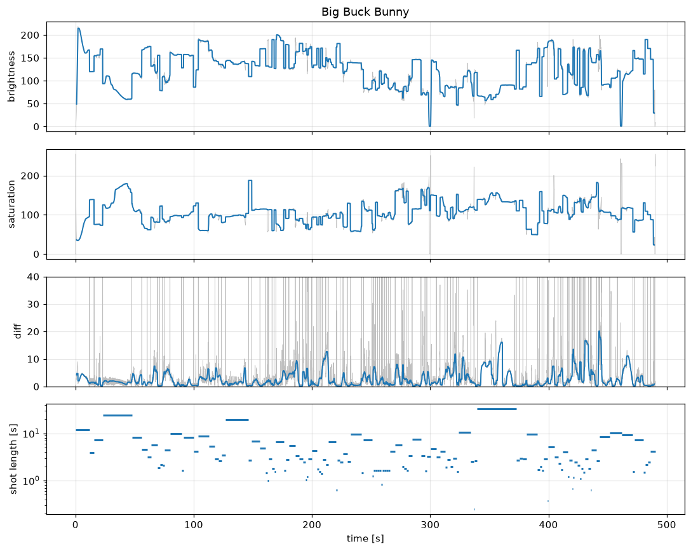
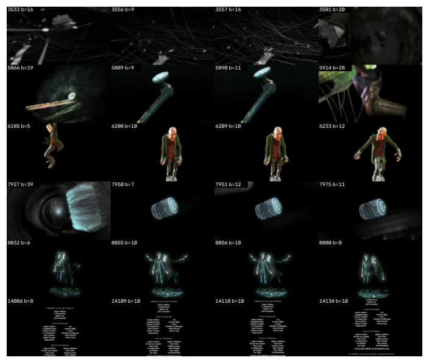
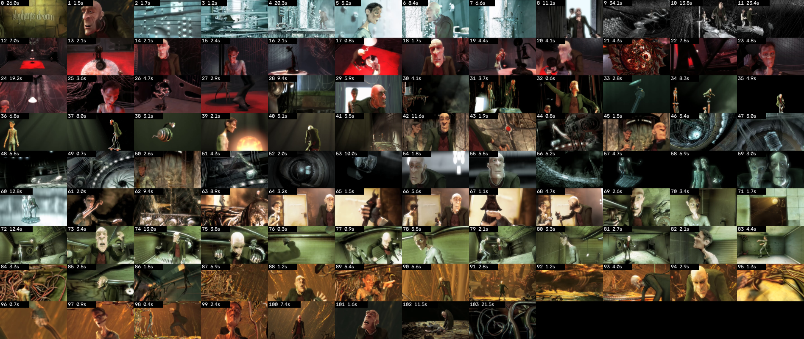
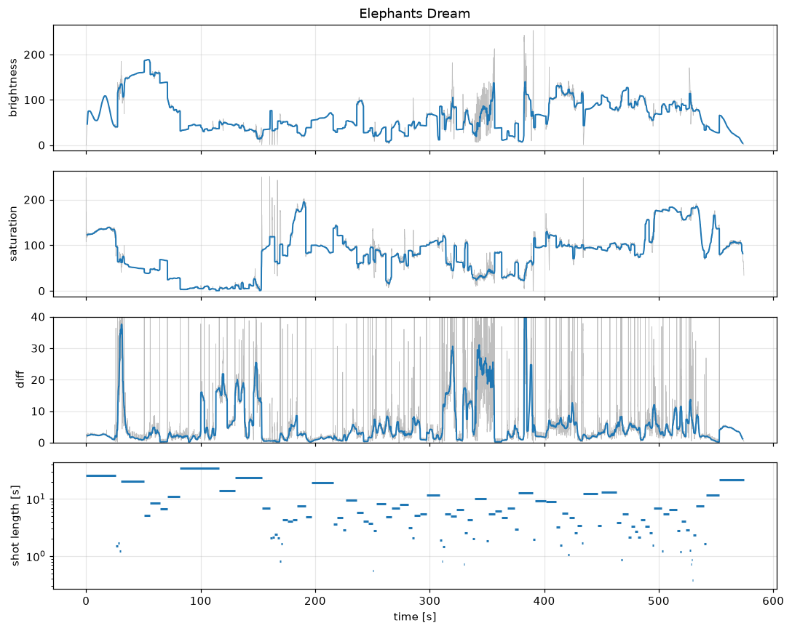
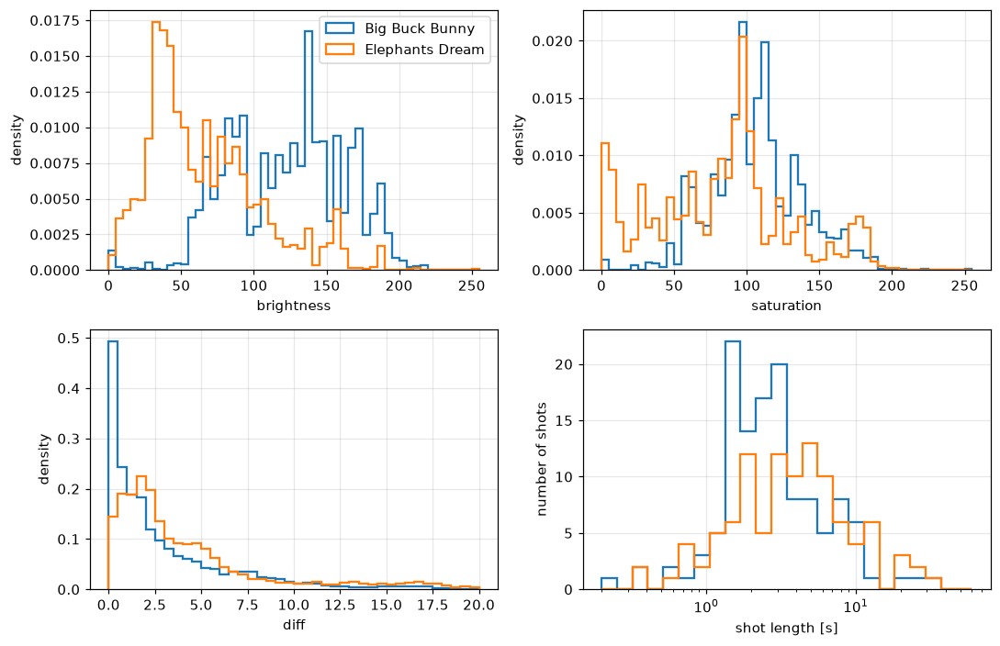

# 総合演習——一本の作品を分析する {#sec-project}

ここまでの章では、明るさ、色、動き、カット点、ショット長を、1つずつ別々に扱ってきました。
最後の章では、これらをひとつの手順にまとめ、作品を最初から最後まで通して分析します。
さらに、同じ手順を2本目の作品にも適用して、2つの作品を数値で比べます。

この章で新しく学ぶ計算方法はありません。
そのかわり、実際の分析で必ず出会う3つの問題——計算に時間がかかる、ある作品で決めた設定が別の作品では通用しない、数値の違いをどこまで信じてよいかわからない——に、順に向き合います。

::: {.callout-note title="この章のゴール"}
1本の作品について、明るさ・彩度・動き・ショット長の移り変わりを1枚の図にまとめます（@fig-ch10-bbb-overview）。
そのうえで、2つの作品の違いを表と図で示し、その違いについて「言えること」と「言えないこと」を区別して説明できるようになります。
:::

{#fig-ch10-bbb-overview width=100%}

新しいノートブック `ch10.ipynb` をプロジェクトフォルダの直下に作り、カーネルに `.venv` を選んでください。
最初のセルで、これまでに作った3つのモジュールから、必要な関数を読み込みます。

```python
import os
import time

import cv2
import matplotlib.pyplot as plt
import numpy as np
import pandas as pd

from cutdetect import color_hist, detect_cuts, hist_distance
from shottools import contact_sheet, get_frames, make_shots, make_tile, shot_sheet
from videotools import iter_frames, show, video_info
```

`videotools.py` は第4章、`cutdetect.py` は第8章、`shottools.py` は第9章で作ったファイルです。
3つともプロジェクトフォルダの直下にあることを確認してください。

## 分析の問いを立てる {#sec-ch10-question}

### 数値より先に、問いを決める

映像からは、いくらでも数値を取り出せます。
しかし、目的を決めずに数値を並べても、そこから何かが見えてくることはまれです。
分析を始める前に、「何を知りたいのか」を言葉にしておきましょう。

この章では、次の問いを立てます。

> Big Buck Bunny と Elephants Dream は、どちらもBlender Foundationが制作した10分ほどの短編アニメーションである。
> この2作品は、画面の明るさ、色の鮮やかさ、動き、編集のテンポにおいて、どのように違うのか。

2本目の作品 Elephants Dream は、機械仕掛けの奇妙な世界を2人の男がさまよう作品です。
のどかな森を舞台にした喜劇である Big Buck Bunny とは、雰囲気がまったく違います。
観れば誰でも「Elephants Dream のほうが暗くて重苦しい」と感じるでしょう。
その印象が数値にどう現れるのか、あるいは現れないのかを確かめます。

### 問いを、測れる形に言い換える

第1章で述べたように、印象を数値にするには、何を数えるかを決める必要があります。
この章では、@tbl-ch10-measures のように決めます。

| 知りたいこと | 測るもの | 学んだ章 |
|---|---|---|
| 画面の明るさ | フレームの平均輝度 | 第5章 |
| 明暗の差の大きさ | フレームの輝度の標準偏差 | 第5章 |
| 色の鮮やかさ | フレームの彩度（HSVのS）の平均 | 第6章 |
| 動きの大きさ | 隣り合うフレームの差分の平均 | 第7章 |
| 編集のテンポ | ショットの長さ | 第8章、第9章 |

: この章で測るもの {#tbl-ch10-measures}

どれも、これまでの章でいちばん単純な定義として学んだものです。
動きについては、オプティカルフローではなくフレーム間差分を使います。
作品全体で3万フレーム近くを処理するので、計算の軽い方法を選びました。
そのかわり、第7章で確かめたとおり、差分は明るさの変化やカット点にも反応します。
この限界は、結果を読むときに思い出すことにします。

### 2本目の作品を入手する

Elephants Dream をダウンロードします。
VS Codeのターミナルで、次の命令を実行してください。
ファイルの大きさは約104 MBです。

```{.default}
> curl.exe -L -o data\elephantsdream-480-h264-st-aac.mov https://download.blender.org/ED/elephantsdream-480-h264-st-aac.mov
```

::: {.callout-note title="クレジット"}
Elephants Dream — © copyright 2006, Blender Foundation / Netherlands Media Art Institute | [www.elephantsdream.org](https://www.elephantsdream.org/)（CC BY 2.5）
:::

2つの映像の基本情報を確かめます。

```python
BBB = "data/BigBuckBunny_320x180.mp4"
ED = "data/elephantsdream-480-h264-st-aac.mov"

for path in [BBB, ED]:
    print(video_info(path))
```

```{.default}
{'width': 320, 'height': 180, 'fps': 24.0, 'frame_count': 14315, 'duration': 596.4583333333334}
{'width': 480, 'height': 270, 'fps': 23.392772927155693, 'frame_count': 15294, 'duration': 653.7916666666667}
```

2つの点に気づきます。

1つ目は、**解像度が違う**ことです。
Big Buck Bunny は320×180、Elephants Dream は480×270です。
どちらも横と縦の比は16:9で、同じです。

2つ目は、Elephants Dream の**フレームレートが23.39という半端な値**になっていることです。
この値の意味は @sec-ch10-caveats であらためて検討します。
いまは「何かおかしい」と気づいたことを覚えておいてください。
自分の用意した映像を分析するときは、最初に必ずこの基本情報を確認し、不自然な値がないかを見る習慣をつけましょう。

## 一度の読み込みですべての特徴量を計算する {#sec-ch10-features}

### なぜまとめて計算するのか

これまでの章では、明るさを調べるときに映像を1回、色を調べるときにもう1回、というように、調べたい量ごとに映像を最初から読み直していました。
学ぶうえではそのほうがわかりやすいのですが、実際の分析では無駄が多くなります。

映像の処理でいちばん時間がかかるのは、圧縮されたファイルからフレームを取り出す部分です。
フレームを1枚取り出したら、その場で必要な量をすべて計算してしまえば、読み込みは1回で済みます。

### 条件をそろえる

もう1つ、作品を比べるうえで大切な準備があります。
**2つの作品を、同じ条件で測る**ことです。

フレーム間差分のような量は、解像度によって値が変わります。
解像度の違う映像をそのまま比べると、作品の違いを見ているのか、ファイルの違いを見ているのか、区別がつかなくなります。
そこで、どちらの作品も、フレームを320×180に縮小してから計算することにします。
Big Buck Bunny は元から320×180なので変化はなく、Elephants Dream だけが縮小されます。

### 関数にまとめる

フレームごとの特徴量を計算して表にする関数を作ります。
中身は、第8章で作った `frame_features` に、コントラストと彩度の計算と、フレームの縮小を加えたものです。

```python
SIZE = (320, 180)


def all_features(path):
    """フレームごとの特徴量をまとめて計算し、表にして返す。"""
    rows = []
    prev_gray = None
    prev_hist = None
    for n, frame in iter_frames(path):
        small = cv2.resize(frame, SIZE, interpolation=cv2.INTER_AREA)
        gray = cv2.cvtColor(small, cv2.COLOR_BGR2GRAY)
        hsv = cv2.cvtColor(small, cv2.COLOR_BGR2HSV)
        hist = color_hist(small)
        if prev_gray is None:
            d_pixel, d_hist = 0.0, 0.0
        else:
            d_pixel = cv2.absdiff(gray, prev_gray).mean()
            d_hist = hist_distance(prev_hist, hist)
        rows.append(
            {
                "frame": n,
                "brightness": gray.mean(),
                "contrast": gray.std(),
                "saturation": hsv[:, :, 1].mean(),
                "diff": d_pixel,
                "chi": d_hist,
            }
        )
        prev_gray = gray
        prev_hist = hist
    df = pd.DataFrame(rows)
    df["time"] = df["frame"] / video_info(path)["fps"]
    return df
```

1枚のフレームから計算している量は、@tbl-ch10-columns のとおりです。

| 列 | 内容 | 使いみち |
|---|---|---|
| `brightness` | 輝度の平均 | 明るさ、暗転の検出 |
| `contrast` | 輝度の標準偏差 | 明暗の差の大きさ |
| `saturation` | 彩度の平均 | 色の鮮やかさ |
| `diff` | 直前のフレームとの差分の平均 | 動きの大きさ |
| `chi` | 直前のフレームとの色ヒストグラムの距離 | カット点の検出 |
| `time` | 開始からの時刻（秒） | グラフの横軸 |

: `all_features` が返す表の列 {#tbl-ch10-columns}

Big Buck Bunny で実行し、時間を測ります。

```python
start = time.perf_counter()
bbb = all_features(BBB)
print(f"{time.perf_counter() - start:.1f} s")
print(bbb.shape)
print(bbb.head())
```

```{.default}
11.7 s
(14315, 7)
   frame  brightness  contrast  saturation      diff  chi      time
0      0    0.000000  0.000000    0.000000  0.000000  0.0  0.000000
1      1    0.000000  0.000000    0.000000  0.000000  0.0  0.041667
2      2    0.000000  0.000000    0.000000  0.000000  0.0  0.083333
3      3    0.000000  0.000000    0.000000  0.000000  0.0  0.125000
4      4    0.418819  0.493366  106.798958  0.418819  0.0  0.166667
```

約10分の作品の全フレームについて、5種類の量が12秒ほどで計算できました（時間は筆者の環境での値で、パソコンによって変わります）。
最初の数フレームは真っ黒なので、どの値も0になっています。

::: {.callout-tip title="彩度の平均は、暗い画素も含めた単純な平均です"}
第6章では、暗すぎて色の判別できない画素を除いてから彩度を平均する方法を学びました。
ここでは処理を簡単にするために、全画素の単純な平均を使っています。
4番目のフレームで、画面がほぼ真っ黒（`brightness` が0.4）なのに `saturation` が107もあるのは、そのためです。
暗い画素の彩度は、わずかな値の違いで大きく揺れます。
暗い場面の多い作品では、この単純な平均は当てにならない場合があることを、結果を読むときに考慮します。
:::

## 結果をファイルに保存し、再利用する {#sec-ch10-cache}

### 計算は1回、分析は何度でも

12秒は短く感じられますが、分析の作業では、グラフの体裁を直したり、しきい値を変えたりするたびにノートブックを実行し直します。
そのたびに12秒待つのは無駄ですし、2時間の映画なら1回の計算に数分かかります。

特徴量の表は、映像が同じなら何度計算しても同じ結果になります。
そこで、**計算した結果をCSVファイルに保存しておき、2回目からはファイルを読むだけにする**という仕組みを作ります。

```python
def load_features(path, csv_path):
    """保存済みの表があれば読み込み、なければ計算して保存する。"""
    if os.path.exists(csv_path):
        return pd.read_csv(csv_path)
    df = all_features(path)
    os.makedirs(os.path.dirname(csv_path), exist_ok=True)
    df.to_csv(csv_path, index=False)
    return df
```

`os.path.exists` は、ファイルがあるかどうかを調べる関数です。
ファイルがあればそれを読んで返し、なければ計算して、保存してから返します。
同じセルを2回続けて実行して、時間を比べてみましょう。

```python
start = time.perf_counter()
bbb = load_features(BBB, "out/bbb_all.csv")
print(f"{time.perf_counter() - start:.1f} s")
```

```{.default}
13.5 s
```

```python
start = time.perf_counter()
bbb = load_features(BBB, "out/bbb_all.csv")
print(f"{time.perf_counter() - start:.2f} s")
```

```{.default}
0.01 s
```

1回目は計算したので13.5秒、2回目はファイルを読むだけなので0.01秒で終わりました。

::: {.callout-warning title="計算方法を変えたら、保存したファイルを消す"}
この仕組みには落とし穴があります。
`all_features` の中身を書き換えても、古いCSVファイルが残っているかぎり、`load_features` は古い結果を返しつづけます。
計算方法を変えたときは、`out` フォルダの該当するCSVファイルを削除してから実行し直してください。
「コードを直したのに結果が変わらない」ときは、まずこれを疑います。
:::

### カット点とショットを求める

保存した表から、第8章の `detect_cuts` でカット点を求めます。

```python
bbb_cuts = detect_cuts(bbb)
print(bbb_cuts["kind"].value_counts())
```

```{.default}
kind
cut     123
fade      4
Name: count, dtype: int64
```

カットが123個、暗転が4個で、第8章の結果と同じです。
`all_features` の表は、第8章の `frame_features` の表と同じ `brightness` と `chi` の列を持っているので、`detect_cuts` をそのまま使えます。

第9章と同じように、エンドクレジットを除いた**本編**だけを取り出し、ショットの表を作ります。
Big Buck Bunny の本編は、11772番のフレームより前でした。

```python
BBB_END = 11772
bbb_main = bbb[bbb["frame"] < BBB_END]
bbb_main_cuts = bbb_cuts[bbb_cuts["frame"] < BBB_END]
bbb_shots = make_shots(bbb_main_cuts["frame"], BBB_END, video_info(BBB)["fps"])
print(len(bbb_shots), bbb_shots["duration"].mean(), bbb_shots["duration"].median())
```

```{.default}
126 3.892857142857143 2.645833333333333
```

126ショット、平均ショット長3.89秒、中央値2.65秒で、第9章で求めた値と一致しました。
部品を組み替えても同じ結果が得られることを、こうして確かめておくと安心です。

## 明るさ・色・動き・ショット長を1枚の図に並べる {#sec-ch10-overview}

### 時間軸をそろえて縦に並べる

4つの量を1枚の図にまとめます。
単位の違う量を1つのグラフに重ねると読みにくくなるので、横軸（時刻）を共有する4つのグラフを縦に並べます。
こうすると、「この時刻に何が起きているか」を、縦に目を動かすだけで見比べられます。

```python
def plot_overview(df, shots, title):
    """明るさ・彩度・動き・ショット長を、時間軸をそろえて縦に並べる。"""
    fig, axes = plt.subplots(4, 1, figsize=(10, 8), sharex=True)
    for ax, col in zip(axes, ["brightness", "saturation", "diff"]):
        smooth = df[col].rolling(49, center=True).median()
        ax.plot(df["time"], df[col], linewidth=0.5, color="0.75")
        ax.plot(df["time"], smooth, linewidth=1.3)
        ax.set_ylabel(col)
        ax.grid(alpha=0.3)
    axes[2].set_ylim(0, 40)
    ax = axes[3]
    ax.hlines(
        shots["duration"],
        shots["start_time"],
        shots["start_time"] + shots["duration"],
        linewidth=2,
    )
    ax.set_yscale("log")
    ax.set_ylabel("shot length [s]")
    ax.set_xlabel("time [s]")
    ax.grid(alpha=0.3)
    axes[0].set_title(title)
    plt.tight_layout()
    return fig
```

上の3段では、フレームごとの生の値を薄い灰色で、49フレーム（約2秒）の移動中央値を青で描いています。
第7章で見たように、差分はカット点で鋭く跳ね上がります。
移動平均ではなく移動中央値を使うことで、その跳ね上がりに引きずられずに、場面ごとの水準を読み取れます。
3段目は、跳ね上がりでグラフが縦に伸びすぎないよう、縦軸を0から40に制限しています。

いちばん下の段は、ショットを1本の横線で表したものです。
線の左端がショットの始まり、右端が終わりで、線の高さがショットの長さを表します。
縦軸は対数目盛です。
線が低い位置に細かく並んでいるところは、短いショットが続く、編集の速い区間です。

```python
fig = plot_overview(bbb_main, bbb_shots, "Big Buck Bunny")
plt.show()
```

{width=100%}

### 図を読む

図から読み取れることを、数値で確かめながら整理します。
時刻で区切った区間ごとに、ショットの数と長さの中央値を数えてみます。

```python
for a, b in [(0, 60), (60, 200), (200, 330), (330, 490)]:
    part = bbb_shots[(bbb_shots["start_time"] >= a) & (bbb_shots["start_time"] < b)]
    print(a, b, len(part), round(part["duration"].median(), 2))
```

```{.default}
0 60 6 7.83
60 200 35 2.92
200 330 43 2.0
330 490 42 2.46
```

- **冒頭の60秒**は、ショットが6つしかなく、長さの中央値は7.83秒です。図の下段でも、線が高い位置にまばらに並んでいます。ゆったりとした導入部であることがわかります。
- **200秒から330秒**は、130秒のあいだに43ショットがあり、中央値は2.0秒です。作品の中でもっとも編集が速い区間です。
- **340秒付近**に、ひときわ長い横線があります。第9章で確かめた、約33秒の長回しのショットです。
- 上段の明るさは、**300秒付近と460秒付近で0まで落ちて**います。第8章で検出した暗転の位置です。

1枚の図にまとめたことで、「編集が速くなる区間で、動きの値も高くなっているか」「暗転の前後で色がどう変わるか」といった、複数の量にまたがる関係を見て取れるようになりました。
気になる箇所を見つけたら、その時刻のフレームを `read_frame` や第9章のショット一覧で確かめる、という往復が、分析の基本的な進め方です。

## 2つの作品を比較する {#sec-ch10-compare}

### 同じ手順を2本目に適用する

Elephants Dream にも、同じ関数を適用します。

```python
ed = load_features(ED, "out/ed_all.csv")
print(ed.shape)
ed_cuts = detect_cuts(ed)
print(ed_cuts["kind"].value_counts())
```

```{.default}
(15294, 7)
kind
cut     95
fade    31
Name: count, dtype: int64
```

カットが95個、暗転が31個と出ました。
ここで手を止めてください。
**暗転が31個**というのは、10分の作品にしては多すぎます。
Big Buck Bunny では4個でした。

数値が出たからといって、それが正しいとは限りません。
第8章で強調したとおり、検出結果は必ず映像と突き合わせて確かめます。

### 結果を目で確かめる

暗転と判定された境目の前後を、画像で並べて確かめる関数を作ります。

```python
def boundary_sheet(path, df, frames, offsets=(-24, -1, 0, 24)):
    """境目の前後のフレームを、1行に1つの境目として並べた画像を返す。"""
    numbers = []
    for n in frames:
        for d in offsets:
            numbers.append(min(max(n + d, 0), len(df) - 1))
    images = get_frames(path, numbers)
    tiles = []
    for m in numbers:
        text = f"{m} b={df['brightness'][m]:.0f}"
        tiles.append(make_tile(images[m], text, 0.5))
    return contact_sheet(tiles, len(offsets))
```

1つの境目につき、1秒前、直前、境目、1秒後の4枚を横に並べます。
各コマの左上には、フレーム番号と平均輝度（`b=`）を書き込みます。
暗転と判定された31個のうち、6個を選んで表示します。

```python
sheet = boundary_sheet(ED, ed, [3557, 5890, 6209, 7951, 8856, 14110])
plt.figure(figsize=(8, 6.9))
show(sheet)
plt.axis("off")
plt.show()
```

{#fig-ch10-ed-fade-check width=85%}

@fig-ch10-ed-fade-check を見ると、どの行も、境目の前後で同じ場面が続いています。
暗転ではありません。
黒い背景の中に小さな被写体が浮かんでいる場面や、黒地に小さな文字が流れるエンドクレジットです。

### なぜ間違えたのか

`detect_cuts` は、「平均輝度が `dark` 未満の区間が明けたところ」を暗転として記録します。
`dark` の既定値は10で、これは第8章で Big Buck Bunny を見ながら決めた値でした。

各コマの `b=` の値を見てください。
7から16のあたりを行き来しています。
この作品には、暗転ではないのに平均輝度が10前後になる場面がたくさんあり、値が10をまたぐたびに「暗転が明けた」と判定されてしまったのです。

2つの作品で、平均輝度の低いフレームがどれくらいあるかを比べます。

```python
for name, df in [("bbb", bbb), ("ed", ed)]:
    print(name, (df["brightness"] < 10).mean().round(3), (df["brightness"] < 2).mean().round(3))
```

```{.default}
bbb 0.008 0.006
ed 0.102 0.013
```

平均輝度が10未満のフレームは、Big Buck Bunny では全体の0.8%ですが、Elephants Dream では10.2%もあります。
明るい作品では「平均輝度が10未満なら、まず暗転だ」と言えましたが、暗い作品ではその前提が成り立ちません。

これが、この章の冒頭で挙げた2つ目の問題——**ある作品で決めた設定が、別の作品では通用しない**——の実例です。

### 設定を見直す

`dark` の値を変えて、検出される数がどう変わるかを調べます。

```python
for dark in [10, 5, 3, 2, 1]:
    cuts = detect_cuts(ed, dark=dark)
    print(dark, (cuts["kind"] == "cut").sum(), (cuts["kind"] == "fade").sum())
```

```{.default}
10 95 31
5 97 14
3 97 13
2 97 13
1 97 12
```

`dark` を小さくすると、暗転の数は31個から13個前後に減り、3以下ではほとんど変わらなくなります。
値を少し動かしても結果が変わらない範囲は、設定として安定していると考えられます。
ここでは `dark=2` を採用します。

採用した設定で検出された暗転を、同じように画像で確かめます。

```python
ed_cuts = detect_cuts(ed, dark=2)
fades = ed_cuts[ed_cuts["kind"] == "fade"]["frame"].tolist()
print(fades)
```

```{.default}
[3590, 3753, 3802, 3852, 3909, 10158, 13458, 13620, 13727, 13807, 13948, 15166, 15220]
```

```python
sheet = boundary_sheet(ED, ed, fades[:6])
plt.figure(figsize=(8, 6.9))
show(sheet)
plt.axis("off")
plt.show()
```

{#fig-ch10-ed-fade-ok width=85%}

@fig-ch10-ed-fade-ok では、どの行も、直前のフレームがほぼ真っ黒（`b=` が1か2）で、その前後で場面が変わっています。
今度は、実際の暗転を捉えています。
7個目以降（13458番以降）は、次に述べるエンドクレジットの中にあるので、本編の分析からは除かれます。

Big Buck Bunny のほうは、`dark` を10から1まで変えても、検出される数は変わりません（カット123、暗転4）。
演習で確かめてみてください。

### 本編の範囲を決める

Elephants Dream についても、エンドクレジットを除いた本編の範囲を決めます。
作品の終わり近くで、画面が最初に真っ黒になるフレームを探します。

```python
tail = ed[ed["frame"] > 13000]
print(tail[tail["brightness"] < 1]["frame"].min())
```

```{.default}
13437
```

13437番のフレームより前を本編とします。
本編のカット点から、ショットの表を作ります。

```python
ED_END = 13437
ed_main = ed[ed["frame"] < ED_END]
ed_main_cuts = ed_cuts[ed_cuts["frame"] < ED_END]
print(ed_main_cuts["kind"].value_counts())
ed_shots = make_shots(ed_main_cuts["frame"], ED_END, video_info(ED)["fps"])
print(len(ed_shots))
```

```{.default}
kind
cut     97
fade     6
Name: count, dtype: int64
104
```

本編は104ショットになりました。
第9章の `shot_sheet` でショット一覧を作り、全体を眺めて確かめます。

```python
sheet = shot_sheet(ED, ed_shots, ncols=12, scale=0.33)
plt.figure(figsize=(12, 5.2))
show(sheet)
plt.axis("off")
plt.show()
```

{#fig-ch10-ed-shots width=100%}

隣り合うコマのほとんどは、別々の画面になっています。
明らかにおかしな分割は見当たりません。

::: {.callout-important title="Elephants Dream の検出結果は、正解データで評価していません"}
第8章では、Big Buck Bunny の冒頭200秒について正解データを作り、検出結果を評価しました。
Elephants Dream については、暗転の確認とショット一覧の目視しか行っていません。
見逃しや誤検出がどれくらいあるのかは、わかっていません。

とくに、長いショット（@fig-ch10-ed-shots の9番は34秒）の中に見逃したカットがないか、隣り合うよく似たコマ（2番と3番、10番と11番など）が本当に別のショットなのかは、確かめる必要があります。
以下で示すショット長の数値は、この不確かさを含んだものとして読んでください。
演習で、一部の区間について正解データを作って評価してみましょう。
:::

見取り図も描いておきます。

```python
fig = plot_overview(ed_main, ed_shots, "Elephants Dream")
plt.show()
```

{#fig-ch10-ed-overview width=100%}

### 数値で比べる

作品全体を要約する数値を計算する関数を作り、2作品の結果を1つの表に並べます。

```python
def summarize(df, shots):
    """作品全体を要約する数値を、辞書で返す。"""
    return {
        "duration [s]": df["time"].max(),
        "shots": len(shots),
        "ASL [s]": shots["duration"].mean(),
        "median shot [s]": shots["duration"].median(),
        "brightness (mean)": df["brightness"].mean(),
        "contrast (mean)": df["contrast"].mean(),
        "saturation (mean)": df["saturation"].mean(),
        "diff (median)": df["diff"].median(),
    }


summary = pd.DataFrame(
    {
        "Big Buck Bunny": summarize(bbb_main, bbb_shots),
        "Elephants Dream": summarize(ed_main, ed_shots),
    }
)
print(summary.round(2))
```

```{.default}
                   Big Buck Bunny  Elephants Dream
duration [s]               490.46           574.37
shots                      126.00           104.00
ASL [s]                      3.89             5.52
median shot [s]              2.65             3.91
brightness (mean)          123.00            65.84
contrast (mean)             49.92            41.94
saturation (mean)          106.67            82.58
diff (median)                1.74             2.93
```

差分の代表値には、第7章で学んだとおり、カット点の跳ね上がりに影響されにくい中央値を使っています。

### 分布で比べる

平均や中央値は、1つの数に要約した値です。
要約すると見えなくなる違いもあるので、分布も比べます。
2つの作品の線が重なるので、塗りつぶさない階段状のヒストグラムにします。

```python
works = [
    ("Big Buck Bunny", bbb_main, bbb_shots),
    ("Elephants Dream", ed_main, ed_shots),
]
panels = [
    ("brightness", np.linspace(0, 255, 52)),
    ("saturation", np.linspace(0, 255, 52)),
    ("diff", np.linspace(0, 20, 41)),
]

fig, axes = plt.subplots(2, 2, figsize=(10, 6.5))
for ax, (col, bins) in zip(axes.ravel(), panels):
    for name, df, shots in works:
        ax.hist(df[col], bins=bins, density=True, histtype="step", linewidth=1.5, label=name)
    ax.set_xlabel(col)
    ax.set_ylabel("density")
    ax.grid(alpha=0.3)

ax = axes[1, 1]
bins = np.logspace(np.log10(0.2), np.log10(60), 25)
for name, df, shots in works:
    ax.hist(shots["duration"], bins=bins, histtype="step", linewidth=1.5, label=name)
ax.set_xscale("log")
ax.set_xlabel("shot length [s]")
ax.set_ylabel("number of shots")
ax.grid(alpha=0.3)

axes[0, 0].legend()
plt.tight_layout()
plt.show()
```

{#fig-ch10-compare width=100%}

上の3つのグラフでは `density=True` を指定して、縦軸を「全体に占める割合」に相当する値にしています。
2つの作品はフレーム数が違うので、枚数のままでは比べにくいからです。

### 結果を読む

表と図から読み取れることを、観点ごとに整理します。

**明るさ**は、もっともはっきりした違いが出ています。
平均輝度は Big Buck Bunny が123.0、Elephants Dream が65.8で、ほぼ半分です。
@fig-ch10-compare の左上を見ると、2つの分布はほとんど別の場所にあります。
Elephants Dream は30から40のあたりに高い山があり、Big Buck Bunny は80から180に広がっています。
「Elephants Dream のほうが暗い」という印象は、数値でも明確に裏づけられました。

**彩度**は、平均で106.7と82.6です。
Elephants Dream のほうが低いのですが、分布（右上）を見ると、Elephants Dream には0付近と170付近にも山があります。
0付近の山は、色のない灰色の場面や、暗くて彩度が当てにならないフレームでしょう。
170付近の山は、@fig-ch10-ed-shots に見える、赤や橙の濃い場面にあたると考えられます。
「全体に色が薄い」というより、「色のない場面と、色の濃い場面の両方がある」作品だと言えます。
平均だけを見ていたら、この違いには気づけません。

**動き**（差分の中央値）は、1.74と2.93で、Elephants Dream のほうが大きくなりました。
ただし、この数値の解釈には注意が必要です。
理由は次の節で述べます。

**ショットの長さ**は、平均で3.89秒と5.52秒、中央値で2.65秒と3.91秒です。
Big Buck Bunny のほうが短く、分布（右下）でも、1秒から4秒のあたりに Big Buck Bunny のショットが集中しています。
この結果からは、Big Buck Bunny のほうが編集のテンポが速いと言えそうです。

## 結果を解釈するときの注意点 {#sec-ch10-caveats}

数値が出そろうと、つい結論を急ぎたくなります。
ここで、得られた数値をどこまで信じてよいかを、1つずつ点検します。

### 検出の設定で、数値はどれくらい変わるか

ショット長の数値は、カット点の検出結果に依存します。
Elephants Dream では `dark` の値を10から2に変えました。
もし変えていなかったら、結果はどうなっていたでしょうか。

```python
for dark in [10, 2]:
    cuts = detect_cuts(ed, dark=dark)
    cuts = cuts[cuts["frame"] < ED_END]
    shots = make_shots(cuts["frame"], ED_END, video_info(ED)["fps"])
    print(dark, len(shots), round(shots["duration"].mean(), 2), round(shots["duration"].median(), 2))
```

```{.default}
10 115 4.99 3.33
2 104 5.52 3.91
```

設定を見直さなければ、Elephants Dream の平均ショット長は4.99秒、中央値は3.33秒になっていました。
見直した後の5.52秒、3.91秒と比べると、1割ほど違います。

一方、Big Buck Bunny の値（平均3.89秒、中央値2.65秒）と比べると、どちらの設定でも Elephants Dream のほうが長い、という関係は変わりません。
このように、**設定を変えても結論が変わらないかどうか**を確かめることは、結論の確かさを見積もる有効な方法です。
「Big Buck Bunny のほうがショットが短い」という結論は、この点検には耐えました。
しかし「Elephants Dream の平均ショット長は5.52秒である」という数値そのものは、設定次第で1割程度は動くものとして扱うべきです。

### フレームレートの値は正しいか

@sec-ch10-question で、Elephants Dream のフレームレートが23.39という半端な値だったことを思い出してください。

```python
info = video_info(ED)
print(info["fps"])
print(info["frame_count"] / 24)
print(info["frame_count"] / info["fps"])
```

```{.default}
23.392772927155693
637.25
653.7916666666667
```

この作品が24 fpsで作られているとすれば、15294フレームは637.3秒にあたります。
一方、ファイルに記録されている再生時間は653.8秒です。
OpenCVは、フレーム数を再生時間で割った値をフレームレートとして報告しているために、23.39という値になっています。
ファイルの中で、フレームが一定の間隔で並んでいない箇所があるのだと考えられます（付録の @sec-app-ffmpeg に、これを調べる方法があります）。

本書では、時刻を「フレーム番号÷フレームレート」で計算してきました。
この映像では、その計算で求めた時刻が、実際の再生時刻から最大で2〜3%ずれている可能性があります。
ショットの長さを秒で表した値にも、同じ程度のあいまいさがあります。
Elephants Dream の平均ショット長は、23.39 fpsとして計算すると5.52秒ですが、24 fpsとして計算すると5.38秒になります。

この問題を避けるには、**ショットの長さをフレーム数で記録しておく**のが確実です。
フレーム数は数え間違えようのない整数で、フレームレートの値に左右されません。
第9章のショットの表に `length`（フレーム数）の列を残してあるのは、そのためです。

### 差分は「動き」だけを測っているのではない

差分の中央値は、Elephants Dream のほうが大きく出ました。
これを「Elephants Dream のほうが動きの激しい作品だ」と読んでよいでしょうか。

慎重になるべき理由が、少なくとも3つあります。

- 差分は、**画面の模様の細かさ**に左右されます。同じ速さでカメラが動いても、細かい模様のある画面のほうが、のっぺりした画面より差分は大きくなります。機械や配線が画面を埋めつくす Elephants Dream は、この点で値が大きく出やすい作品です。
- 差分は、**カメラの動きと被写体の動きを区別しません**。第7章で確かめたとおりです。
- 2つの映像は、**元の解像度も圧縮のされ方も違います**。320×180にそろえはしましたが、Elephants Dream は縮小の処理を経ており、Big Buck Bunny は経ていません。圧縮によるノイズの現れ方も同じではないでしょう。

したがって、この数値から言えるのは「同じ条件で測ったフレーム間の画素の変化は、Elephants Dream のほうが大きかった」というところまでです。
それが被写体の動きによるものかどうかを確かめるには、第7章のオプティカルフローを使った、より踏み込んだ分析が必要になります。

### 何を比べたのかを明確にする

この章の比較は、次の条件のもとで行ったものです。

- 対象は、それぞれの作品の**本編**（Big Buck Bunny は11772番より前、Elephants Dream は13437番より前のフレーム）。エンドクレジットは含まない。
- フレームを**320×180に縮小**してから計算した。
- カット点は第8章の方法で検出し、`dark` は Big Buck Bunny で10、Elephants Dream で2とした。
- Elephants Dream の検出結果は、**正解データによる評価を行っていない**。

条件を変えれば、数値は変わります。
たとえば、エンドクレジットを含めて平均輝度を計算すれば、黒い背景のクレジットが長く続く分だけ、どちらの作品も値が下がります。
分析の結果を人に伝えるときは、数値と一緒に、こうした条件を必ず書き添えてください。
条件が書かれていない数値は、ほかの人が確かめることも、ほかの研究と比べることもできません。

### 2作品の比較から言えること

最後に、もっとも根本的な注意点です。

この章で比べたのは、2つの作品だけです。
ここから「喜劇は編集が速い」とか「暗い作品はショットが長い」といった一般的な結論を導くことはできません。
2つの作品の違いは、ジャンルの違いによるのかもしれませんし、監督の作風、制作された年、上映時間、あるいは単なる偶然によるのかもしれません。
それらを区別するには、多くの作品を、条件をそろえて調べる必要があります。

また、数値が示しているのは「画面がどうなっているか」であって、「なぜそうなっているか」や「観る人がどう感じるか」ではありません。
Elephants Dream の暗さが不安をかき立てるのかどうかは、平均輝度65.8という数値からはわかりません。
数値は、作品を観て得た印象や解釈を、点検し、支え、ときに修正するための材料です。
数値と映像のあいだを何度も行き来することが、定量分析を意味のあるものにします。

## この先の学習に向けて {#sec-ch10-next}

本書で扱ったのは、映像の定量分析のうち、もっとも基本的な部分です。
ここから先へ進むための方向を、いくつか挙げておきます。

**自分の問いで分析する。**
いちばんの近道は、自分の関心のある作品や問いで、この章の手順をたどり直すことです。
作品が変われば、この章の `dark` のように、どこかで必ず設定の見直しが必要になります。
そのたびに映像と数値を突き合わせる経験が、いちばんの力になります。

**作品の数を増やす。**
この章の関数は、映像のパスを渡せば動くように作ってあります。
`for` 文で複数の作品に適用し、`summarize` の結果を1つの表にまとめれば、多数の作品の比較ができます。
映画のショット長については、Cinemetricsのように、研究者や愛好家が計測したデータを集めて公開している取り組みもあります [@cinemetrics]。

**検出の精度を上げる。**
本書のカット点検出は、ヒストグラムの違いにしきい値を当てる単純な方法でした。
ディゾルブのようなゆるやかな切り替わりには弱いことを、第8章で確かめました。
近年は、大量の映像で学習させたニューラルネットワークを使って、ショットの境目を検出する手法が使われています。
本書で学んだ評価の方法（正解データを作り、適合率と再現率を計算する）は、どんな手法を使う場合にも、そのまま役に立ちます。

**画面の中身に踏み込む。**
本書の分析は、画面全体の平均的な性質だけを扱いました。
「誰が映っているか」「顔がどれくらいの大きさで映っているか」「どんな物が映っているか」といった内容に踏み込むには、顔検出や物体検出といった、画像認識の技術が必要になります。
OpenCVにもそのための機能がありますし、深層学習のライブラリを使う方法もあります。

**音を扱う。**
映像作品の印象は、音楽、台詞、効果音にも大きく左右されます。
音声の大きさや高さの時間変化を取り出し、本書の方法で求めた映像の特徴量と並べれば、映像と音の関係を調べられます。

**統計を学ぶ。**
作品の数が増えると、「この違いは偶然とは言えないほど大きいのか」という問いに答える必要が出てきます。
そのためには、統計的な推測の考え方が欠かせません。
統計学の入門書を1冊読んでおくと、分析の幅が大きく広がります。

## まとめ {#sec-ch10-summary}

- 分析は、**問いを立てる**ことから始めます。問いを、測れる量に言い換えてから、計算に進みます。
- 映像の読み込みは1回にまとめ、フレームを取り出したその場で必要な量をすべて計算します。結果は**ファイルに保存**し、2回目からは読み込むだけにします。
- 作品を比べるときは、解像度や対象とする範囲などの**条件をそろえ**ます。
- ある作品で決めた設定が、別の作品でも通用するとは限りません。検出結果は、**必ず映像と突き合わせて**確かめます。
- 平均や中央値だけでなく、**分布**も比べます。要約すると見えなくなる違いがあります。
- 結論の確かさは、**設定を変えても結論が変わらないか**で点検できます。
- 数値には、それを得た**条件**を必ず書き添えます。
- 数値が示すのは画面の状態であり、その意味を解釈するのは人間の役割です。

## 演習 {#sec-ch10-exercises}

1. `detect_cuts(bbb, dark=dark)` を `dark` が10、5、3、2、1の場合について実行し、Big Buck Bunny では検出される数が変わらないことを確かめてください。数は同じでも、暗転のフレーム番号は同じでしょうか。違う場合、その理由を考えてみましょう。
2. Elephants Dream の冒頭2分間について、第8章と同じ方法で正解データを作り、`dark=2` での検出結果の適合率と再現率を求めてください。見逃しや誤検出があった場合、それはどのような箇所だったでしょうか。
3. エンドクレジットを含めた映像全体について `summarize` を実行し、本編だけの場合と比べてください。どの数値が、どちらの向きに、どれくらい変わるでしょうか。
4. `all_features` の `SIZE` を `(160, 90)` に変えて、2作品の特徴量を計算し直してください（保存したCSVファイルを消すか、別のファイル名で保存することを忘れずに）。計算時間と、`summarize` の各数値は、どう変わるでしょうか。解像度に左右されやすい数値はどれでしょうか。
5. 彩度の平均を、第6章で学んだように「明度が一定以上の画素だけ」で計算するよう、`all_features` を書き換えてください。2作品の彩度の比較は、どう変わるでしょうか。
6. 自分で用意した映像について、この章の手順を最初からたどってください。基本情報の確認、特徴量の計算、カット点の検出と目視での確認、見取り図の作成までを行い、気づいたことを、得られた条件とともに文章にまとめましょう。
