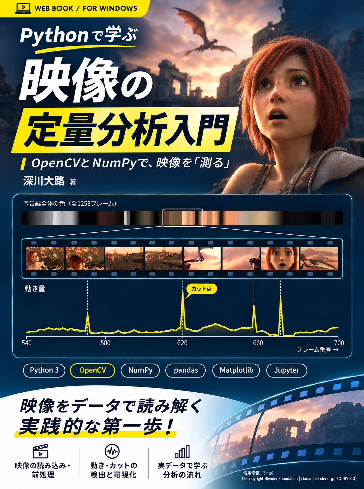

# はじめに {.unnumbered}

::: {.cover .cover-image}

<h1 class="cover-title">Pythonで学ぶ 映像の定量分析入門</h1>

:::

表紙の画像は、短編アニメーション『Sintel』（© copyright Blender Foundation | [durian.blender.org](https://durian.blender.org/)、[CC BY 3.0](https://creativecommons.org/licenses/by/3.0/deed.ja)）の映像と、その映像から計算した数値の図をもとに、生成AI（ChatGPT）を使って作り直したものです。
表紙の中の映像やグラフは、デザイン上のイメージです。
元の映像や、計算の結果を正確に再現したものではありません。

## この本について {.unnumbered}

映画やアニメ、動画投稿サイトの映像を観て「このシーンはテンポが速い」「この作品は全体に色味が暗い」と感じることがあります。本書は、そうした**感覚を数値で確かめる方法**を、Pythonのコードを一歩ずつ動かしながら学ぶ入門書です。

映像は、突き詰めれば「数値の並んだ画像が、時間順に並んだもの」です。ですから、明るさ・色・動きはすべて計算で取り出せますし、ショットの切れ目（カット点）も自動で見つけられます。取り出した数値をグラフにすれば、作品の構成やリズムが目に見える形で現れます。

::: {.callout-note title="本書でできるようになること"}
- 動画ファイルをPythonで読み込み、フレームを自在に取り出す
- 明るさ・色・動きを数値化し、時系列グラフとして可視化する
- カット点を自動検出し、その精度を自分で評価する
- ショット長の統計から、作品の編集のテンポを比較する
- 一本の映像作品を、最初から最後まで自分の手で分析する
:::

## 対象とする読者 {.unnumbered}

- 映像作品を数値で分析してみたい、映像研究・メディア研究の学生や研究者の方
- Pythonの基本文法（変数、`for`文、関数）をひととおり学び、次に何か作ってみたい方
- OpenCVを「画像」ではなく「映像」に使ってみたい方

OpenCVやNumPyの経験は前提としません。必要な知識は、使う場面でそのつど説明します。数学は高校程度で読めるようにし、少し進んだ内容（統計的検定など）は、式の意味を図と言葉で補います。

## 本書の読み方 {.unnumbered}

どの章も、次の流れで進みます。

1. **この章のゴール**——章を読み終えたときに手元に残る成果物（グラフや画像）を最初に示します。
2. **しくみの図解**——コードを書く前に、何をどう計算するのかを図で確認します。
3. **コードと実行結果**——短いコードを少しずつ実行し、そのたびに結果を確かめます。
4. **まとめと演習**——要点を整理し、自分の映像で試すための課題を示します。

コードはすべてJupyterノートブックで実行できる形で掲載します。読むだけでなく、ぜひ手元のWindowsパソコンで動かしながら読み進めてください。

## 動作環境 {.unnumbered}

| 項目 | 本書で使うもの |
|---|---|
| OS | Windows 11 |
| Python | Python 3（`uv` で導入・管理） |
| 主なライブラリ | OpenCV（`opencv-python`）、NumPy、pandas、Matplotlib、SciPy |
| 実行環境 | Visual Studio Code ＋ Jupyter拡張機能 |
| サンプル映像 | 自由に再利用できるライセンスで公開されている映像作品 |

環境の準備は[第2章](chapters/02-setup.qmd)で、手順を一つずつ確かめながら説明します。macOSやLinuxでもコードはそのまま動きますが、手順の説明はWindowsを基準にしています。

## ライセンス {.unnumbered}

本書は、内容の種類ごとに次のライセンスで公開しています。

| 対象 | ライセンス |
|---|---|
| 文章と図 | [クリエイティブ・コモンズ 表示 - 非営利 - 継承 4.0 国際（CC BY-NC-SA 4.0）](https://creativecommons.org/licenses/by-nc-sa/4.0/deed.ja) |
| コード | [MITライセンス](https://github.com/dfukagaw28/intro-to-quantitative-video-analysis-py/blob/main/LICENSE-CODE) |

文章と図は、出典を示し、営利を目的とせず、改変した場合は同じライセンスで公開するという条件のもとで、複製・再配布・改変ができます。
本文に掲載しているコードは、著作権表示を残せば、営利・非営利を問わず自由に利用できます。

ただし、サンプル映像から切り出した画像は第三者の著作物であり、上記のライセンスの対象外です。
それぞれの画像に添えたクレジットとライセンスに従ってください。

© 2026 Daiji Fukagawa

[目次へ進む →](contents.qmd){.btn .btn-primary}
